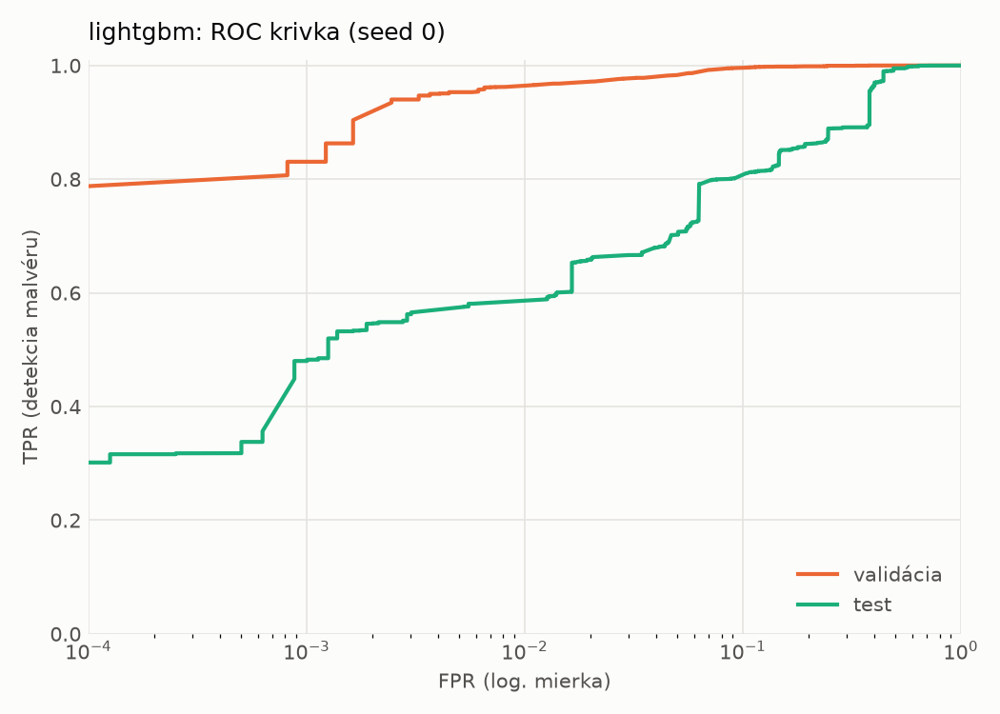
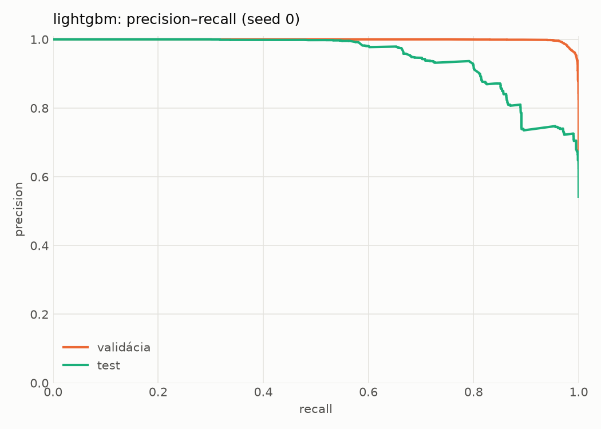
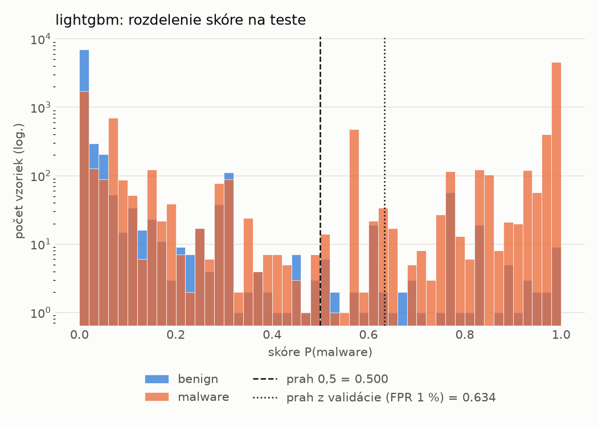
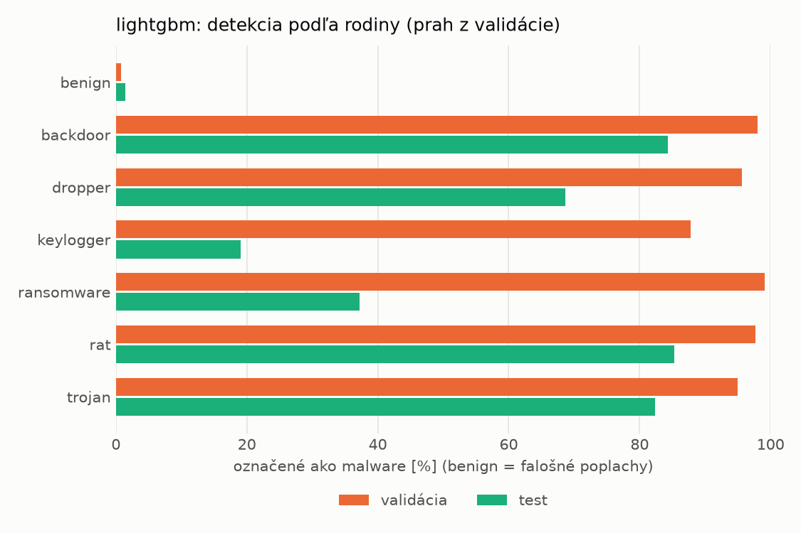
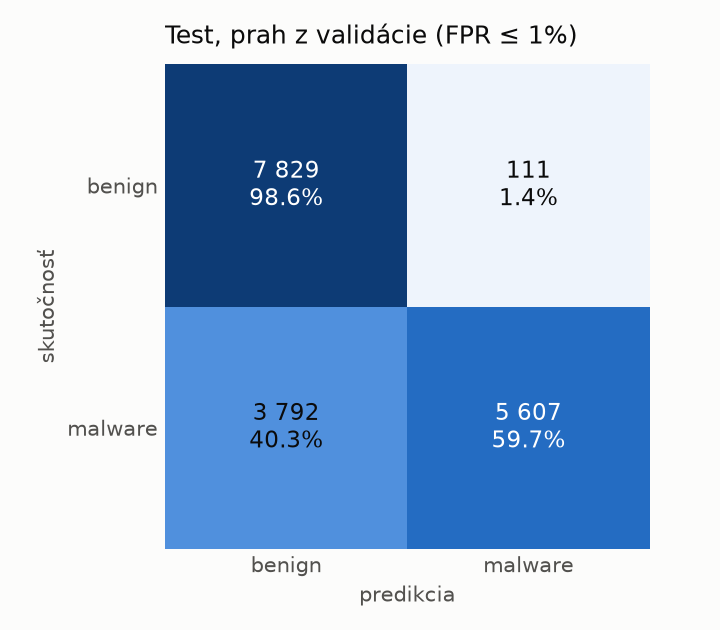
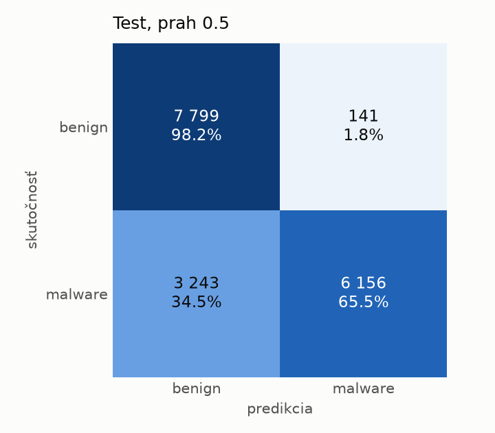
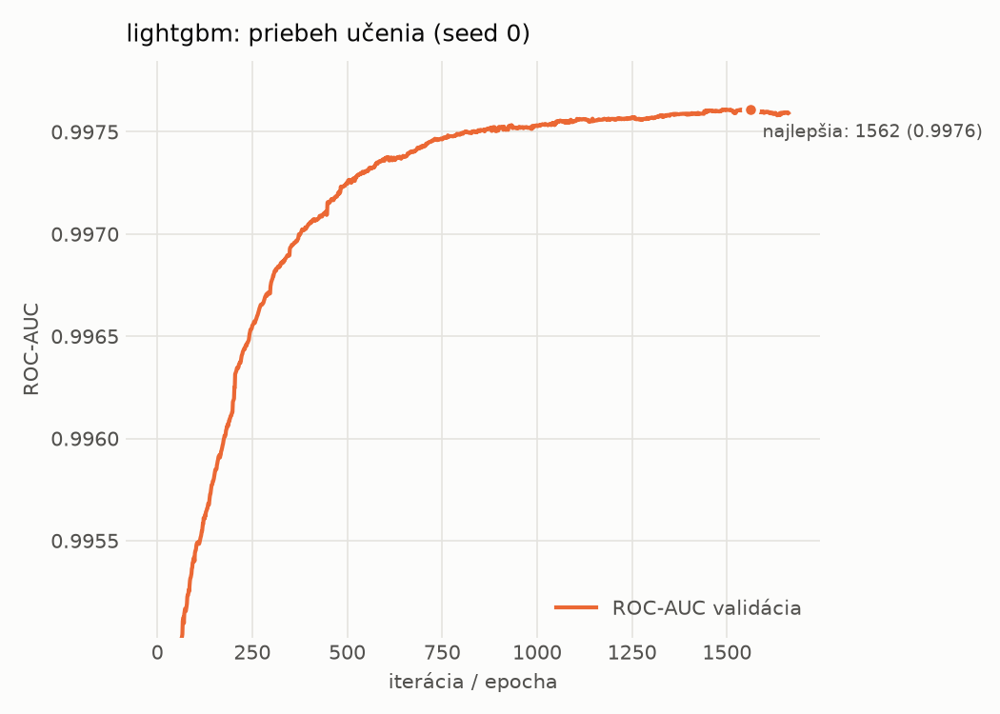

# dynamic/lightgbm – beh `20261103-234518`

> Automaticky generované (`src/training/run_tabular.py`). Konfigurácia: `config.yaml`, protokol: `protocol.yaml`.

- **Model:** `lightgbm` – LightGBM, gradient boosting stromov s early stopping na validácii (pôvodné hodnoty príznakov)
- **Ladenie:** bez ladenia – hyperparametre prevzaté z `runs_final/dynamic/lightgbm/20261102-003953`
- **Finálne modely:** seedy [0, 1, 2]; hodnoty sú priemer ± smerodajná odchýlka cez seedy
- **Najlepšie hyperparametre:** `{"num_boost_round": 5000, "early_stopping_rounds": 100, "learning_rate": 0.012600391102852807, "num_leaves": 261, "min_child_samples": 12, "feature_fraction": 0.7323605840883831, "bagging_fraction": 0.7241803281580393, "lambda_l1": 9.843384499248837e-06, "lambda_l2": 0.7301583949167907}`

## Detekčná kvalita (bez prahu)
| metrika | train (podvzorka) | validácia | test |
|---|---|---|---|
| ROC-AUC | 0.9986 ± 0.0000 | 0.9976 ± 0.0000 | 0.9314 ± 0.0040 |
| PR-AUC | 0.9991 ± 0.0000 | 0.9986 ± 0.0000 | 0.9480 ± 0.0024 |
| TPR pri FPR 1 % | 0.9696 ± 0.0008 | 0.9624 ± 0.0001 | 0.5804 ± 0.0005 |
| TPR pri FPR 0,1 % | 0.8942 ± 0.0035 | 0.8464 ± 0.0136 | 0.4800 ± 0.0003 |
| log loss | 0.0459 ± 0.0005 | 0.0599 ± 0.0002 | 0.8478 ± 0.0350 |
| Brier skóre | 0.0146 ± 0.0001 | 0.0177 ± 0.0001 | 0.1806 ± 0.0019 |

Rozdiel ROC-AUC train − validácia: **0.0010** (veľký rozdiel = preučenie).

## Pri prahu z validácie (FPR ≤ 1% na validácii)
| metrika | train (podvzorka) | validácia | test |
|---|---|---|---|
| accuracy | 0.9761 ± 0.0001 | 0.9731 ± 0.0001 | 0.7744 ± 0.0007 |
| balanced accuracy | 0.9804 ± 0.0000 | 0.9773 ± 0.0002 | 0.7908 ± 0.0007 |
| precision | 0.9983 ± 0.0000 | 0.9954 ± 0.0001 | 0.9804 ± 0.0006 |
| recall (TPR) | 0.9635 ± 0.0001 | 0.9624 ± 0.0001 | 0.5958 ± 0.0010 |
| FPR | 0.0027 ± 0.0000 | 0.0079 ± 0.0002 | 0.0141 ± 0.0005 |
| F1 | 0.9806 ± 0.0000 | 0.9786 ± 0.0001 | 0.7412 ± 0.0009 |
| MCC | 0.9506 ± 0.0001 | 0.9434 ± 0.0003 | 0.6166 ± 0.0013 |

## Pri pevnom prahu 0.5
| metrika | train (podvzorka) | validácia | test |
|---|---|---|---|
| accuracy | 0.9776 ± 0.0001 | 0.9741 ± 0.0001 | 0.7956 ± 0.0159 |
| balanced accuracy | 0.9811 ± 0.0000 | 0.9772 ± 0.0001 | 0.8101 ± 0.0147 |
| precision | 0.9967 ± 0.0002 | 0.9933 ± 0.0000 | 0.9769 ± 0.0011 |
| recall (TPR) | 0.9675 ± 0.0003 | 0.9659 ± 0.0001 | 0.6380 ± 0.0294 |
| FPR | 0.0054 ± 0.0003 | 0.0115 ± 0.0000 | 0.0178 ± 0.0001 |
| F1 | 0.9819 ± 0.0001 | 0.9794 ± 0.0001 | 0.7717 ± 0.0221 |
| MCC | 0.9533 ± 0.0002 | 0.9450 ± 0.0002 | 0.6462 ± 0.0240 |

## Výpočtové nároky (seed 0, testovacia množina)
| meranie | hodnota |
|---|---|
| tréning finálneho modelu | 26.8 s (priemer cez seedy) |
| ladenie spolu | 0 s |
| počet parametrov / uzlov | 784 550 |
| veľkosť modelu na disku | 44.77 MB |
| CPU latencia modelu (batch 1, 1 vlákno) | 0.280 ms (p95 0.340) |
| CPU priepustnosť (24 vlákien) | 46 222 vzoriek/s |

## Grafy
| | |
|---|---|
|  |  |
|  |  |
|  |  |
|  |  |

## Súbory
`metrics.json` (všetky metriky po seedoch vrátane rodín), `timing.json`, `hpo_trials.csv`,
`predictions/<časť>_seed<N>.parquet` (sha256, family, label, score), `model/seed_<N>/`, `log.txt`.
