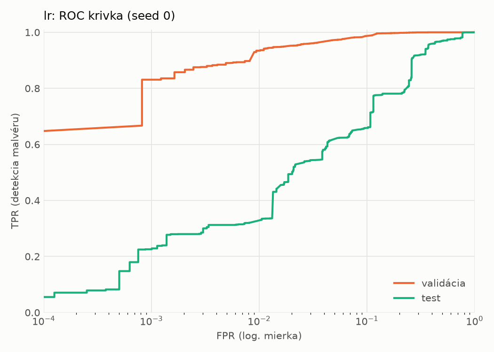
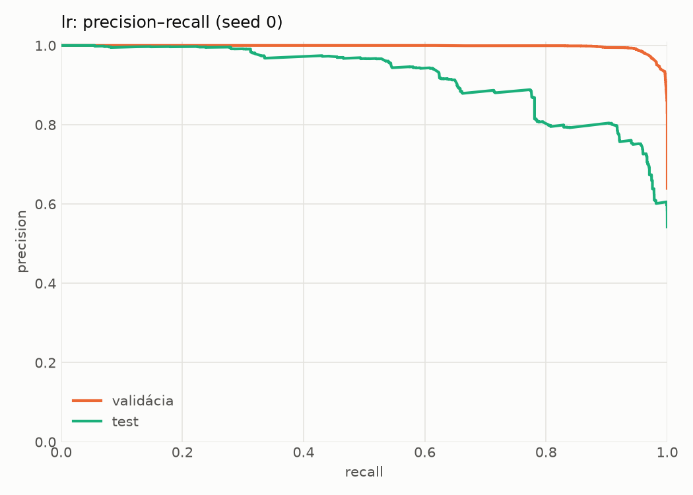
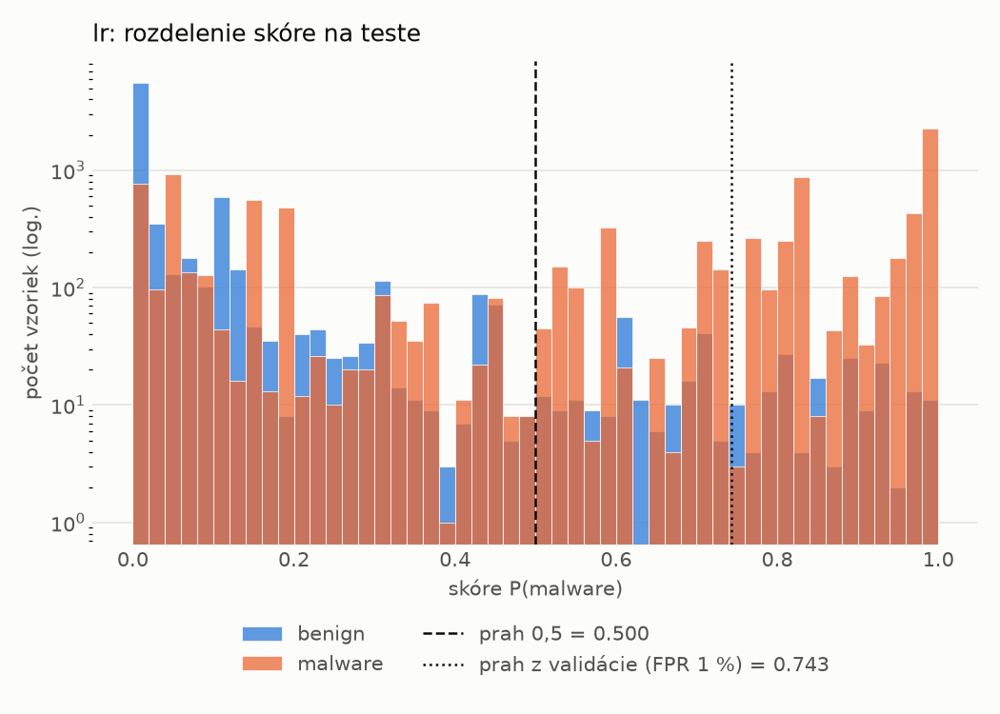
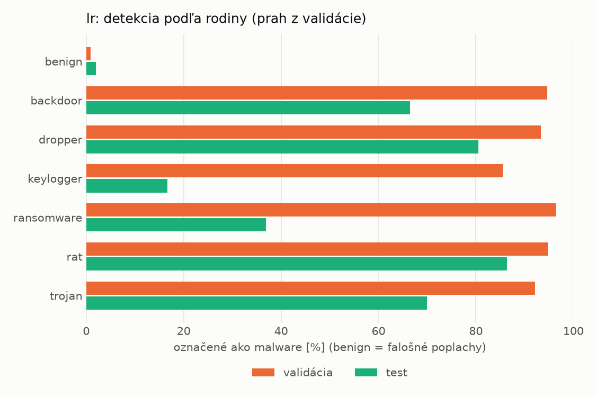
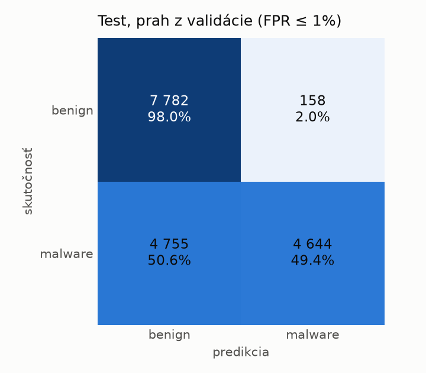
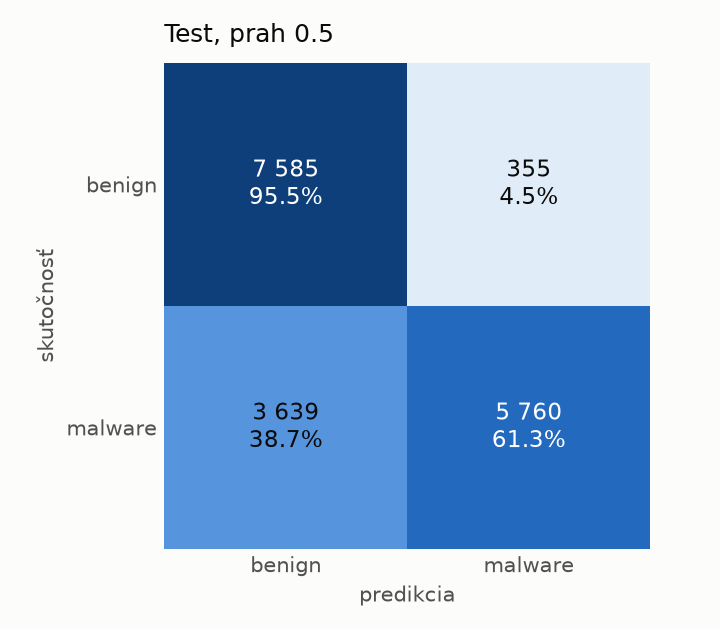

# dynamic/lr – beh `20261103-234308`

> Automaticky generované (`src/training/run_tabular.py`). Konfigurácia: `config.yaml`, protokol: `protocol.yaml`.

- **Model:** `logreg` – logistická regresia s L2 regularizáciou (vstup signed log1p + štandardizácia)
- **Ladenie:** bez ladenia – hyperparametre prevzaté z `runs_final/dynamic/lr/20261102-002602`
- **Finálne modely:** seedy [0, 1, 2]; hodnoty sú priemer ± smerodajná odchýlka cez seedy
- **Najlepšie hyperparametre:** `{"max_iter": 2000, "C": 0.04224422279858655}`

## Detekčná kvalita (bez prahu)
| metrika | train (podvzorka) | validácia | test |
|---|---|---|---|
| ROC-AUC | 0.9965 ± 0.0000 | 0.9954 ± 0.0000 | 0.9006 ± 0.0000 |
| PR-AUC | 0.9979 ± 0.0000 | 0.9974 ± 0.0000 | 0.9193 ± 0.0000 |
| TPR pri FPR 1 % | 0.9485 ± 0.0000 | 0.9344 ± 0.0000 | 0.3205 ± 0.0000 |
| TPR pri FPR 0,1 % | 0.8015 ± 0.0000 | 0.8309 ± 0.0000 | 0.2257 ± 0.0000 |
| log loss | 0.0783 ± 0.0000 | 0.0858 ± 0.0000 | 0.7708 ± 0.0000 |
| Brier skóre | 0.0236 ± 0.0000 | 0.0260 ± 0.0000 | 0.1951 ± 0.0000 |

Rozdiel ROC-AUC train − validácia: **0.0010** (veľký rozdiel = preučenie).

## Pri prahu z validácie (FPR ≤ 1% na validácii)
| metrika | train (podvzorka) | validácia | test |
|---|---|---|---|
| accuracy | 0.9542 ± 0.0000 | 0.9547 ± 0.0000 | 0.7167 ± 0.0000 |
| balanced accuracy | 0.9619 ± 0.0000 | 0.9625 ± 0.0000 | 0.7371 ± 0.0000 |
| precision | 0.9951 ± 0.0000 | 0.9943 ± 0.0000 | 0.9671 ± 0.0000 |
| recall (TPR) | 0.9316 ± 0.0000 | 0.9344 ± 0.0000 | 0.4941 ± 0.0000 |
| FPR | 0.0078 ± 0.0000 | 0.0094 ± 0.0000 | 0.0199 ± 0.0000 |
| F1 | 0.9623 ± 0.0000 | 0.9634 ± 0.0000 | 0.6540 ± 0.0000 |
| MCC | 0.9073 ± 0.0000 | 0.9070 ± 0.0000 | 0.5280 ± 0.0000 |

## Pri pevnom prahu 0.5
| metrika | train (podvzorka) | validácia | test |
|---|---|---|---|
| accuracy | 0.9672 ± 0.0000 | 0.9640 ± 0.0000 | 0.7697 ± 0.0000 |
| balanced accuracy | 0.9697 ± 0.0000 | 0.9660 ± 0.0000 | 0.7841 ± 0.0000 |
| precision | 0.9874 ± 0.0000 | 0.9846 ± 0.0000 | 0.9419 ± 0.0000 |
| recall (TPR) | 0.9600 ± 0.0000 | 0.9587 ± 0.0000 | 0.6128 ± 0.0000 |
| FPR | 0.0206 ± 0.0000 | 0.0266 ± 0.0000 | 0.0447 ± 0.0000 |
| F1 | 0.9735 ± 0.0000 | 0.9714 ± 0.0000 | 0.7426 ± 0.0000 |
| MCC | 0.9312 ± 0.0000 | 0.9232 ± 0.0000 | 0.5924 ± 0.0000 |

## Výpočtové nároky (seed 0, testovacia množina)
| meranie | hodnota |
|---|---|
| tréning finálneho modelu | 5.1 s (priemer cez seedy) |
| ladenie spolu | 0 s |
| počet parametrov / uzlov | 2 001 |
| veľkosť modelu na disku | 0.06 MB |
| transformácia vstupu – latencia (1 vlákno) | 0.017 ms |
| transformácia vstupu – priepustnosť | 55 382 vzoriek/s |
| CPU latencia modelu (batch 1, 1 vlákno) | 0.005 ms (p95 0.006) |
| CPU priepustnosť (24 vlákien) | 340 111 vzoriek/s |

## Grafy
| | |
|---|---|
|  |  |
|  |  |
|  |  |
|  |  |

## Súbory
`metrics.json` (všetky metriky po seedoch vrátane rodín), `timing.json`, `hpo_trials.csv`,
`predictions/<časť>_seed<N>.parquet` (sha256, family, label, score), `model/seed_<N>/`, `log.txt`.
