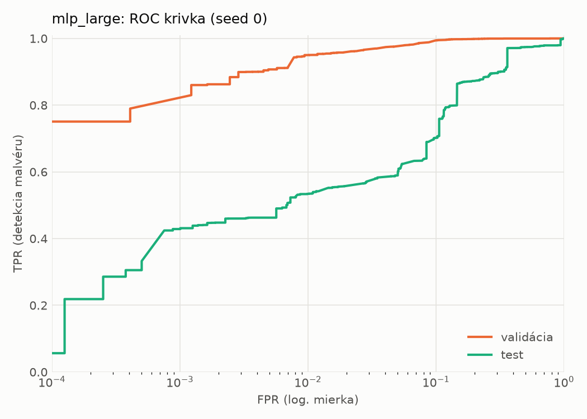
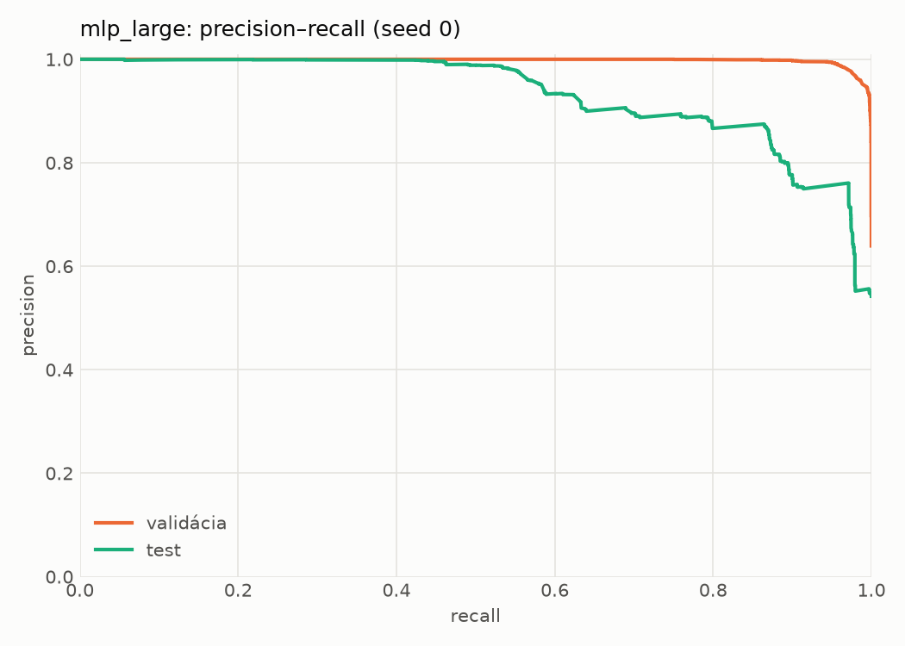
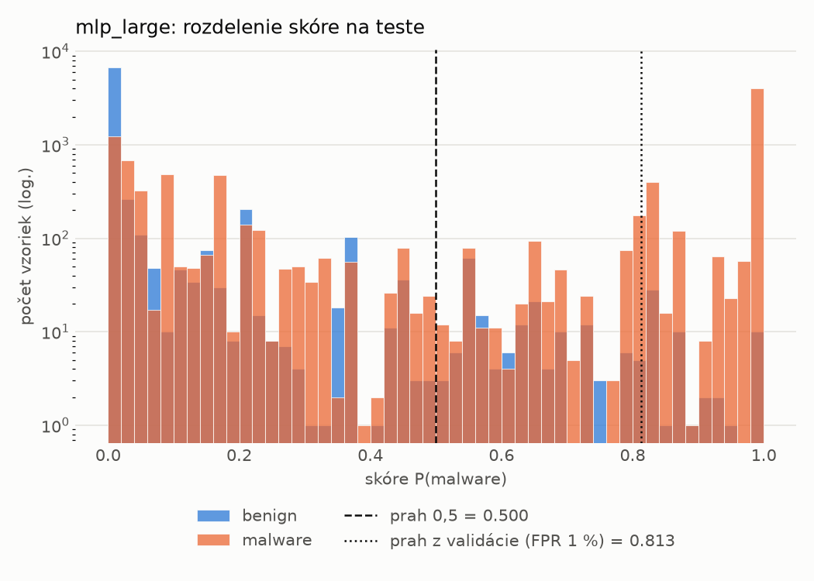
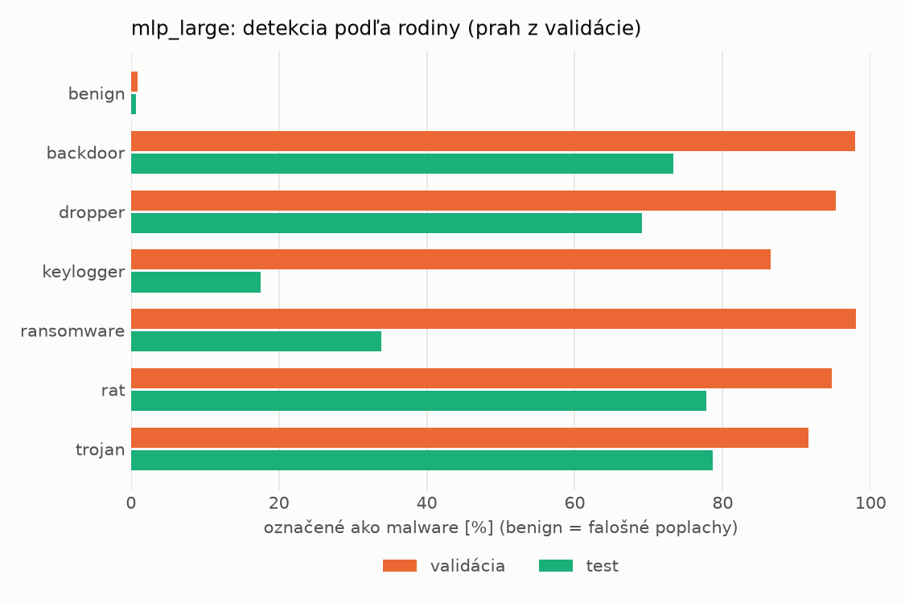
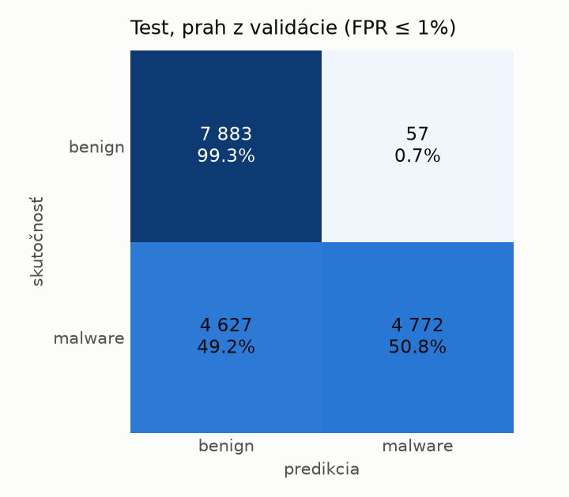
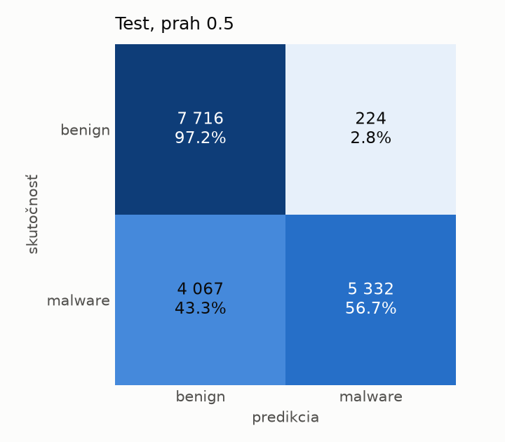
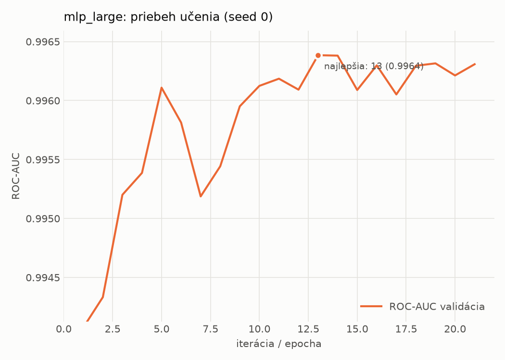

# dynamic/mlp_large – beh `20261103-234722`

> Automaticky generované (`src/training/run_tabular.py`). Konfigurácia: `config.yaml`, protokol: `protocol.yaml`.

- **Model:** `mlp` – veľká neurónová sieť (3–5 skrytých vrstiev, 512–2048 neurónov), kandidát na učiteľa
- **Ladenie:** bez ladenia – hyperparametre prevzaté z `runs_final/dynamic/mlp_large/20261102-005920`
- **Finálne modely:** seedy [0, 1, 2]; hodnoty sú priemer ± smerodajná odchýlka cez seedy
- **Najlepšie hyperparametre:** `{"max_epochs": 100, "patience": 8, "hidden_layers": 3, "hidden_width": 512, "width_decay": 0.5, "dropout": 0.3735687797102123, "lr": 0.00020669709962675654, "weight_decay": 1.4747439017290252e-05, "batch_size": 256}`

## Detekčná kvalita (bez prahu)
| metrika | train (podvzorka) | validácia | test |
|---|---|---|---|
| ROC-AUC | 0.9974 ± 0.0002 | 0.9966 ± 0.0002 | 0.9137 ± 0.0052 |
| PR-AUC | 0.9984 ± 0.0001 | 0.9980 ± 0.0001 | 0.9358 ± 0.0035 |
| TPR pri FPR 1 % | 0.9556 ± 0.0029 | 0.9501 ± 0.0002 | 0.5434 ± 0.0158 |
| TPR pri FPR 0,1 % | 0.8855 ± 0.0040 | 0.7847 ± 0.0067 | 0.4272 ± 0.0030 |
| log loss | 0.0624 ± 0.0017 | 0.0735 ± 0.0012 | 0.9429 ± 0.0291 |
| Brier skóre | 0.0198 ± 0.0007 | 0.0216 ± 0.0005 | 0.2003 ± 0.0083 |

Rozdiel ROC-AUC train − validácia: **0.0008** (veľký rozdiel = preučenie).

## Pri prahu z validácie (FPR ≤ 1% na validácii)
| metrika | train (podvzorka) | validácia | test |
|---|---|---|---|
| accuracy | 0.9641 ± 0.0004 | 0.9647 ± 0.0001 | 0.7404 ± 0.0091 |
| balanced accuracy | 0.9698 ± 0.0002 | 0.9703 ± 0.0001 | 0.7597 ± 0.0083 |
| precision | 0.9953 ± 0.0003 | 0.9944 ± 0.0000 | 0.9844 ± 0.0068 |
| recall (TPR) | 0.9473 ± 0.0008 | 0.9501 ± 0.0002 | 0.5295 ± 0.0189 |
| FPR | 0.0076 ± 0.0004 | 0.0094 ± 0.0000 | 0.0100 ± 0.0047 |
| F1 | 0.9707 ± 0.0003 | 0.9718 ± 0.0001 | 0.6884 ± 0.0153 |
| MCC | 0.9264 ± 0.0007 | 0.9265 ± 0.0003 | 0.5695 ± 0.0121 |

## Pri pevnom prahu 0.5
| metrika | train (podvzorka) | validácia | test |
|---|---|---|---|
| accuracy | 0.9702 ± 0.0015 | 0.9683 ± 0.0010 | 0.7693 ± 0.0150 |
| balanced accuracy | 0.9726 ± 0.0023 | 0.9707 ± 0.0015 | 0.7852 ± 0.0139 |
| precision | 0.9889 ± 0.0034 | 0.9880 ± 0.0019 | 0.9647 ± 0.0044 |
| recall (TPR) | 0.9634 ± 0.0011 | 0.9622 ± 0.0007 | 0.5961 ± 0.0261 |
| FPR | 0.0182 ± 0.0056 | 0.0207 ± 0.0033 | 0.0258 ± 0.0023 |
| F1 | 0.9760 ± 0.0012 | 0.9749 ± 0.0007 | 0.7367 ± 0.0212 |
| MCC | 0.9375 ± 0.0034 | 0.9326 ± 0.0022 | 0.6021 ± 0.0235 |

## Výpočtové nároky (seed 0, testovacia množina)
| meranie | hodnota |
|---|---|
| tréning finálneho modelu | 13.3 s (priemer cez seedy) |
| ladenie spolu | 0 s |
| počet parametrov / uzlov | 1 190 657 |
| veľkosť modelu na disku | 4.83 MB |
| transformácia vstupu – latencia (1 vlákno) | 0.034 ms |
| transformácia vstupu – priepustnosť | 45 560 vzoriek/s |
| CPU latencia modelu (batch 1, 1 vlákno) | 0.196 ms (p95 0.225) |
| CPU priepustnosť (24 vlákien) | 102 747 vzoriek/s |
| GPU latencia (batch 1) | 0.531 ms (p95 1.343) |
| GPU priepustnosť | 91 496 vzoriek/s |
| GPU špičková pamäť | 1283 MB |

## Grafy
| | |
|---|---|
|  |  |
|  |  |
|  |  |
|  |  |

## Súbory
`metrics.json` (všetky metriky po seedoch vrátane rodín), `timing.json`, `hpo_trials.csv`,
`predictions/<časť>_seed<N>.parquet` (sha256, family, label, score), `model/seed_<N>/`, `log.txt`.
