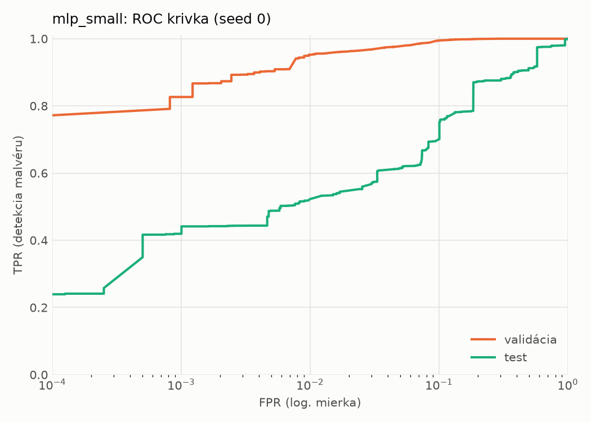
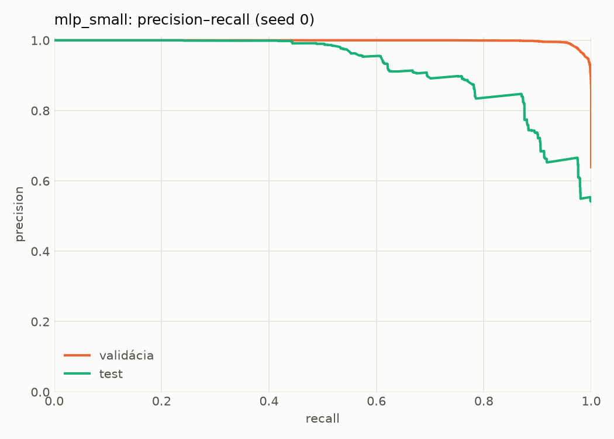
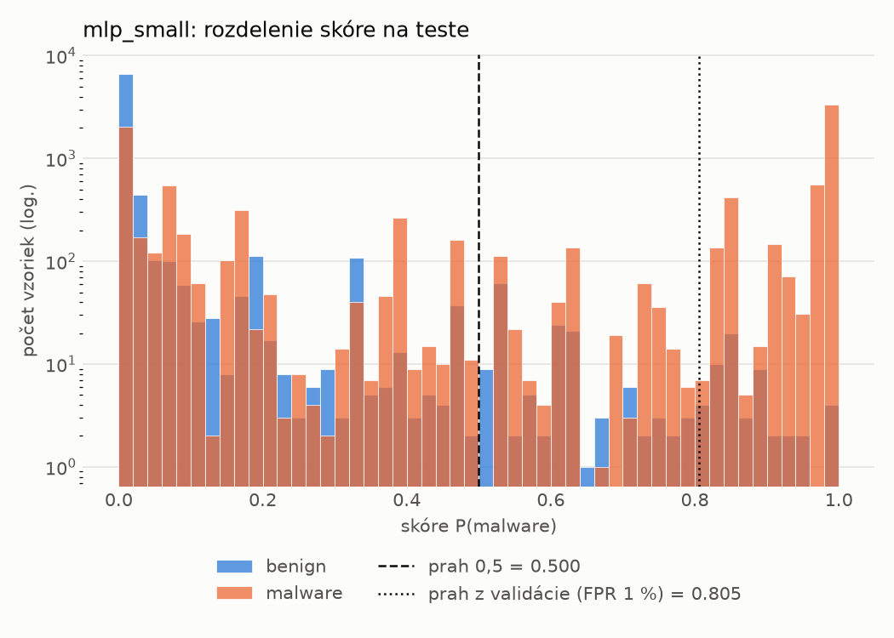
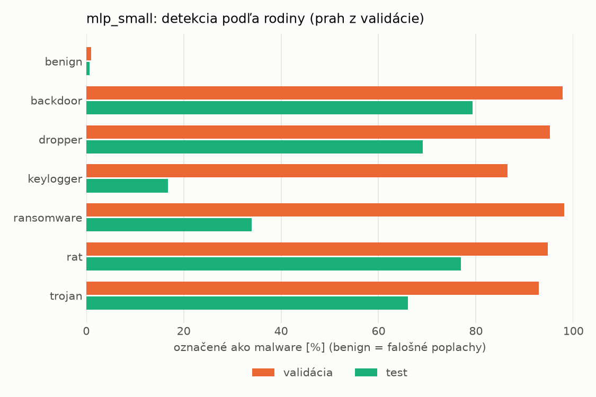
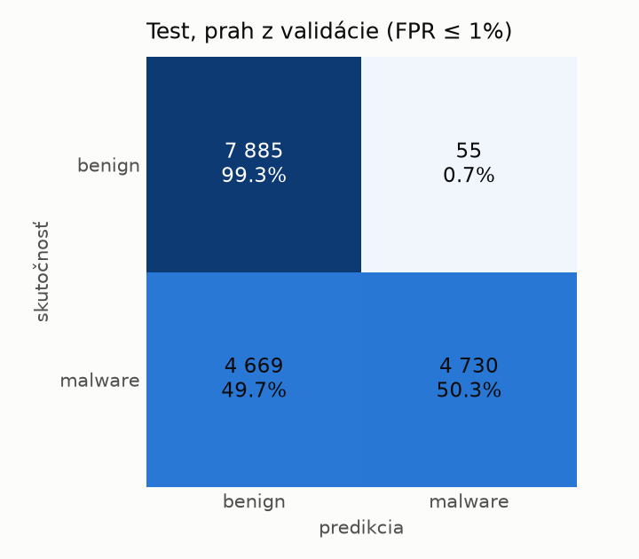
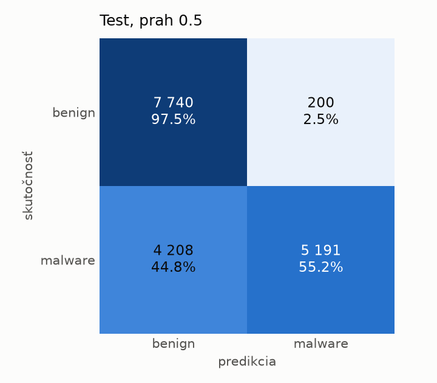
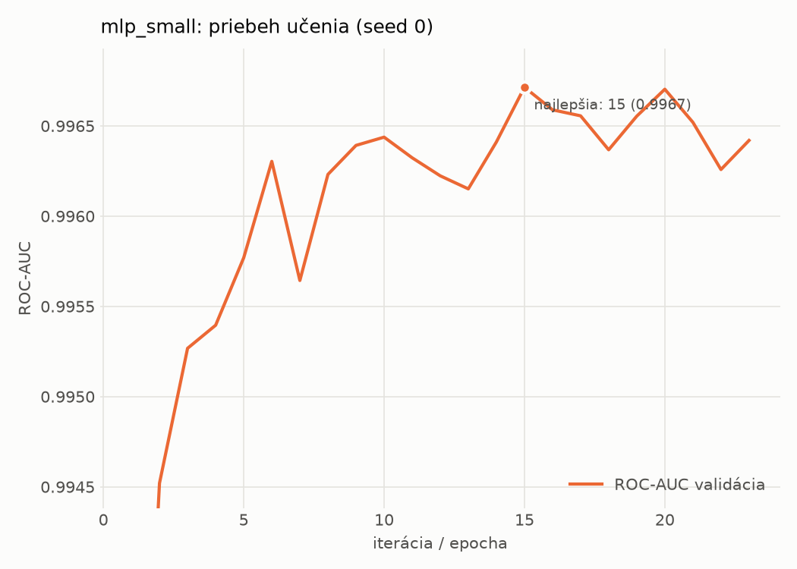

# dynamic/mlp_small – beh `20261103-234702`

> Automaticky generované (`src/training/run_tabular.py`). Konfigurácia: `config.yaml`, protokol: `protocol.yaml`.

- **Model:** `mlp` – malá neurónová sieť (1–2 skryté vrstvy), kandidát na ľahkého študenta
- **Ladenie:** bez ladenia – hyperparametre prevzaté z `runs_final/dynamic/mlp_small/20261102-005611`
- **Finálne modely:** seedy [0, 1, 2]; hodnoty sú priemer ± smerodajná odchýlka cez seedy
- **Najlepšie hyperparametre:** `{"width_decay": 0.5, "max_epochs": 100, "patience": 8, "hidden_layers": 2, "hidden_width": 256, "dropout": 0.194338644844741, "lr": 0.0002516607127550297, "weight_decay": 0.0020651425578959264, "batch_size": 1024}`

## Detekčná kvalita (bez prahu)
| metrika | train (podvzorka) | validácia | test |
|---|---|---|---|
| ROC-AUC | 0.9976 ± 0.0001 | 0.9967 ± 0.0001 | 0.8962 ± 0.0087 |
| PR-AUC | 0.9985 ± 0.0001 | 0.9981 ± 0.0000 | 0.9251 ± 0.0042 |
| TPR pri FPR 1 % | 0.9581 ± 0.0009 | 0.9530 ± 0.0031 | 0.5212 ± 0.0041 |
| TPR pri FPR 0,1 % | 0.8808 ± 0.0103 | 0.8064 ± 0.0207 | 0.3603 ± 0.0511 |
| log loss | 0.0607 ± 0.0018 | 0.0717 ± 0.0002 | 1.0671 ± 0.0448 |
| Brier skóre | 0.0189 ± 0.0005 | 0.0210 ± 0.0004 | 0.2132 ± 0.0060 |

Rozdiel ROC-AUC train − validácia: **0.0009** (veľký rozdiel = preučenie).

## Pri prahu z validácie (FPR ≤ 1% na validácii)
| metrika | train (podvzorka) | validácia | test |
|---|---|---|---|
| accuracy | 0.9659 ± 0.0018 | 0.9664 ± 0.0020 | 0.7297 ± 0.0039 |
| balanced accuracy | 0.9712 ± 0.0013 | 0.9716 ± 0.0015 | 0.7501 ± 0.0036 |
| precision | 0.9951 ± 0.0004 | 0.9942 ± 0.0000 | 0.9871 ± 0.0013 |
| recall (TPR) | 0.9504 ± 0.0032 | 0.9530 ± 0.0031 | 0.5081 ± 0.0075 |
| FPR | 0.0079 ± 0.0007 | 0.0098 ± 0.0000 | 0.0079 ± 0.0009 |
| F1 | 0.9722 ± 0.0015 | 0.9732 ± 0.0016 | 0.6708 ± 0.0065 |
| MCC | 0.9299 ± 0.0035 | 0.9298 ± 0.0039 | 0.5556 ± 0.0055 |

## Pri pevnom prahu 0.5
| metrika | train (podvzorka) | validácia | test |
|---|---|---|---|
| accuracy | 0.9721 ± 0.0005 | 0.9696 ± 0.0007 | 0.7484 ± 0.0053 |
| balanced accuracy | 0.9747 ± 0.0007 | 0.9721 ± 0.0009 | 0.7661 ± 0.0050 |
| precision | 0.9909 ± 0.0008 | 0.9889 ± 0.0010 | 0.9650 ± 0.0024 |
| recall (TPR) | 0.9644 ± 0.0002 | 0.9633 ± 0.0001 | 0.5559 ± 0.0088 |
| FPR | 0.0149 ± 0.0013 | 0.0192 ± 0.0018 | 0.0238 ± 0.0014 |
| F1 | 0.9775 ± 0.0004 | 0.9759 ± 0.0005 | 0.7054 ± 0.0077 |
| MCC | 0.9415 ± 0.0011 | 0.9354 ± 0.0015 | 0.5721 ± 0.0086 |

## Výpočtové nároky (seed 0, testovacia množina)
| meranie | hodnota |
|---|---|
| tréning finálneho modelu | 4.1 s (priemer cez seedy) |
| ladenie spolu | 0 s |
| počet parametrov / uzlov | 546 049 |
| veľkosť modelu na disku | 2.24 MB |
| transformácia vstupu – latencia (1 vlákno) | 0.034 ms |
| transformácia vstupu – priepustnosť | 45 288 vzoriek/s |
| CPU latencia modelu (batch 1, 1 vlákno) | 0.133 ms (p95 0.153) |
| CPU priepustnosť (24 vlákien) | 120 222 vzoriek/s |
| GPU latencia (batch 1) | 0.408 ms (p95 0.457) |
| GPU priepustnosť | 128 067 vzoriek/s |
| GPU špičková pamäť | 719 MB |

## Grafy
| | |
|---|---|
|  |  |
|  |  |
|  |  |
|  |  |

## Súbory
`metrics.json` (všetky metriky po seedoch vrátane rodín), `timing.json`, `hpo_trials.csv`,
`predictions/<časť>_seed<N>.parquet` (sha256, family, label, score), `model/seed_<N>/`, `log.txt`.
