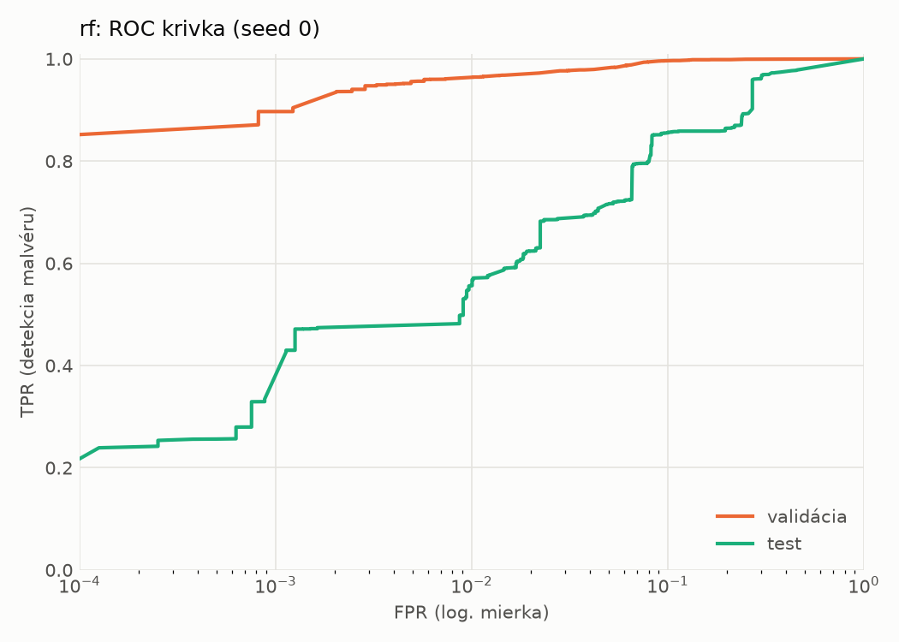
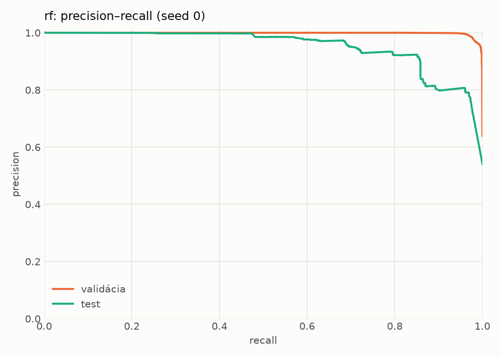
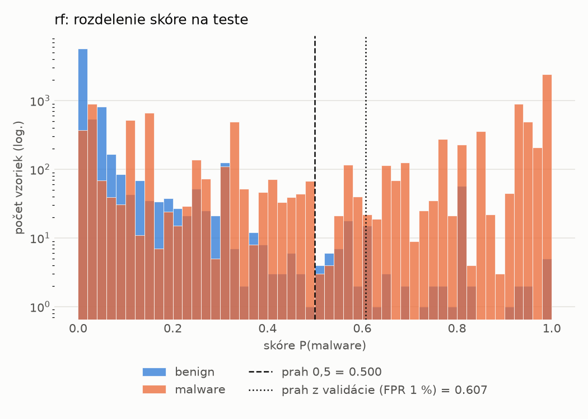
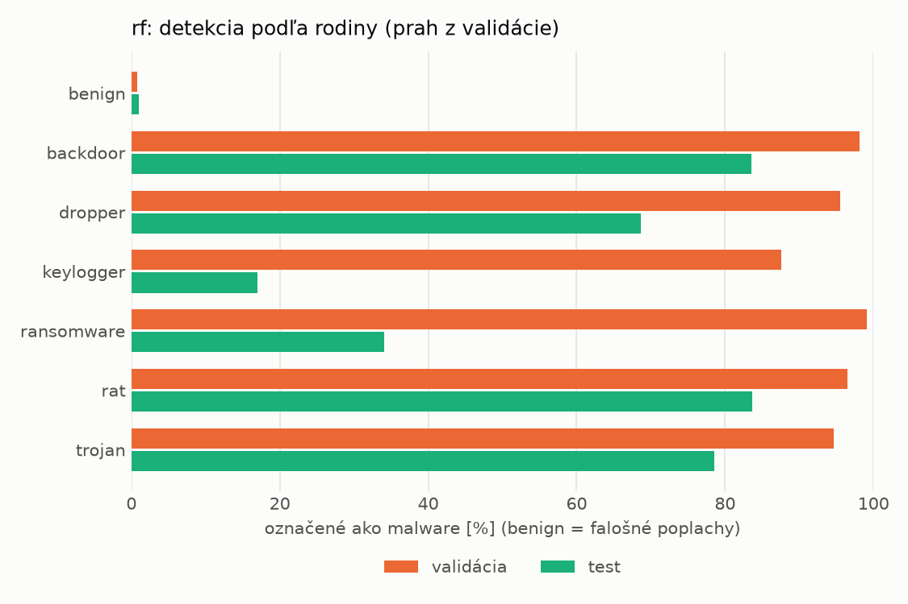
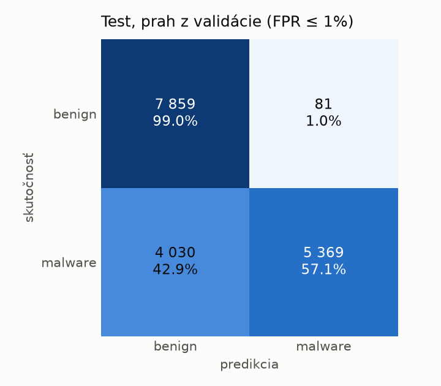
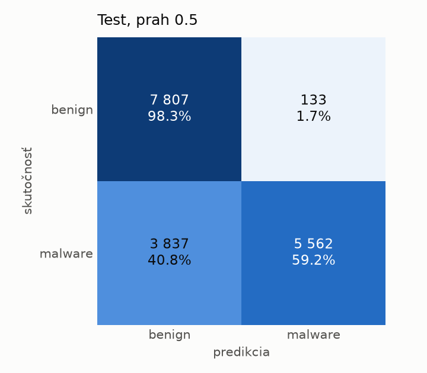

# dynamic/rf – beh `20261103-234330`

> Automaticky generované (`src/training/run_tabular.py`). Konfigurácia: `config.yaml`, protokol: `protocol.yaml`.

- **Model:** `random_forest` – Random Forest (pôvodné hodnoty príznakov)
- **Ladenie:** bez ladenia – hyperparametre prevzaté z `runs_final/dynamic/rf/20261102-003041`
- **Finálne modely:** seedy [0, 1, 2]; hodnoty sú priemer ± smerodajná odchýlka cez seedy
- **Najlepšie hyperparametre:** `{"n_estimators": 450, "max_depth": null, "min_samples_leaf": 1, "max_features": 0.05}`

## Detekčná kvalita (bez prahu)
| metrika | train (podvzorka) | validácia | test |
|---|---|---|---|
| ROC-AUC | 0.9987 ± 0.0000 | 0.9975 ± 0.0000 | 0.9359 ± 0.0011 |
| PR-AUC | 0.9991 ± 0.0000 | 0.9985 ± 0.0000 | 0.9494 ± 0.0008 |
| TPR pri FPR 1 % | 0.9692 ± 0.0000 | 0.9610 ± 0.0002 | 0.5583 ± 0.0025 |
| TPR pri FPR 0,1 % | 0.9022 ± 0.0004 | 0.8977 ± 0.0006 | 0.3334 ± 0.0015 |
| log loss | 0.0460 ± 0.0000 | 0.0629 ± 0.0008 | 0.7205 ± 0.0132 |
| Brier skóre | 0.0147 ± 0.0000 | 0.0177 ± 0.0000 | 0.1748 ± 0.0013 |

Rozdiel ROC-AUC train − validácia: **0.0012** (veľký rozdiel = preučenie).

## Pri prahu z validácie (FPR ≤ 1% na validácii)
| metrika | train (podvzorka) | validácia | test |
|---|---|---|---|
| accuracy | 0.9755 ± 0.0001 | 0.9724 ± 0.0001 | 0.7586 ± 0.0039 |
| balanced accuracy | 0.9799 ± 0.0001 | 0.9768 ± 0.0001 | 0.7766 ± 0.0035 |
| precision | 0.9983 ± 0.0000 | 0.9957 ± 0.0000 | 0.9851 ± 0.0000 |
| recall (TPR) | 0.9626 ± 0.0002 | 0.9610 ± 0.0002 | 0.5632 ± 0.0072 |
| FPR | 0.0027 ± 0.0000 | 0.0074 ± 0.0000 | 0.0101 ± 0.0001 |
| F1 | 0.9801 ± 0.0001 | 0.9780 ± 0.0001 | 0.7166 ± 0.0058 |
| MCC | 0.9494 ± 0.0002 | 0.9420 ± 0.0003 | 0.5959 ± 0.0055 |

## Pri pevnom prahu 0.5
| metrika | train (podvzorka) | validácia | test |
|---|---|---|---|
| accuracy | 0.9778 ± 0.0000 | 0.9744 ± 0.0002 | 0.7726 ± 0.0014 |
| balanced accuracy | 0.9810 ± 0.0000 | 0.9771 ± 0.0002 | 0.7890 ± 0.0013 |
| precision | 0.9960 ± 0.0001 | 0.9923 ± 0.0001 | 0.9771 ± 0.0004 |
| recall (TPR) | 0.9685 ± 0.0001 | 0.9675 ± 0.0001 | 0.5945 ± 0.0024 |
| FPR | 0.0066 ± 0.0002 | 0.0134 ± 0.0002 | 0.0165 ± 0.0002 |
| F1 | 0.9821 ± 0.0000 | 0.9797 ± 0.0001 | 0.7392 ± 0.0019 |
| MCC | 0.9536 ± 0.0000 | 0.9456 ± 0.0004 | 0.6125 ± 0.0022 |

## Výpočtové nároky (seed 0, testovacia množina)
| meranie | hodnota |
|---|---|
| tréning finálneho modelu | 32.3 s (priemer cez seedy) |
| ladenie spolu | 0 s |
| počet parametrov / uzlov | 889 982 |
| veľkosť modelu na disku | 71.62 MB |
| CPU latencia modelu (batch 1, 1 vlákno) | 13.002 ms (p95 13.315) |
| CPU priepustnosť (24 vlákien) | 87 593 vzoriek/s |

## Grafy
| | |
|---|---|
|  |  |
|  |  |
|  |  |
|  |  |

## Súbory
`metrics.json` (všetky metriky po seedoch vrátane rodín), `timing.json`, `hpo_trials.csv`,
`predictions/<časť>_seed<N>.parquet` (sha256, family, label, score), `model/seed_<N>/`, `log.txt`.
