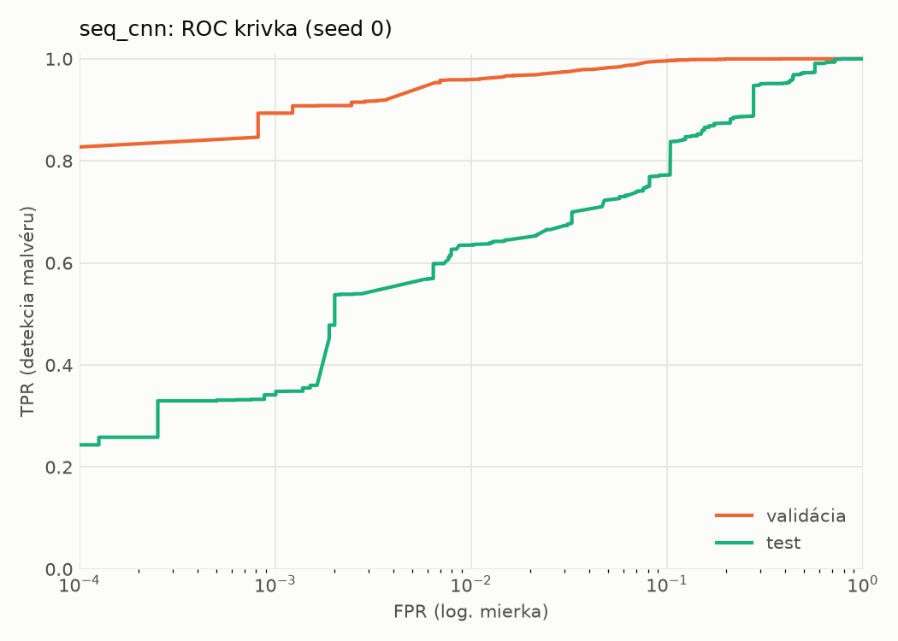
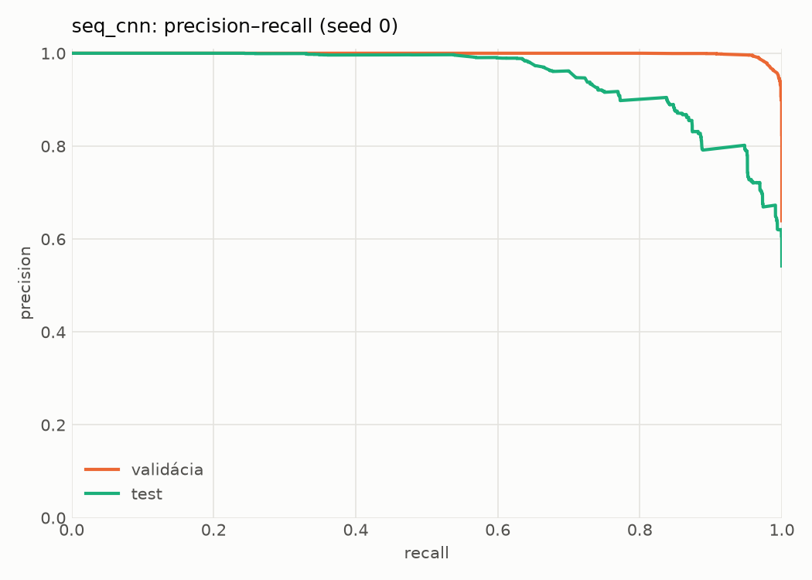
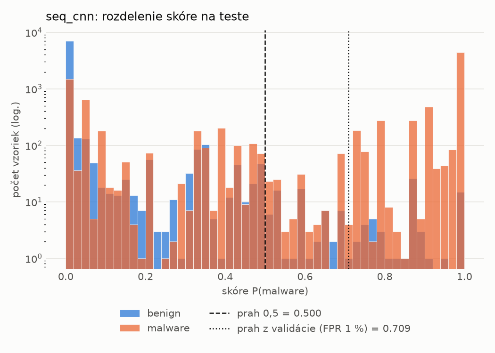
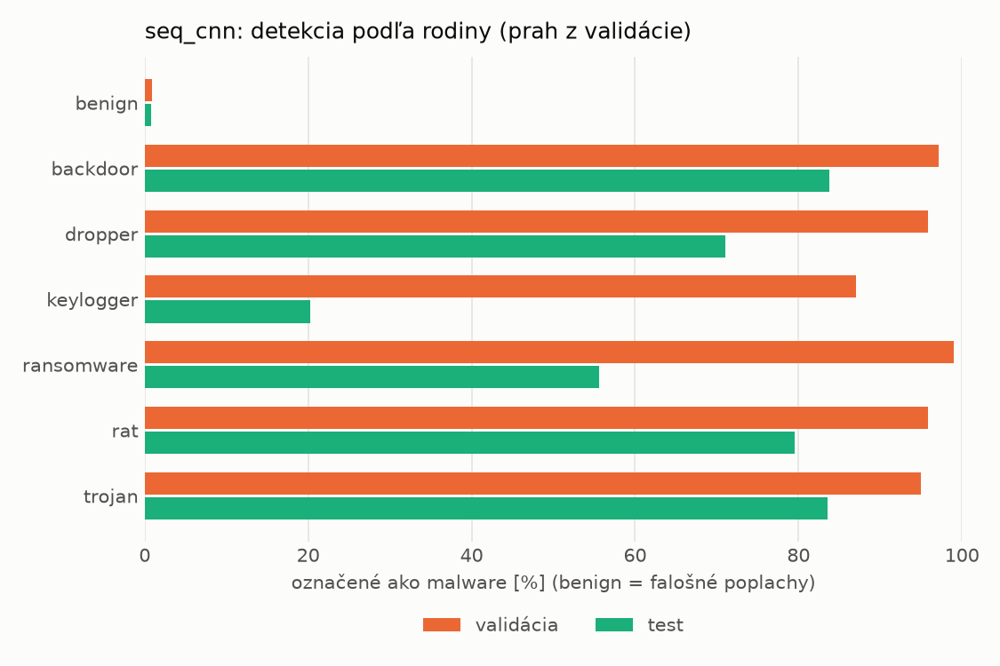
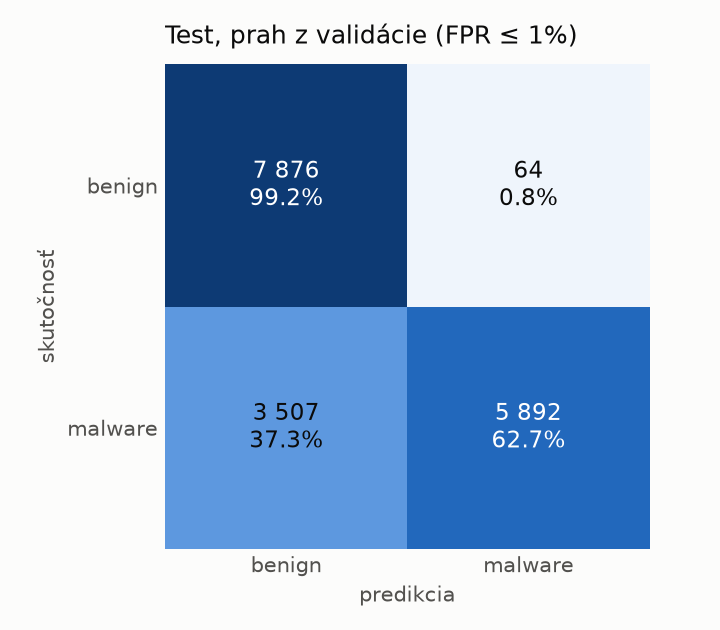
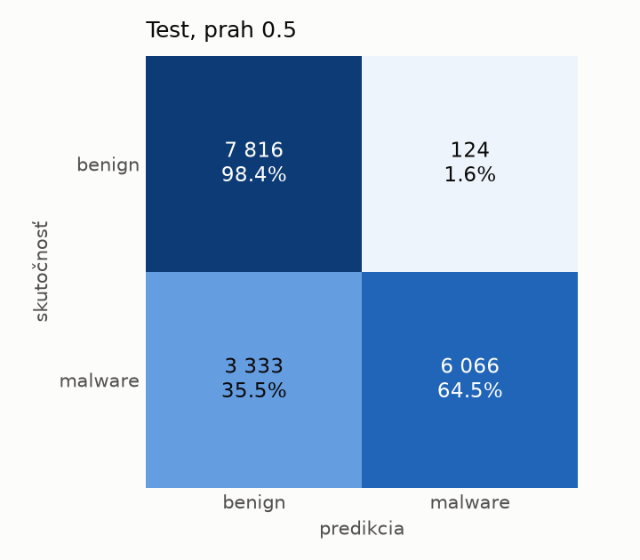
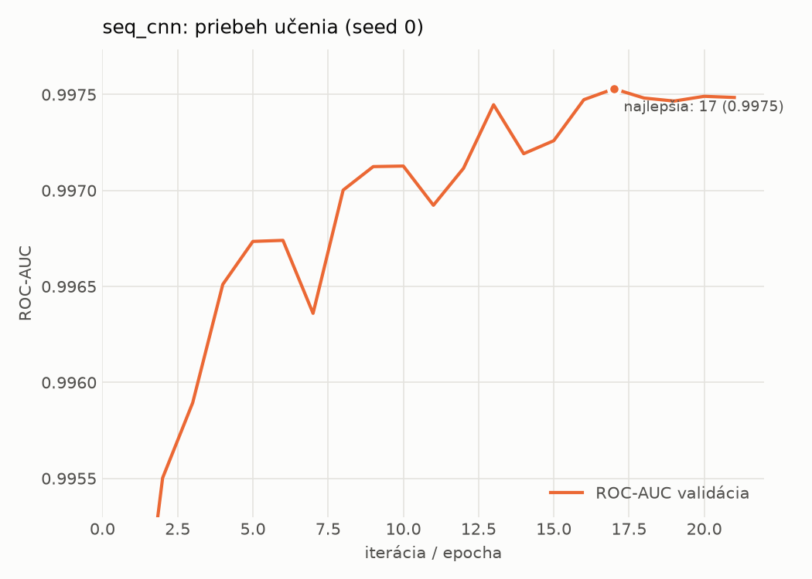

# dynamic_seq/seq_cnn – beh `20261103-234810`

> Automaticky generované (`src/training/run_tabular.py`). Konfigurácia: `config.yaml`, protokol: `protocol.yaml`.

- **Model:** `seq_cnn` – embedding API + paralelné 1D konvolúcie + maximum cez postupnosť
- **Ladenie:** bez ladenia – hyperparametre prevzaté z `runs_final/dynamic/seq_cnn/20261102-010741`
- **Finálne modely:** seedy [0, 1, 2]; hodnoty sú priemer ± smerodajná odchýlka cez seedy
- **Najlepšie hyperparametre:** `{"max_epochs": 30, "patience": 4, "emb_dim": 64, "channels": 128, "kernels": "2-4-8", "hidden": 64, "dropout": 0.19665662644598886, "lr": 0.0005755683530429188, "weight_decay": 0.0005400591881097476, "batch_size": 128}`

## Detekčná kvalita (bez prahu)
| metrika | train (podvzorka) | validácia | test |
|---|---|---|---|
| ROC-AUC | 0.9981 ± 0.0001 | 0.9975 ± 0.0001 | 0.9358 ± 0.0073 |
| PR-AUC | 0.9988 ± 0.0001 | 0.9985 ± 0.0000 | 0.9523 ± 0.0052 |
| TPR pri FPR 1 % | 0.9639 ± 0.0008 | 0.9591 ± 0.0002 | 0.6241 ± 0.0180 |
| TPR pri FPR 0,1 % | 0.9065 ± 0.0030 | 0.8791 ± 0.0230 | 0.3457 ± 0.0045 |
| log loss | 0.0545 ± 0.0017 | 0.0640 ± 0.0017 | 0.8165 ± 0.1520 |
| Brier skóre | 0.0173 ± 0.0007 | 0.0191 ± 0.0004 | 0.1651 ± 0.0109 |

Rozdiel ROC-AUC train − validácia: **0.0007** (veľký rozdiel = preučenie).

## Pri prahu z validácie (FPR ≤ 1% na validácii)
| metrika | train (podvzorka) | validácia | test |
|---|---|---|---|
| accuracy | 0.9716 ± 0.0004 | 0.9704 ± 0.0002 | 0.7894 ± 0.0040 |
| balanced accuracy | 0.9760 ± 0.0005 | 0.9747 ± 0.0002 | 0.8050 ± 0.0039 |
| precision | 0.9958 ± 0.0005 | 0.9943 ± 0.0001 | 0.9866 ± 0.0052 |
| recall (TPR) | 0.9587 ± 0.0005 | 0.9591 ± 0.0002 | 0.6200 ± 0.0063 |
| FPR | 0.0068 ± 0.0009 | 0.0097 ± 0.0002 | 0.0099 ± 0.0039 |
| F1 | 0.9769 ± 0.0003 | 0.9764 ± 0.0001 | 0.7614 ± 0.0052 |
| MCC | 0.9411 ± 0.0009 | 0.9377 ± 0.0004 | 0.6413 ± 0.0074 |

## Pri pevnom prahu 0.5
| metrika | train (podvzorka) | validácia | test |
|---|---|---|---|
| accuracy | 0.9742 ± 0.0008 | 0.9722 ± 0.0010 | 0.7963 ± 0.0051 |
| balanced accuracy | 0.9771 ± 0.0009 | 0.9749 ± 0.0008 | 0.8110 ± 0.0048 |
| precision | 0.9928 ± 0.0011 | 0.9911 ± 0.0003 | 0.9809 ± 0.0049 |
| recall (TPR) | 0.9659 ± 0.0013 | 0.9651 ± 0.0016 | 0.6366 ± 0.0083 |
| FPR | 0.0117 ± 0.0019 | 0.0153 ± 0.0005 | 0.0147 ± 0.0037 |
| F1 | 0.9792 ± 0.0007 | 0.9780 ± 0.0008 | 0.7721 ± 0.0066 |
| MCC | 0.9460 ± 0.0017 | 0.9409 ± 0.0021 | 0.6489 ± 0.0089 |

## Výpočtové nároky (seed 0, testovacia množina)
| meranie | hodnota |
|---|---|
| tréning finálneho modelu | 376.2 s (priemer cez seedy) |
| ladenie spolu | 0 s |
| počet parametrov / uzlov | 209 409 |
| veľkosť modelu na disku | 0.84 MB |
| CPU latencia modelu (batch 1, 1 vlákno) | 3.044 ms (p95 3.368) |
| CPU priepustnosť (24 vlákien) | 1 195 vzoriek/s |
| GPU latencia (batch 1) | 0.775 ms (p95 1.868) |
| GPU priepustnosť | 9 476 vzoriek/s |
| GPU špičková pamäť | 1918 MB |

## Grafy
| | |
|---|---|
|  |  |
|  |  |
|  |  |
|  |  |

## Súbory
`metrics.json` (všetky metriky po seedoch vrátane rodín), `timing.json`, `hpo_trials.csv`,
`predictions/<časť>_seed<N>.parquet` (sha256, family, label, score), `model/seed_<N>/`, `log.txt`.
