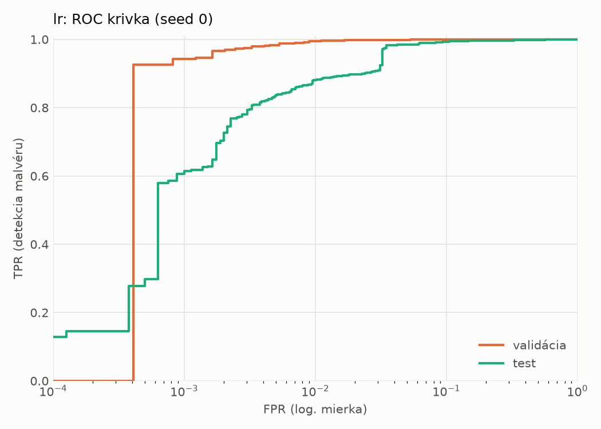
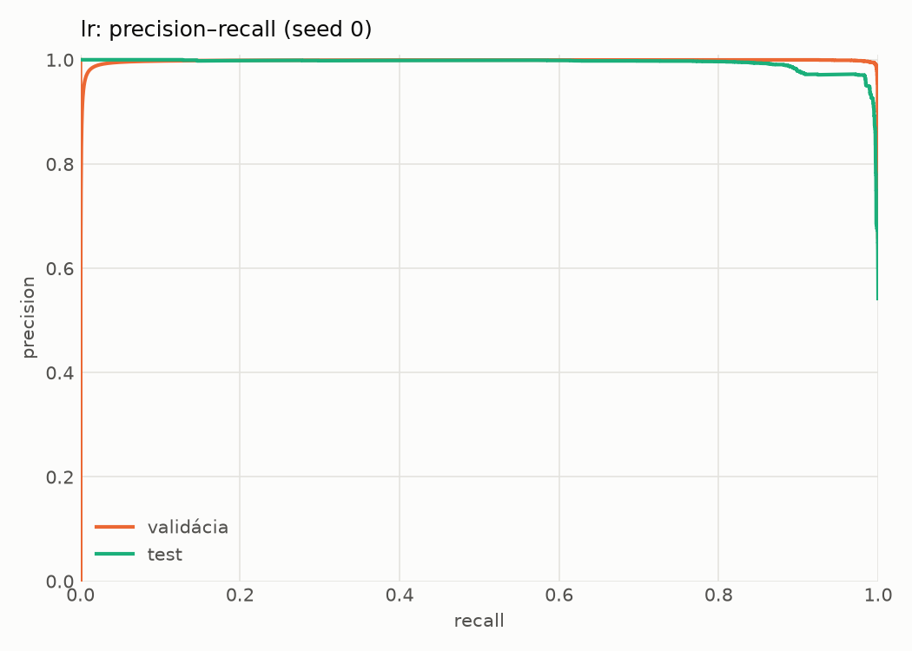
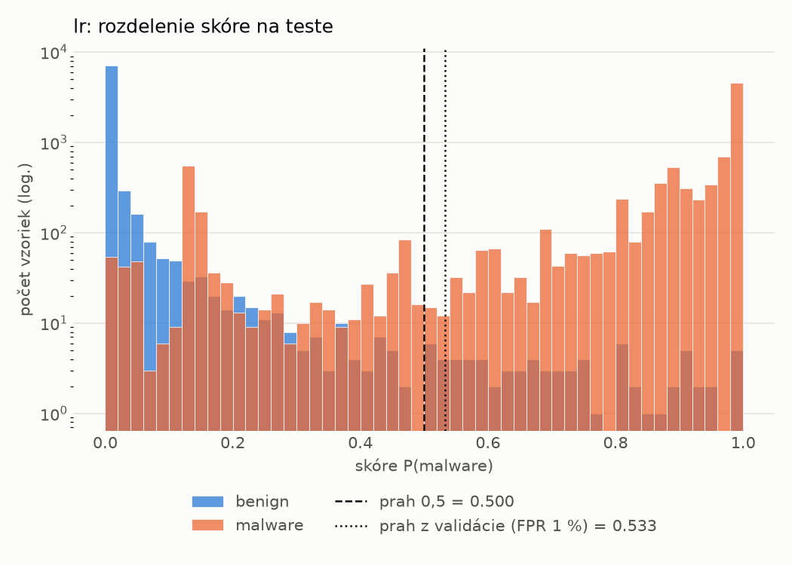
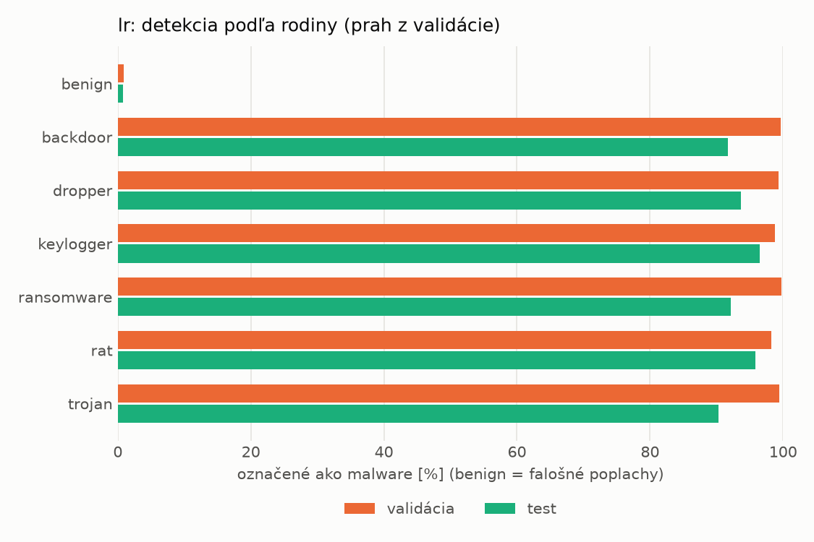
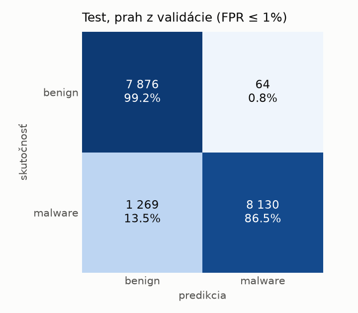
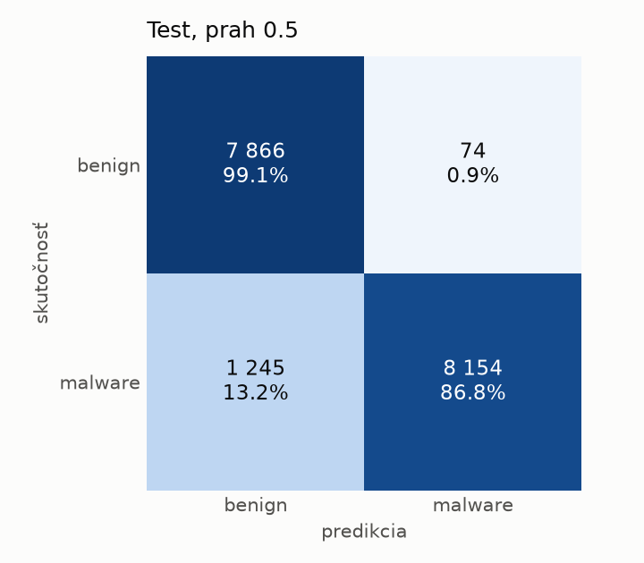

# hybrid/lr – beh `20261104-000855`

> Automaticky generované (`src/training/run_tabular.py`). Konfigurácia: `config.yaml`, protokol: `protocol.yaml`.

- **Model:** `logreg` – logistická regresia s L2 regularizáciou (vstup signed log1p + štandardizácia)
- **Ladenie:** bez ladenia – hyperparametre prevzaté z `runs_final/hybrid/lr/20261102-044357`
- **Finálne modely:** seedy [0, 1, 2]; hodnoty sú priemer ± smerodajná odchýlka cez seedy
- **Najlepšie hyperparametre:** `{"max_iter": 2000, "C": 0.0028355883180749405}`

## Detekčná kvalita (bez prahu)
| metrika | train (podvzorka) | validácia | test |
|---|---|---|---|
| ROC-AUC | 0.9998 ± 0.0000 | 0.9990 ± 0.0000 | 0.9930 ± 0.0000 |
| PR-AUC | 0.9999 ± 0.0000 | 0.9979 ± 0.0000 | 0.9939 ± 0.0000 |
| TPR pri FPR 1 % | 0.9982 ± 0.0000 | 0.9942 ± 0.0000 | 0.8815 ± 0.0000 |
| TPR pri FPR 0,1 % | 0.9675 ± 0.0000 | 0.9422 ± 0.0000 | 0.6058 ± 0.0000 |
| log loss | 0.0202 ± 0.0000 | 0.0293 ± 0.0000 | 0.1916 ± 0.0000 |
| Brier skóre | 0.0041 ± 0.0000 | 0.0064 ± 0.0000 | 0.0581 ± 0.0000 |

Rozdiel ROC-AUC train − validácia: **0.0008** (veľký rozdiel = preučenie).

## Pri prahu z validácie (FPR ≤ 1% na validácii)
| metrika | train (podvzorka) | validácia | test |
|---|---|---|---|
| accuracy | 0.9965 ± 0.0000 | 0.9929 ± 0.0000 | 0.9231 ± 0.0000 |
| balanced accuracy | 0.9965 ± 0.0000 | 0.9924 ± 0.0000 | 0.9285 ± 0.0000 |
| precision | 0.9979 ± 0.0000 | 0.9947 ± 0.0000 | 0.9922 ± 0.0000 |
| recall (TPR) | 0.9965 ± 0.0000 | 0.9942 ± 0.0000 | 0.8650 ± 0.0000 |
| FPR | 0.0035 ± 0.0000 | 0.0094 ± 0.0000 | 0.0081 ± 0.0000 |
| F1 | 0.9972 ± 0.0000 | 0.9945 ± 0.0000 | 0.9242 ± 0.0000 |
| MCC | 0.9925 ± 0.0000 | 0.9846 ± 0.0000 | 0.8552 ± 0.0000 |

## Pri pevnom prahu 0.5
| metrika | train (podvzorka) | validácia | test |
|---|---|---|---|
| accuracy | 0.9965 ± 0.0000 | 0.9925 ± 0.0000 | 0.9239 ± 0.0000 |
| balanced accuracy | 0.9964 ± 0.0000 | 0.9918 ± 0.0000 | 0.9291 ± 0.0000 |
| precision | 0.9978 ± 0.0000 | 0.9940 ± 0.0000 | 0.9910 ± 0.0000 |
| recall (TPR) | 0.9967 ± 0.0000 | 0.9942 ± 0.0000 | 0.8675 ± 0.0000 |
| FPR | 0.0038 ± 0.0000 | 0.0106 ± 0.0000 | 0.0093 ± 0.0000 |
| F1 | 0.9972 ± 0.0000 | 0.9941 ± 0.0000 | 0.9252 ± 0.0000 |
| MCC | 0.9925 ± 0.0000 | 0.9837 ± 0.0000 | 0.8563 ± 0.0000 |

## Výpočtové nároky (seed 0, testovacia množina)
| meranie | hodnota |
|---|---|
| tréning finálneho modelu | 4.9 s (priemer cez seedy) |
| ladenie spolu | 0 s |
| počet parametrov / uzlov | 4 320 |
| veľkosť modelu na disku | 0.13 MB |
| transformácia vstupu – latencia (1 vlákno) | 0.034 ms |
| transformácia vstupu – priepustnosť | 23 146 vzoriek/s |
| CPU latencia modelu (batch 1, 1 vlákno) | 0.008 ms (p95 0.008) |
| CPU priepustnosť (24 vlákien) | 159 833 vzoriek/s |

## Grafy
| | |
|---|---|
|  |  |
|  |  |
|  |  |
|  |  |

## Súbory
`metrics.json` (všetky metriky po seedoch vrátane rodín), `timing.json`, `hpo_trials.csv`,
`predictions/<časť>_seed<N>.parquet` (sha256, family, label, score), `model/seed_<N>/`, `log.txt`.
