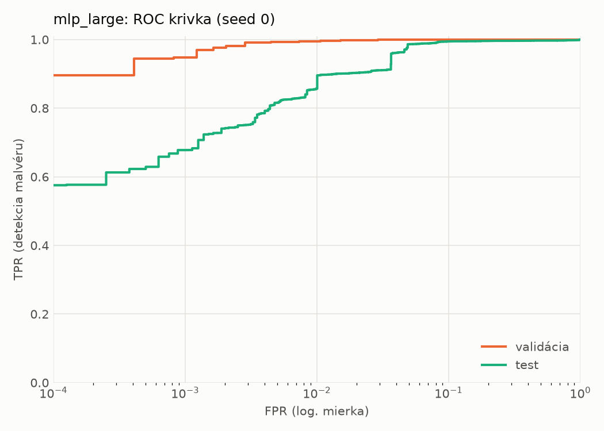
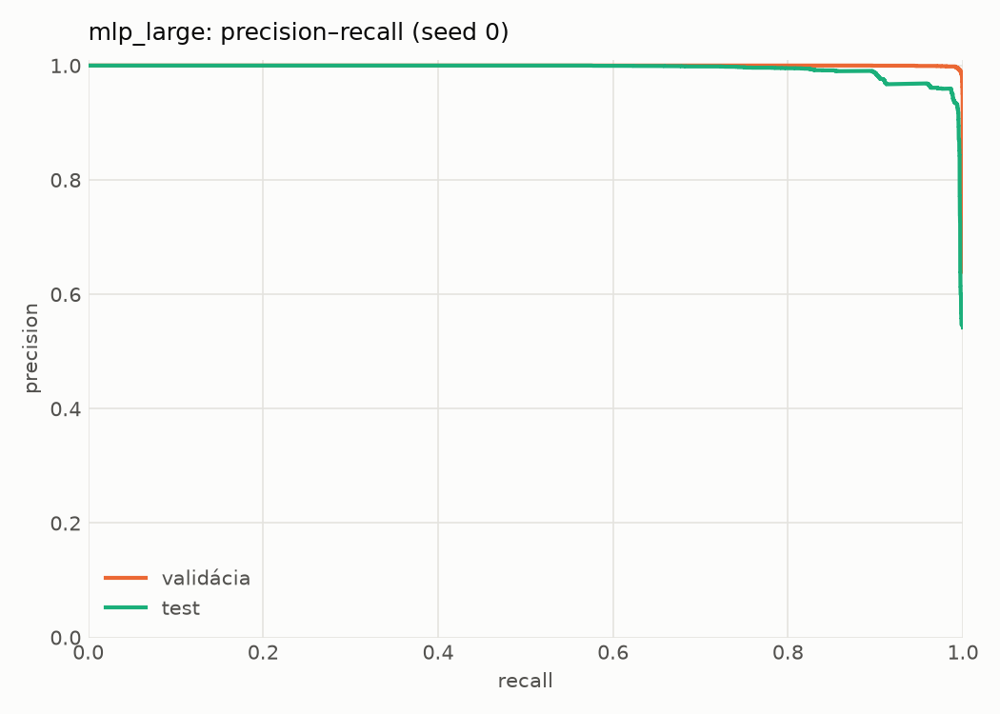
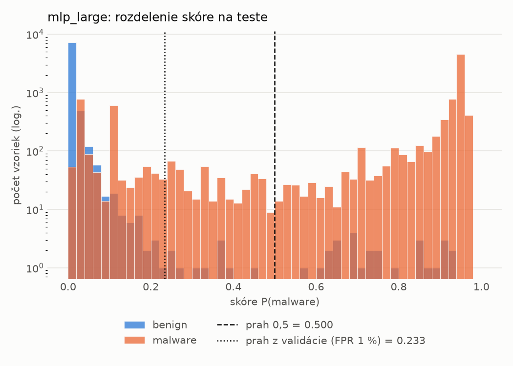
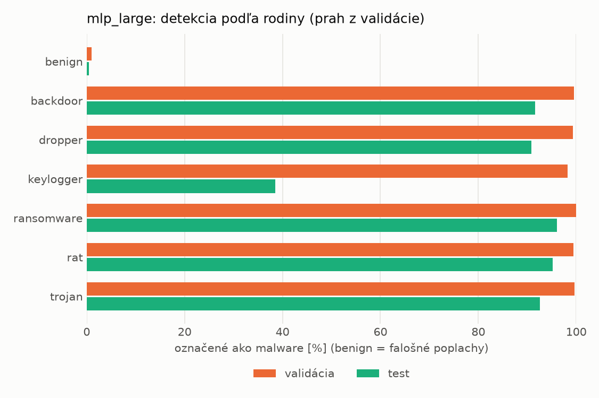
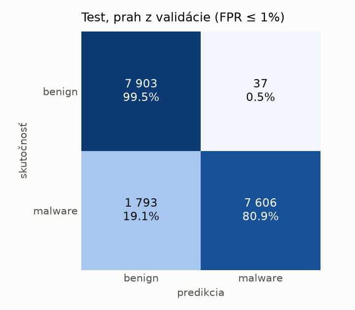
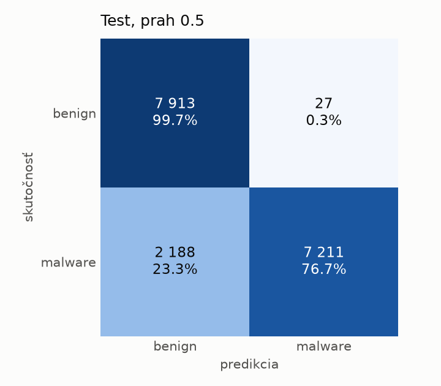
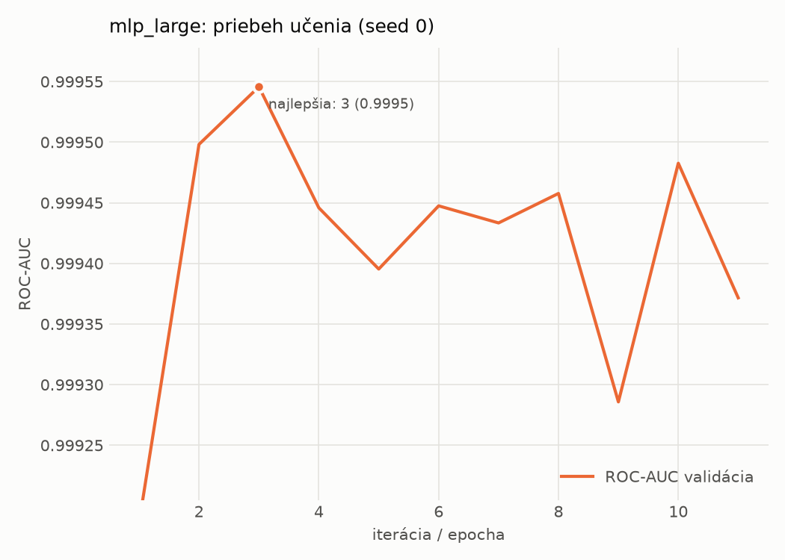

# hybrid/mlp_large – beh `20261104-001651`

> Automaticky generované (`src/training/run_tabular.py`). Konfigurácia: `config.yaml`, protokol: `protocol.yaml`.

- **Model:** `mlp` – veľká neurónová sieť (3–5 skrytých vrstiev, 512–2048 neurónov), kandidát na učiteľa
- **Ladenie:** bez ladenia – hyperparametre prevzaté z `runs_final/hybrid/mlp_large/20261102-064138`
- **Finálne modely:** seedy [0, 1, 2]; hodnoty sú priemer ± smerodajná odchýlka cez seedy
- **Najlepšie hyperparametre:** `{"max_epochs": 100, "patience": 8, "hidden_layers": 4, "hidden_width": 512, "width_decay": 0.5, "dropout": 0.1951820260605614, "lr": 0.000176468680848935, "weight_decay": 1.209699321025492e-05, "batch_size": 512}`

## Detekčná kvalita (bez prahu)
| metrika | train (podvzorka) | validácia | test |
|---|---|---|---|
| ROC-AUC | 0.9999 ± 0.0001 | 0.9995 ± 0.0000 | 0.9931 ± 0.0014 |
| PR-AUC | 1.0000 ± 0.0000 | 0.9998 ± 0.0000 | 0.9948 ± 0.0009 |
| TPR pri FPR 1 % | 0.9995 ± 0.0003 | 0.9961 ± 0.0011 | 0.8829 ± 0.0227 |
| TPR pri FPR 0,1 % | 0.9884 ± 0.0057 | 0.9674 ± 0.0189 | 0.7285 ± 0.0448 |
| log loss | 0.0283 ± 0.0163 | 0.0378 ± 0.0132 | 0.3089 ± 0.0431 |
| Brier skóre | 0.0031 ± 0.0016 | 0.0055 ± 0.0012 | 0.0806 ± 0.0206 |

Rozdiel ROC-AUC train − validácia: **0.0004** (veľký rozdiel = preučenie).

## Pri prahu z validácie (FPR ≤ 1% na validácii)
| metrika | train (podvzorka) | validácia | test |
|---|---|---|---|
| accuracy | 0.9972 ± 0.0014 | 0.9941 ± 0.0008 | 0.9200 ± 0.0222 |
| balanced accuracy | 0.9969 ± 0.0014 | 0.9933 ± 0.0007 | 0.9258 ± 0.0204 |
| precision | 0.9974 ± 0.0013 | 0.9946 ± 0.0003 | 0.9946 ± 0.0010 |
| recall (TPR) | 0.9981 ± 0.0016 | 0.9961 ± 0.0011 | 0.8571 ± 0.0416 |
| FPR | 0.0044 ± 0.0022 | 0.0096 ± 0.0005 | 0.0055 ± 0.0012 |
| F1 | 0.9978 ± 0.0011 | 0.9954 ± 0.0006 | 0.9204 ± 0.0241 |
| MCC | 0.9940 ± 0.0029 | 0.9872 ± 0.0017 | 0.8509 ± 0.0377 |

## Pri pevnom prahu 0.5
| metrika | train (podvzorka) | validácia | test |
|---|---|---|---|
| accuracy | 0.9973 ± 0.0010 | 0.9942 ± 0.0007 | 0.9068 ± 0.0301 |
| balanced accuracy | 0.9974 ± 0.0009 | 0.9941 ± 0.0004 | 0.9137 ± 0.0278 |
| precision | 0.9987 ± 0.0005 | 0.9966 ± 0.0003 | 0.9963 ± 0.0000 |
| recall (TPR) | 0.9970 ± 0.0013 | 0.9943 ± 0.0015 | 0.8311 ± 0.0558 |
| FPR | 0.0022 ± 0.0008 | 0.0060 ± 0.0006 | 0.0037 ± 0.0002 |
| F1 | 0.9978 ± 0.0008 | 0.9955 ± 0.0006 | 0.9055 ± 0.0338 |
| MCC | 0.9942 ± 0.0020 | 0.9874 ± 0.0016 | 0.8291 ± 0.0502 |

## Výpočtové nároky (seed 0, testovacia množina)
| meranie | hodnota |
|---|---|
| tréning finálneho modelu | 4.9 s (priemer cez seedy) |
| ladenie spolu | 0 s |
| počet parametrov / uzlov | 2 386 305 |
| veľkosť modelu na disku | 9.67 MB |
| transformácia vstupu – latencia (1 vlákno) | 0.062 ms |
| transformácia vstupu – priepustnosť | 22 629 vzoriek/s |
| CPU latencia modelu (batch 1, 1 vlákno) | 0.295 ms (p95 0.328) |
| CPU priepustnosť (24 vlákien) | 37 447 vzoriek/s |
| GPU latencia (batch 1) | 0.538 ms (p95 1.063) |
| GPU priepustnosť | 35 729 vzoriek/s |
| GPU špičková pamäť | 2710 MB |

## Grafy
| | |
|---|---|
|  |  |
|  |  |
|  |  |
|  |  |

## Súbory
`metrics.json` (všetky metriky po seedoch vrátane rodín), `timing.json`, `hpo_trials.csv`,
`predictions/<časť>_seed<N>.parquet` (sha256, family, label, score), `model/seed_<N>/`, `log.txt`.
