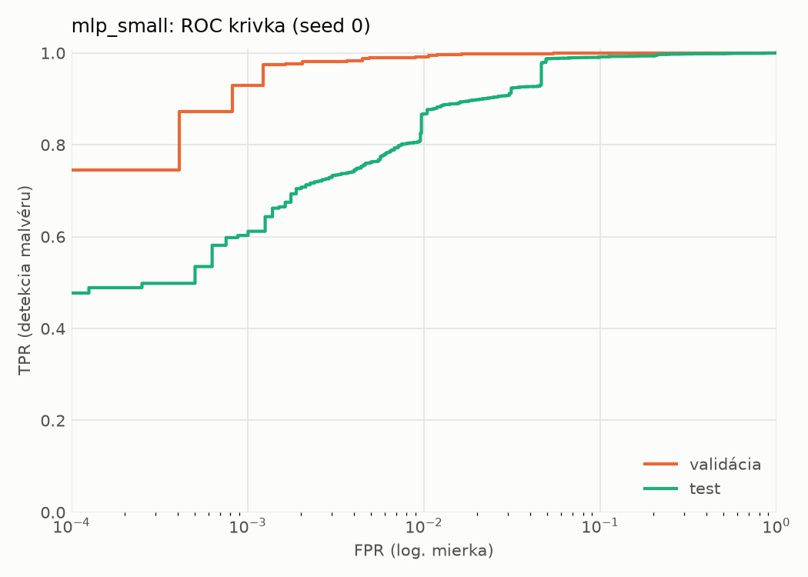
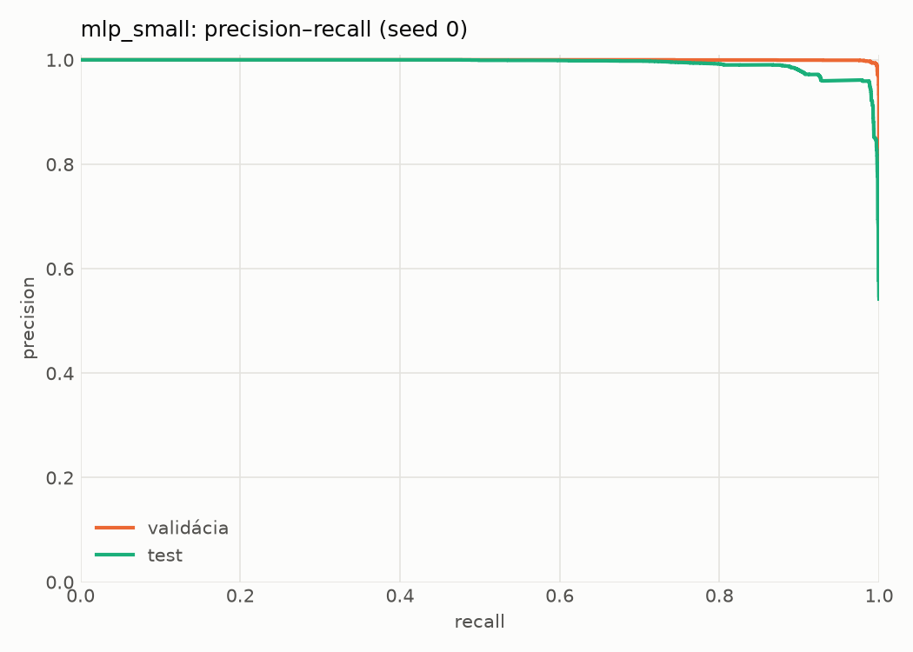
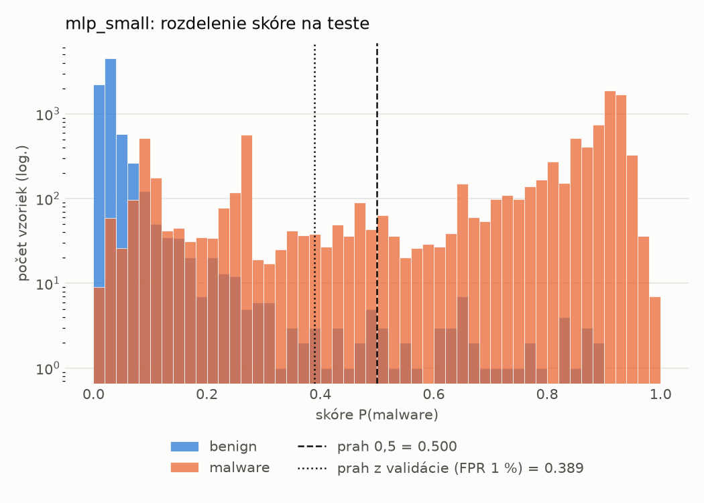
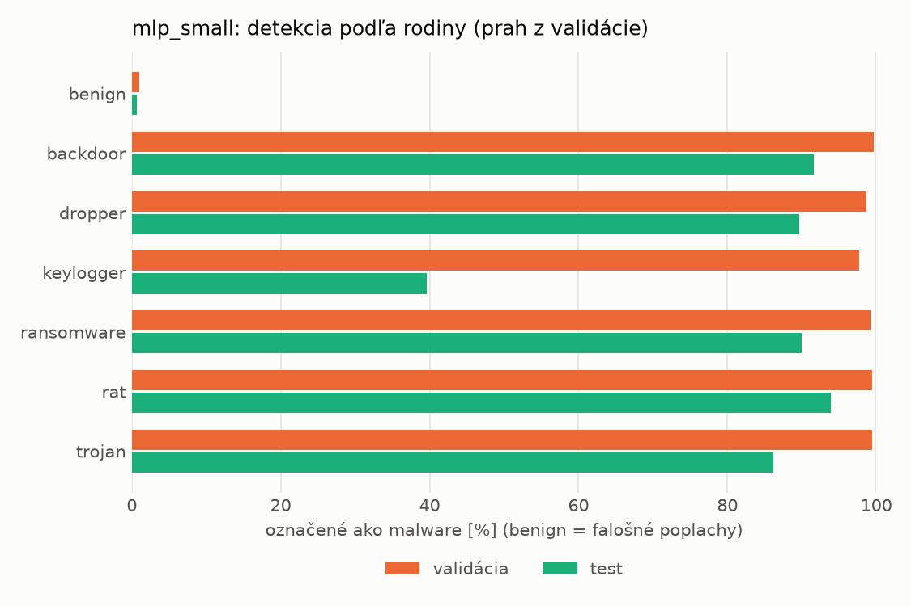
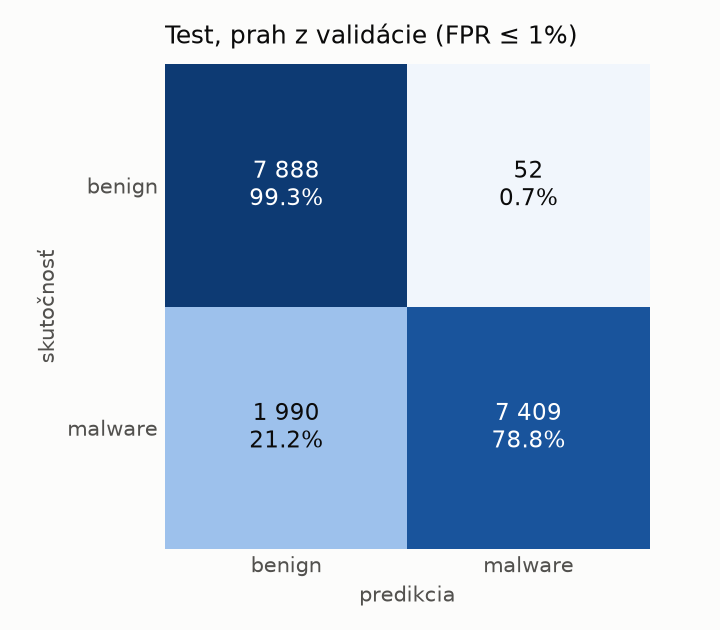
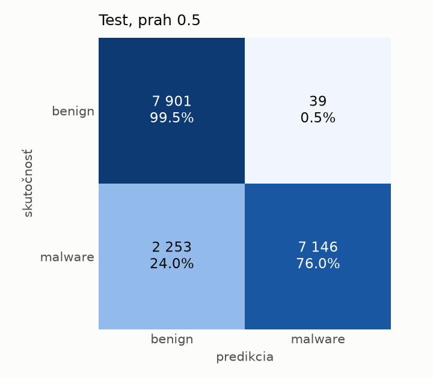
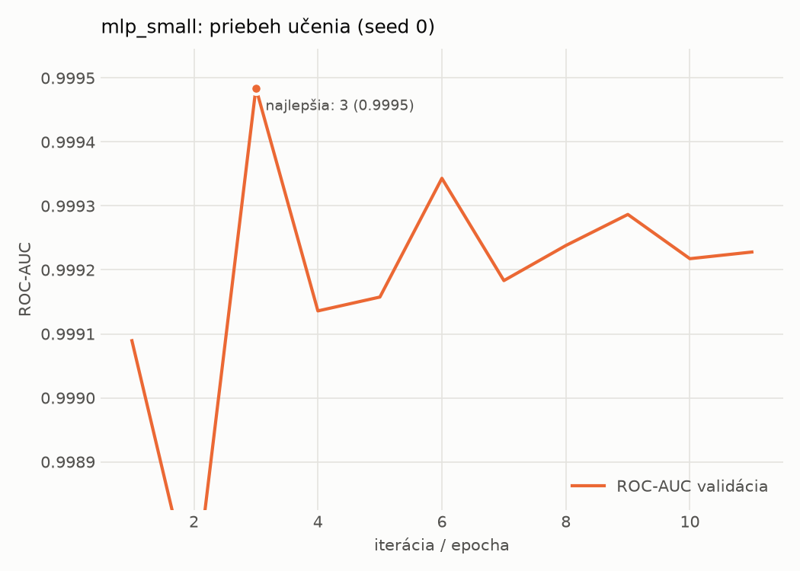

# hybrid/mlp_small – beh `20261104-001617`

> Automaticky generované (`src/training/run_tabular.py`). Konfigurácia: `config.yaml`, protokol: `protocol.yaml`.

- **Model:** `mlp` – malá neurónová sieť (1–2 skryté vrstvy), kandidát na ľahkého študenta
- **Ladenie:** bez ladenia – hyperparametre prevzaté z `runs_final/hybrid/mlp_small/20261102-063854`
- **Finálne modely:** seedy [0, 1, 2]; hodnoty sú priemer ± smerodajná odchýlka cez seedy
- **Najlepšie hyperparametre:** `{"width_decay": 0.5, "max_epochs": 100, "patience": 8, "hidden_layers": 2, "hidden_width": 32, "dropout": 0.16874195706419903, "lr": 0.0006143857735366936, "weight_decay": 0.007079811471617702, "batch_size": 512}`

## Detekčná kvalita (bez prahu)
| metrika | train (podvzorka) | validácia | test |
|---|---|---|---|
| ROC-AUC | 0.9999 ± 0.0001 | 0.9994 ± 0.0002 | 0.9930 ± 0.0012 |
| PR-AUC | 0.9999 ± 0.0001 | 0.9992 ± 0.0010 | 0.9942 ± 0.0009 |
| TPR pri FPR 1 % | 0.9991 ± 0.0008 | 0.9953 ± 0.0035 | 0.8799 ± 0.0114 |
| TPR pri FPR 0,1 % | 0.9892 ± 0.0088 | 0.9660 ± 0.0316 | 0.6388 ± 0.0315 |
| log loss | 0.0301 ± 0.0372 | 0.0396 ± 0.0341 | 0.2570 ± 0.0445 |
| Brier skóre | 0.0040 ± 0.0044 | 0.0066 ± 0.0036 | 0.0766 ± 0.0171 |

Rozdiel ROC-AUC train − validácia: **0.0004** (veľký rozdiel = preučenie).

## Pri prahu z validácie (FPR ≤ 1% na validácii)
| metrika | train (podvzorka) | validácia | test |
|---|---|---|---|
| accuracy | 0.9970 ± 0.0031 | 0.9935 ± 0.0023 | 0.9093 ± 0.0237 |
| balanced accuracy | 0.9970 ± 0.0030 | 0.9928 ± 0.0018 | 0.9158 ± 0.0219 |
| precision | 0.9981 ± 0.0016 | 0.9945 ± 0.0001 | 0.9932 ± 0.0003 |
| recall (TPR) | 0.9971 ± 0.0035 | 0.9953 ± 0.0035 | 0.8384 ± 0.0439 |
| FPR | 0.0031 ± 0.0026 | 0.0097 ± 0.0002 | 0.0068 ± 0.0003 |
| F1 | 0.9976 ± 0.0025 | 0.9949 ± 0.0018 | 0.9089 ± 0.0262 |
| MCC | 0.9937 ± 0.0067 | 0.9859 ± 0.0050 | 0.8322 ± 0.0399 |

## Pri pevnom prahu 0.5
| metrika | train (podvzorka) | validácia | test |
|---|---|---|---|
| accuracy | 0.9967 ± 0.0032 | 0.9936 ± 0.0022 | 0.8963 ± 0.0286 |
| balanced accuracy | 0.9969 ± 0.0029 | 0.9932 ± 0.0015 | 0.9040 ± 0.0264 |
| precision | 0.9985 ± 0.0011 | 0.9954 ± 0.0007 | 0.9942 ± 0.0003 |
| recall (TPR) | 0.9962 ± 0.0041 | 0.9946 ± 0.0039 | 0.8135 ± 0.0533 |
| FPR | 0.0025 ± 0.0018 | 0.0082 ± 0.0012 | 0.0056 ± 0.0006 |
| F1 | 0.9974 ± 0.0026 | 0.9950 ± 0.0017 | 0.8942 ± 0.0322 |
| MCC | 0.9930 ± 0.0068 | 0.9861 ± 0.0046 | 0.8109 ± 0.0476 |

## Výpočtové nároky (seed 0, testovacia množina)
| meranie | hodnota |
|---|---|
| tréning finálneho modelu | 5.2 s (priemer cez seedy) |
| ladenie spolu | 0 s |
| počet parametrov / uzlov | 138 881 |
| veľkosť modelu na disku | 0.67 MB |
| transformácia vstupu – latencia (1 vlákno) | 0.062 ms |
| transformácia vstupu – priepustnosť | 21 811 vzoriek/s |
| CPU latencia modelu (batch 1, 1 vlákno) | 0.102 ms (p95 0.117) |
| CPU priepustnosť (24 vlákien) | 46 335 vzoriek/s |
| GPU latencia (batch 1) | 0.424 ms (p95 0.467) |
| GPU priepustnosť | 27 621 vzoriek/s |
| GPU špičková pamäť | 1490 MB |

## Grafy
| | |
|---|---|
|  |  |
|  |  |
|  |  |
|  |  |

## Súbory
`metrics.json` (všetky metriky po seedoch vrátane rodín), `timing.json`, `hpo_trials.csv`,
`predictions/<časť>_seed<N>.parquet` (sha256, family, label, score), `model/seed_<N>/`, `log.txt`.
