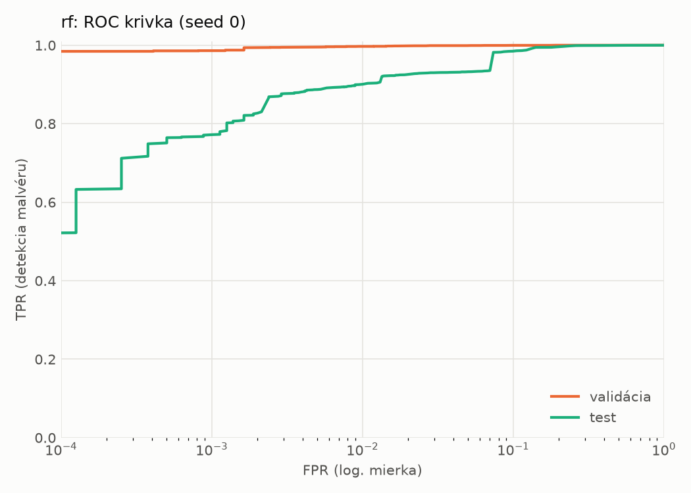
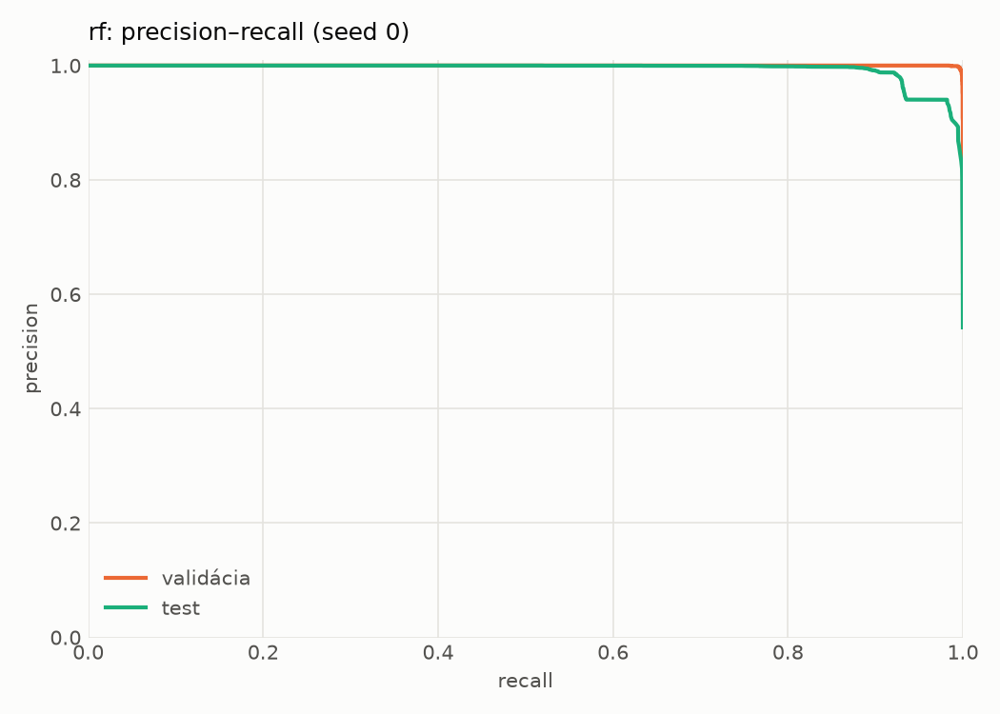
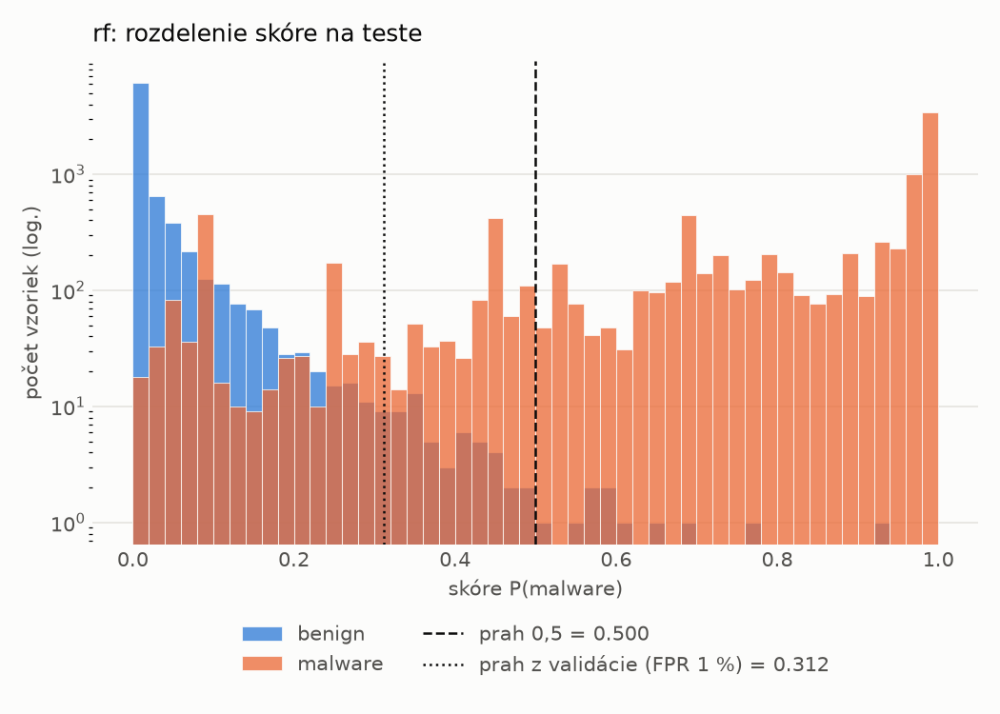
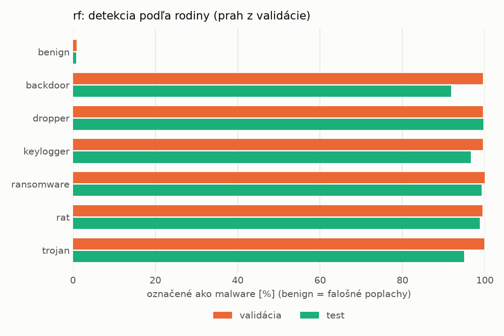
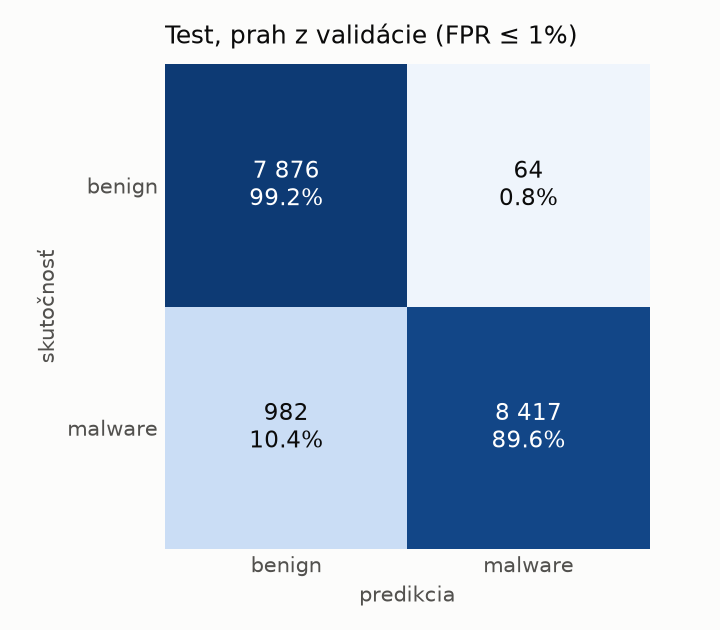
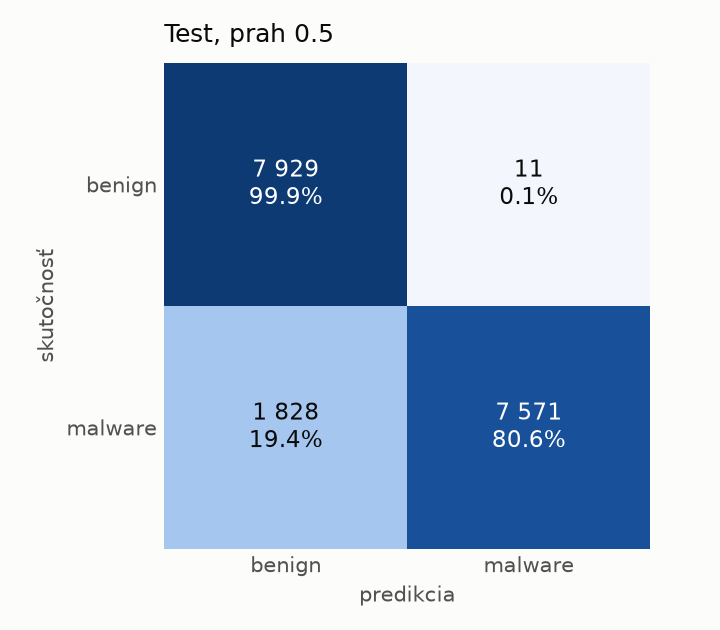

# hybrid/rf – beh `20261104-000926`

> Automaticky generované (`src/training/run_tabular.py`). Konfigurácia: `config.yaml`, protokol: `protocol.yaml`.

- **Model:** `random_forest` – Random Forest (pôvodné hodnoty príznakov)
- **Ladenie:** bez ladenia – hyperparametre prevzaté z `runs_final/hybrid/rf/20261102-044751`
- **Finálne modely:** seedy [0, 1, 2]; hodnoty sú priemer ± smerodajná odchýlka cez seedy
- **Najlepšie hyperparametre:** `{"n_estimators": 250, "max_depth": null, "min_samples_leaf": 1, "max_features": 0.05}`

## Detekčná kvalita (bez prahu)
| metrika | train (podvzorka) | validácia | test |
|---|---|---|---|
| ROC-AUC | 1.0000 ± 0.0000 | 0.9998 ± 0.0000 | 0.9923 ± 0.0006 |
| PR-AUC | 1.0000 ± 0.0000 | 0.9999 ± 0.0000 | 0.9936 ± 0.0005 |
| TPR pri FPR 1 % | 1.0000 ± 0.0000 | 0.9972 ± 0.0001 | 0.9001 ± 0.0006 |
| TPR pri FPR 0,1 % | 1.0000 ± 0.0000 | 0.9868 ± 0.0008 | 0.7678 ± 0.0028 |
| log loss | 0.0052 ± 0.0001 | 0.0189 ± 0.0000 | 0.2379 ± 0.0043 |
| Brier skóre | 0.0006 ± 0.0000 | 0.0043 ± 0.0000 | 0.0742 ± 0.0012 |

Rozdiel ROC-AUC train − validácia: **0.0002** (veľký rozdiel = preučenie).

## Pri prahu z validácie (FPR ≤ 1% na validácii)
| metrika | train (podvzorka) | validácia | test |
|---|---|---|---|
| accuracy | 1.0000 ± 0.0000 | 0.9947 ± 0.0000 | 0.9407 ± 0.0010 |
| balanced accuracy | 1.0000 ± 0.0000 | 0.9937 ± 0.0001 | 0.9446 ± 0.0008 |
| precision | 1.0000 ± 0.0000 | 0.9945 ± 0.0001 | 0.9917 ± 0.0011 |
| recall (TPR) | 1.0000 ± 0.0000 | 0.9972 ± 0.0001 | 0.8981 ± 0.0027 |
| FPR | 0.0000 ± 0.0000 | 0.0097 ± 0.0002 | 0.0089 ± 0.0012 |
| F1 | 1.0000 ± 0.0000 | 0.9958 ± 0.0000 | 0.9426 ± 0.0011 |
| MCC | 1.0000 ± 0.0000 | 0.9885 ± 0.0000 | 0.8862 ± 0.0016 |

## Pri pevnom prahu 0.5
| metrika | train (podvzorka) | validácia | test |
|---|---|---|---|
| accuracy | 1.0000 ± 0.0000 | 0.9954 ± 0.0001 | 0.8923 ± 0.0047 |
| balanced accuracy | 1.0000 ± 0.0000 | 0.9958 ± 0.0002 | 0.9005 ± 0.0043 |
| precision | 1.0000 ± 0.0000 | 0.9985 ± 0.0003 | 0.9985 ± 0.0001 |
| recall (TPR) | 1.0000 ± 0.0000 | 0.9943 ± 0.0001 | 0.8025 ± 0.0088 |
| FPR | 0.0000 ± 0.0000 | 0.0027 ± 0.0005 | 0.0015 ± 0.0001 |
| F1 | 1.0000 ± 0.0000 | 0.9964 ± 0.0001 | 0.8898 ± 0.0054 |
| MCC | 1.0000 ± 0.0000 | 0.9900 ± 0.0002 | 0.8049 ± 0.0077 |

## Výpočtové nároky (seed 0, testovacia množina)
| meranie | hodnota |
|---|---|
| tréning finálneho modelu | 115.8 s (priemer cez seedy) |
| ladenie spolu | 0 s |
| počet parametrov / uzlov | 248 438 |
| veľkosť modelu na disku | 20.22 MB |
| CPU latencia modelu (batch 1, 1 vlákno) | 7.200 ms (p95 7.426) |
| CPU priepustnosť (24 vlákien) | 110 832 vzoriek/s |

## Grafy
| | |
|---|---|
|  |  |
|  |  |
|  |  |
|  |  |

## Súbory
`metrics.json` (všetky metriky po seedoch vrátane rodín), `timing.json`, `hpo_trials.csv`,
`predictions/<časť>_seed<N>.parquet` (sha256, family, label, score), `model/seed_<N>/`, `log.txt`.
