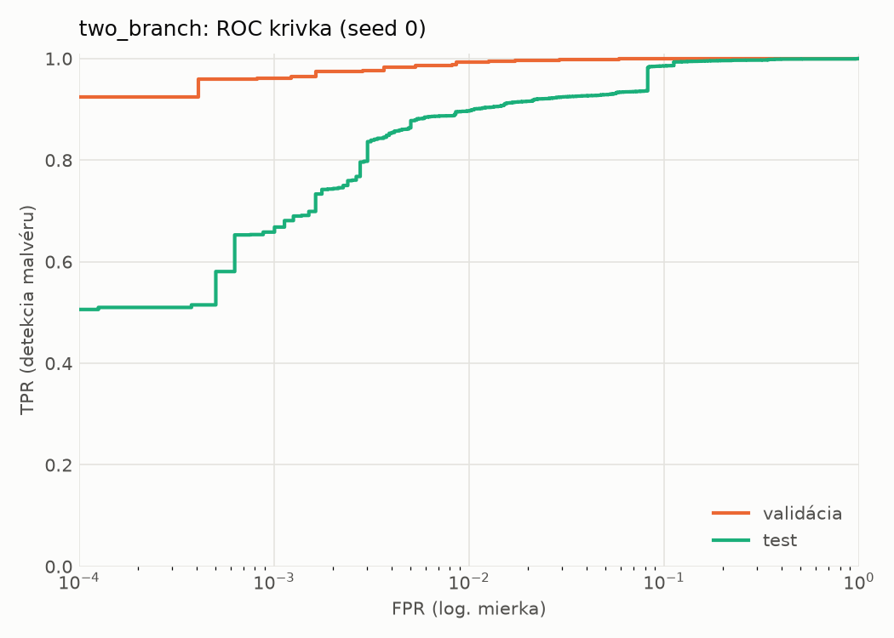
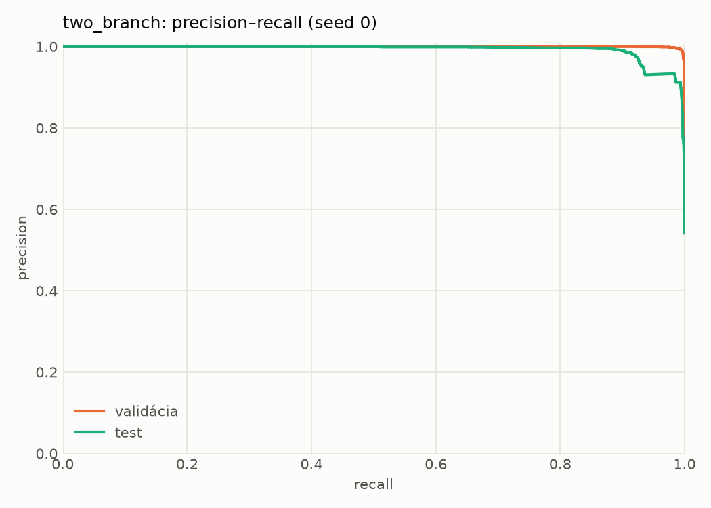
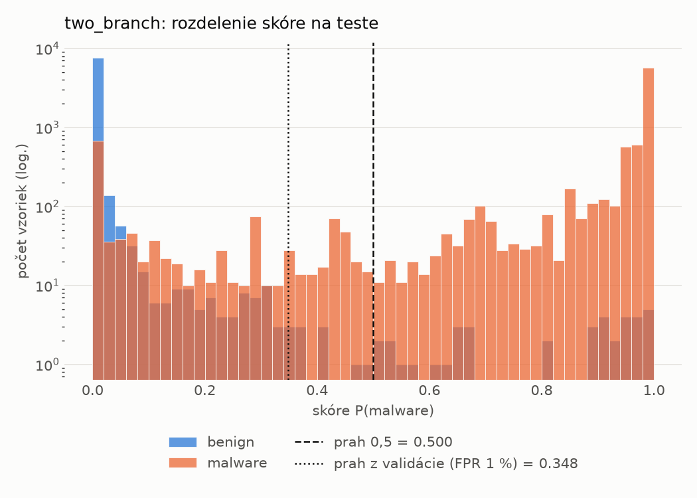
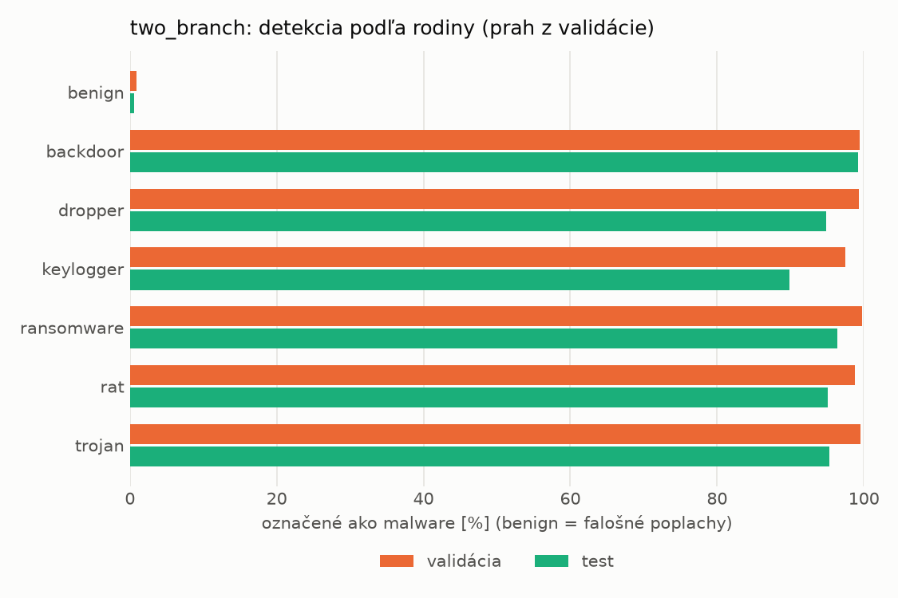
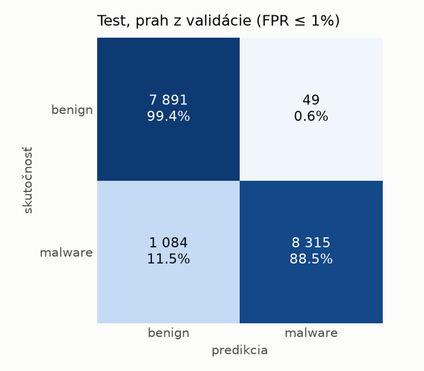
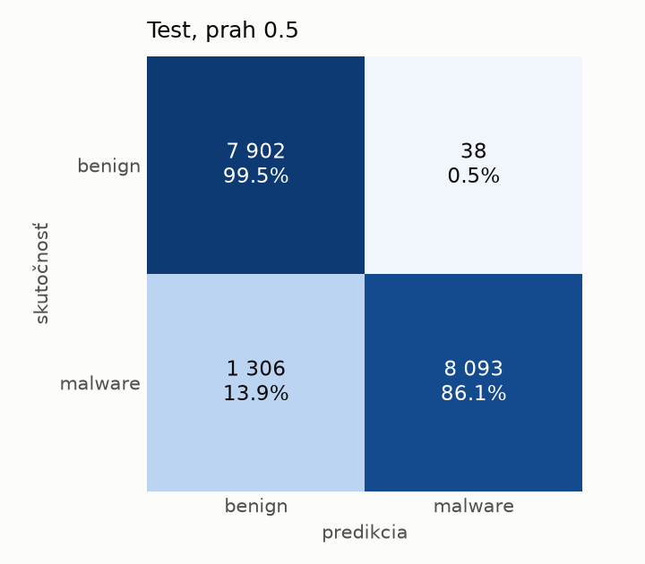
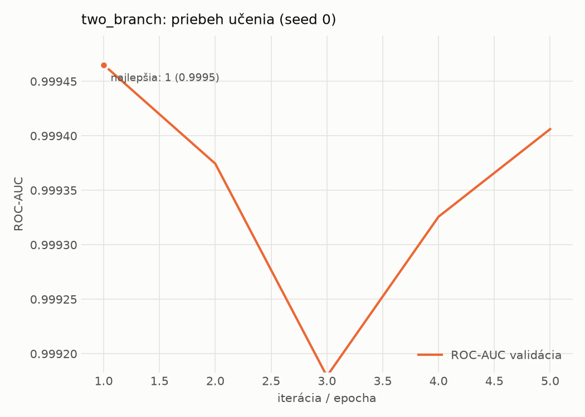

# hybrid_seq/two_branch – beh `20261104-001725`

> Automaticky generované (`src/training/run_tabular.py`). Konfigurácia: `config.yaml`, protokol: `protocol.yaml`.

- **Model:** `two_branch` – statická MLP vetva + sekvenčná CNN vetva nad API volaniami, spojené v spoločnej hlave
- **Ladenie:** bez ladenia – hyperparametre prevzaté z `runs_final/hybrid/two_branch/20261102-170657`
- **Finálne modely:** seedy [0, 1, 2]; hodnoty sú priemer ± smerodajná odchýlka cez seedy
- **Najlepšie hyperparametre:** `{"n_static": 2381, "width_decay": 0.5, "max_epochs": 30, "patience": 4, "static_layers": 3, "static_width": 256, "emb_dim": 64, "channels": 256, "kernels": "2-4-8", "hidden": 512, "dropout": 0.32477392485404594, "lr": 0.0006728393356648638, "weight_decay": 0.0003230215070317658, "batch_size": 256}`

## Detekčná kvalita (bez prahu)
| metrika | train (podvzorka) | validácia | test |
|---|---|---|---|
| ROC-AUC | 0.9998 ± 0.0004 | 0.9995 ± 0.0000 | 0.9939 ± 0.0026 |
| PR-AUC | 0.9998 ± 0.0003 | 0.9998 ± 0.0000 | 0.9948 ± 0.0018 |
| TPR pri FPR 1 % | 0.9984 ± 0.0023 | 0.9957 ± 0.0023 | 0.9058 ± 0.0084 |
| TPR pri FPR 0,1 % | 0.9845 ± 0.0164 | 0.9720 ± 0.0087 | 0.7186 ± 0.0576 |
| log loss | 0.0119 ± 0.0105 | 0.0239 ± 0.0035 | 0.2595 ± 0.0626 |
| Brier skóre | 0.0031 ± 0.0028 | 0.0056 ± 0.0018 | 0.0570 ± 0.0080 |

Rozdiel ROC-AUC train − validácia: **0.0003** (veľký rozdiel = preučenie).

## Pri prahu z validácie (FPR ≤ 1% na validácii)
| metrika | train (podvzorka) | validácia | test |
|---|---|---|---|
| accuracy | 0.9968 ± 0.0026 | 0.9940 ± 0.0016 | 0.9409 ± 0.0057 |
| balanced accuracy | 0.9966 ± 0.0028 | 0.9934 ± 0.0014 | 0.9450 ± 0.0053 |
| precision | 0.9974 ± 0.0020 | 0.9950 ± 0.0003 | 0.9942 ± 0.0005 |
| recall (TPR) | 0.9976 ± 0.0022 | 0.9957 ± 0.0023 | 0.8962 ± 0.0104 |
| FPR | 0.0044 ± 0.0034 | 0.0089 ± 0.0005 | 0.0062 ± 0.0005 |
| F1 | 0.9975 ± 0.0021 | 0.9953 ± 0.0013 | 0.9427 ± 0.0059 |
| MCC | 0.9932 ± 0.0056 | 0.9871 ± 0.0035 | 0.8872 ± 0.0103 |

## Pri pevnom prahu 0.5
| metrika | train (podvzorka) | validácia | test |
|---|---|---|---|
| accuracy | 0.9959 ± 0.0044 | 0.9930 ± 0.0034 | 0.9363 ± 0.0119 |
| balanced accuracy | 0.9960 ± 0.0039 | 0.9929 ± 0.0027 | 0.9408 ± 0.0109 |
| precision | 0.9980 ± 0.0013 | 0.9959 ± 0.0014 | 0.9945 ± 0.0013 |
| recall (TPR) | 0.9954 ± 0.0058 | 0.9931 ± 0.0055 | 0.8874 ± 0.0228 |
| FPR | 0.0033 ± 0.0022 | 0.0072 ± 0.0025 | 0.0058 ± 0.0015 |
| F1 | 0.9967 ± 0.0035 | 0.9945 ± 0.0027 | 0.9378 ± 0.0125 |
| MCC | 0.9912 ± 0.0093 | 0.9848 ± 0.0073 | 0.8790 ± 0.0209 |

## Výpočtové nároky (seed 0, testovacia množina)
| meranie | hodnota |
|---|---|
| tréning finálneho modelu | 348.1 s (priemer cez seedy) |
| ladenie spolu | 0 s |
| počet parametrov / uzlov | 1 756 994 |
| veľkosť modelu na disku | 7.10 MB |
| CPU latencia modelu (batch 1, 1 vlákno) | 5.260 ms (p95 5.483) |
| CPU priepustnosť (24 vlákien) | 659 vzoriek/s |
| GPU latencia (batch 1) | 1.232 ms (p95 2.834) |
| GPU priepustnosť | 4 357 vzoriek/s |
| GPU špičková pamäť | 3817 MB |

## Grafy
| | |
|---|---|
|  |  |
|  |  |
|  |  |
|  |  |

## Súbory
`metrics.json` (všetky metriky po seedoch vrátane rodín), `timing.json`, `hpo_trials.csv`,
`predictions/<časť>_seed<N>.parquet` (sha256, family, label, score), `model/seed_<N>/`, `log.txt`.
