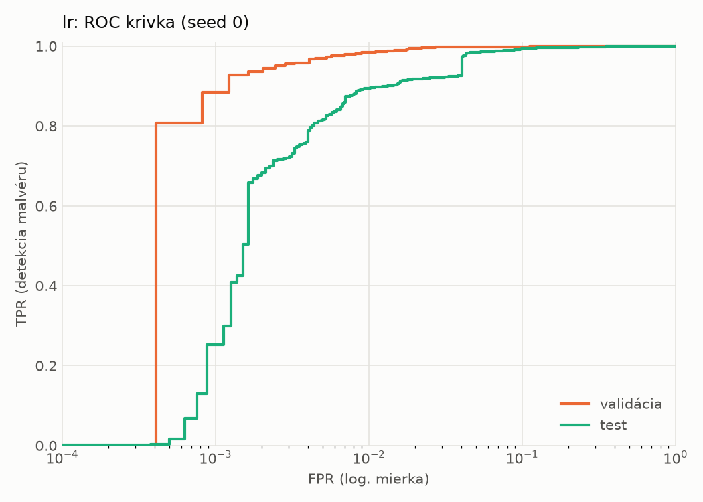
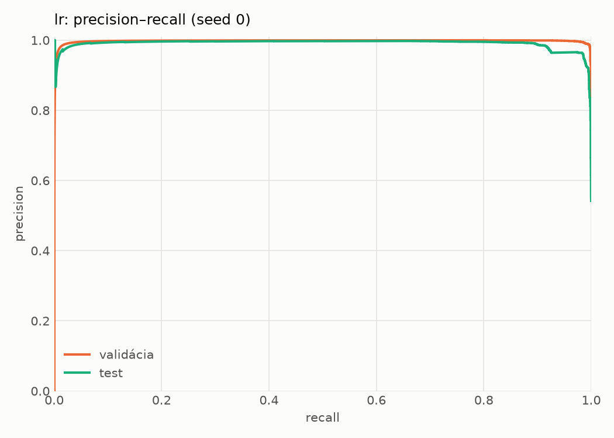
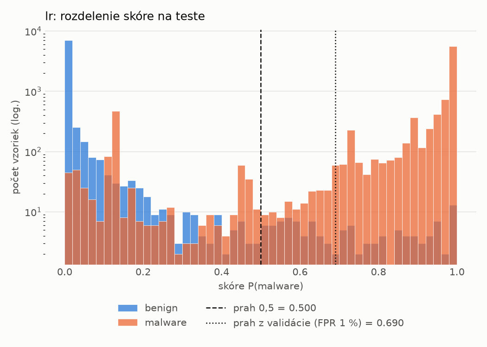
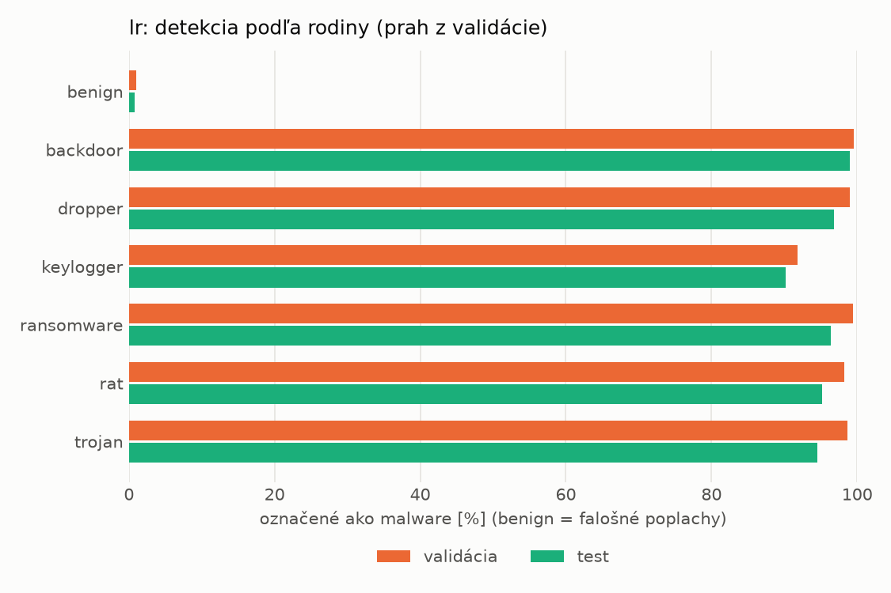
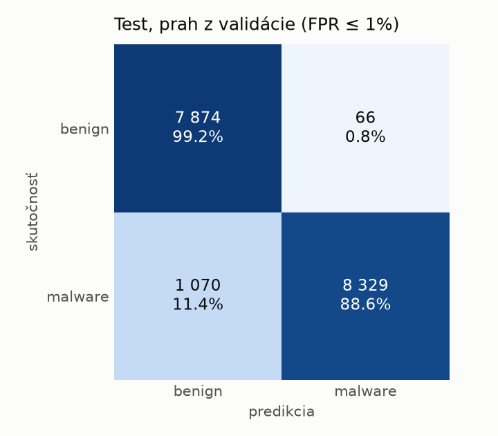
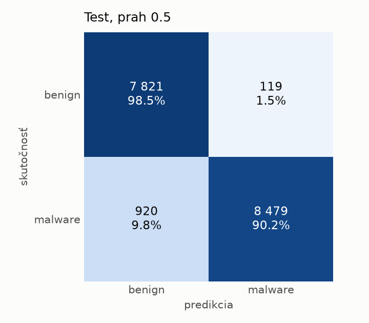

# static/lr – beh `20261103-232724`

> Automaticky generované (`src/training/run_tabular.py`). Konfigurácia: `config.yaml`, protokol: `protocol.yaml`.

- **Model:** `logreg` – logistická regresia s L2 regularizáciou (vstup signed log1p + štandardizácia)
- **Ladenie:** bez ladenia – hyperparametre prevzaté z `runs_final/static/lr/20261101-213555`
- **Finálne modely:** seedy [0, 1, 2]; hodnoty sú priemer ± smerodajná odchýlka cez seedy
- **Najlepšie hyperparametre:** `{"max_iter": 2000, "C": 0.00515917154582608}`

## Detekčná kvalita (bez prahu)
| metrika | train (podvzorka) | validácia | test |
|---|---|---|---|
| ROC-AUC | 0.9997 ± 0.0000 | 0.9986 ± 0.0000 | 0.9928 ± 0.0000 |
| PR-AUC | 0.9998 ± 0.0000 | 0.9978 ± 0.0000 | 0.9911 ± 0.0000 |
| TPR pri FPR 1 % | 0.9978 ± 0.0000 | 0.9850 ± 0.0000 | 0.8949 ± 0.0000 |
| TPR pri FPR 0,1 % | 0.9649 ± 0.0000 | 0.8833 ± 0.0000 | 0.2524 ± 0.0000 |
| log loss | 0.0244 ± 0.0000 | 0.0380 ± 0.0000 | 0.1601 ± 0.0000 |
| Brier skóre | 0.0051 ± 0.0000 | 0.0088 ± 0.0000 | 0.0468 ± 0.0000 |

Rozdiel ROC-AUC train − validácia: **0.0010** (veľký rozdiel = preučenie).

## Pri prahu z validácie (FPR ≤ 1% na validácii)
| metrika | train (podvzorka) | validácia | test |
|---|---|---|---|
| accuracy | 0.9904 ± 0.0000 | 0.9869 ± 0.0000 | 0.9345 ± 0.0000 |
| balanced accuracy | 0.9919 ± 0.0000 | 0.9876 ± 0.0000 | 0.9389 ± 0.0000 |
| precision | 0.9987 ± 0.0000 | 0.9944 ± 0.0000 | 0.9921 ± 0.0000 |
| recall (TPR) | 0.9860 ± 0.0000 | 0.9850 ± 0.0000 | 0.8862 ± 0.0000 |
| FPR | 0.0021 ± 0.0000 | 0.0098 ± 0.0000 | 0.0083 ± 0.0000 |
| F1 | 0.9923 ± 0.0000 | 0.9897 ± 0.0000 | 0.9362 ± 0.0000 |
| MCC | 0.9797 ± 0.0000 | 0.9717 ± 0.0000 | 0.8752 ± 0.0000 |

## Pri pevnom prahu 0.5
| metrika | train (podvzorka) | validácia | test |
|---|---|---|---|
| accuracy | 0.9939 ± 0.0000 | 0.9873 ± 0.0000 | 0.9401 ± 0.0000 |
| balanced accuracy | 0.9945 ± 0.0000 | 0.9866 ± 0.0000 | 0.9436 ± 0.0000 |
| precision | 0.9981 ± 0.0000 | 0.9910 ± 0.0000 | 0.9862 ± 0.0000 |
| recall (TPR) | 0.9922 ± 0.0000 | 0.9891 ± 0.0000 | 0.9021 ± 0.0000 |
| FPR | 0.0032 ± 0.0000 | 0.0160 ± 0.0000 | 0.0150 ± 0.0000 |
| F1 | 0.9951 ± 0.0000 | 0.9901 ± 0.0000 | 0.9423 ± 0.0000 |
| MCC | 0.9870 ± 0.0000 | 0.9725 ± 0.0000 | 0.8840 ± 0.0000 |

## Výpočtové nároky (seed 0, testovacia množina)
| meranie | hodnota |
|---|---|
| tréning finálneho modelu | 1.8 s (priemer cez seedy) |
| ladenie spolu | 0 s |
| počet parametrov / uzlov | 2 320 |
| veľkosť modelu na disku | 0.07 MB |
| transformácia vstupu – latencia (1 vlákno) | 0.021 ms |
| transformácia vstupu – priepustnosť | 43 288 vzoriek/s |
| CPU latencia modelu (batch 1, 1 vlákno) | 0.006 ms (p95 0.006) |
| CPU priepustnosť (24 vlákien) | 286 236 vzoriek/s |

## Grafy
| | |
|---|---|
|  |  |
|  |  |
|  |  |
|  |  |

## Súbory
`metrics.json` (všetky metriky po seedoch vrátane rodín), `timing.json`, `hpo_trials.csv`,
`predictions/<časť>_seed<N>.parquet` (sha256, family, label, score), `model/seed_<N>/`, `log.txt`.
