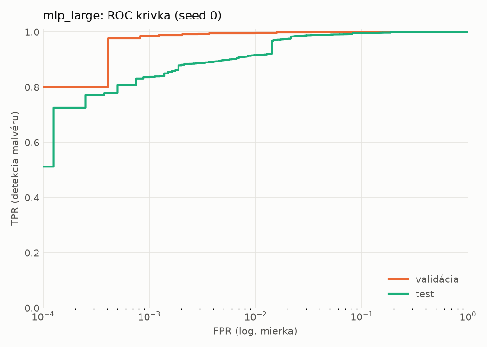
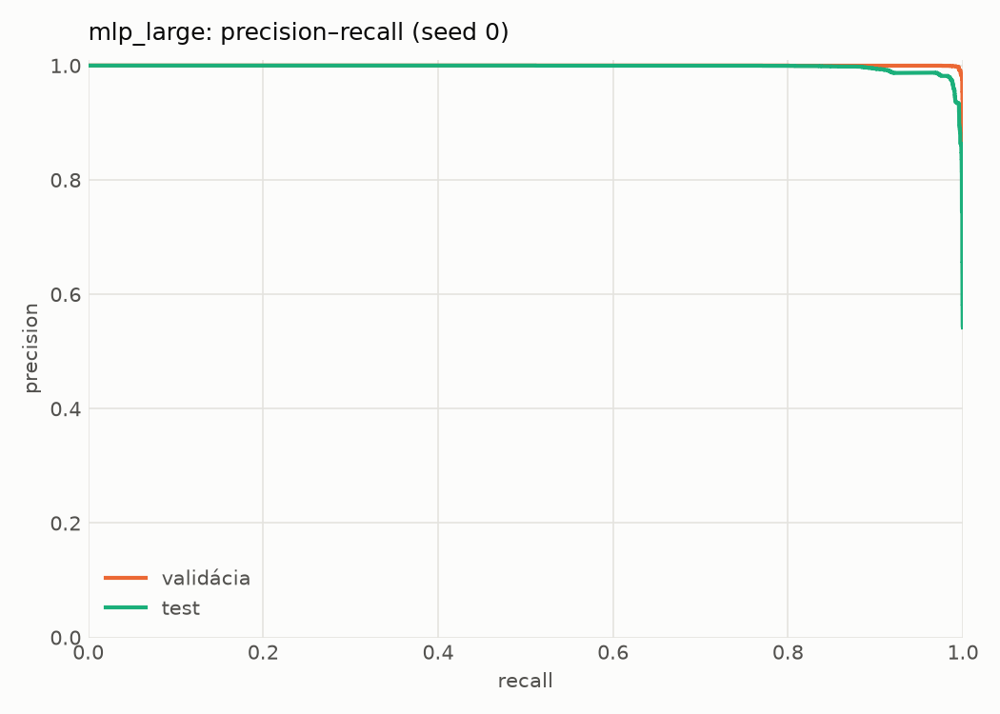
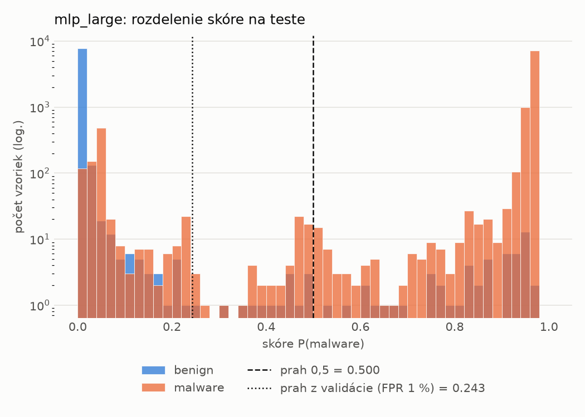
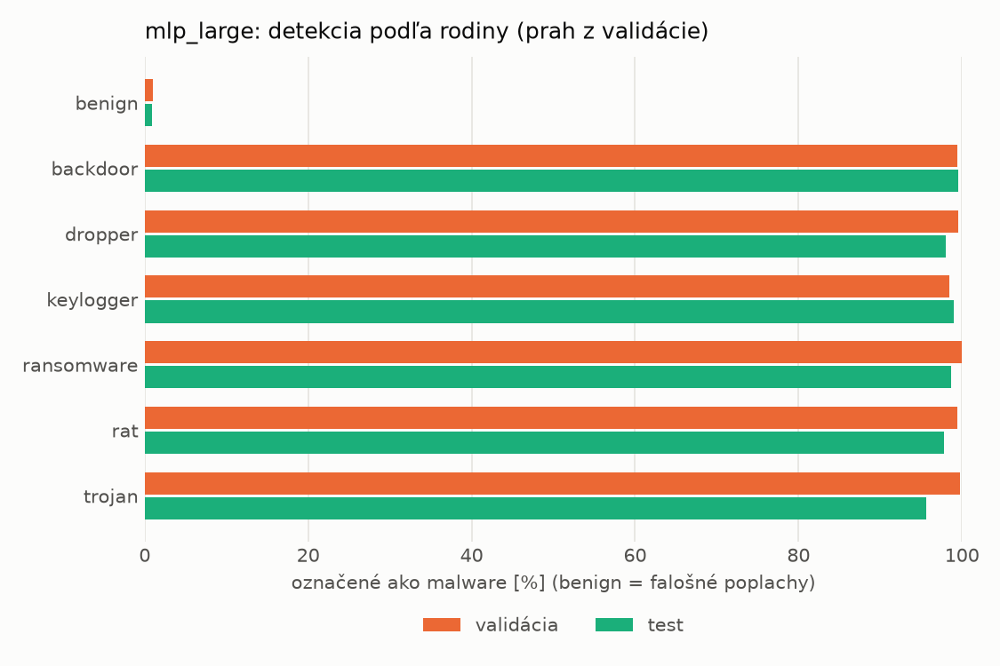
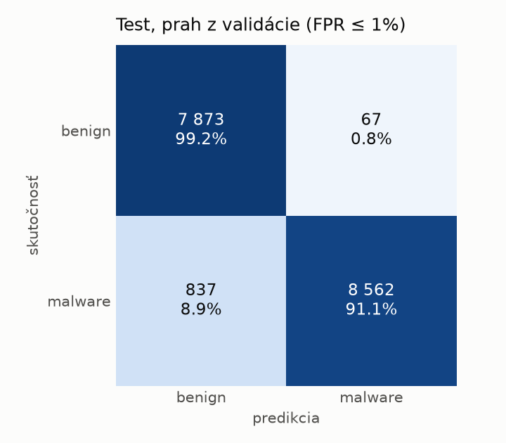
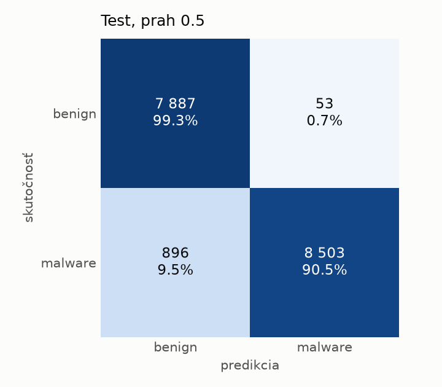
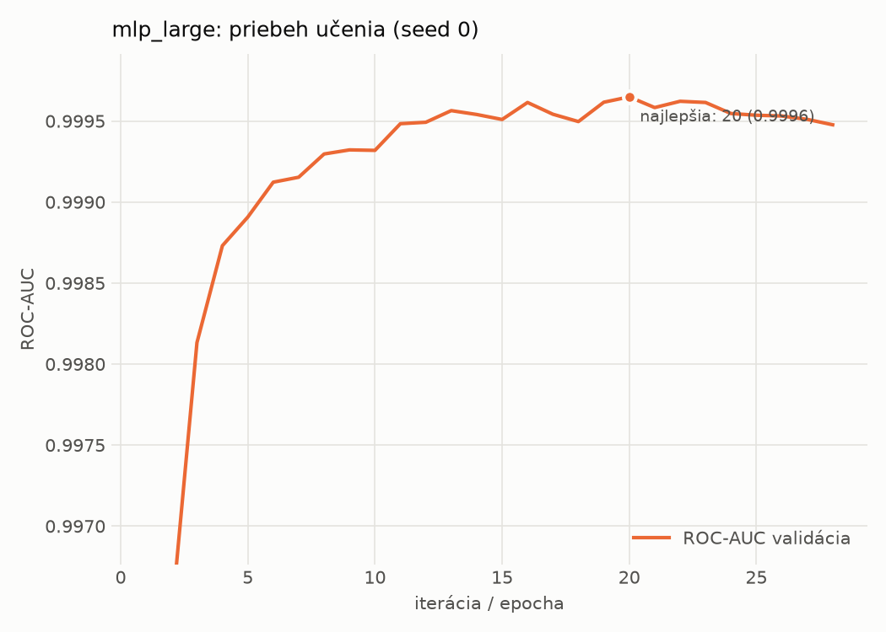

# static/mlp_large – beh `20261103-234240`

> Automaticky generované (`src/training/run_tabular.py`). Konfigurácia: `config.yaml`, protokol: `protocol.yaml`.

- **Model:** `mlp` – veľká neurónová sieť (3–5 skrytých vrstiev, 512–2048 neurónov), kandidát na učiteľa
- **Ladenie:** bez ladenia – hyperparametre prevzaté z `runs_final/static/mlp_large/20261101-235239`
- **Finálne modely:** seedy [0, 1, 2]; hodnoty sú priemer ± smerodajná odchýlka cez seedy
- **Najlepšie hyperparametre:** `{"max_epochs": 100, "patience": 8, "hidden_layers": 5, "hidden_width": 512, "width_decay": 0.5, "dropout": 0.4556986332296347, "lr": 0.00015070674125138616, "weight_decay": 0.0036646034219705954, "batch_size": 1024}`

## Detekčná kvalita (bez prahu)
| metrika | train (podvzorka) | validácia | test |
|---|---|---|---|
| ROC-AUC | 0.9998 ± 0.0001 | 0.9997 ± 0.0000 | 0.9964 ± 0.0003 |
| PR-AUC | 0.9999 ± 0.0000 | 0.9998 ± 0.0000 | 0.9970 ± 0.0004 |
| TPR pri FPR 1 % | 0.9994 ± 0.0001 | 0.9954 ± 0.0002 | 0.9148 ± 0.0008 |
| TPR pri FPR 0,1 % | 0.9973 ± 0.0003 | 0.9834 ± 0.0015 | 0.8127 ± 0.0198 |
| log loss | 0.0389 ± 0.0073 | 0.0502 ± 0.0068 | 0.1898 ± 0.0030 |
| Brier skóre | 0.0029 ± 0.0007 | 0.0062 ± 0.0007 | 0.0482 ± 0.0006 |

Rozdiel ROC-AUC train − validácia: **0.0002** (veľký rozdiel = preučenie).

## Pri prahu z validácie (FPR ≤ 1% na validácii)
| metrika | train (podvzorka) | validácia | test |
|---|---|---|---|
| accuracy | 0.9983 ± 0.0003 | 0.9939 ± 0.0005 | 0.9474 ± 0.0011 |
| balanced accuracy | 0.9983 ± 0.0002 | 0.9934 ± 0.0008 | 0.9509 ± 0.0009 |
| precision | 0.9991 ± 0.0002 | 0.9952 ± 0.0010 | 0.9929 ± 0.0018 |
| recall (TPR) | 0.9982 ± 0.0007 | 0.9954 ± 0.0002 | 0.9095 ± 0.0038 |
| FPR | 0.0015 ± 0.0004 | 0.0086 ± 0.0018 | 0.0077 ± 0.0020 |
| F1 | 0.9986 ± 0.0002 | 0.9953 ± 0.0004 | 0.9494 ± 0.0012 |
| MCC | 0.9964 ± 0.0006 | 0.9869 ± 0.0011 | 0.8986 ± 0.0017 |

## Pri pevnom prahu 0.5
| metrika | train (podvzorka) | validácia | test |
|---|---|---|---|
| accuracy | 0.9980 ± 0.0002 | 0.9943 ± 0.0005 | 0.9466 ± 0.0015 |
| balanced accuracy | 0.9981 ± 0.0001 | 0.9940 ± 0.0005 | 0.9502 ± 0.0014 |
| precision | 0.9991 ± 0.0001 | 0.9959 ± 0.0005 | 0.9939 ± 0.0008 |
| recall (TPR) | 0.9977 ± 0.0003 | 0.9951 ± 0.0002 | 0.9070 ± 0.0033 |
| FPR | 0.0015 ± 0.0002 | 0.0072 ± 0.0009 | 0.0066 ± 0.0009 |
| F1 | 0.9984 ± 0.0001 | 0.9955 ± 0.0004 | 0.9485 ± 0.0016 |
| MCC | 0.9957 ± 0.0004 | 0.9876 ± 0.0010 | 0.8973 ± 0.0027 |

## Výpočtové nároky (seed 0, testovacia množina)
| meranie | hodnota |
|---|---|
| tréning finálneho modelu | 5.0 s (priemer cez seedy) |
| ladenie spolu | 0 s |
| počet parametrov / uzlov | 1 364 417 |
| veľkosť modelu na disku | 5.53 MB |
| transformácia vstupu – latencia (1 vlákno) | 0.041 ms |
| transformácia vstupu – priepustnosť | 39 221 vzoriek/s |
| CPU latencia modelu (batch 1, 1 vlákno) | 0.264 ms (p95 0.330) |
| CPU priepustnosť (24 vlákien) | 52 054 vzoriek/s |
| GPU latencia (batch 1) | 0.732 ms (p95 1.173) |
| GPU priepustnosť | 86 197 vzoriek/s |
| GPU špičková pamäť | 1481 MB |

## Grafy
| | |
|---|---|
|  |  |
|  |  |
|  |  |
|  |  |

## Súbory
`metrics.json` (všetky metriky po seedoch vrátane rodín), `timing.json`, `hpo_trials.csv`,
`predictions/<časť>_seed<N>.parquet` (sha256, family, label, score), `model/seed_<N>/`, `log.txt`.
