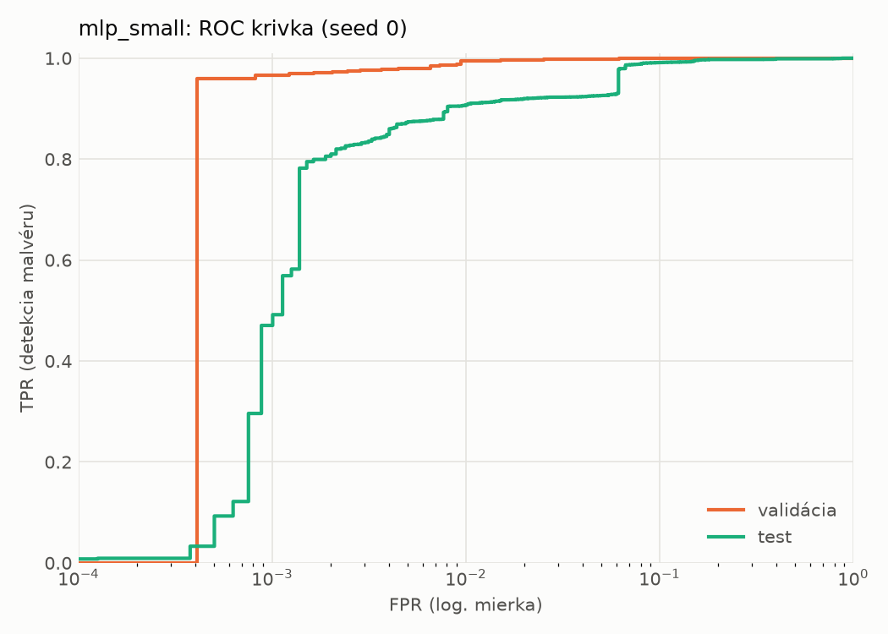
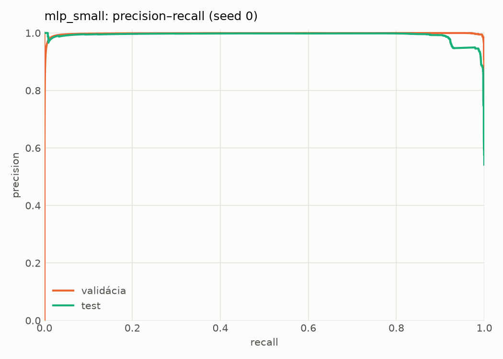
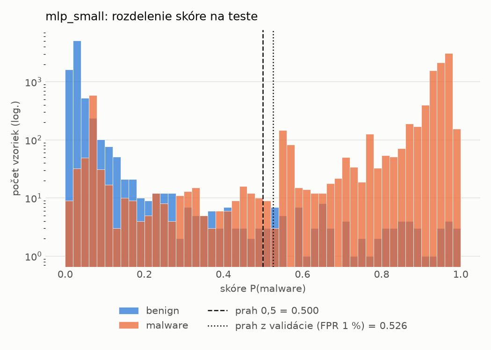
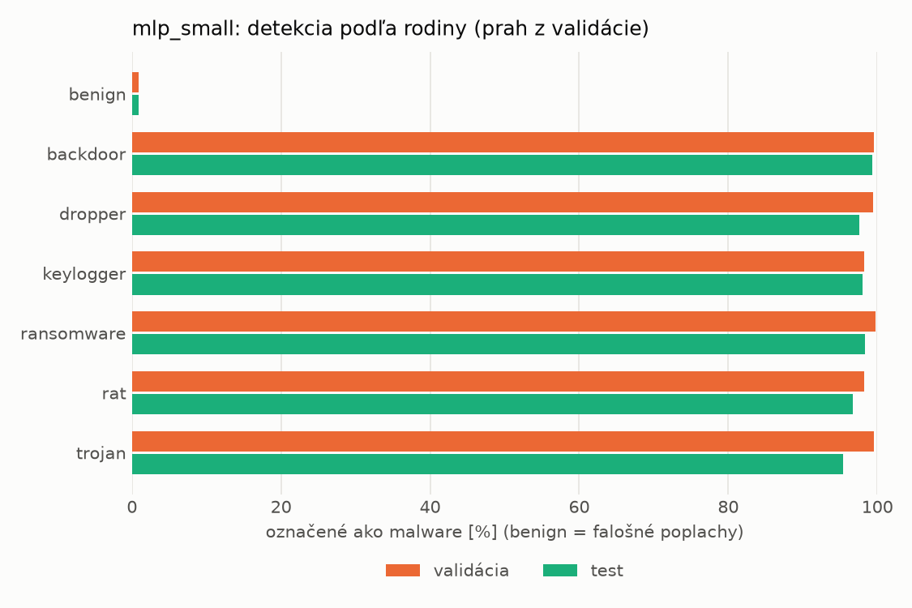
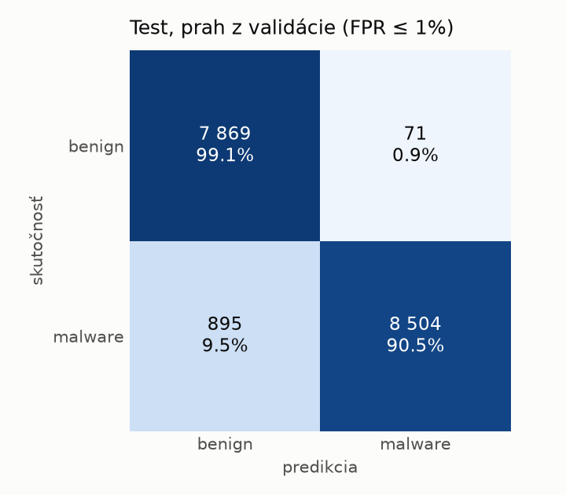
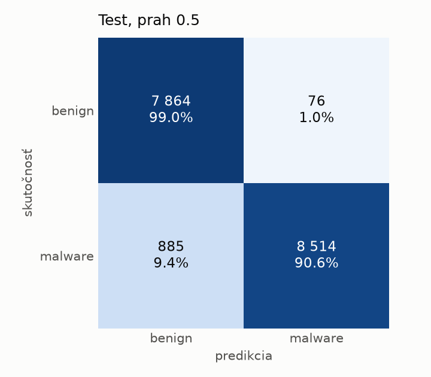
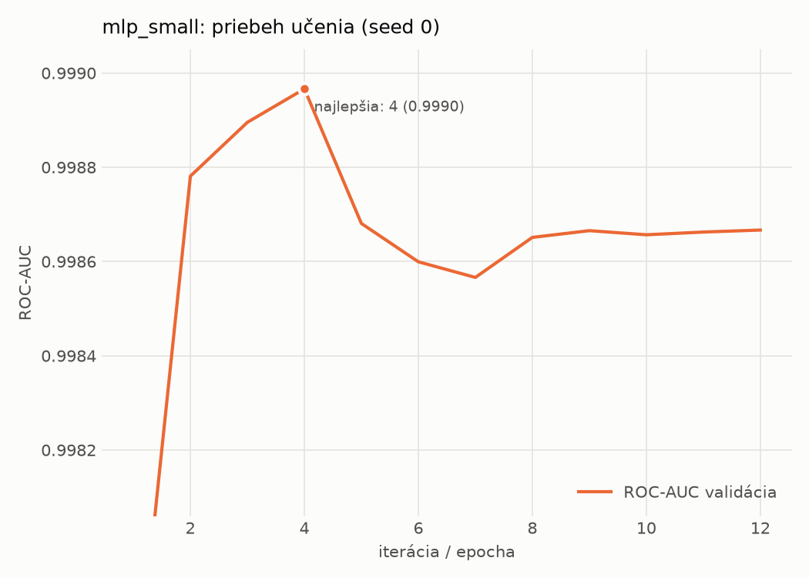

# static/mlp_small – beh `20261103-234218`

> Automaticky generované (`src/training/run_tabular.py`). Konfigurácia: `config.yaml`, protokol: `protocol.yaml`.

- **Model:** `mlp` – malá neurónová sieť (1–2 skryté vrstvy), kandidát na ľahkého študenta
- **Ladenie:** bez ladenia – hyperparametre prevzaté z `runs_final/static/mlp_small/20261101-235005`
- **Finálne modely:** seedy [0, 1, 2]; hodnoty sú priemer ± smerodajná odchýlka cez seedy
- **Najlepšie hyperparametre:** `{"width_decay": 0.5, "max_epochs": 100, "patience": 8, "hidden_layers": 2, "hidden_width": 32, "dropout": 0.15212112147976886, "lr": 0.0005958389350068958, "weight_decay": 5.34293726127978e-05, "batch_size": 512}`

## Detekčná kvalita (bez prahu)
| metrika | train (podvzorka) | validácia | test |
|---|---|---|---|
| ROC-AUC | 0.9998 ± 0.0001 | 0.9991 ± 0.0001 | 0.9942 ± 0.0021 |
| PR-AUC | 0.9999 ± 0.0001 | 0.9979 ± 0.0000 | 0.9938 ± 0.0018 |
| TPR pri FPR 1 % | 0.9988 ± 0.0008 | 0.9941 ± 0.0007 | 0.9101 ± 0.0044 |
| TPR pri FPR 0,1 % | 0.9871 ± 0.0092 | 0.9701 ± 0.0141 | 0.5781 ± 0.1247 |
| log loss | 0.0339 ± 0.0216 | 0.0453 ± 0.0180 | 0.1700 ± 0.0213 |
| Brier skóre | 0.0039 ± 0.0020 | 0.0072 ± 0.0015 | 0.0476 ± 0.0046 |

Rozdiel ROC-AUC train − validácia: **0.0008** (veľký rozdiel = preučenie).

## Pri prahu z validácie (FPR ≤ 1% na validácii)
| metrika | train (podvzorka) | validácia | test |
|---|---|---|---|
| accuracy | 0.9969 ± 0.0010 | 0.9930 ± 0.0008 | 0.9409 ± 0.0039 |
| balanced accuracy | 0.9970 ± 0.0010 | 0.9926 ± 0.0009 | 0.9450 ± 0.0036 |
| precision | 0.9985 ± 0.0007 | 0.9949 ± 0.0006 | 0.9934 ± 0.0018 |
| recall (TPR) | 0.9965 ± 0.0008 | 0.9941 ± 0.0007 | 0.8970 ± 0.0078 |
| FPR | 0.0025 ± 0.0012 | 0.0090 ± 0.0011 | 0.0071 ± 0.0020 |
| F1 | 0.9975 ± 0.0008 | 0.9945 ± 0.0007 | 0.9427 ± 0.0041 |
| MCC | 0.9933 ± 0.0021 | 0.9848 ± 0.0018 | 0.8870 ± 0.0070 |

## Pri pevnom prahu 0.5
| metrika | train (podvzorka) | validácia | test |
|---|---|---|---|
| accuracy | 0.9969 ± 0.0010 | 0.9924 ± 0.0003 | 0.9419 ± 0.0045 |
| balanced accuracy | 0.9969 ± 0.0009 | 0.9917 ± 0.0002 | 0.9457 ± 0.0041 |
| precision | 0.9983 ± 0.0005 | 0.9939 ± 0.0001 | 0.9922 ± 0.0009 |
| recall (TPR) | 0.9968 ± 0.0010 | 0.9942 ± 0.0006 | 0.8999 ± 0.0090 |
| FPR | 0.0029 ± 0.0009 | 0.0108 ± 0.0002 | 0.0084 ± 0.0010 |
| F1 | 0.9975 ± 0.0008 | 0.9941 ± 0.0002 | 0.9438 ± 0.0047 |
| MCC | 0.9934 ± 0.0021 | 0.9836 ± 0.0007 | 0.8885 ± 0.0080 |

## Výpočtové nároky (seed 0, testovacia množina)
| meranie | hodnota |
|---|---|
| tréning finálneho modelu | 4.4 s (priemer cez seedy) |
| ladenie spolu | 0 s |
| počet parametrov / uzlov | 74 881 |
| veľkosť modelu na disku | 0.36 MB |
| transformácia vstupu – latencia (1 vlákno) | 0.041 ms |
| transformácia vstupu – priepustnosť | 39 037 vzoriek/s |
| CPU latencia modelu (batch 1, 1 vlákno) | 0.097 ms (p95 0.107) |
| CPU priepustnosť (24 vlákien) | 61 656 vzoriek/s |
| GPU latencia (batch 1) | 0.372 ms (p95 0.412) |
| GPU priepustnosť | 81 745 vzoriek/s |
| GPU špičková pamäť | 810 MB |

## Grafy
| | |
|---|---|
|  |  |
|  |  |
|  |  |
|  |  |

## Súbory
`metrics.json` (všetky metriky po seedoch vrátane rodín), `timing.json`, `hpo_trials.csv`,
`predictions/<časť>_seed<N>.parquet` (sha256, family, label, score), `model/seed_<N>/`, `log.txt`.
