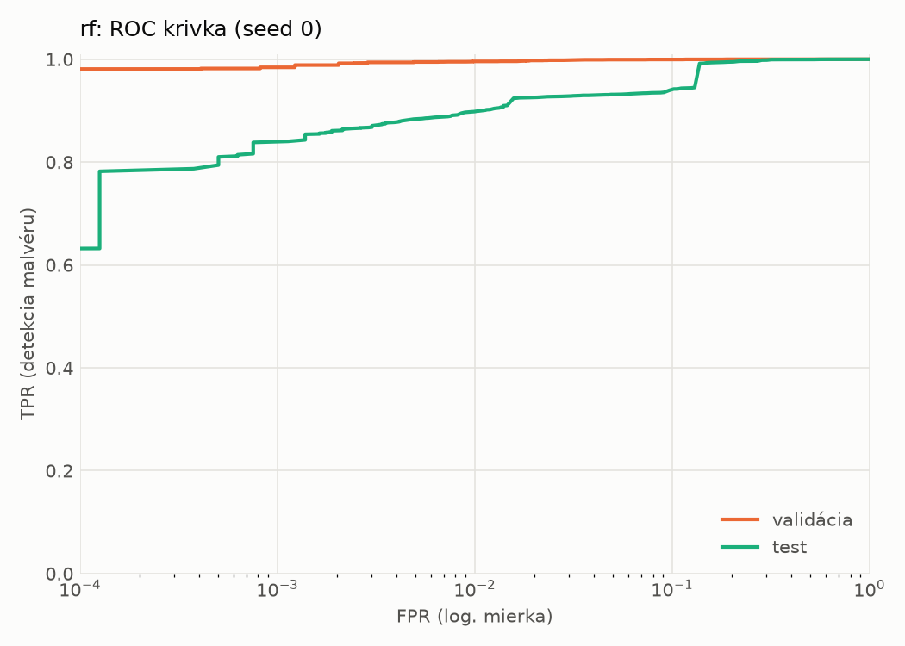
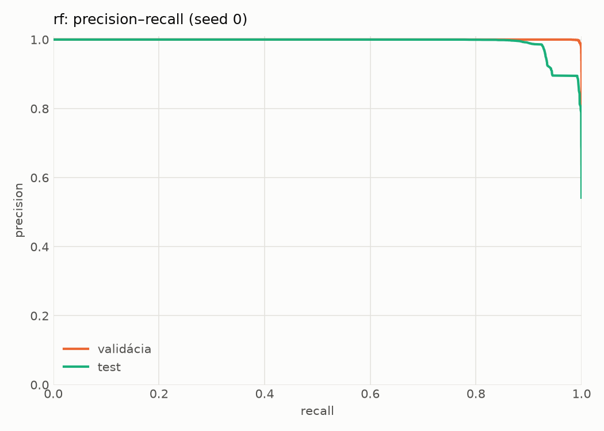
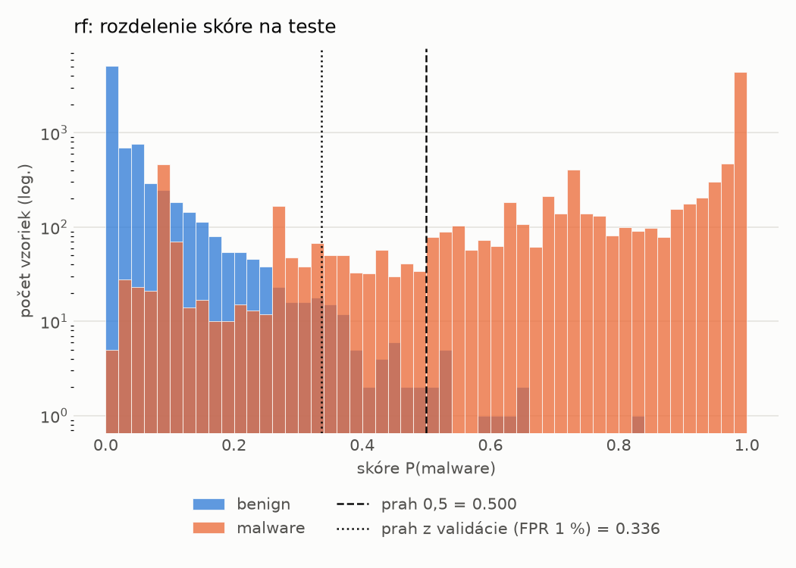
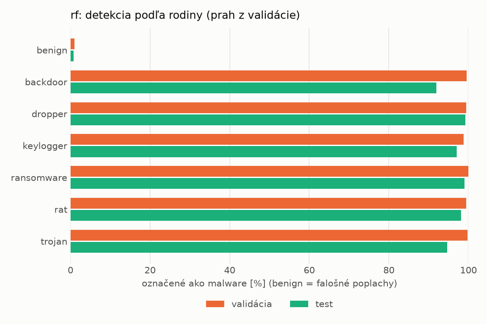
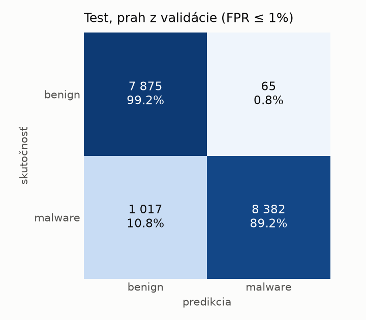
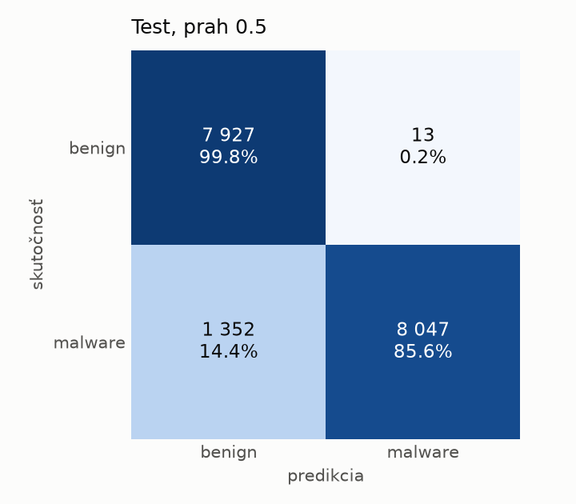

# static/rf – beh `20261103-232738`

> Automaticky generované (`src/training/run_tabular.py`). Konfigurácia: `config.yaml`, protokol: `protocol.yaml`.

- **Model:** `random_forest` – Random Forest (pôvodné hodnoty príznakov)
- **Ladenie:** bez ladenia – hyperparametre prevzaté z `runs_final/static/rf/20261101-213728`
- **Finálne modely:** seedy [0, 1, 2]; hodnoty sú priemer ± smerodajná odchýlka cez seedy
- **Najlepšie hyperparametre:** `{"n_estimators": 250, "max_depth": null, "min_samples_leaf": 1, "max_features": "sqrt"}`

## Detekčná kvalita (bez prahu)
| metrika | train (podvzorka) | validácia | test |
|---|---|---|---|
| ROC-AUC | 1.0000 ± 0.0000 | 0.9998 ± 0.0000 | 0.9903 ± 0.0007 |
| PR-AUC | 1.0000 ± 0.0000 | 0.9999 ± 0.0000 | 0.9924 ± 0.0005 |
| TPR pri FPR 1 % | 1.0000 ± 0.0000 | 0.9955 ± 0.0003 | 0.8992 ± 0.0013 |
| TPR pri FPR 0,1 % | 1.0000 ± 0.0000 | 0.9851 ± 0.0008 | 0.8250 ± 0.0120 |
| log loss | 0.0069 ± 0.0000 | 0.0245 ± 0.0001 | 0.2085 ± 0.0033 |
| Brier skóre | 0.0008 ± 0.0000 | 0.0055 ± 0.0000 | 0.0647 ± 0.0007 |

Rozdiel ROC-AUC train − validácia: **0.0002** (veľký rozdiel = preučenie).

## Pri prahu z validácie (FPR ≤ 1% na validácii)
| metrika | train (podvzorka) | validácia | test |
|---|---|---|---|
| accuracy | 1.0000 ± 0.0000 | 0.9936 ± 0.0002 | 0.9383 ± 0.0015 |
| balanced accuracy | 1.0000 ± 0.0000 | 0.9929 ± 0.0001 | 0.9424 ± 0.0014 |
| precision | 1.0000 ± 0.0000 | 0.9945 ± 0.0000 | 0.9921 ± 0.0004 |
| recall (TPR) | 1.0000 ± 0.0000 | 0.9955 ± 0.0003 | 0.8933 ± 0.0025 |
| FPR | 0.0000 ± 0.0000 | 0.0098 ± 0.0000 | 0.0084 ± 0.0004 |
| F1 | 1.0000 ± 0.0000 | 0.9950 ± 0.0001 | 0.9401 ± 0.0015 |
| MCC | 1.0000 ± 0.0000 | 0.9861 ± 0.0004 | 0.8820 ± 0.0027 |

## Pri pevnom prahu 0.5
| metrika | train (podvzorka) | validácia | test |
|---|---|---|---|
| accuracy | 1.0000 ± 0.0000 | 0.9945 ± 0.0001 | 0.9191 ± 0.0019 |
| balanced accuracy | 1.0000 ± 0.0000 | 0.9951 ± 0.0001 | 0.9253 ± 0.0018 |
| precision | 1.0000 ± 0.0000 | 0.9984 ± 0.0000 | 0.9984 ± 0.0002 |
| recall (TPR) | 1.0000 ± 0.0000 | 0.9931 ± 0.0002 | 0.8521 ± 0.0036 |
| FPR | 0.0000 ± 0.0000 | 0.0029 ± 0.0000 | 0.0016 ± 0.0002 |
| F1 | 1.0000 ± 0.0000 | 0.9957 ± 0.0001 | 0.9195 ± 0.0021 |
| MCC | 1.0000 ± 0.0000 | 0.9882 ± 0.0003 | 0.8499 ± 0.0033 |

## Výpočtové nároky (seed 0, testovacia množina)
| meranie | hodnota |
|---|---|
| tréning finálneho modelu | 22.3 s (priemer cez seedy) |
| ladenie spolu | 0 s |
| počet parametrov / uzlov | 347 980 |
| veľkosť modelu na disku | 28.18 MB |
| CPU latencia modelu (batch 1, 1 vlákno) | 7.206 ms (p95 7.608) |
| CPU priepustnosť (24 vlákien) | 137 944 vzoriek/s |

## Grafy
| | |
|---|---|
|  |  |
|  |  |
|  |  |
|  |  |

## Súbory
`metrics.json` (všetky metriky po seedoch vrátane rodín), `timing.json`, `hpo_trials.csv`,
`predictions/<časť>_seed<N>.parquet` (sha256, family, label, score), `model/seed_<N>/`, `log.txt`.
