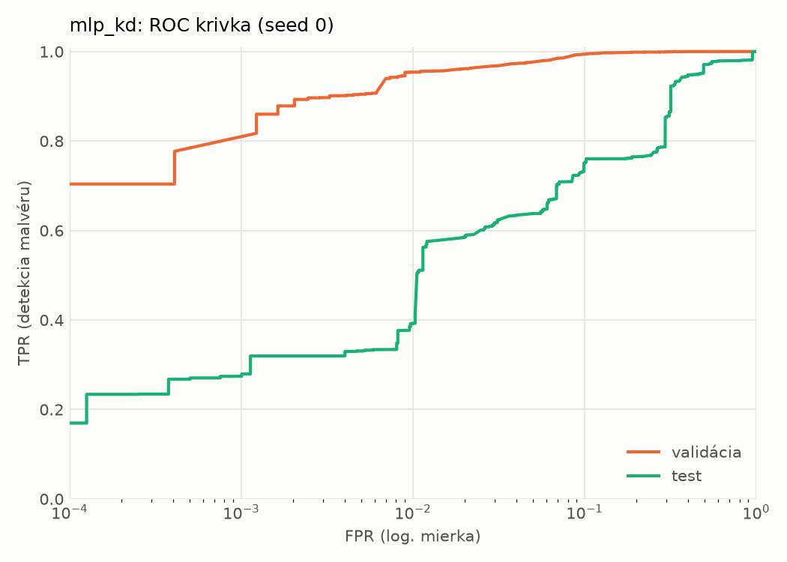
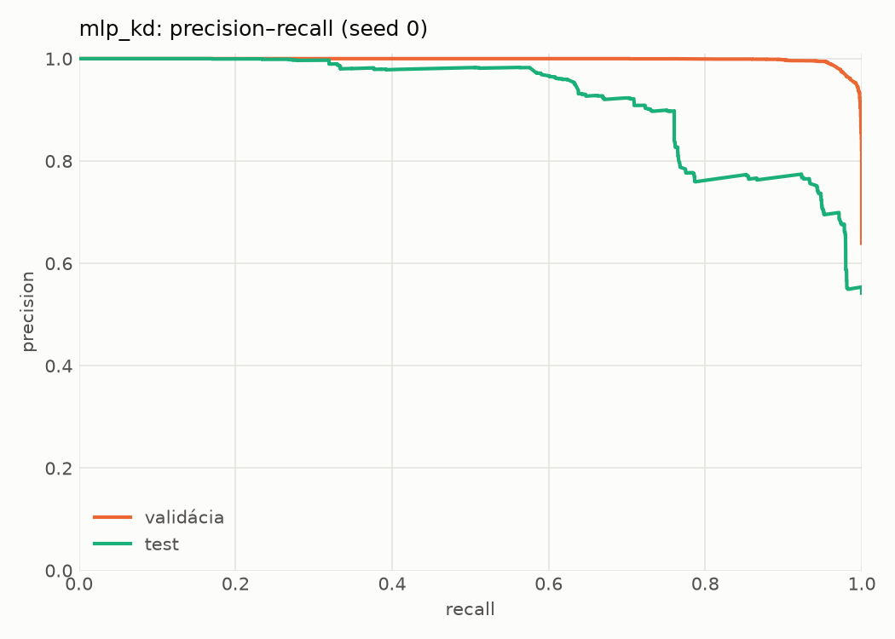
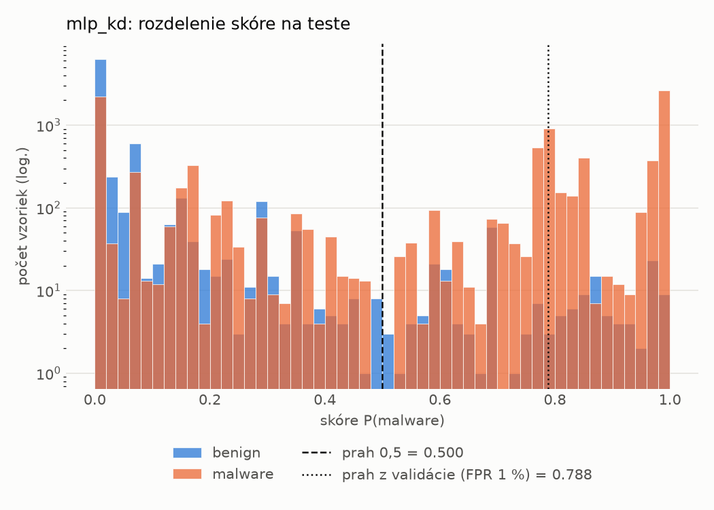
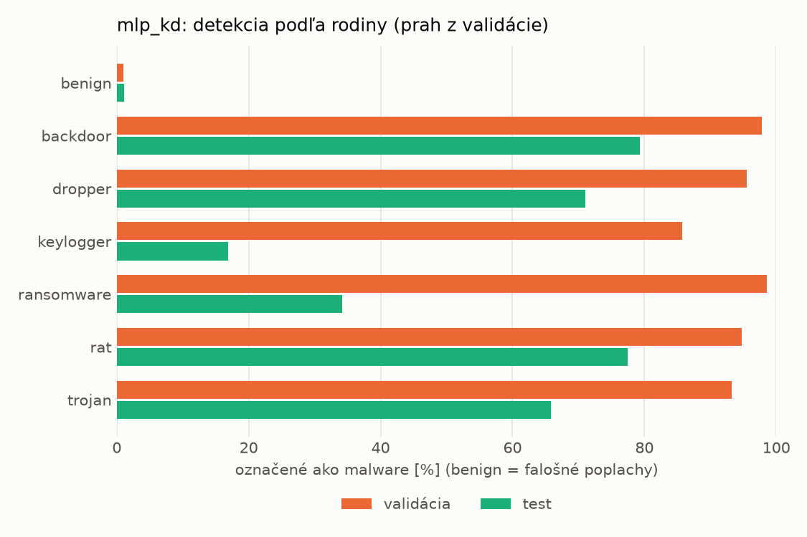
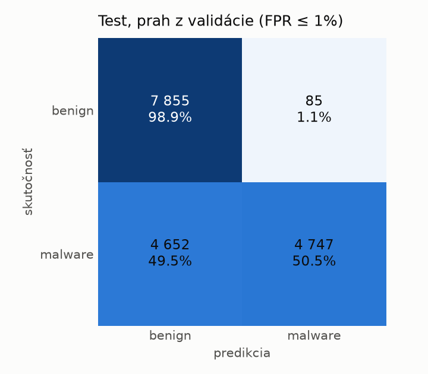
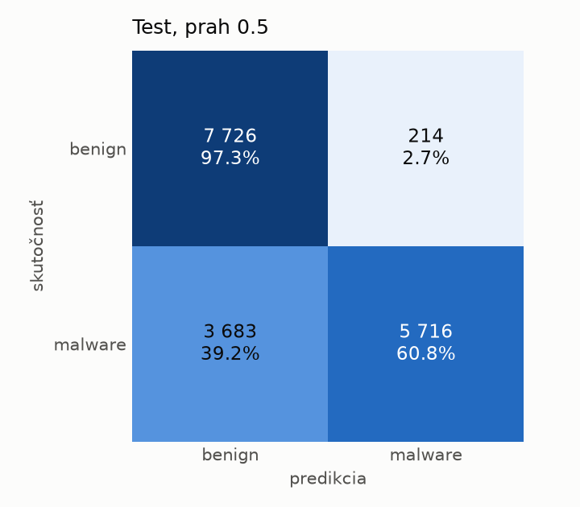
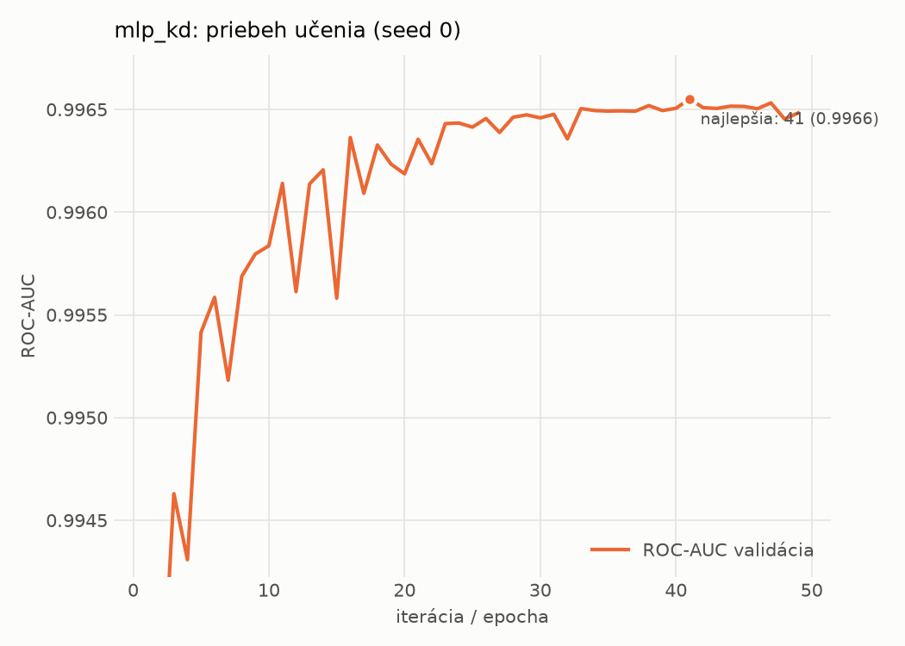

# dynamic/mlp_kd – beh `20261104-012249`

> Automaticky generované (`src/training/run_tabular.py`). Konfigurácia: `config.yaml`, protokol: `protocol.yaml`.

- **Model:** `mlp` – študent – malé MLP učené destiláciou z hybridného učiteľa
- **Ladenie:** bez ladenia – hyperparametre prevzaté z `runs_final/students_dynamic/mlp_kd/20261102-212132`
- **Finálne modely:** seedy [0, 1, 2]; hodnoty sú priemer ± smerodajná odchýlka cez seedy
- **Najlepšie hyperparametre:** `{"hidden_layers": 1, "max_epochs": 100, "patience": 8, "hidden_width": 32, "dropout": 0.14978534481914754, "lr": 0.0015794492400712224, "weight_decay": 1.2553588001973222e-06, "batch_size": 512, "kd_alpha": 0.7118939371172979, "kd_temperature": 1.298431487079528}`

## Detekčná kvalita (bez prahu)
| metrika | train (podvzorka) | validácia | test |
|---|---|---|---|
| ROC-AUC | 0.9973 ± 0.0001 | 0.9966 ± 0.0001 | 0.8951 ± 0.0167 |
| PR-AUC | 0.9984 ± 0.0001 | 0.9981 ± 0.0001 | 0.9225 ± 0.0118 |
| TPR pri FPR 1 % | 0.9561 ± 0.0019 | 0.9540 ± 0.0002 | 0.4507 ± 0.0506 |
| TPR pri FPR 0,1 % | 0.8690 ± 0.0031 | 0.8319 ± 0.0522 | 0.3290 ± 0.0690 |
| log loss | 0.0666 ± 0.0037 | 0.0765 ± 0.0016 | 1.1363 ± 0.2165 |
| Brier skóre | 0.0208 ± 0.0011 | 0.0226 ± 0.0008 | 0.2085 ± 0.0122 |

Rozdiel ROC-AUC train − validácia: **0.0007** (veľký rozdiel = preučenie).

## Pri prahu z validácie (FPR ≤ 1% na validácii)
| metrika | train (podvzorka) | validácia | test |
|---|---|---|---|
| accuracy | 0.9673 ± 0.0002 | 0.9671 ± 0.0001 | 0.7299 ± 0.0053 |
| balanced accuracy | 0.9722 ± 0.0001 | 0.9721 ± 0.0001 | 0.7499 ± 0.0047 |
| precision | 0.9947 ± 0.0001 | 0.9942 ± 0.0000 | 0.9802 ± 0.0037 |
| recall (TPR) | 0.9530 ± 0.0004 | 0.9540 ± 0.0002 | 0.5121 ± 0.0120 |
| FPR | 0.0085 ± 0.0002 | 0.0098 ± 0.0000 | 0.0123 ± 0.0027 |
| F1 | 0.9734 ± 0.0002 | 0.9737 ± 0.0001 | 0.6727 ± 0.0095 |
| MCC | 0.9326 ± 0.0004 | 0.9311 ± 0.0003 | 0.5527 ± 0.0058 |

## Pri pevnom prahu 0.5
| metrika | train (podvzorka) | validácia | test |
|---|---|---|---|
| accuracy | 0.9712 ± 0.0010 | 0.9685 ± 0.0006 | 0.7569 ± 0.0160 |
| balanced accuracy | 0.9742 ± 0.0009 | 0.9713 ± 0.0007 | 0.7738 ± 0.0147 |
| precision | 0.9916 ± 0.0004 | 0.9893 ± 0.0008 | 0.9630 ± 0.0010 |
| recall (TPR) | 0.9622 ± 0.0014 | 0.9611 ± 0.0006 | 0.5736 ± 0.0301 |
| FPR | 0.0138 ± 0.0006 | 0.0184 ± 0.0015 | 0.0261 ± 0.0008 |
| F1 | 0.9767 ± 0.0008 | 0.9750 ± 0.0005 | 0.7187 ± 0.0236 |
| MCC | 0.9397 ± 0.0021 | 0.9331 ± 0.0013 | 0.5835 ± 0.0235 |

## Výpočtové nároky (seed 0, testovacia množina)
| meranie | hodnota |
|---|---|
| tréning finálneho modelu | 8.4 s (priemer cez seedy) |
| ladenie spolu | 0 s |
| počet parametrov / uzlov | 64 129 |
| veľkosť modelu na disku | 0.31 MB |
| transformácia vstupu – latencia (1 vlákno) | 0.018 ms |
| transformácia vstupu – priepustnosť | 50 139 vzoriek/s |
| CPU latencia modelu (batch 1, 1 vlákno) | 0.067 ms (p95 0.075) |
| CPU priepustnosť (24 vlákien) | 139 201 vzoriek/s |
| GPU latencia (batch 1) | 0.283 ms (p95 0.310) |
| GPU priepustnosť | 101 855 vzoriek/s |
| GPU špičková pamäť | 700 MB |

## Grafy
| | |
|---|---|
|  |  |
|  |  |
|  |  |
|  |  |

## Súbory
`metrics.json` (všetky metriky po seedoch vrátane rodín), `timing.json`, `hpo_trials.csv`,
`predictions/<časť>_seed<N>.parquet` (sha256, family, label, score), `model/seed_<N>/`, `log.txt`.
