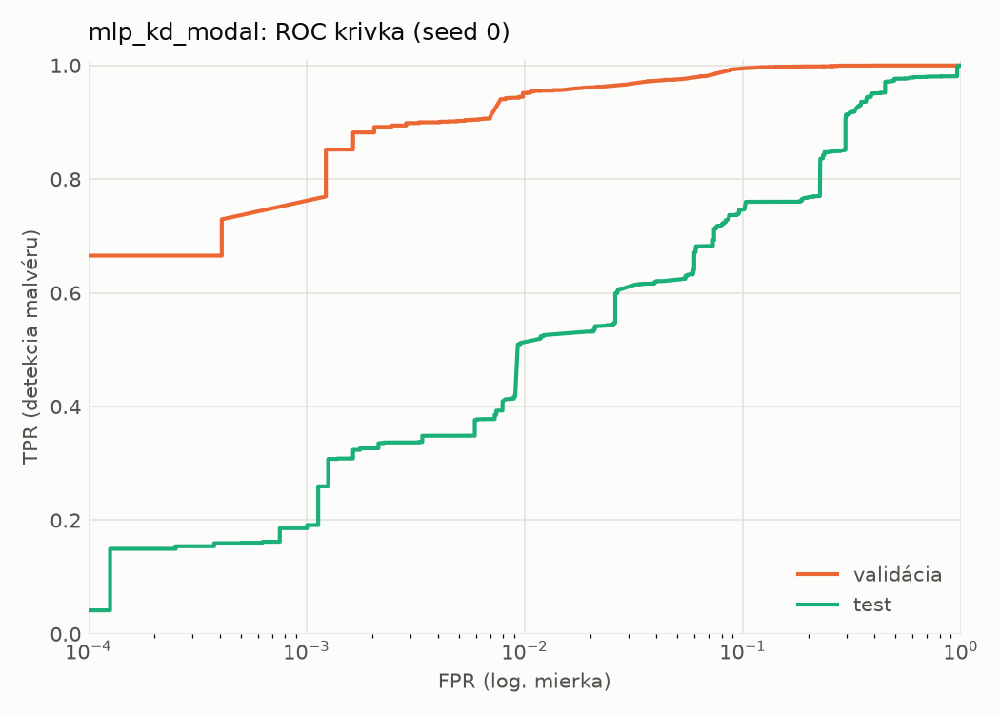
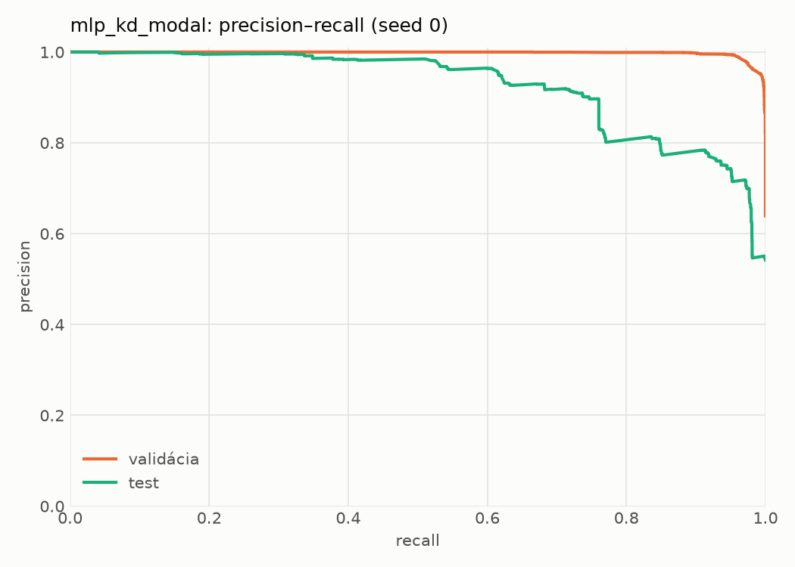
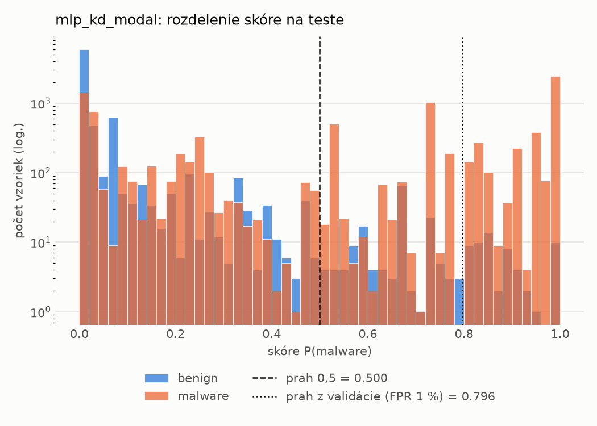
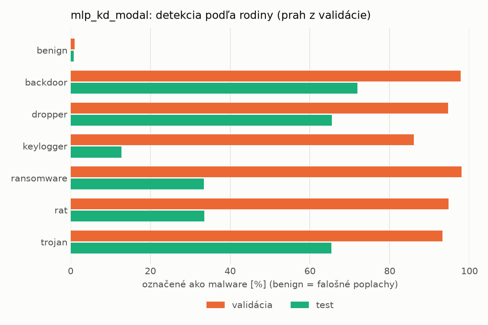
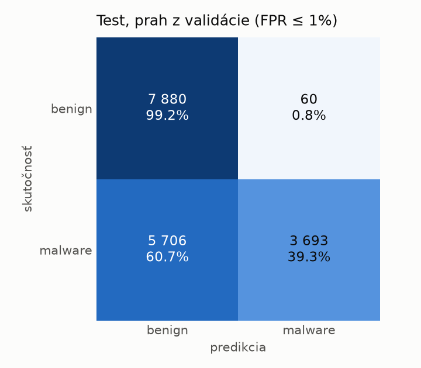
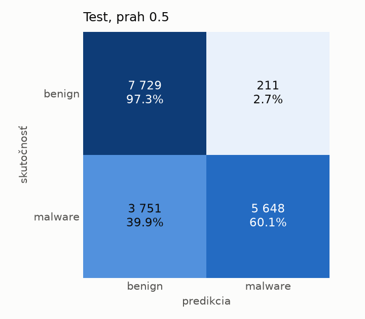
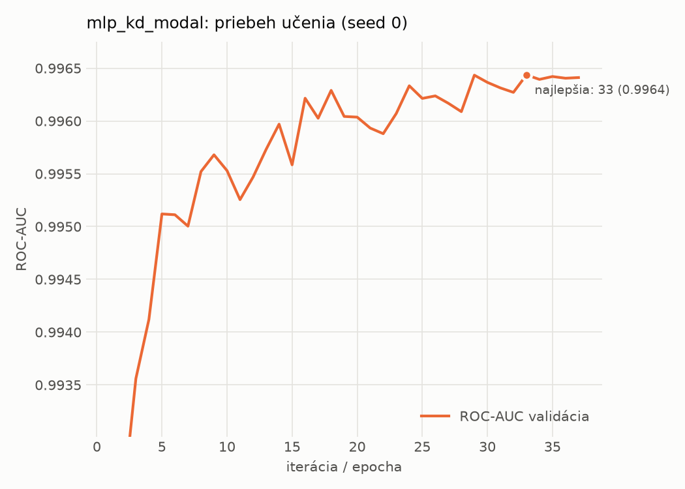

# dynamic/mlp_kd_modal – beh `20261104-012344`

> Automaticky generované (`src/training/run_tabular.py`). Konfigurácia: `config.yaml`, protokol: `protocol.yaml`.

- **Model:** `mlp` – študent – malé MLP učené destiláciou z učiteľa rovnakej modality (variant A)
- **Ladenie:** bez ladenia – hyperparametre prevzaté z `runs_final/students_dynamic/mlp_kd_modal/20261102-212954`
- **Finálne modely:** seedy [0, 1, 2]; hodnoty sú priemer ± smerodajná odchýlka cez seedy
- **Najlepšie hyperparametre:** `{"hidden_layers": 1, "max_epochs": 100, "patience": 8, "hidden_width": 32, "dropout": 0.14040860994340293, "lr": 0.00037778352941027736, "weight_decay": 1.149514965975221e-06, "batch_size": 512, "kd_alpha": 0.8818461482523741, "kd_temperature": 1.583698009756735}`

## Detekčná kvalita (bez prahu)
| metrika | train (podvzorka) | validácia | test |
|---|---|---|---|
| ROC-AUC | 0.9974 ± 0.0001 | 0.9964 ± 0.0001 | 0.9082 ± 0.0073 |
| PR-AUC | 0.9984 ± 0.0001 | 0.9979 ± 0.0001 | 0.9313 ± 0.0061 |
| TPR pri FPR 1 % | 0.9574 ± 0.0012 | 0.9494 ± 0.0046 | 0.5235 ± 0.0218 |
| TPR pri FPR 0,1 % | 0.8668 ± 0.0016 | 0.7359 ± 0.0095 | 0.2656 ± 0.0692 |
| log loss | 0.0638 ± 0.0015 | 0.0735 ± 0.0016 | 0.8853 ± 0.0282 |
| Brier skóre | 0.0199 ± 0.0006 | 0.0219 ± 0.0004 | 0.1944 ± 0.0056 |

Rozdiel ROC-AUC train − validácia: **0.0009** (veľký rozdiel = preučenie).

## Pri prahu z validácie (FPR ≤ 1% na validácii)
| metrika | train (podvzorka) | validácia | test |
|---|---|---|---|
| accuracy | 0.9637 ± 0.0025 | 0.9642 ± 0.0029 | 0.6676 ± 0.0075 |
| balanced accuracy | 0.9696 ± 0.0020 | 0.9699 ± 0.0022 | 0.6929 ± 0.0069 |
| precision | 0.9956 ± 0.0002 | 0.9943 ± 0.0001 | 0.9853 ± 0.0013 |
| recall (TPR) | 0.9463 ± 0.0042 | 0.9494 ± 0.0046 | 0.3927 ± 0.0143 |
| FPR | 0.0071 ± 0.0003 | 0.0097 ± 0.0002 | 0.0069 ± 0.0008 |
| F1 | 0.9703 ± 0.0021 | 0.9713 ± 0.0024 | 0.5614 ± 0.0145 |
| MCC | 0.9256 ± 0.0049 | 0.9254 ± 0.0056 | 0.4670 ± 0.0104 |

## Pri pevnom prahu 0.5
| metrika | train (podvzorka) | validácia | test |
|---|---|---|---|
| accuracy | 0.9704 ± 0.0014 | 0.9681 ± 0.0008 | 0.7577 ± 0.0136 |
| balanced accuracy | 0.9728 ± 0.0020 | 0.9702 ± 0.0009 | 0.7744 ± 0.0125 |
| precision | 0.9891 ± 0.0025 | 0.9871 ± 0.0009 | 0.9615 ± 0.0032 |
| recall (TPR) | 0.9633 ± 0.0002 | 0.9627 ± 0.0008 | 0.5761 ± 0.0258 |
| FPR | 0.0178 ± 0.0041 | 0.0222 ± 0.0017 | 0.0273 ± 0.0025 |
| F1 | 0.9761 ± 0.0011 | 0.9748 ± 0.0006 | 0.7203 ± 0.0204 |
| MCC | 0.9378 ± 0.0032 | 0.9321 ± 0.0016 | 0.5839 ± 0.0200 |

## Výpočtové nároky (seed 0, testovacia množina)
| meranie | hodnota |
|---|---|
| tréning finálneho modelu | 8.8 s (priemer cez seedy) |
| ladenie spolu | 0 s |
| počet parametrov / uzlov | 64 129 |
| veľkosť modelu na disku | 0.31 MB |
| transformácia vstupu – latencia (1 vlákno) | 0.034 ms |
| transformácia vstupu – priepustnosť | 45 942 vzoriek/s |
| CPU latencia modelu (batch 1, 1 vlákno) | 0.067 ms (p95 0.076) |
| CPU priepustnosť (24 vlákien) | 140 054 vzoriek/s |
| GPU latencia (batch 1) | 0.286 ms (p95 0.316) |
| GPU priepustnosť | 99 532 vzoriek/s |
| GPU špičková pamäť | 700 MB |

## Grafy
| | |
|---|---|
|  |  |
|  |  |
|  |  |
|  |  |

## Súbory
`metrics.json` (všetky metriky po seedoch vrátane rodín), `timing.json`, `hpo_trials.csv`,
`predictions/<časť>_seed<N>.parquet` (sha256, family, label, score), `model/seed_<N>/`, `log.txt`.
