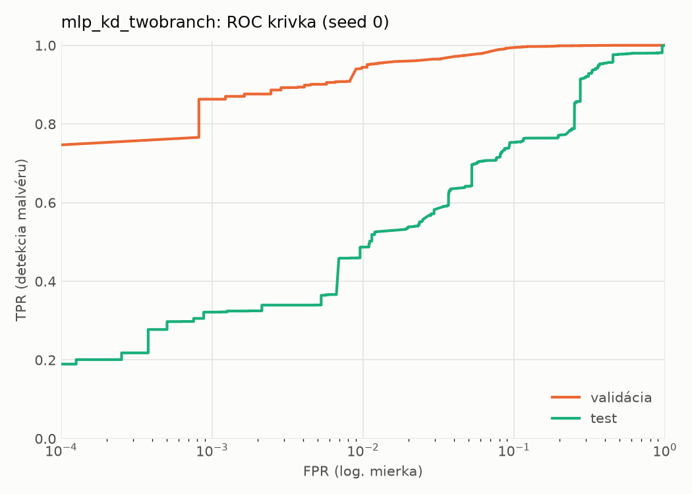
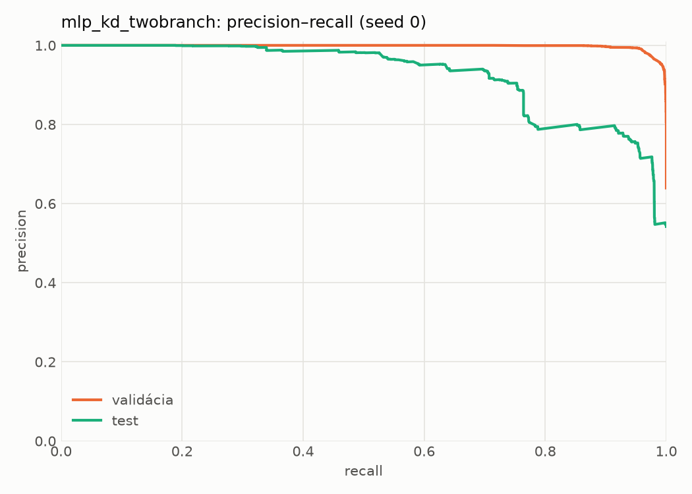
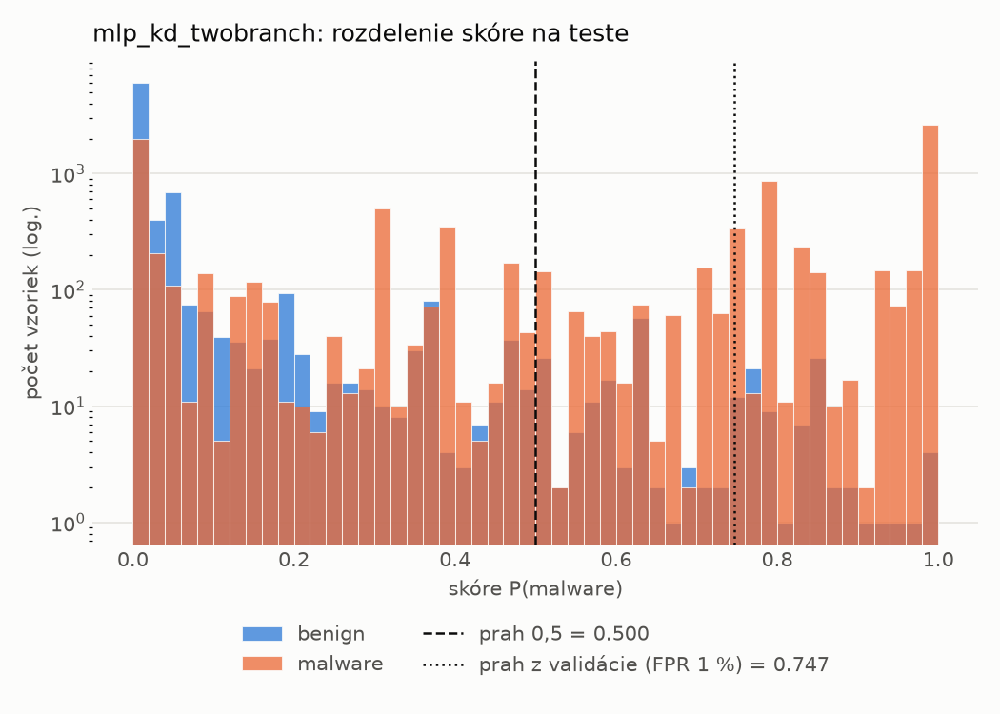
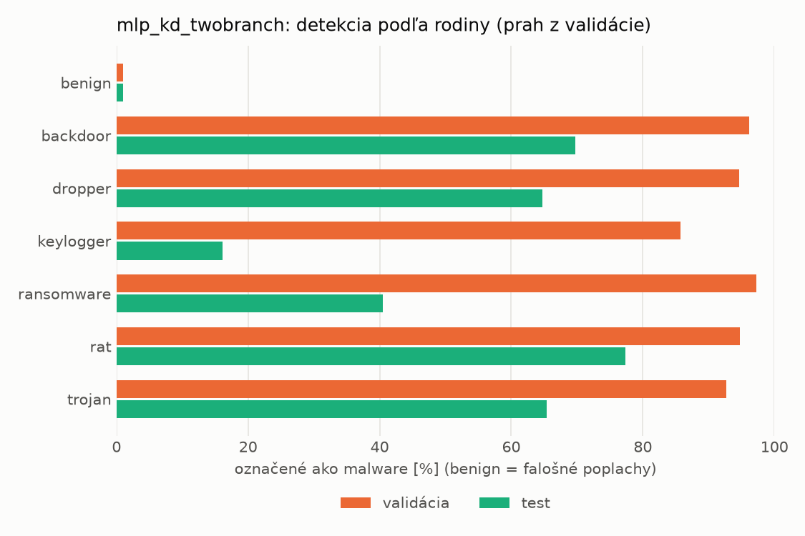
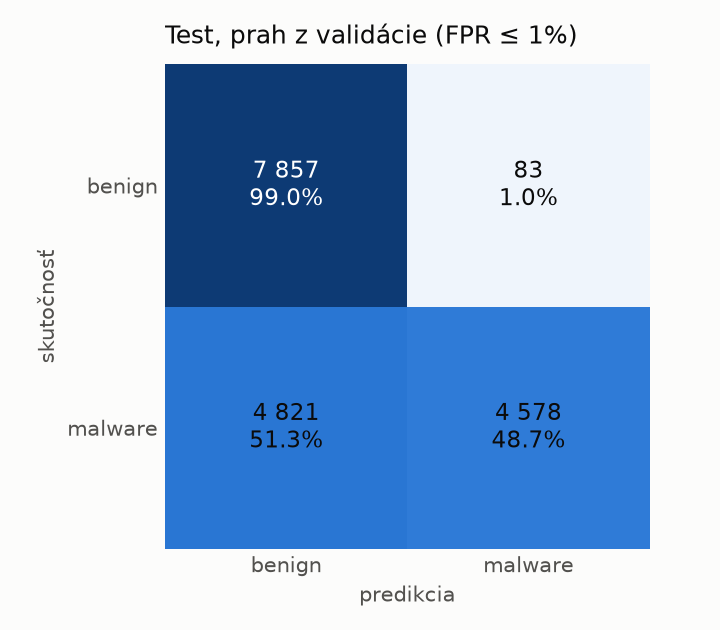
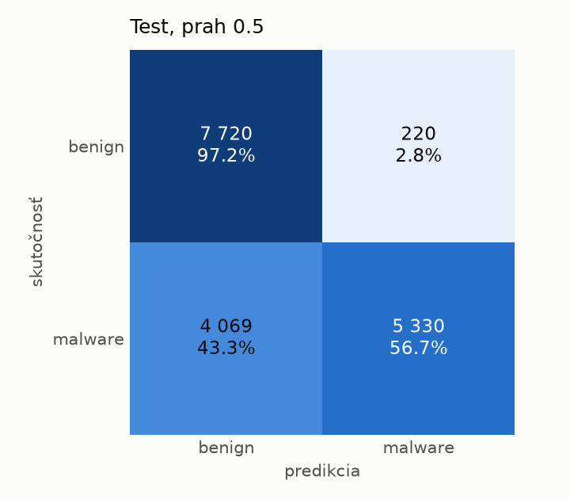
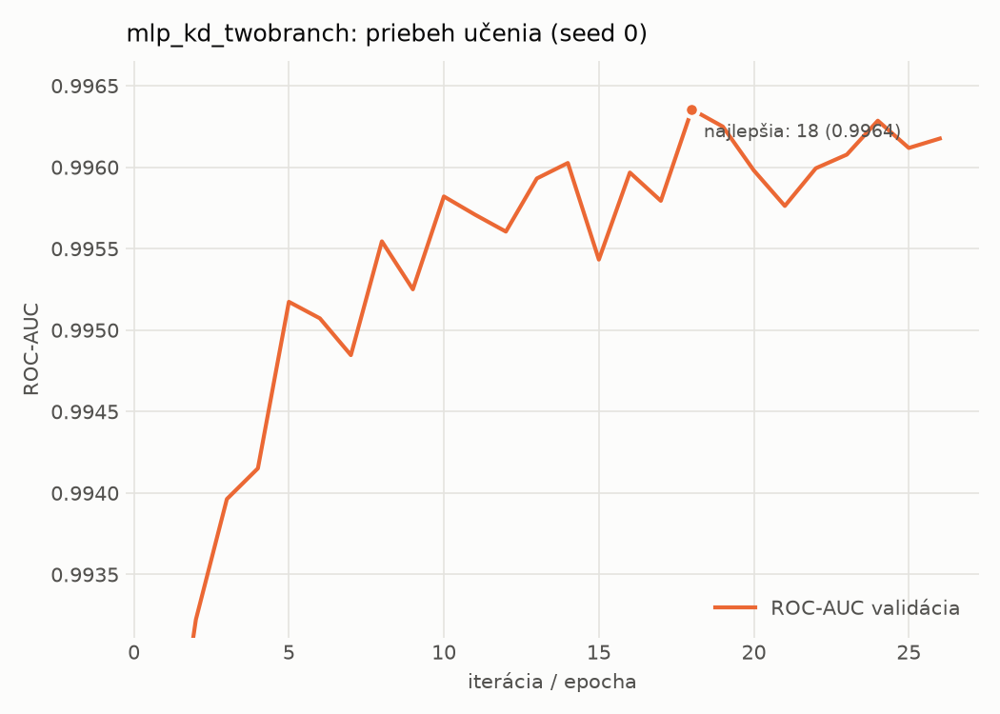

# dynamic/mlp_kd_twobranch – beh `20261104-012418`

> Automaticky generované (`src/training/run_tabular.py`). Konfigurácia: `config.yaml`, protokol: `protocol.yaml`.

- **Model:** `mlp` – študent – malé MLP učené destiláciou z dvojvetvovej siete (V2)
- **Ladenie:** bez ladenia – hyperparametre prevzaté z `runs_v2/full/students_dynamic/mlp_kd_twobranch/20261103-210509`
- **Finálne modely:** seedy [0, 1, 2]; hodnoty sú priemer ± smerodajná odchýlka cez seedy
- **Najlepšie hyperparametre:** `{"hidden_layers": 1, "max_epochs": 100, "patience": 8, "hidden_width": 32, "dropout": 0.20072105080128874, "lr": 0.0007693195243892695, "weight_decay": 5.480532660403751e-05, "batch_size": 512, "kd_alpha": 0.8408369066096718, "kd_temperature": 1.578549465607724}`

## Detekčná kvalita (bez prahu)
| metrika | train (podvzorka) | validácia | test |
|---|---|---|---|
| ROC-AUC | 0.9972 ± 0.0001 | 0.9965 ± 0.0002 | 0.9143 ± 0.0101 |
| PR-AUC | 0.9983 ± 0.0000 | 0.9980 ± 0.0001 | 0.9345 ± 0.0066 |
| TPR pri FPR 1 % | 0.9563 ± 0.0009 | 0.9497 ± 0.0054 | 0.4664 ± 0.0444 |
| TPR pri FPR 0,1 % | 0.8632 ± 0.0061 | 0.8179 ± 0.0420 | 0.3073 ± 0.0156 |
| log loss | 0.0662 ± 0.0020 | 0.0747 ± 0.0024 | 0.8678 ± 0.0588 |
| Brier skóre | 0.0206 ± 0.0007 | 0.0223 ± 0.0007 | 0.1887 ± 0.0098 |

Rozdiel ROC-AUC train − validácia: **0.0007** (veľký rozdiel = preučenie).

## Pri prahu z validácie (FPR ≤ 1% na validácii)
| metrika | train (podvzorka) | validácia | test |
|---|---|---|---|
| accuracy | 0.9640 ± 0.0033 | 0.9643 ± 0.0035 | 0.7085 ± 0.0271 |
| balanced accuracy | 0.9698 ± 0.0024 | 0.9699 ± 0.0027 | 0.7303 ± 0.0250 |
| precision | 0.9954 ± 0.0006 | 0.9942 ± 0.0000 | 0.9799 ± 0.0021 |
| recall (TPR) | 0.9470 ± 0.0058 | 0.9497 ± 0.0054 | 0.4719 ± 0.0506 |
| FPR | 0.0074 ± 0.0010 | 0.0098 ± 0.0000 | 0.0114 ± 0.0013 |
| F1 | 0.9705 ± 0.0028 | 0.9714 ± 0.0029 | 0.6360 ± 0.0470 |
| MCC | 0.9261 ± 0.0063 | 0.9257 ± 0.0069 | 0.5224 ± 0.0388 |

## Pri pevnom prahu 0.5
| metrika | train (podvzorka) | validácia | test |
|---|---|---|---|
| accuracy | 0.9709 ± 0.0009 | 0.9676 ± 0.0009 | 0.7837 ± 0.0286 |
| balanced accuracy | 0.9734 ± 0.0005 | 0.9697 ± 0.0007 | 0.7980 ± 0.0261 |
| precision | 0.9896 ± 0.0005 | 0.9870 ± 0.0005 | 0.9590 ± 0.0013 |
| recall (TPR) | 0.9638 ± 0.0018 | 0.9619 ± 0.0014 | 0.6279 ± 0.0561 |
| FPR | 0.0171 ± 0.0008 | 0.0224 ± 0.0009 | 0.0319 ± 0.0039 |
| F1 | 0.9765 ± 0.0007 | 0.9743 ± 0.0007 | 0.7579 ± 0.0410 |
| MCC | 0.9390 ± 0.0017 | 0.9309 ± 0.0018 | 0.6211 ± 0.0416 |

## Výpočtové nároky (seed 0, testovacia množina)
| meranie | hodnota |
|---|---|
| tréning finálneho modelu | 6.0 s (priemer cez seedy) |
| ladenie spolu | 0 s |
| počet parametrov / uzlov | 64 129 |
| veľkosť modelu na disku | 0.31 MB |
| transformácia vstupu – latencia (1 vlákno) | 0.034 ms |
| transformácia vstupu – priepustnosť | 42 246 vzoriek/s |
| CPU latencia modelu (batch 1, 1 vlákno) | 0.068 ms (p95 0.076) |
| CPU priepustnosť (24 vlákien) | 95 626 vzoriek/s |
| GPU latencia (batch 1) | 0.455 ms (p95 0.691) |
| GPU priepustnosť | 104 903 vzoriek/s |
| GPU špičková pamäť | 1242 MB |

## Grafy
| | |
|---|---|
|  |  |
|  |  |
|  |  |
|  |  |

## Súbory
`metrics.json` (všetky metriky po seedoch vrátane rodín), `timing.json`, `hpo_trials.csv`,
`predictions/<časť>_seed<N>.parquet` (sha256, family, label, score), `model/seed_<N>/`, `log.txt`.
