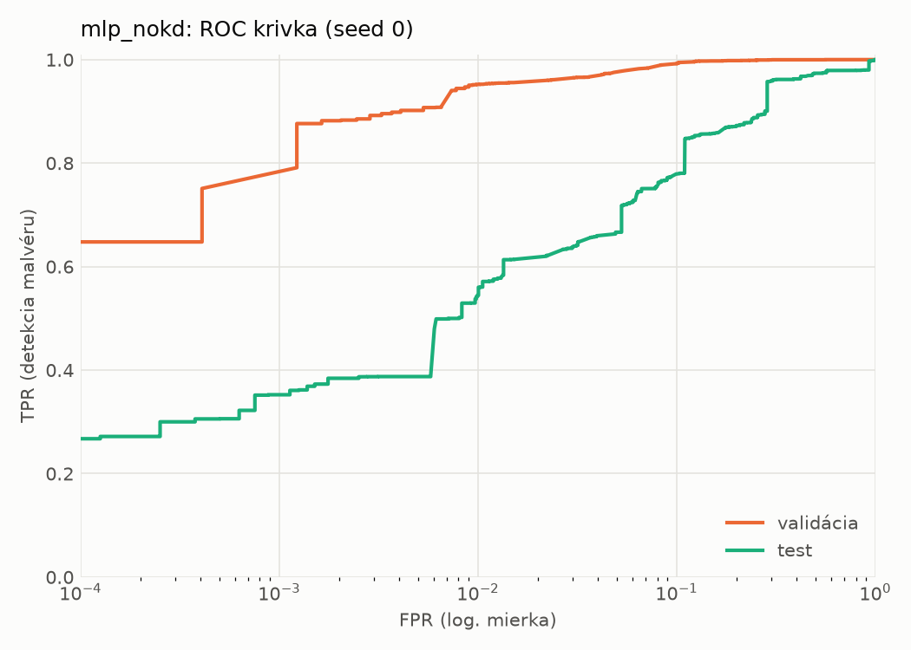
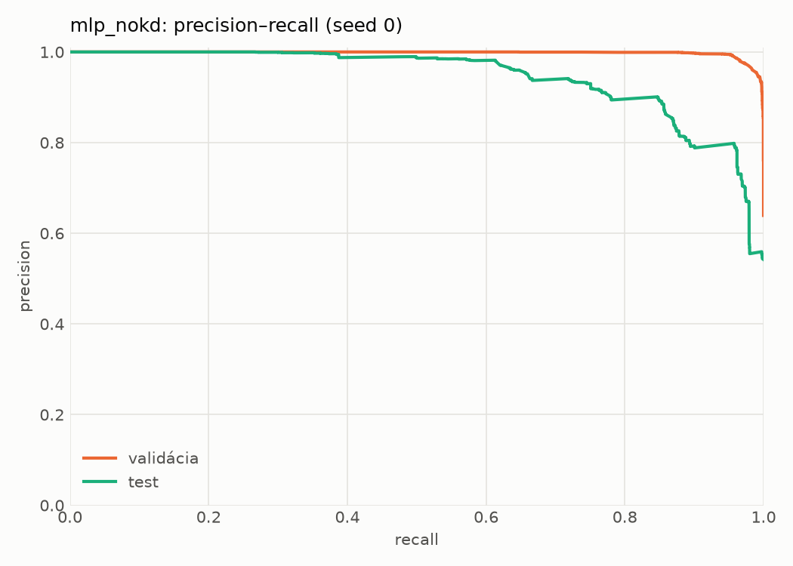
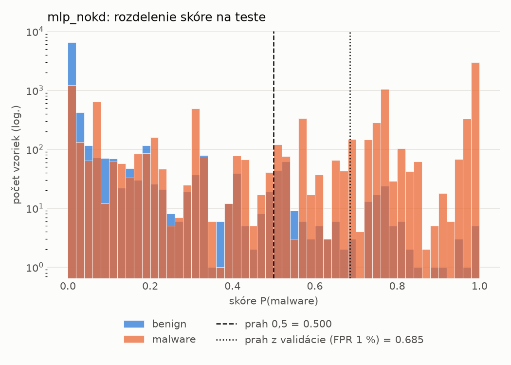
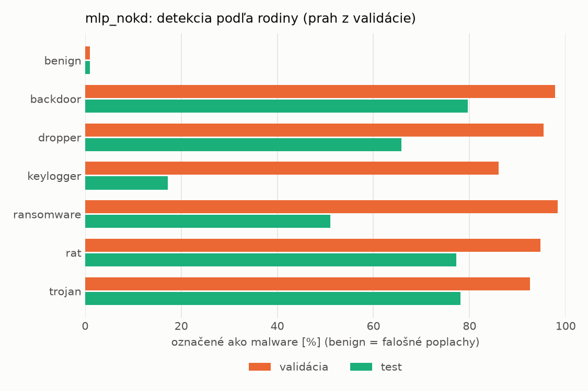
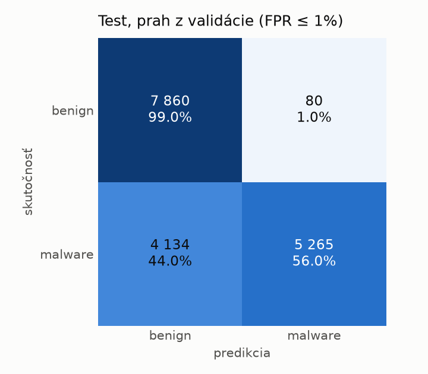
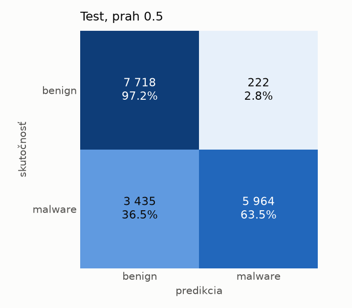
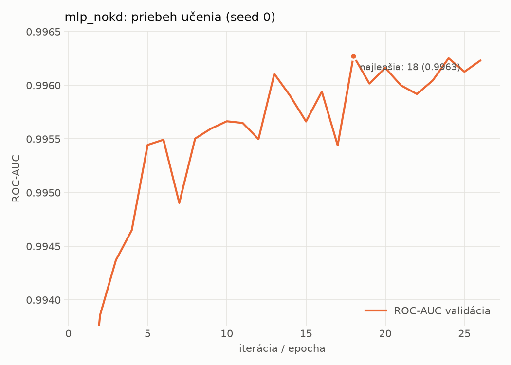

# dynamic/mlp_nokd – beh `20261104-012323`

> Automaticky generované (`src/training/run_tabular.py`). Konfigurácia: `config.yaml`, protokol: `protocol.yaml`.

- **Model:** `mlp` – kontrola – rovnaké malé MLP bez destilácie (iba skutočné označenia)
- **Ladenie:** bez ladenia – hyperparametre prevzaté z `runs_final/students_dynamic/mlp_nokd/20261102-212647`
- **Finálne modely:** seedy [0, 1, 2]; hodnoty sú priemer ± smerodajná odchýlka cez seedy
- **Najlepšie hyperparametre:** `{"hidden_layers": 1, "max_epochs": 100, "patience": 8, "hidden_width": 32, "dropout": 0.27854460554056926, "lr": 0.002048574130711367, "weight_decay": 5.911733622585913e-06, "batch_size": 512}`

## Detekčná kvalita (bez prahu)
| metrika | train (podvzorka) | validácia | test |
|---|---|---|---|
| ROC-AUC | 0.9973 ± 0.0001 | 0.9964 ± 0.0001 | 0.9202 ± 0.0049 |
| PR-AUC | 0.9983 ± 0.0001 | 0.9979 ± 0.0001 | 0.9393 ± 0.0049 |
| TPR pri FPR 1 % | 0.9555 ± 0.0008 | 0.9530 ± 0.0011 | 0.5329 ± 0.0107 |
| TPR pri FPR 0,1 % | 0.8693 ± 0.0075 | 0.7689 ± 0.0155 | 0.3266 ± 0.0333 |
| log loss | 0.0664 ± 0.0024 | 0.0770 ± 0.0018 | 0.9311 ± 0.1143 |
| Brier skóre | 0.0208 ± 0.0008 | 0.0226 ± 0.0007 | 0.1919 ± 0.0152 |

Rozdiel ROC-AUC train − validácia: **0.0009** (veľký rozdiel = preučenie).

## Pri prahu z validácie (FPR ≤ 1% na validácii)
| metrika | train (podvzorka) | validácia | test |
|---|---|---|---|
| accuracy | 0.9660 ± 0.0012 | 0.9664 ± 0.0007 | 0.7449 ± 0.0125 |
| balanced accuracy | 0.9712 ± 0.0008 | 0.9716 ± 0.0005 | 0.7639 ± 0.0114 |
| precision | 0.9947 ± 0.0004 | 0.9942 ± 0.0000 | 0.9837 ± 0.0031 |
| recall (TPR) | 0.9509 ± 0.0022 | 0.9530 ± 0.0011 | 0.5384 ± 0.0238 |
| FPR | 0.0085 ± 0.0006 | 0.0098 ± 0.0000 | 0.0106 ± 0.0022 |
| F1 | 0.9723 ± 0.0010 | 0.9732 ± 0.0006 | 0.6957 ± 0.0198 |
| MCC | 0.9300 ± 0.0022 | 0.9298 ± 0.0014 | 0.5758 ± 0.0176 |

## Pri pevnom prahu 0.5
| metrika | train (podvzorka) | validácia | test |
|---|---|---|---|
| accuracy | 0.9706 ± 0.0012 | 0.9670 ± 0.0006 | 0.7645 ± 0.0213 |
| balanced accuracy | 0.9725 ± 0.0015 | 0.9685 ± 0.0012 | 0.7806 ± 0.0196 |
| precision | 0.9878 ± 0.0018 | 0.9850 ± 0.0021 | 0.9616 ± 0.0024 |
| recall (TPR) | 0.9651 ± 0.0010 | 0.9631 ± 0.0015 | 0.5890 ± 0.0395 |
| FPR | 0.0201 ± 0.0030 | 0.0261 ± 0.0038 | 0.0278 ± 0.0008 |
| F1 | 0.9763 ± 0.0009 | 0.9739 ± 0.0004 | 0.7301 ± 0.0306 |
| MCC | 0.9381 ± 0.0025 | 0.9295 ± 0.0014 | 0.5939 ± 0.0320 |

## Výpočtové nároky (seed 0, testovacia množina)
| meranie | hodnota |
|---|---|
| tréning finálneho modelu | 4.5 s (priemer cez seedy) |
| ladenie spolu | 0 s |
| počet parametrov / uzlov | 64 129 |
| veľkosť modelu na disku | 0.31 MB |
| transformácia vstupu – latencia (1 vlákno) | 0.034 ms |
| transformácia vstupu – priepustnosť | 45 153 vzoriek/s |
| CPU latencia modelu (batch 1, 1 vlákno) | 0.067 ms (p95 0.076) |
| CPU priepustnosť (24 vlákien) | 96 931 vzoriek/s |
| GPU latencia (batch 1) | 0.451 ms (p95 0.480) |
| GPU priepustnosť | 101 745 vzoriek/s |
| GPU špičková pamäť | 1242 MB |

## Grafy
| | |
|---|---|
|  |  |
|  |  |
|  |  |
|  |  |

## Súbory
`metrics.json` (všetky metriky po seedoch vrátane rodín), `timing.json`, `hpo_trials.csv`,
`predictions/<časť>_seed<N>.parquet` (sha256, family, label, score), `model/seed_<N>/`, `log.txt`.
