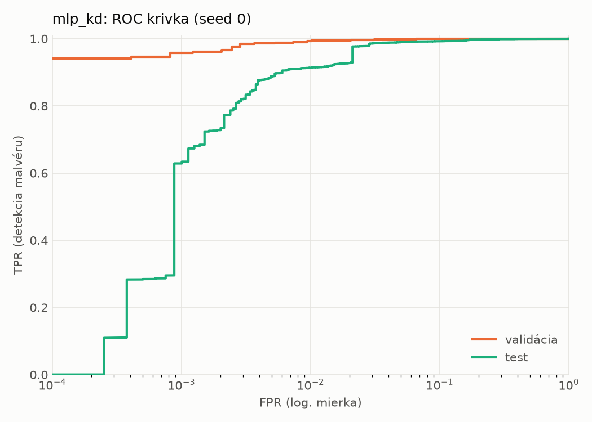
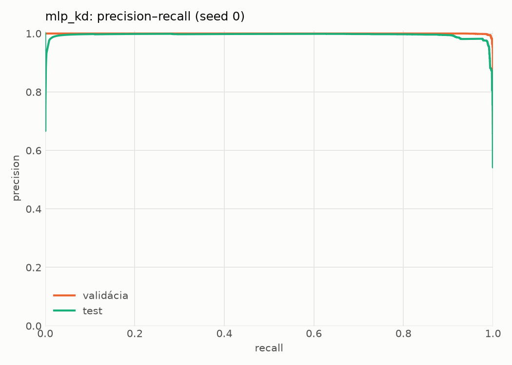
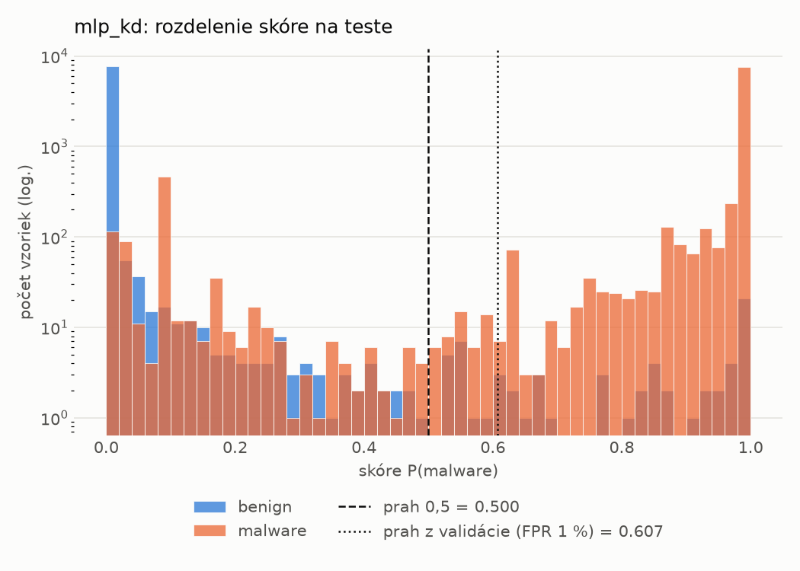
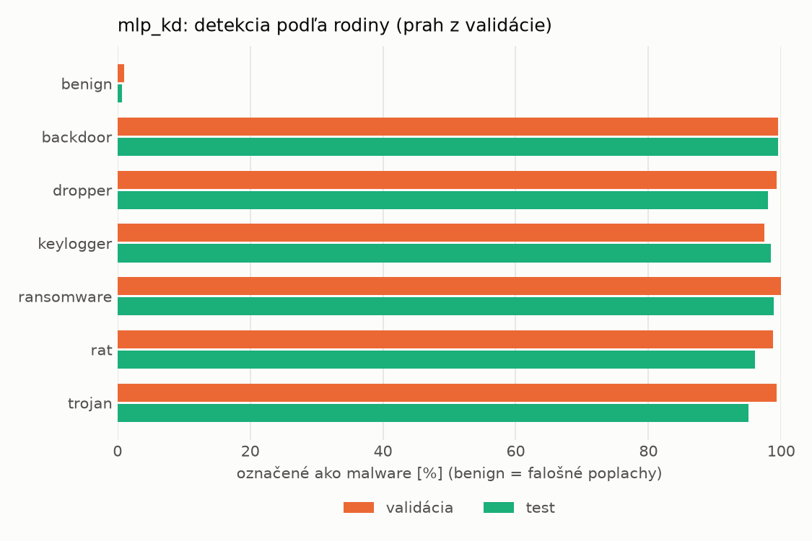
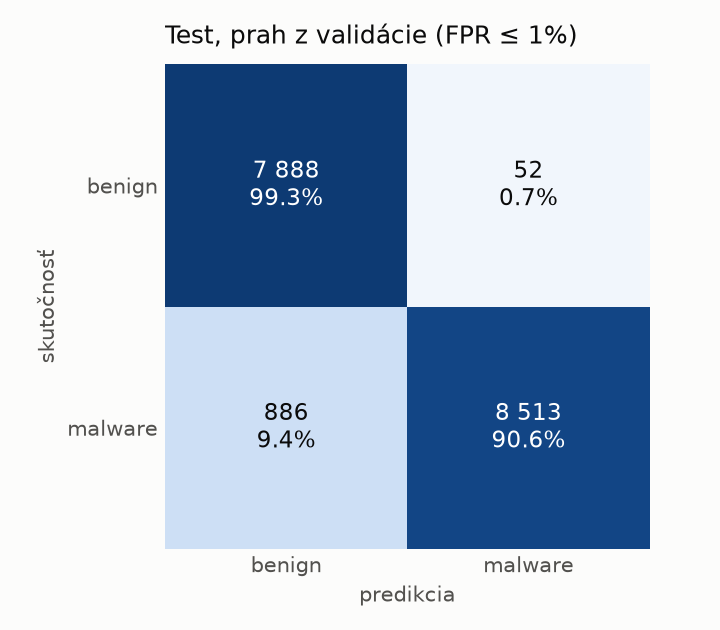
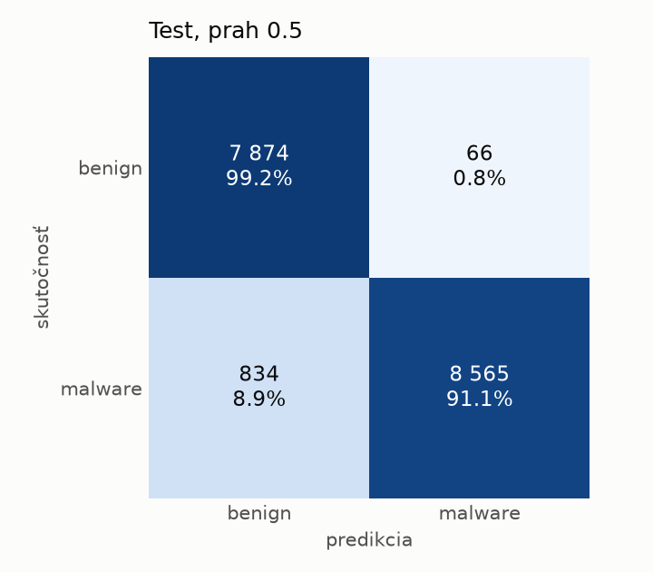
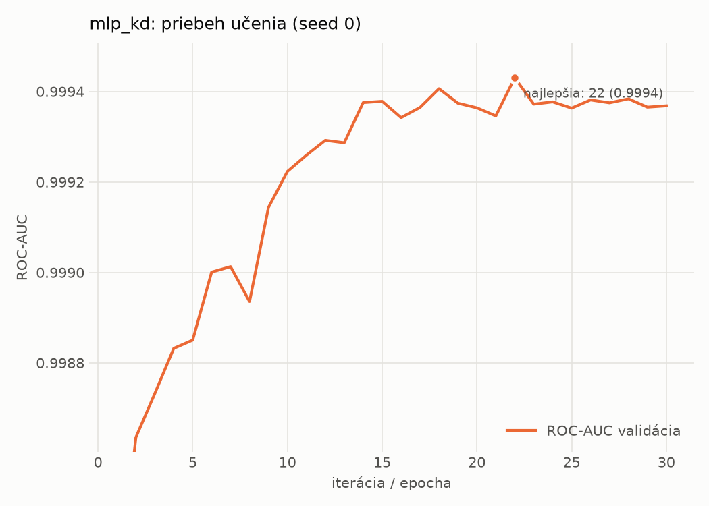

# static/mlp_kd – beh `20261104-012050`

> Automaticky generované (`src/training/run_tabular.py`). Konfigurácia: `config.yaml`, protokol: `protocol.yaml`.

- **Model:** `mlp` – študent – malé MLP učené destiláciou z hybridného učiteľa
- **Ladenie:** bez ladenia – hyperparametre prevzaté z `runs_final/students_static/mlp_kd/20261102-211333`
- **Finálne modely:** seedy [0, 1, 2]; hodnoty sú priemer ± smerodajná odchýlka cez seedy
- **Najlepšie hyperparametre:** `{"hidden_layers": 1, "max_epochs": 100, "patience": 8, "hidden_width": 32, "dropout": 0.0997633477545663, "lr": 0.0015427581570995174, "weight_decay": 0.00017559733451057006, "batch_size": 256, "kd_alpha": 0.604033962068706, "kd_temperature": 6.472658522077935}`

## Detekčná kvalita (bez prahu)
| metrika | train (podvzorka) | validácia | test |
|---|---|---|---|
| ROC-AUC | 0.9998 ± 0.0002 | 0.9993 ± 0.0002 | 0.9950 ± 0.0002 |
| PR-AUC | 0.9998 ± 0.0003 | 0.9992 ± 0.0009 | 0.9941 ± 0.0004 |
| TPR pri FPR 1 % | 0.9987 ± 0.0006 | 0.9905 ± 0.0024 | 0.9122 ± 0.0011 |
| TPR pri FPR 0,1 % | 0.9906 ± 0.0046 | 0.9657 ± 0.0073 | 0.6571 ± 0.0258 |
| log loss | 0.0124 ± 0.0018 | 0.0294 ± 0.0012 | 0.1754 ± 0.0170 |
| Brier skóre | 0.0032 ± 0.0005 | 0.0071 ± 0.0005 | 0.0457 ± 0.0023 |

Rozdiel ROC-AUC train − validácia: **0.0005** (veľký rozdiel = preučenie).

## Pri prahu z validácie (FPR ≤ 1% na validácii)
| metrika | train (podvzorka) | validácia | test |
|---|---|---|---|
| accuracy | 0.9941 ± 0.0017 | 0.9905 ± 0.0015 | 0.9433 ± 0.0022 |
| balanced accuracy | 0.9950 ± 0.0015 | 0.9905 ± 0.0011 | 0.9472 ± 0.0021 |
| precision | 0.9990 ± 0.0006 | 0.9946 ± 0.0003 | 0.9936 ± 0.0003 |
| recall (TPR) | 0.9915 ± 0.0021 | 0.9905 ± 0.0024 | 0.9012 ± 0.0039 |
| FPR | 0.0016 ± 0.0010 | 0.0096 ± 0.0005 | 0.0068 ± 0.0003 |
| F1 | 0.9953 ± 0.0013 | 0.9926 ± 0.0012 | 0.9452 ± 0.0023 |
| MCC | 0.9875 ± 0.0035 | 0.9795 ± 0.0031 | 0.8913 ± 0.0041 |

## Pri pevnom prahu 0.5
| metrika | train (podvzorka) | validácia | test |
|---|---|---|---|
| accuracy | 0.9963 ± 0.0011 | 0.9916 ± 0.0009 | 0.9477 ± 0.0004 |
| balanced accuracy | 0.9963 ± 0.0011 | 0.9905 ± 0.0012 | 0.9510 ± 0.0004 |
| precision | 0.9980 ± 0.0009 | 0.9924 ± 0.0014 | 0.9914 ± 0.0009 |
| recall (TPR) | 0.9961 ± 0.0012 | 0.9945 ± 0.0008 | 0.9114 ± 0.0005 |
| FPR | 0.0034 ± 0.0016 | 0.0135 ± 0.0026 | 0.0094 ± 0.0010 |
| F1 | 0.9970 ± 0.0008 | 0.9935 ± 0.0007 | 0.9497 ± 0.0004 |
| MCC | 0.9920 ± 0.0022 | 0.9818 ± 0.0020 | 0.8988 ± 0.0009 |

## Výpočtové nároky (seed 0, testovacia množina)
| meranie | hodnota |
|---|---|
| tréning finálneho modelu | 9.4 s (priemer cez seedy) |
| ladenie spolu | 0 s |
| počet parametrov / uzlov | 74 337 |
| veľkosť modelu na disku | 0.36 MB |
| transformácia vstupu – latencia (1 vlákno) | 0.041 ms |
| transformácia vstupu – priepustnosť | 39 594 vzoriek/s |
| CPU latencia modelu (batch 1, 1 vlákno) | 0.069 ms (p95 0.079) |
| CPU priepustnosť (24 vlákien) | 109 260 vzoriek/s |
| GPU latencia (batch 1) | 0.279 ms (p95 0.316) |
| GPU priepustnosť | 59 472 vzoriek/s |
| GPU špičková pamäť | 810 MB |

## Grafy
| | |
|---|---|
|  |  |
|  |  |
|  |  |
|  |  |

## Súbory
`metrics.json` (všetky metriky po seedoch vrátane rodín), `timing.json`, `hpo_trials.csv`,
`predictions/<časť>_seed<N>.parquet` (sha256, family, label, score), `model/seed_<N>/`, `log.txt`.
