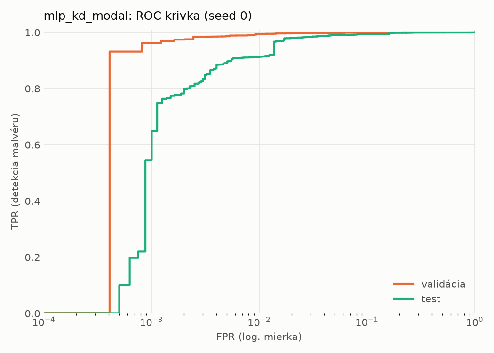
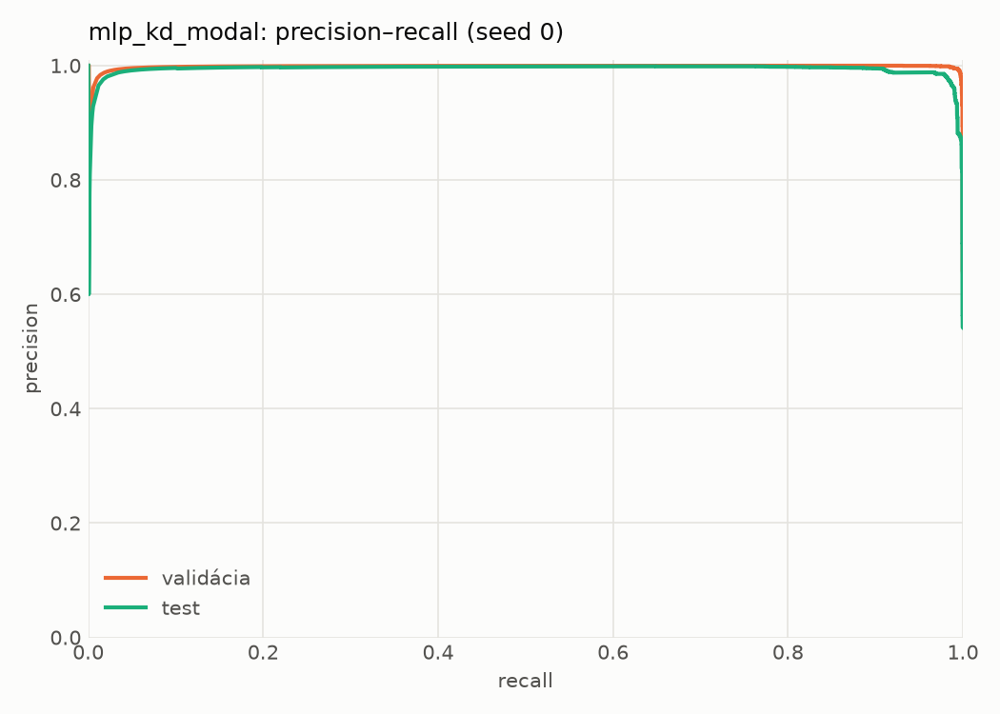
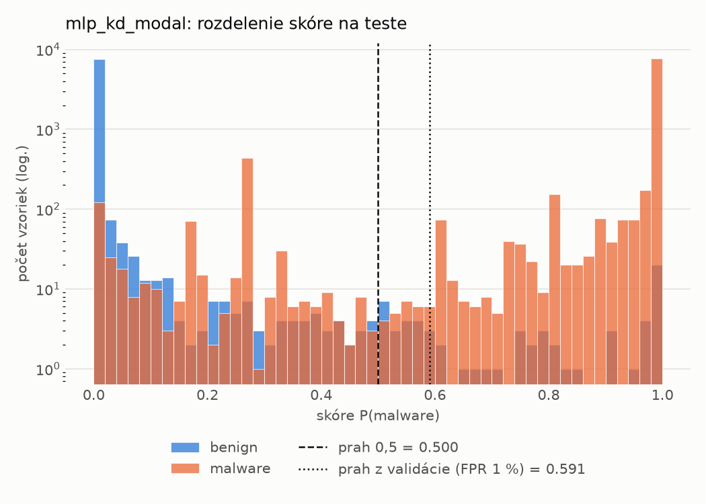
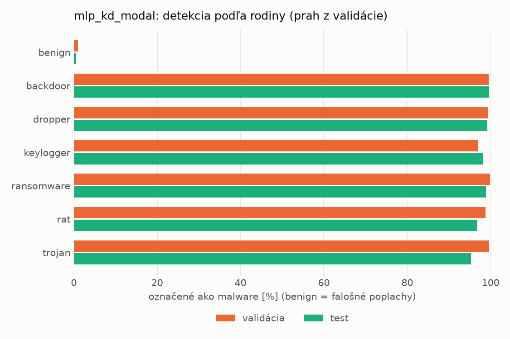
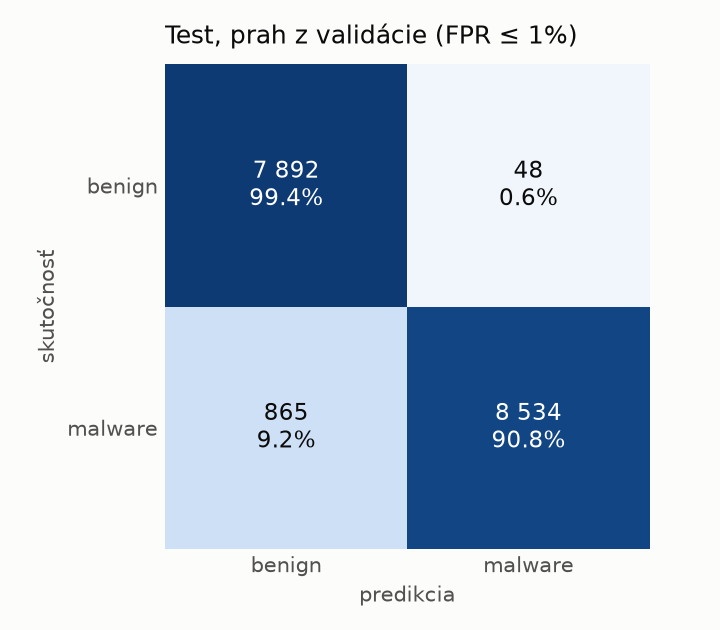
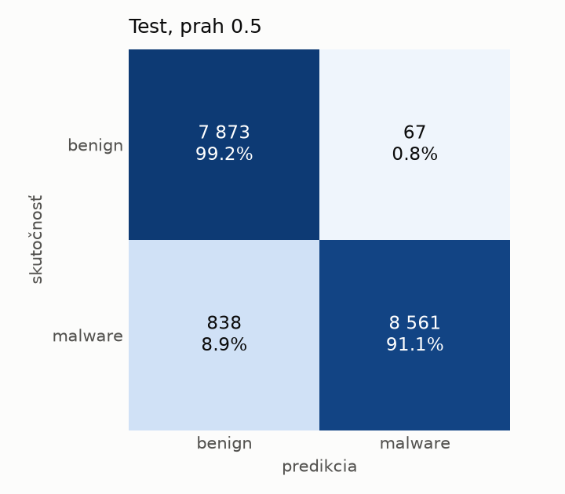
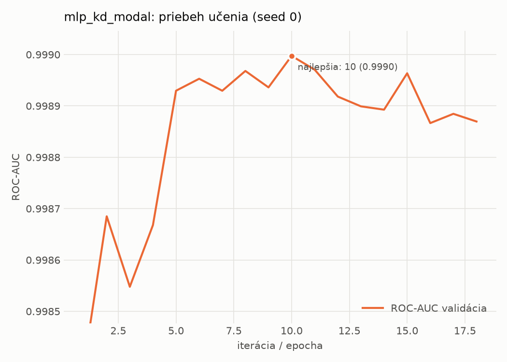

# static/mlp_kd_modal – beh `20261104-012144`

> Automaticky generované (`src/training/run_tabular.py`). Konfigurácia: `config.yaml`, protokol: `protocol.yaml`.

- **Model:** `mlp` – študent – malé MLP učené destiláciou z učiteľa rovnakej modality (variant A)
- **Ladenie:** bez ladenia – hyperparametre prevzaté z `runs_final/students_static/mlp_kd_modal/20261102-211832`
- **Finálne modely:** seedy [0, 1, 2]; hodnoty sú priemer ± smerodajná odchýlka cez seedy
- **Najlepšie hyperparametre:** `{"hidden_layers": 1, "max_epochs": 100, "patience": 8, "hidden_width": 32, "dropout": 0.15602040635334324, "lr": 0.00105640764164036, "weight_decay": 3.5856126103453987e-06, "batch_size": 256, "kd_alpha": 0.815861880342119, "kd_temperature": 5.185299851677596}`

## Detekčná kvalita (bez prahu)
| metrika | train (podvzorka) | validácia | test |
|---|---|---|---|
| ROC-AUC | 0.9999 ± 0.0000 | 0.9991 ± 0.0002 | 0.9953 ± 0.0004 |
| PR-AUC | 0.9999 ± 0.0000 | 0.9987 ± 0.0008 | 0.9933 ± 0.0005 |
| TPR pri FPR 1 % | 0.9994 ± 0.0002 | 0.9912 ± 0.0018 | 0.9124 ± 0.0009 |
| TPR pri FPR 0,1 % | 0.9925 ± 0.0033 | 0.9538 ± 0.0190 | 0.6139 ± 0.0626 |
| log loss | 0.0098 ± 0.0009 | 0.0274 ± 0.0002 | 0.1537 ± 0.0176 |
| Brier skóre | 0.0025 ± 0.0002 | 0.0065 ± 0.0002 | 0.0415 ± 0.0051 |

Rozdiel ROC-AUC train − validácia: **0.0008** (veľký rozdiel = preučenie).

## Pri prahu z validácie (FPR ≤ 1% na validácii)
| metrika | train (podvzorka) | validácia | test |
|---|---|---|---|
| accuracy | 0.9947 ± 0.0015 | 0.9910 ± 0.0011 | 0.9417 ± 0.0074 |
| balanced accuracy | 0.9956 ± 0.0012 | 0.9909 ± 0.0009 | 0.9457 ± 0.0069 |
| precision | 0.9996 ± 0.0002 | 0.9947 ± 0.0004 | 0.9939 ± 0.0004 |
| recall (TPR) | 0.9919 ± 0.0023 | 0.9912 ± 0.0018 | 0.8979 ± 0.0136 |
| FPR | 0.0007 ± 0.0003 | 0.0094 ± 0.0007 | 0.0065 ± 0.0004 |
| F1 | 0.9957 ± 0.0012 | 0.9929 ± 0.0009 | 0.9435 ± 0.0076 |
| MCC | 0.9887 ± 0.0032 | 0.9805 ± 0.0024 | 0.8885 ± 0.0134 |

## Pri pevnom prahu 0.5
| metrika | train (podvzorka) | validácia | test |
|---|---|---|---|
| accuracy | 0.9975 ± 0.0004 | 0.9925 ± 0.0002 | 0.9477 ± 0.0010 |
| balanced accuracy | 0.9976 ± 0.0004 | 0.9916 ± 0.0002 | 0.9511 ± 0.0009 |
| precision | 0.9988 ± 0.0002 | 0.9933 ± 0.0000 | 0.9919 ± 0.0003 |
| recall (TPR) | 0.9972 ± 0.0005 | 0.9950 ± 0.0004 | 0.9109 ± 0.0017 |
| FPR | 0.0021 ± 0.0003 | 0.0119 ± 0.0000 | 0.0088 ± 0.0003 |
| F1 | 0.9980 ± 0.0003 | 0.9942 ± 0.0002 | 0.9497 ± 0.0010 |
| MCC | 0.9946 ± 0.0009 | 0.9838 ± 0.0005 | 0.8990 ± 0.0018 |

## Výpočtové nároky (seed 0, testovacia množina)
| meranie | hodnota |
|---|---|
| tréning finálneho modelu | 9.6 s (priemer cez seedy) |
| ladenie spolu | 0 s |
| počet parametrov / uzlov | 74 337 |
| veľkosť modelu na disku | 0.36 MB |
| transformácia vstupu – latencia (1 vlákno) | 0.042 ms |
| transformácia vstupu – priepustnosť | 39 858 vzoriek/s |
| CPU latencia modelu (batch 1, 1 vlákno) | 0.068 ms (p95 0.114) |
| CPU priepustnosť (24 vlákien) | 109 391 vzoriek/s |
| GPU latencia (batch 1) | 0.272 ms (p95 0.319) |
| GPU priepustnosť | 74 527 vzoriek/s |
| GPU špičková pamäť | 810 MB |

## Grafy
| | |
|---|---|
|  |  |
|  |  |
|  |  |
|  |  |

## Súbory
`metrics.json` (všetky metriky po seedoch vrátane rodín), `timing.json`, `hpo_trials.csv`,
`predictions/<časť>_seed<N>.parquet` (sha256, family, label, score), `model/seed_<N>/`, `log.txt`.
