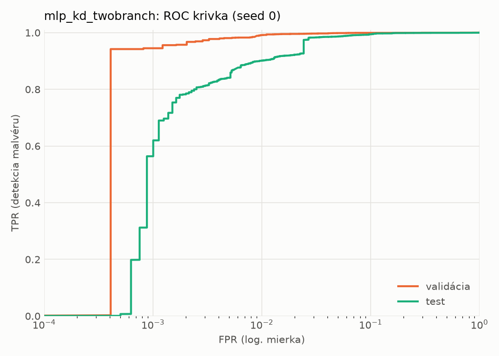
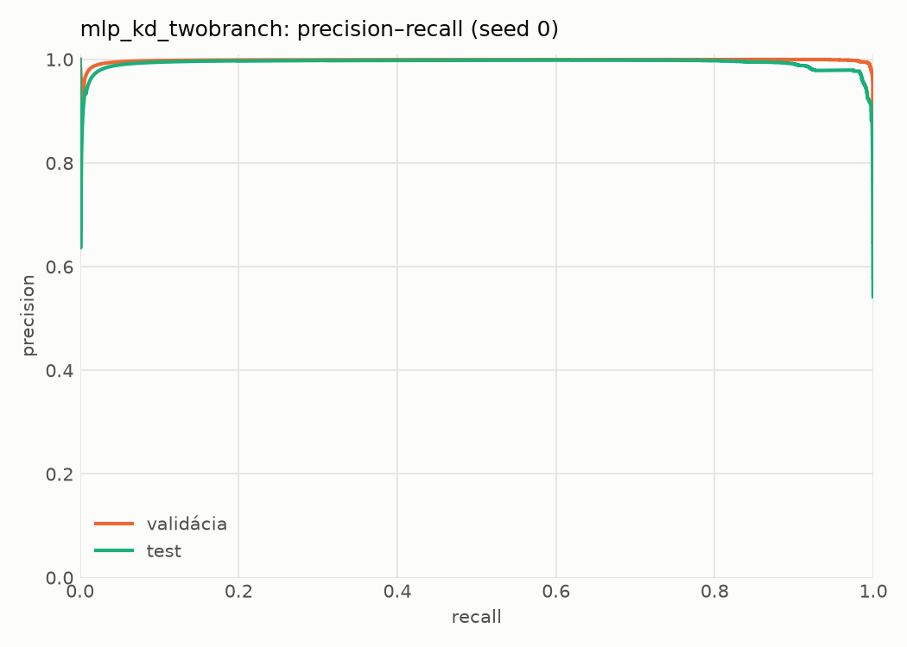
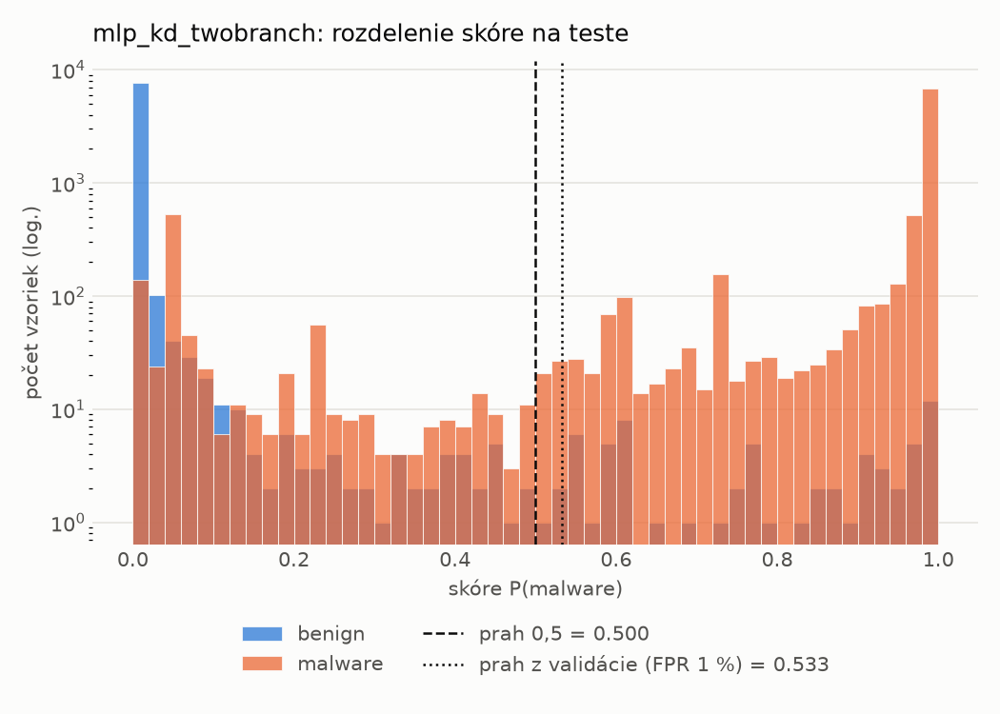
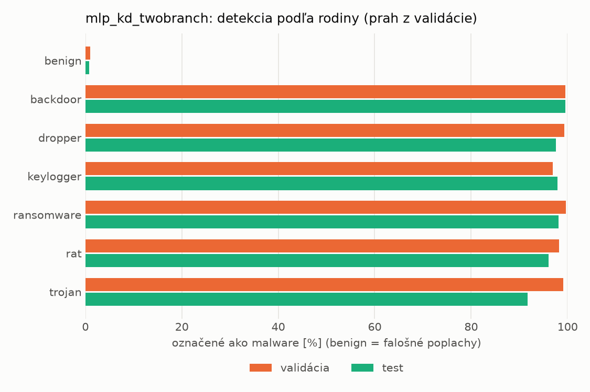
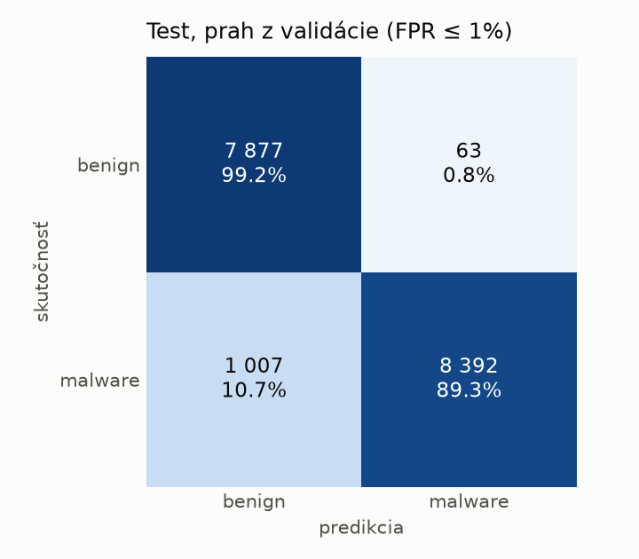
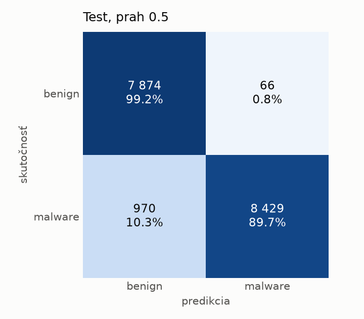
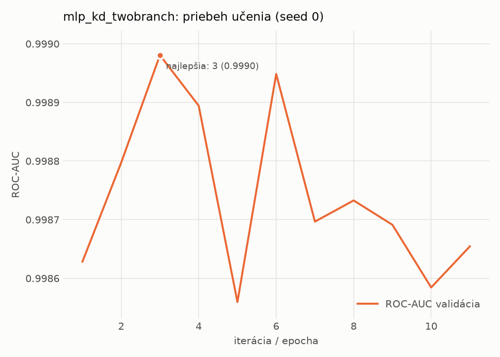

# static/mlp_kd_twobranch – beh `20261104-012222`

> Automaticky generované (`src/training/run_tabular.py`). Konfigurácia: `config.yaml`, protokol: `protocol.yaml`.

- **Model:** `mlp` – študent – malé MLP učené destiláciou z dvojvetvovej siete (V2)
- **Ladenie:** bez ladenia – hyperparametre prevzaté z `runs_v2/full/students_static/mlp_kd_twobranch/20261103-210128`
- **Finálne modely:** seedy [0, 1, 2]; hodnoty sú priemer ± smerodajná odchýlka cez seedy
- **Najlepšie hyperparametre:** `{"hidden_layers": 1, "max_epochs": 100, "patience": 8, "hidden_width": 32, "dropout": 0.11907530604839062, "lr": 0.0013122016832935236, "weight_decay": 1.6321051677063922e-05, "batch_size": 256, "kd_alpha": 0.8749635763069835, "kd_temperature": 3.9893325789148495}`

## Detekčná kvalita (bez prahu)
| metrika | train (podvzorka) | validácia | test |
|---|---|---|---|
| ROC-AUC | 0.9999 ± 0.0001 | 0.9991 ± 0.0001 | 0.9947 ± 0.0009 |
| PR-AUC | 0.9999 ± 0.0000 | 0.9983 ± 0.0001 | 0.9932 ± 0.0004 |
| TPR pri FPR 1 % | 0.9984 ± 0.0009 | 0.9891 ± 0.0036 | 0.8980 ± 0.0157 |
| TPR pri FPR 0,1 % | 0.9846 ± 0.0076 | 0.9583 ± 0.0142 | 0.6107 ± 0.0859 |
| log loss | 0.0142 ± 0.0041 | 0.0287 ± 0.0038 | 0.1775 ± 0.0249 |
| Brier skóre | 0.0038 ± 0.0011 | 0.0072 ± 0.0008 | 0.0485 ± 0.0057 |

Rozdiel ROC-AUC train − validácia: **0.0008** (veľký rozdiel = preučenie).

## Pri prahu z validácie (FPR ≤ 1% na validácii)
| metrika | train (podvzorka) | validácia | test |
|---|---|---|---|
| accuracy | 0.9932 ± 0.0029 | 0.9898 ± 0.0019 | 0.9344 ± 0.0113 |
| balanced accuracy | 0.9942 ± 0.0025 | 0.9901 ± 0.0013 | 0.9389 ± 0.0105 |
| precision | 0.9988 ± 0.0008 | 0.9950 ± 0.0006 | 0.9931 ± 0.0007 |
| recall (TPR) | 0.9904 ± 0.0043 | 0.9891 ± 0.0036 | 0.8851 ± 0.0207 |
| FPR | 0.0020 ± 0.0013 | 0.0089 ± 0.0010 | 0.0073 ± 0.0007 |
| F1 | 0.9946 ± 0.0024 | 0.9920 ± 0.0015 | 0.9359 ± 0.0118 |
| MCC | 0.9857 ± 0.0062 | 0.9780 ± 0.0041 | 0.8753 ± 0.0201 |

## Pri pevnom prahu 0.5
| metrika | train (podvzorka) | validácia | test |
|---|---|---|---|
| accuracy | 0.9960 ± 0.0007 | 0.9915 ± 0.0009 | 0.9406 ± 0.0066 |
| balanced accuracy | 0.9961 ± 0.0007 | 0.9909 ± 0.0006 | 0.9445 ± 0.0062 |
| precision | 0.9979 ± 0.0007 | 0.9936 ± 0.0005 | 0.9911 ± 0.0018 |
| recall (TPR) | 0.9957 ± 0.0009 | 0.9931 ± 0.0019 | 0.8985 ± 0.0111 |
| FPR | 0.0035 ± 0.0012 | 0.0113 ± 0.0009 | 0.0095 ± 0.0018 |
| F1 | 0.9968 ± 0.0005 | 0.9934 ± 0.0007 | 0.9425 ± 0.0067 |
| MCC | 0.9915 ± 0.0014 | 0.9816 ± 0.0020 | 0.8860 ± 0.0123 |

## Výpočtové nároky (seed 0, testovacia množina)
| meranie | hodnota |
|---|---|
| tréning finálneho modelu | 5.1 s (priemer cez seedy) |
| ladenie spolu | 0 s |
| počet parametrov / uzlov | 74 337 |
| veľkosť modelu na disku | 0.36 MB |
| transformácia vstupu – latencia (1 vlákno) | 0.042 ms |
| transformácia vstupu – priepustnosť | 38 364 vzoriek/s |
| CPU latencia modelu (batch 1, 1 vlákno) | 0.068 ms (p95 0.079) |
| CPU priepustnosť (24 vlákien) | 109 711 vzoriek/s |
| GPU latencia (batch 1) | 0.270 ms (p95 0.309) |
| GPU priepustnosť | 75 827 vzoriek/s |
| GPU špičková pamäť | 1439 MB |

## Grafy
| | |
|---|---|
|  |  |
|  |  |
|  |  |
|  |  |

## Súbory
`metrics.json` (všetky metriky po seedoch vrátane rodín), `timing.json`, `hpo_trials.csv`,
`predictions/<časť>_seed<N>.parquet` (sha256, family, label, score), `model/seed_<N>/`, `log.txt`.
