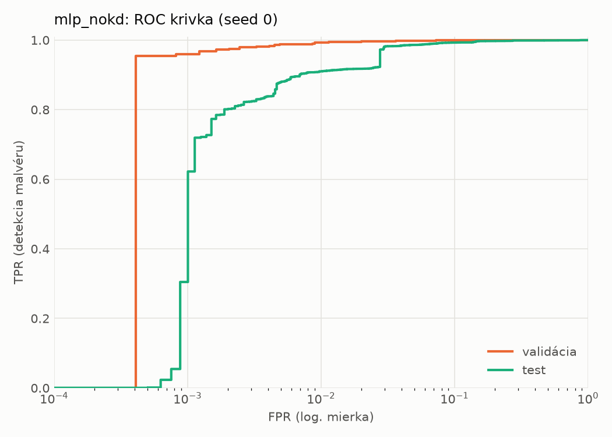
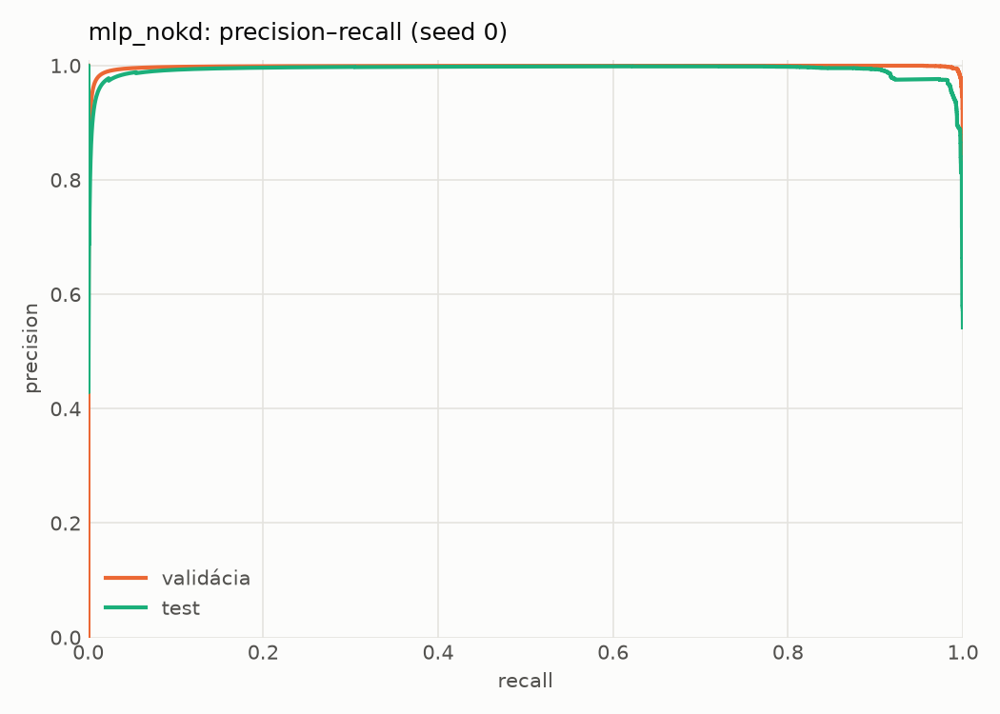
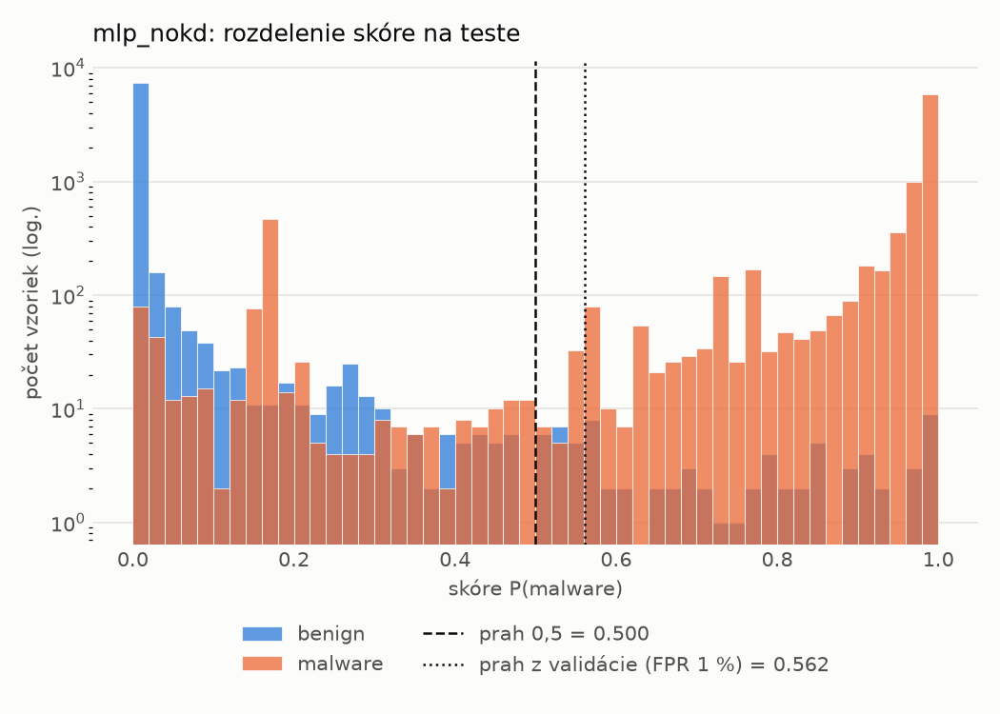
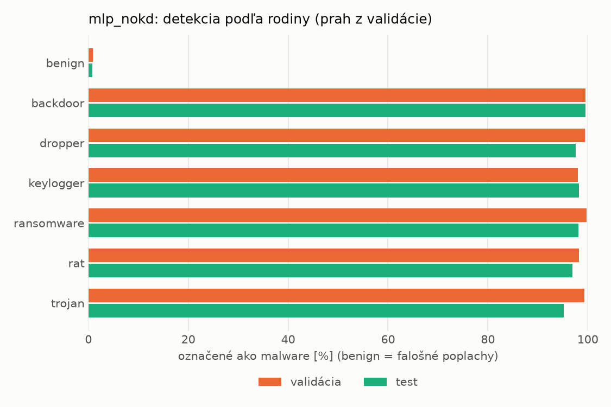
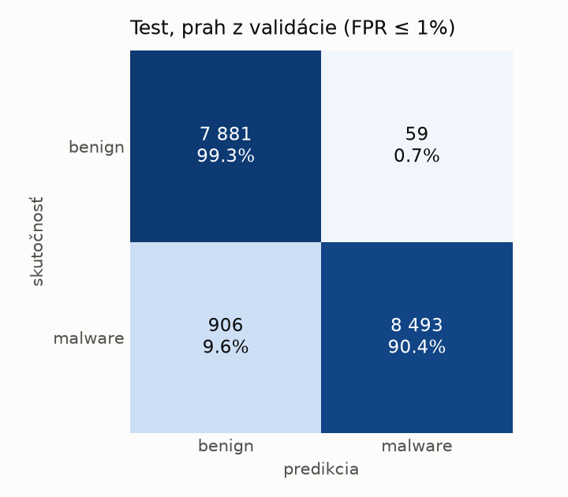
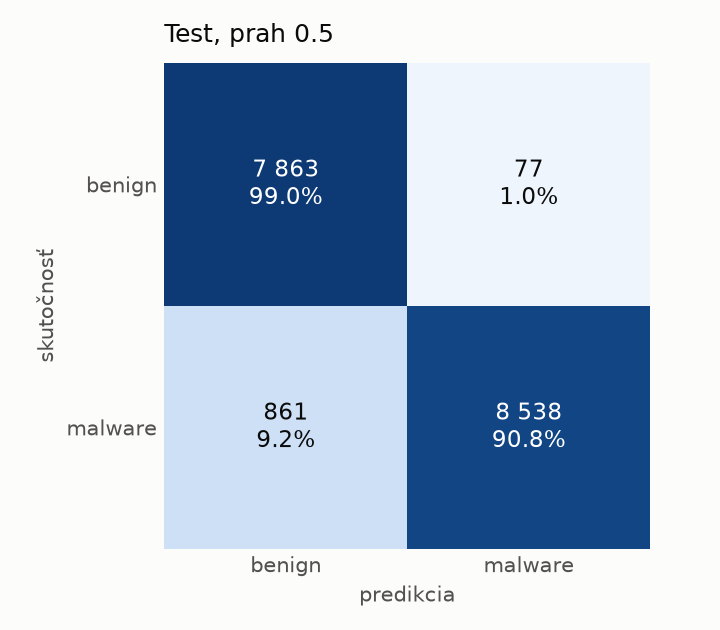
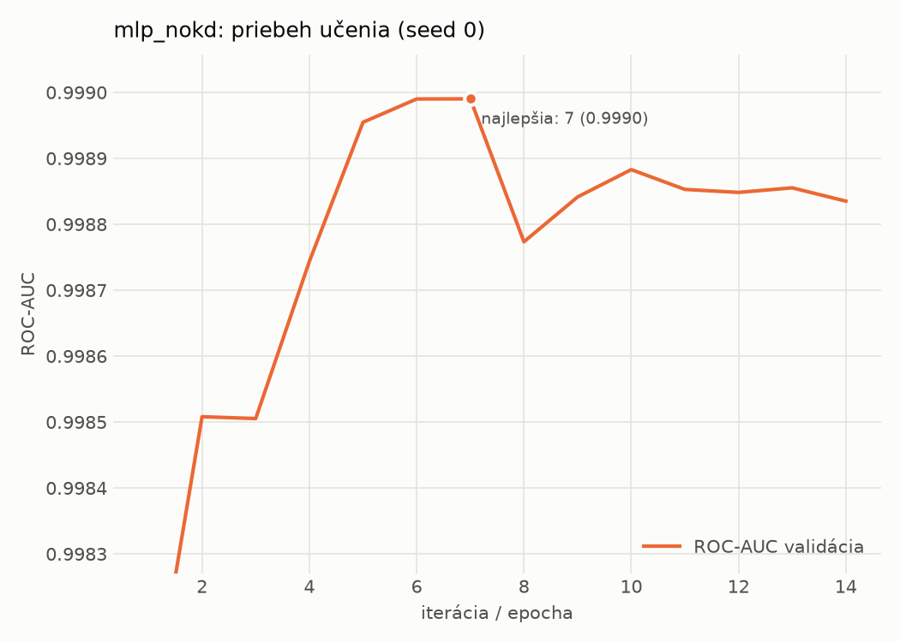

# static/mlp_nokd – beh `20261104-012129`

> Automaticky generované (`src/training/run_tabular.py`). Konfigurácia: `config.yaml`, protokol: `protocol.yaml`.

- **Model:** `mlp` – kontrola – rovnaké malé MLP bez destilácie (iba skutočné označenia)
- **Ladenie:** bez ladenia – hyperparametre prevzaté z `runs_final/students_static/mlp_nokd/20261102-211710`
- **Finálne modely:** seedy [0, 1, 2]; hodnoty sú priemer ± smerodajná odchýlka cez seedy
- **Najlepšie hyperparametre:** `{"hidden_layers": 1, "max_epochs": 100, "patience": 8, "hidden_width": 32, "dropout": 0.137657909519708, "lr": 0.0007042503153050794, "weight_decay": 1.207246112223234e-05, "batch_size": 512}`

## Detekčná kvalita (bez prahu)
| metrika | train (podvzorka) | validácia | test |
|---|---|---|---|
| ROC-AUC | 0.9997 ± 0.0001 | 0.9989 ± 0.0001 | 0.9936 ± 0.0010 |
| PR-AUC | 0.9999 ± 0.0000 | 0.9978 ± 0.0000 | 0.9917 ± 0.0002 |
| TPR pri FPR 1 % | 0.9981 ± 0.0006 | 0.9871 ± 0.0054 | 0.8962 ± 0.0123 |
| TPR pri FPR 0,1 % | 0.9763 ± 0.0125 | 0.9523 ± 0.0094 | 0.5504 ± 0.2131 |
| log loss | 0.0244 ± 0.0080 | 0.0375 ± 0.0060 | 0.1508 ± 0.0088 |
| Brier skóre | 0.0044 ± 0.0012 | 0.0080 ± 0.0010 | 0.0449 ± 0.0027 |

Rozdiel ROC-AUC train − validácia: **0.0008** (veľký rozdiel = preučenie).

## Pri prahu z validácie (FPR ≤ 1% na validácii)
| metrika | train (podvzorka) | validácia | test |
|---|---|---|---|
| accuracy | 0.9926 ± 0.0034 | 0.9883 ± 0.0036 | 0.9371 ± 0.0065 |
| balanced accuracy | 0.9937 ± 0.0027 | 0.9888 ± 0.0029 | 0.9413 ± 0.0061 |
| precision | 0.9988 ± 0.0006 | 0.9946 ± 0.0003 | 0.9918 ± 0.0011 |
| recall (TPR) | 0.9894 ± 0.0054 | 0.9871 ± 0.0054 | 0.8913 ± 0.0112 |
| FPR | 0.0021 ± 0.0009 | 0.0094 ± 0.0004 | 0.0087 ± 0.0011 |
| F1 | 0.9940 ± 0.0027 | 0.9908 ± 0.0029 | 0.9389 ± 0.0067 |
| MCC | 0.9843 ± 0.0072 | 0.9749 ± 0.0077 | 0.8798 ± 0.0119 |

## Pri pevnom prahu 0.5
| metrika | train (podvzorka) | validácia | test |
|---|---|---|---|
| accuracy | 0.9954 ± 0.0012 | 0.9895 ± 0.0022 | 0.9413 ± 0.0044 |
| balanced accuracy | 0.9957 ± 0.0010 | 0.9889 ± 0.0021 | 0.9450 ± 0.0042 |
| precision | 0.9981 ± 0.0002 | 0.9926 ± 0.0012 | 0.9891 ± 0.0022 |
| recall (TPR) | 0.9945 ± 0.0019 | 0.9910 ± 0.0024 | 0.9017 ± 0.0062 |
| FPR | 0.0031 ± 0.0003 | 0.0131 ± 0.0022 | 0.0118 ± 0.0024 |
| F1 | 0.9963 ± 0.0010 | 0.9918 ± 0.0017 | 0.9434 ± 0.0044 |
| MCC | 0.9902 ± 0.0027 | 0.9773 ± 0.0047 | 0.8868 ± 0.0084 |

## Výpočtové nároky (seed 0, testovacia množina)
| meranie | hodnota |
|---|---|
| tréning finálneho modelu | 2.1 s (priemer cez seedy) |
| ladenie spolu | 0 s |
| počet parametrov / uzlov | 74 337 |
| veľkosť modelu na disku | 0.36 MB |
| transformácia vstupu – latencia (1 vlákno) | 0.041 ms |
| transformácia vstupu – priepustnosť | 38 193 vzoriek/s |
| CPU latencia modelu (batch 1, 1 vlákno) | 0.069 ms (p95 0.080) |
| CPU priepustnosť (24 vlákien) | 60 917 vzoriek/s |
| GPU latencia (batch 1) | 0.263 ms (p95 0.299) |
| GPU priepustnosť | 80 758 vzoriek/s |
| GPU špičková pamäť | 1439 MB |

## Grafy
| | |
|---|---|
|  |  |
|  |  |
|  |  |
|  |  |

## Súbory
`metrics.json` (všetky metriky po seedoch vrátane rodín), `timing.json`, `hpo_trials.csv`,
`predictions/<časť>_seed<N>.parquet` (sha256, family, label, score), `model/seed_<N>/`, `log.txt`.
