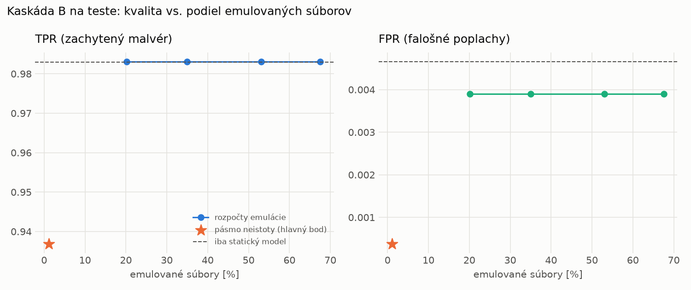

# Kaskáda B `b_baselines` – beh `20261104-034547`

> Generované `src/cascade/evaluate_b.py` (2026-11-04T03:45:47+01:00). Seedy: [0, 1, 2]; hodnoty = priemer ± sm. odchýlka.
> Všetky prahy a pásmo neistoty sú z validácie; test sa na nič nenastavuje. Postup: `docs/09_plan_v2.md`.

| rola | beh |
|---|---|
| static | `runs_v2/lofo/dropper/static/lightgbm/20261104-012654` |
| dynamic | `runs_v2/lofo/dropper/dynamic/lightgbm/20261104-014114` |
| hybrid | `runs_v2/lofo/dropper/hybrid/lightgbm/20261104-022110` |

Druhý stupeň: **dynamic**. Pásmo neistoty statického modelu: FPR ≤ 0.1% nad `hi`,
najviac 1% malvéru validácie pod `lo` (seed 0: lo = 0.9647, hi = 0.9647, seed 1: lo = 0.9211, hi = 0.9548, seed 2: lo = 0.9567, hi = 0.9567).

## Test
| prístup | accuracy | balanced_accuracy | precision | recall_tpr | fpr | f1 | mcc |
|---|---|---|---|---|---|---|---|
| kaskáda B | 0.9656 ± 0.0046 | 0.9682 ± 0.0043 | 0.9997 ± 0.0000 | 0.9369 ± 0.0086 | 0.0004 ± 0.0000 | 0.9672 ± 0.0046 | 0.9333 ± 0.0086 |
| statický | 0.9886 ± 0.0017 | 0.9891 ± 0.0016 | 0.9960 ± 0.0003 | 0.9829 ± 0.0034 | 0.0047 ± 0.0003 | 0.9894 ± 0.0016 | 0.9772 ± 0.0034 |
| dynamický | 0.8237 ± 0.0014 | 0.8355 ± 0.0011 | 0.9717 ± 0.0023 | 0.6950 ± 0.0044 | 0.0239 ± 0.0022 | 0.8104 ± 0.0022 | 0.6862 ± 0.0012 |
| hybrid (každá vzorka) | 0.9896 ± 0.0008 | 0.9900 ± 0.0006 | 0.9960 ± 0.0009 | 0.9848 ± 0.0022 | 0.0047 ± 0.0010 | 0.9904 ± 0.0007 | 0.9792 ± 0.0015 |

- **emulované súbory: 1.13%** (ostatné rozhodne iba statický model); na hybrid ide 0.39% súborov
- chyby pri istom rozhodnutí statického modelu (seed 0): 689
- validácia: emulované 0.06%, na hybrid 0.04%

## Validácia
| prístup | accuracy | balanced_accuracy | precision | recall_tpr | fpr | f1 | mcc |
|---|---|---|---|---|---|---|---|
| kaskáda B | 0.9935 ± 0.0004 | 0.9946 ± 0.0005 | 0.9993 ± 0.0004 | 0.9904 ± 0.0002 | 0.0012 ± 0.0007 | 0.9948 ± 0.0003 | 0.9861 ± 0.0009 |
| statický | 0.9949 ± 0.0002 | 0.9940 ± 0.0001 | 0.9943 ± 0.0001 | 0.9976 ± 0.0004 | 0.0097 ± 0.0002 | 0.9960 ± 0.0001 | 0.9891 ± 0.0004 |
| dynamický | 0.9702 ± 0.0009 | 0.9743 ± 0.0007 | 0.9942 ± 0.0003 | 0.9583 ± 0.0015 | 0.0096 ± 0.0005 | 0.9759 ± 0.0008 | 0.9379 ± 0.0018 |
| hybrid (každá vzorka) | 0.9947 ± 0.0002 | 0.9939 ± 0.0002 | 0.9944 ± 0.0001 | 0.9973 ± 0.0001 | 0.0096 ± 0.0002 | 0.9958 ± 0.0001 | 0.9887 ± 0.0004 |

## Januárové vzorky vynechanej rodiny (iba malvér → TPR)
| prístup | TPR |
|---|---|
| kaskáda B | 0.7545 ± 0.0136 |
| statický | 0.9791 ± 0.0046 |
| dynamický | 0.6458 ± 0.0037 |
| hybrid (každá vzorka) | 0.9796 ± 0.0017 |

Podiel emulovaných: 1.52%

## Krivka rozpočtu emulácie (test, priemer cez seedy)
| budget_val | emulation_rate | hybrid_rate | recall_tpr | fpr | f1 |
|---|---|---|---|---|---|
| 0.1000 | 0.2015 | 0.0495 | 0.9831 | 0.0039 | 0.9898 |
| 0.2000 | 0.3498 | 0.0796 | 0.9831 | 0.0039 | 0.9898 |
| 0.3000 | 0.5306 | 0.1131 | 0.9831 | 0.0039 | 0.9898 |
| 0.4000 | 0.6755 | 0.1347 | 0.9831 | 0.0039 | 0.9898 |

## Výpočtové nároky
Emulácia (Speakeasy) sa nedá zmerať (dataset neobsahuje PE súbory). **Predpoklad** 60 s na súbor
(limit z `speakeasy-config.json`): kaskáda B ≈ 0.7 s na súbor v priemere, dynamický/hybridný model
a kaskáda A 60 s (emulujú každý súbor).

_Chýba benchmark niektorého komponentu (v zero-day behoch sa nemeria)._

