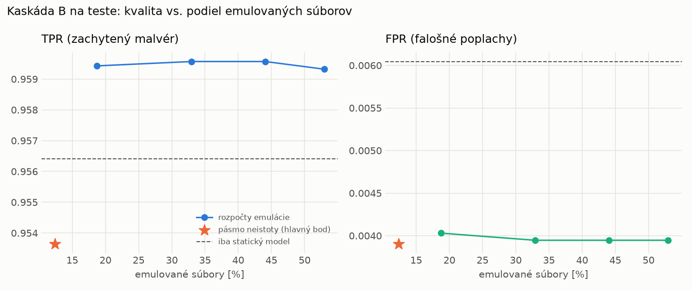

# Kaskáda B `b_heavy` – beh `20261104-034545`

> Generované `src/cascade/evaluate_b.py` (2026-11-04T03:45:45+01:00). Seedy: [0, 1, 2]; hodnoty = priemer ± sm. odchýlka.
> Všetky prahy a pásmo neistoty sú z validácie; test sa na nič nenastavuje. Postup: `docs/09_plan_v2.md`.

| rola | beh |
|---|---|
| static | `runs_v2/lofo/dropper/students_static/mlp_kd/20261104-034134` |
| dynamic | `runs_v2/lofo/dropper/students_dynamic/mlp_kd/20261104-034323` |
| hybrid | `runs_v2/lofo/dropper/hybrid/two_branch/20261104-022321` |

Druhý stupeň: **dynamic**. Pásmo neistoty statického modelu: FPR ≤ 0.1% nad `hi`,
najviac 1% malvéru validácie pod `lo` (seed 0: lo = 0.5371, hi = 0.9965, seed 1: lo = 0.5383, hi = 0.9998, seed 2: lo = 0.5418, hi = 0.9990).

## Test
| prístup | accuracy | balanced_accuracy | precision | recall_tpr | fpr | f1 | mcc |
|---|---|---|---|---|---|---|---|
| kaskáda B | 0.9731 ± 0.0017 | 0.9749 ± 0.0016 | 0.9966 ± 0.0004 | 0.9536 ± 0.0035 | 0.0039 ± 0.0004 | 0.9746 ± 0.0017 | 0.9470 ± 0.0033 |
| statický | 0.9736 ± 0.0016 | 0.9752 ± 0.0015 | 0.9947 ± 0.0005 | 0.9564 ± 0.0035 | 0.0060 ± 0.0006 | 0.9752 ± 0.0016 | 0.9479 ± 0.0031 |
| dynamický | 0.7453 ± 0.0142 | 0.7630 ± 0.0131 | 0.9611 ± 0.0020 | 0.5525 ± 0.0262 | 0.0264 ± 0.0006 | 0.7014 ± 0.0215 | 0.5660 ± 0.0212 |
| hybrid (každá vzorka) | 0.9837 ± 0.0050 | 0.9844 ± 0.0048 | 0.9938 ± 0.0019 | 0.9760 ± 0.0082 | 0.0073 ± 0.0022 | 0.9848 ± 0.0047 | 0.9674 ± 0.0100 |

- **emulované súbory: 12.38%** (ostatné rozhodne iba statický model); na hybrid ide 6.23% súborov
- chyby pri istom rozhodnutí statického modelu (seed 0): 341
- validácia: emulované 5.78%, na hybrid 2.01%

## Validácia
| prístup | accuracy | balanced_accuracy | precision | recall_tpr | fpr | f1 | mcc |
|---|---|---|---|---|---|---|---|
| kaskáda B | 0.9901 ± 0.0006 | 0.9909 ± 0.0006 | 0.9965 ± 0.0004 | 0.9877 ± 0.0006 | 0.0059 ± 0.0006 | 0.9921 ± 0.0005 | 0.9789 ± 0.0013 |
| statický | 0.9884 ± 0.0004 | 0.9889 ± 0.0003 | 0.9944 ± 0.0003 | 0.9873 ± 0.0009 | 0.0096 ± 0.0005 | 0.9908 ± 0.0004 | 0.9753 ± 0.0009 |
| dynamický | 0.9570 ± 0.0020 | 0.9639 ± 0.0016 | 0.9941 ± 0.0001 | 0.9373 ± 0.0033 | 0.0096 ± 0.0002 | 0.9649 ± 0.0017 | 0.9122 ± 0.0039 |
| hybrid (každá vzorka) | 0.9938 ± 0.0003 | 0.9931 ± 0.0003 | 0.9944 ± 0.0001 | 0.9958 ± 0.0005 | 0.0096 ± 0.0002 | 0.9951 ± 0.0003 | 0.9868 ± 0.0008 |

## Januárové vzorky vynechanej rodiny (iba malvér → TPR)
| prístup | TPR |
|---|---|
| kaskáda B | 0.9374 ± 0.0125 |
| statický | 0.9300 ± 0.0192 |
| dynamický | 0.6764 ± 0.0115 |
| hybrid (každá vzorka) | 0.9551 ± 0.0118 |

Podiel emulovaných: 53.30%

## Krivka rozpočtu emulácie (test, priemer cez seedy)
| budget_val | emulation_rate | hybrid_rate | recall_tpr | fpr | f1 |
|---|---|---|---|---|---|
| 0.1000 | 0.1871 | 0.0757 | 0.9594 | 0.0040 | 0.9776 |
| 0.2000 | 0.3294 | 0.1459 | 0.9596 | 0.0039 | 0.9777 |
| 0.3000 | 0.4406 | 0.1926 | 0.9596 | 0.0039 | 0.9777 |
| 0.4000 | 0.5295 | 0.2261 | 0.9593 | 0.0039 | 0.9776 |

## Výpočtové nároky
Emulácia (Speakeasy) sa nedá zmerať (dataset neobsahuje PE súbory). **Predpoklad** 60 s na súbor
(limit z `speakeasy-config.json`): kaskáda B ≈ 7.4 s na súbor v priemere, dynamický/hybridný model
a kaskáda A 60 s (emulujú každý súbor).

_Chýba benchmark niektorého komponentu (v zero-day behoch sa nemeria)._

