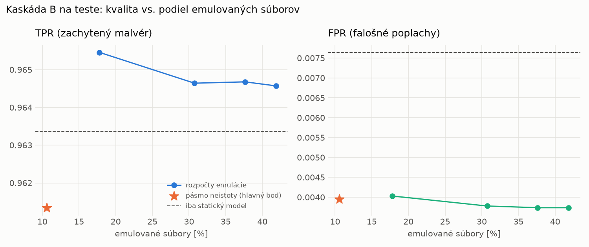

# Kaskáda B `b_nokd` – beh `20261104-034549`

> Generované `src/cascade/evaluate_b.py` (2026-11-04T03:45:49+01:00). Seedy: [0, 1, 2]; hodnoty = priemer ± sm. odchýlka.
> Všetky prahy a pásmo neistoty sú z validácie; test sa na nič nenastavuje. Postup: `docs/09_plan_v2.md`.

| rola | beh |
|---|---|
| static | `runs_v2/lofo/dropper/students_static/mlp_nokd/20261104-034206` |
| dynamic | `runs_v2/lofo/dropper/students_dynamic/mlp_nokd/20261104-034356` |
| hybrid | `runs_v2/lofo/dropper/hybrid/lightgbm/20261104-022110` |

Druhý stupeň: **dynamic**. Pásmo neistoty statického modelu: FPR ≤ 0.1% nad `hi`,
najviac 1% malvéru validácie pod `lo` (seed 0: lo = 0.5263, hi = 0.9866, seed 1: lo = 0.5297, hi = 0.9627, seed 2: lo = 0.5408, hi = 0.9624).

## Test
| prístup | accuracy | balanced_accuracy | precision | recall_tpr | fpr | f1 | mcc |
|---|---|---|---|---|---|---|---|
| kaskáda B | 0.9772 ± 0.0023 | 0.9787 ± 0.0022 | 0.9965 ± 0.0006 | 0.9613 ± 0.0042 | 0.0039 ± 0.0006 | 0.9786 ± 0.0022 | 0.9550 ± 0.0045 |
| statický | 0.9766 ± 0.0037 | 0.9779 ± 0.0034 | 0.9933 ± 0.0007 | 0.9634 ± 0.0069 | 0.0076 ± 0.0008 | 0.9781 ± 0.0035 | 0.9536 ± 0.0071 |
| dynamický | 0.7303 ± 0.0058 | 0.7494 ± 0.0052 | 0.9639 ± 0.0050 | 0.5220 ± 0.0128 | 0.0232 ± 0.0037 | 0.6772 ± 0.0100 | 0.5458 ± 0.0075 |
| hybrid (každá vzorka) | 0.9896 ± 0.0008 | 0.9900 ± 0.0006 | 0.9960 ± 0.0009 | 0.9848 ± 0.0022 | 0.0047 ± 0.0010 | 0.9904 ± 0.0007 | 0.9792 ± 0.0015 |

- **emulované súbory: 10.60%** (ostatné rozhodne iba statický model); na hybrid ide 6.79% súborov
- chyby pri istom rozhodnutí statického modelu (seed 0): 308
- validácia: emulované 4.74%, na hybrid 1.86%

## Validácia
| prístup | accuracy | balanced_accuracy | precision | recall_tpr | fpr | f1 | mcc |
|---|---|---|---|---|---|---|---|
| kaskáda B | 0.9905 ± 0.0014 | 0.9914 ± 0.0013 | 0.9970 ± 0.0006 | 0.9878 ± 0.0016 | 0.0051 ± 0.0010 | 0.9924 ± 0.0011 | 0.9797 ± 0.0029 |
| statický | 0.9895 ± 0.0020 | 0.9897 ± 0.0015 | 0.9944 ± 0.0003 | 0.9889 ± 0.0032 | 0.0096 ± 0.0005 | 0.9916 ± 0.0016 | 0.9775 ± 0.0041 |
| dynamický | 0.9550 ± 0.0013 | 0.9623 ± 0.0010 | 0.9939 ± 0.0001 | 0.9343 ± 0.0023 | 0.0097 ± 0.0002 | 0.9632 ± 0.0011 | 0.9084 ± 0.0025 |
| hybrid (každá vzorka) | 0.9947 ± 0.0002 | 0.9939 ± 0.0002 | 0.9944 ± 0.0001 | 0.9973 ± 0.0001 | 0.0096 ± 0.0002 | 0.9958 ± 0.0001 | 0.9887 ± 0.0004 |

## Januárové vzorky vynechanej rodiny (iba malvér → TPR)
| prístup | TPR |
|---|---|
| kaskáda B | 0.9207 ± 0.0117 |
| statický | 0.9198 ± 0.0130 |
| dynamický | 0.6733 ± 0.0024 |
| hybrid (každá vzorka) | 0.9796 ± 0.0017 |

Podiel emulovaných: 45.35%

## Krivka rozpočtu emulácie (test, priemer cez seedy)
| budget_val | emulation_rate | hybrid_rate | recall_tpr | fpr | f1 |
|---|---|---|---|---|---|
| 0.1000 | 0.1779 | 0.0934 | 0.9655 | 0.0040 | 0.9807 |
| 0.2000 | 0.3075 | 0.1769 | 0.9646 | 0.0038 | 0.9804 |
| 0.3000 | 0.3761 | 0.1930 | 0.9647 | 0.0037 | 0.9804 |
| 0.4000 | 0.4185 | 0.2071 | 0.9646 | 0.0037 | 0.9804 |

## Výpočtové nároky
Emulácia (Speakeasy) sa nedá zmerať (dataset neobsahuje PE súbory). **Predpoklad** 60 s na súbor
(limit z `speakeasy-config.json`): kaskáda B ≈ 6.4 s na súbor v priemere, dynamický/hybridný model
a kaskáda A 60 s (emulujú každý súbor).

_Chýba benchmark niektorého komponentu (v zero-day behoch sa nemeria)._

