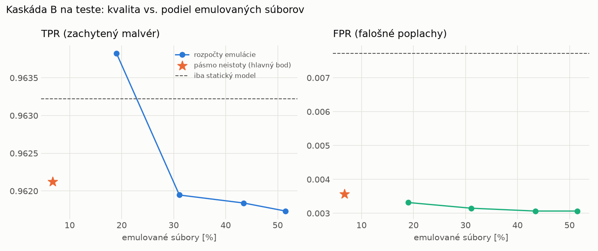
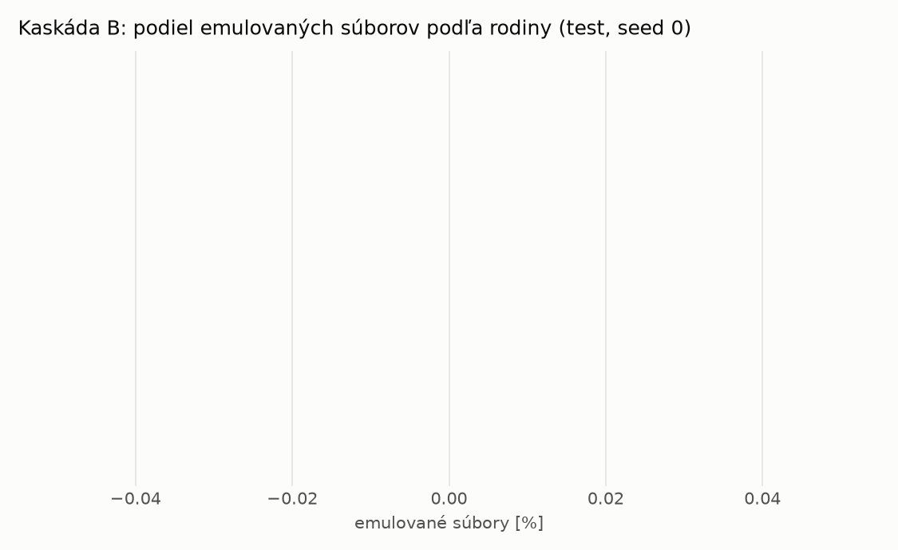

# Kaskáda B `b_twobranch` – beh `20261104-034551`

> Generované `src/cascade/evaluate_b.py` (2026-11-04T03:45:51+01:00). Seedy: [0, 1, 2]; hodnoty = priemer ± sm. odchýlka.
> Všetky prahy a pásmo neistoty sú z validácie; test sa na nič nenastavuje. Postup: `docs/09_plan_v2.md`.

| rola | beh |
|---|---|
| static | `runs_v2/lofo/dropper/students_static/mlp_kd_twobranch/20261104-034252` |
| dynamic | `runs_v2/lofo/dropper/students_dynamic/mlp_kd_twobranch/20261104-034455` |
| hybrid | `runs_v2/lofo/dropper/hybrid/lightgbm/20261104-022110` |

Druhý stupeň: **dynamic**. Pásmo neistoty statického modelu: FPR ≤ 0.1% nad `hi`,
najviac 1% malvéru validácie pod `lo` (seed 0: lo = 0.5846, hi = 0.9934, seed 1: lo = 0.4759, hi = 0.9938, seed 2: lo = 0.5518, hi = 0.9830).

## Test
| prístup | accuracy | balanced_accuracy | precision | recall_tpr | fpr | f1 | mcc |
|---|---|---|---|---|---|---|---|
| kaskáda B | 0.9778 ± 0.0026 | 0.9793 ± 0.0024 | 0.9969 ± 0.0003 | 0.9621 ± 0.0048 | 0.0036 ± 0.0003 | 0.9792 ± 0.0025 | 0.9562 ± 0.0051 |
| statický | 0.9765 ± 0.0024 | 0.9777 ± 0.0021 | 0.9933 ± 0.0009 | 0.9632 ± 0.0051 | 0.0077 ± 0.0010 | 0.9780 ± 0.0023 | 0.9534 ± 0.0045 |
| dynamický | 0.7296 ± 0.0176 | 0.7492 ± 0.0158 | 0.9721 ± 0.0065 | 0.5162 ± 0.0367 | 0.0177 ± 0.0052 | 0.6737 ± 0.0300 | 0.5487 ± 0.0223 |
| hybrid (každá vzorka) | 0.9896 ± 0.0008 | 0.9900 ± 0.0006 | 0.9960 ± 0.0009 | 0.9848 ± 0.0022 | 0.0047 ± 0.0010 | 0.9904 ± 0.0007 | 0.9792 ± 0.0015 |

- **emulované súbory: 6.77%** (ostatné rozhodne iba statický model); na hybrid ide 4.05% súborov
- chyby pri istom rozhodnutí statického modelu (seed 0): 333
- validácia: emulované 2.64%, na hybrid 1.39%

## Validácia
| prístup | accuracy | balanced_accuracy | precision | recall_tpr | fpr | f1 | mcc |
|---|---|---|---|---|---|---|---|
| kaskáda B | 0.9909 ± 0.0005 | 0.9919 ± 0.0006 | 0.9973 ± 0.0004 | 0.9882 ± 0.0005 | 0.0045 ± 0.0007 | 0.9928 ± 0.0004 | 0.9806 ± 0.0012 |
| statický | 0.9895 ± 0.0003 | 0.9899 ± 0.0005 | 0.9949 ± 0.0010 | 0.9885 ± 0.0009 | 0.0086 ± 0.0018 | 0.9917 ± 0.0002 | 0.9777 ± 0.0006 |
| dynamický | 0.9530 ± 0.0007 | 0.9608 ± 0.0006 | 0.9941 ± 0.0000 | 0.9310 ± 0.0011 | 0.0094 ± 0.0000 | 0.9615 ± 0.0006 | 0.9047 ± 0.0013 |
| hybrid (každá vzorka) | 0.9947 ± 0.0002 | 0.9939 ± 0.0002 | 0.9944 ± 0.0001 | 0.9973 ± 0.0001 | 0.0096 ± 0.0002 | 0.9958 ± 0.0001 | 0.9887 ± 0.0004 |

## Januárové vzorky vynechanej rodiny (iba malvér → TPR)
| prístup | TPR |
|---|---|
| kaskáda B | 0.9459 ± 0.0151 |
| statický | 0.9439 ± 0.0163 |
| dynamický | 0.6593 ± 0.0202 |
| hybrid (každá vzorka) | 0.9796 ± 0.0017 |

Podiel emulovaných: 35.28%

## Krivka rozpočtu emulácie (test, priemer cez seedy)
| budget_val | emulation_rate | hybrid_rate | recall_tpr | fpr | f1 |
|---|---|---|---|---|---|
| 0.1000 | 0.1900 | 0.0993 | 0.9638 | 0.0033 | 0.9802 |
| 0.2000 | 0.3110 | 0.1597 | 0.9619 | 0.0031 | 0.9793 |
| 0.3000 | 0.4348 | 0.2116 | 0.9618 | 0.0031 | 0.9793 |
| 0.4000 | 0.5152 | 0.2285 | 0.9617 | 0.0031 | 0.9792 |

## Výpočtové nároky
Emulácia (Speakeasy) sa nedá zmerať (dataset neobsahuje PE súbory). **Predpoklad** 60 s na súbor
(limit z `speakeasy-config.json`): kaskáda B ≈ 4.1 s na súbor v priemere, dynamický/hybridný model
a kaskáda A 60 s (emulujú každý súbor).

_Chýba benchmark niektorého komponentu (v zero-day behoch sa nemeria)._

