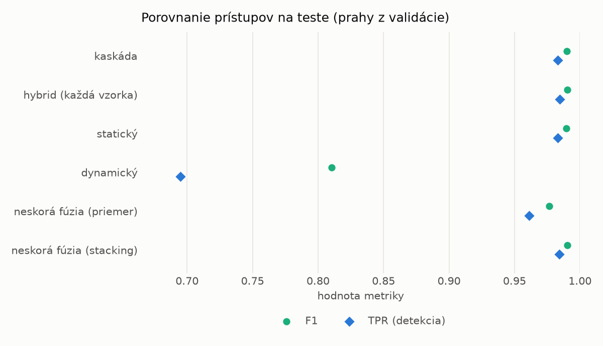
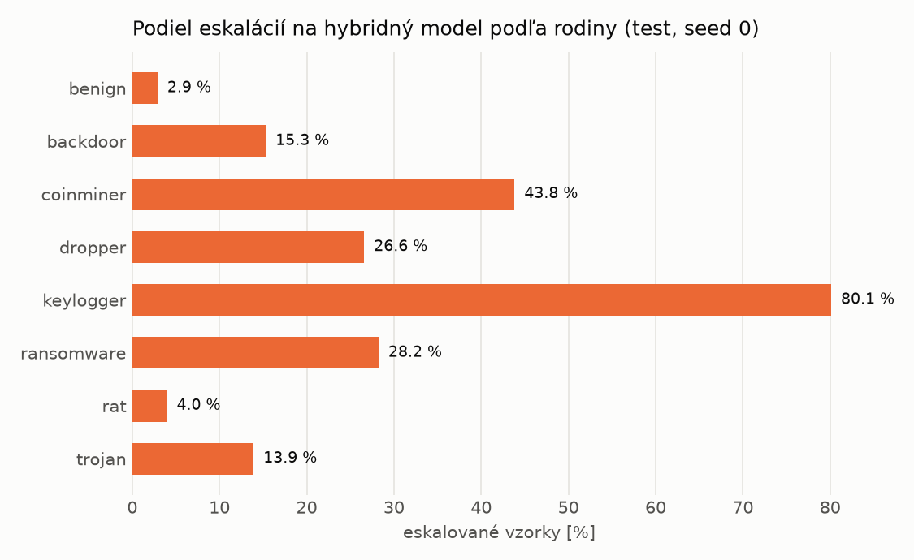

# Kaskáda `baselines` – beh `20261104-034537`

> Generované `src/cascade/evaluate.py` (2026-11-04T03:45:37+01:00). Seedy: [0, 1, 2]; hodnoty = priemer ± sm. odchýlka.
> Všetky prahy sú určené na validácii (FPR ≤ 1 %); test sa na nič nenastavuje.

| rola | beh |
|---|---|
| static | `runs_v2/lofo/dropper/static/lightgbm/20261104-012654` |
| dynamic | `runs_v2/lofo/dropper/dynamic/lightgbm/20261104-014114` |
| hybrid | `runs_v2/lofo/dropper/hybrid/lightgbm/20261104-022110` |

## Test
| prístup | accuracy | balanced_accuracy | precision | recall_tpr | fpr | f1 | mcc |
|---|---|---|---|---|---|---|---|
| kaskáda | 0.9891 ± 0.0007 | 0.9896 ± 0.0007 | 0.9967 ± 0.0002 | 0.9831 ± 0.0014 | 0.0039 ± 0.0002 | 0.9898 ± 0.0007 | 0.9781 ± 0.0014 |
| hybrid (každá vzorka) | 0.9896 ± 0.0008 | 0.9900 ± 0.0006 | 0.9960 ± 0.0009 | 0.9848 ± 0.0022 | 0.0047 ± 0.0010 | 0.9904 ± 0.0007 | 0.9792 ± 0.0015 |
| statický | 0.9886 ± 0.0017 | 0.9891 ± 0.0016 | 0.9960 ± 0.0003 | 0.9829 ± 0.0034 | 0.0047 ± 0.0003 | 0.9894 ± 0.0016 | 0.9772 ± 0.0034 |
| dynamický | 0.8237 ± 0.0014 | 0.8355 ± 0.0011 | 0.9717 ± 0.0023 | 0.6950 ± 0.0044 | 0.0239 ± 0.0022 | 0.8104 ± 0.0022 | 0.6862 ± 0.0012 |
| neskorá fúzia (priemer) | 0.9750 ± 0.0122 | 0.9762 ± 0.0108 | 0.9924 ± 0.0052 | 0.9613 ± 0.0275 | 0.0089 ± 0.0061 | 0.9764 ± 0.0119 | 0.9507 ± 0.0228 |
| neskorá fúzia (stacking) | 0.9894 ± 0.0012 | 0.9899 ± 0.0011 | 0.9963 ± 0.0001 | 0.9841 ± 0.0021 | 0.0043 ± 0.0001 | 0.9902 ± 0.0011 | 0.9787 ± 0.0023 |

## Validácia
| prístup | accuracy | balanced_accuracy | precision | recall_tpr | fpr | f1 | mcc |
|---|---|---|---|---|---|---|---|
| kaskáda | 0.9952 ± 0.0002 | 0.9944 ± 0.0002 | 0.9950 ± 0.0004 | 0.9973 ± 0.0001 | 0.0085 ± 0.0006 | 0.9962 ± 0.0001 | 0.9896 ± 0.0003 |
| hybrid (každá vzorka) | 0.9947 ± 0.0002 | 0.9939 ± 0.0002 | 0.9944 ± 0.0001 | 0.9973 ± 0.0001 | 0.0096 ± 0.0002 | 0.9958 ± 0.0001 | 0.9887 ± 0.0004 |
| statický | 0.9949 ± 0.0002 | 0.9940 ± 0.0001 | 0.9943 ± 0.0001 | 0.9976 ± 0.0004 | 0.0097 ± 0.0002 | 0.9960 ± 0.0001 | 0.9891 ± 0.0004 |
| dynamický | 0.9702 ± 0.0009 | 0.9743 ± 0.0007 | 0.9942 ± 0.0003 | 0.9583 ± 0.0015 | 0.0096 ± 0.0005 | 0.9759 ± 0.0008 | 0.9379 ± 0.0018 |
| neskorá fúzia (priemer) | 0.9947 ± 0.0004 | 0.9942 ± 0.0009 | 0.9954 ± 0.0015 | 0.9962 ± 0.0009 | 0.0079 ± 0.0026 | 0.9958 ± 0.0003 | 0.9886 ± 0.0009 |
| neskorá fúzia (stacking) | 0.9954 ± 0.0002 | 0.9944 ± 0.0002 | 0.9946 ± 0.0001 | 0.9982 ± 0.0003 | 0.0093 ± 0.0002 | 0.9964 ± 0.0002 | 0.9901 ± 0.0005 |

## Správanie kaskády (test, seed 0)
- podiel eskalácií na hybrid: **17.13%** (2971 vzoriek)
- chyby pri zhode študentov (kaskáda ich nemôže opraviť): **118**
  (0.821% zo zhôd; FP 9, FN 109)
- úspešnosť na eskalovaných vzorkách: hybrid 0.975092561427129, statický 0.9798047795355099,
  dynamický 0.02019522046449007  → prínos hybridu pri nezhode

## Výpočtové nároky (odhad z benchmarkov komponentov)
_Chýba benchmark niektorého komponentu (`python -m src.evaluation.benchmark`)._

