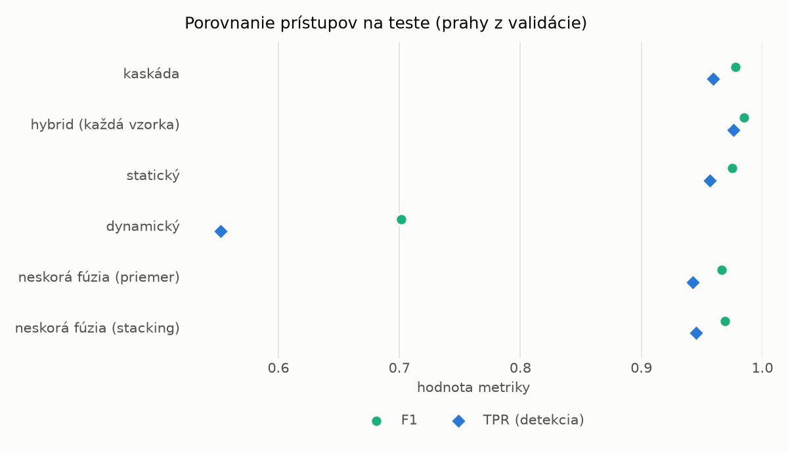
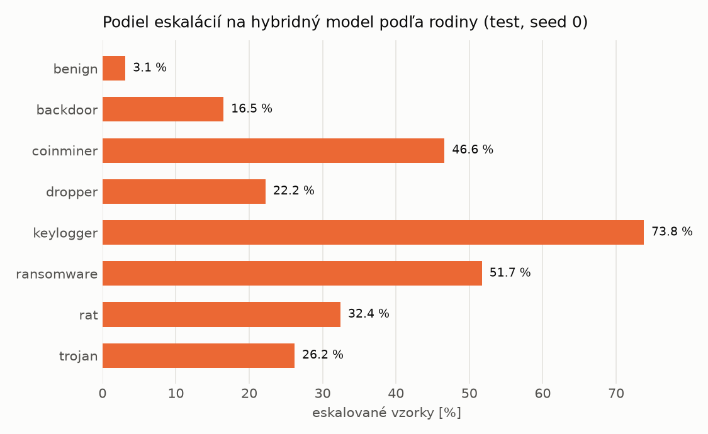

# Kaskáda `heavy` – beh `20261104-034535`

> Generované `src/cascade/evaluate.py` (2026-11-04T03:45:35+01:00). Seedy: [0, 1, 2]; hodnoty = priemer ± sm. odchýlka.
> Všetky prahy sú určené na validácii (FPR ≤ 1 %); test sa na nič nenastavuje.

| rola | beh |
|---|---|
| static | `runs_v2/lofo/dropper/students_static/mlp_kd/20261104-034134` |
| dynamic | `runs_v2/lofo/dropper/students_dynamic/mlp_kd/20261104-034323` |
| hybrid | `runs_v2/lofo/dropper/hybrid/two_branch/20261104-022321` |

## Test
| prístup | accuracy | balanced_accuracy | precision | recall_tpr | fpr | f1 | mcc |
|---|---|---|---|---|---|---|---|
| kaskáda | 0.9763 ± 0.0016 | 0.9779 ± 0.0014 | 0.9969 ± 0.0005 | 0.9593 ± 0.0034 | 0.0036 ± 0.0006 | 0.9777 ± 0.0015 | 0.9533 ± 0.0030 |
| hybrid (každá vzorka) | 0.9837 ± 0.0050 | 0.9844 ± 0.0048 | 0.9938 ± 0.0019 | 0.9760 ± 0.0082 | 0.0073 ± 0.0022 | 0.9848 ± 0.0047 | 0.9674 ± 0.0100 |
| statický | 0.9736 ± 0.0016 | 0.9752 ± 0.0015 | 0.9947 ± 0.0005 | 0.9564 ± 0.0035 | 0.0060 ± 0.0006 | 0.9752 ± 0.0016 | 0.9479 ± 0.0031 |
| dynamický | 0.7453 ± 0.0142 | 0.7630 ± 0.0131 | 0.9611 ± 0.0020 | 0.5525 ± 0.0262 | 0.0264 ± 0.0006 | 0.7014 ± 0.0215 | 0.5660 ± 0.0212 |
| neskorá fúzia (priemer) | 0.9647 ± 0.0029 | 0.9667 ± 0.0024 | 0.9919 ± 0.0033 | 0.9425 ± 0.0087 | 0.0091 ± 0.0039 | 0.9666 ± 0.0030 | 0.9306 ± 0.0052 |
| neskorá fúzia (stacking) | 0.9675 ± 0.0032 | 0.9695 ± 0.0030 | 0.9944 ± 0.0002 | 0.9453 ± 0.0061 | 0.0063 ± 0.0003 | 0.9692 ± 0.0031 | 0.9361 ± 0.0061 |

## Validácia
| prístup | accuracy | balanced_accuracy | precision | recall_tpr | fpr | f1 | mcc |
|---|---|---|---|---|---|---|---|
| kaskáda | 0.9907 ± 0.0003 | 0.9913 ± 0.0002 | 0.9964 ± 0.0002 | 0.9888 ± 0.0006 | 0.0061 ± 0.0004 | 0.9926 ± 0.0003 | 0.9801 ± 0.0007 |
| hybrid (každá vzorka) | 0.9938 ± 0.0003 | 0.9931 ± 0.0003 | 0.9944 ± 0.0001 | 0.9958 ± 0.0005 | 0.0096 ± 0.0002 | 0.9951 ± 0.0003 | 0.9868 ± 0.0008 |
| statický | 0.9884 ± 0.0004 | 0.9889 ± 0.0003 | 0.9944 ± 0.0003 | 0.9873 ± 0.0009 | 0.0096 ± 0.0005 | 0.9908 ± 0.0004 | 0.9753 ± 0.0009 |
| dynamický | 0.9570 ± 0.0020 | 0.9639 ± 0.0016 | 0.9941 ± 0.0001 | 0.9373 ± 0.0033 | 0.0096 ± 0.0002 | 0.9649 ± 0.0017 | 0.9122 ± 0.0039 |
| neskorá fúzia (priemer) | 0.9913 ± 0.0015 | 0.9911 ± 0.0012 | 0.9944 ± 0.0002 | 0.9917 ± 0.0022 | 0.0096 ± 0.0002 | 0.9931 ± 0.0012 | 0.9813 ± 0.0032 |
| neskorá fúzia (stacking) | 0.9911 ± 0.0006 | 0.9909 ± 0.0005 | 0.9943 ± 0.0001 | 0.9915 ± 0.0010 | 0.0097 ± 0.0002 | 0.9929 ± 0.0005 | 0.9809 ± 0.0013 |

## Správanie kaskády (test, seed 0)
- podiel eskalácií na hybrid: **22.92%** (3974 vzoriek)
- chyby pri zhode študentov (kaskáda ich nemôže opraviť): **295**
  (2.207% zo zhôd; FP 7, FN 288)
- úspešnosť na eskalovaných vzorkách: hybrid 0.9783593356819326, statický 0.9672873678912934,
  dynamický 0.03271263210870659  → prínos hybridu pri nezhode

## Výpočtové nároky (odhad z benchmarkov komponentov)
_Chýba benchmark niektorého komponentu (`python -m src.evaluation.benchmark`)._

