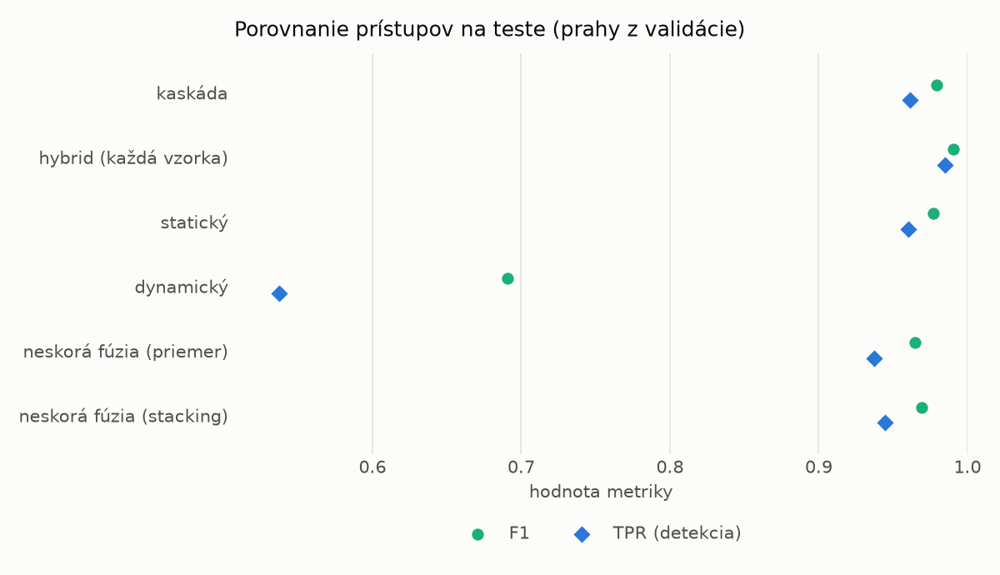
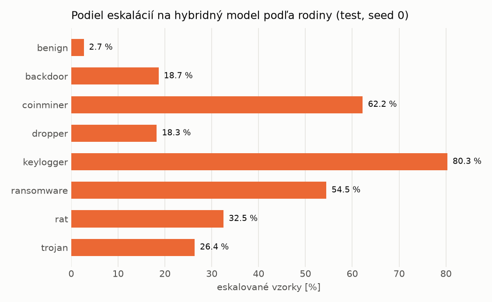

# Kaskáda `modal` – beh `20261104-034533`

> Generované `src/cascade/evaluate.py` (2026-11-04T03:45:33+01:00). Seedy: [0, 1, 2]; hodnoty = priemer ± sm. odchýlka.
> Všetky prahy sú určené na validácii (FPR ≤ 1 %); test sa na nič nenastavuje.

| rola | beh |
|---|---|
| static | `runs_v2/lofo/dropper/students_static/mlp_kd_modal/20261104-034223` |
| dynamic | `runs_v2/lofo/dropper/students_dynamic/mlp_kd_modal/20261104-034420` |
| hybrid | `runs_v2/lofo/dropper/hybrid/lightgbm/20261104-022110` |

## Test
| prístup | accuracy | balanced_accuracy | precision | recall_tpr | fpr | f1 | mcc |
|---|---|---|---|---|---|---|---|
| kaskáda | 0.9777 ± 0.0018 | 0.9792 ± 0.0017 | 0.9975 ± 0.0003 | 0.9612 ± 0.0030 | 0.0028 ± 0.0004 | 0.9790 ± 0.0017 | 0.9559 ± 0.0035 |
| hybrid (každá vzorka) | 0.9896 ± 0.0008 | 0.9900 ± 0.0006 | 0.9960 ± 0.0009 | 0.9848 ± 0.0022 | 0.0047 ± 0.0010 | 0.9904 ± 0.0007 | 0.9792 ± 0.0015 |
| statický | 0.9755 ± 0.0030 | 0.9769 ± 0.0027 | 0.9944 ± 0.0008 | 0.9602 ± 0.0063 | 0.0064 ± 0.0010 | 0.9770 ± 0.0029 | 0.9514 ± 0.0057 |
| dynamický | 0.7396 ± 0.0108 | 0.7582 ± 0.0100 | 0.9685 ± 0.0026 | 0.5370 ± 0.0189 | 0.0207 ± 0.0011 | 0.6908 ± 0.0163 | 0.5611 ± 0.0165 |
| neskorá fúzia (priemer) | 0.9630 ± 0.0055 | 0.9653 ± 0.0050 | 0.9943 ± 0.0010 | 0.9370 ± 0.0110 | 0.0063 ± 0.0012 | 0.9648 ± 0.0054 | 0.9276 ± 0.0101 |
| neskorá fúzia (stacking) | 0.9675 ± 0.0023 | 0.9695 ± 0.0021 | 0.9949 ± 0.0003 | 0.9448 ± 0.0044 | 0.0058 ± 0.0003 | 0.9692 ± 0.0023 | 0.9362 ± 0.0044 |

## Validácia
| prístup | accuracy | balanced_accuracy | precision | recall_tpr | fpr | f1 | mcc |
|---|---|---|---|---|---|---|---|
| kaskáda | 0.9915 ± 0.0014 | 0.9920 ± 0.0012 | 0.9964 ± 0.0004 | 0.9901 ± 0.0023 | 0.0061 ± 0.0007 | 0.9932 ± 0.0012 | 0.9818 ± 0.0030 |
| hybrid (každá vzorka) | 0.9947 ± 0.0002 | 0.9939 ± 0.0002 | 0.9944 ± 0.0001 | 0.9973 ± 0.0001 | 0.0096 ± 0.0002 | 0.9958 ± 0.0001 | 0.9887 ± 0.0004 |
| statický | 0.9891 ± 0.0014 | 0.9893 ± 0.0011 | 0.9942 ± 0.0000 | 0.9885 ± 0.0023 | 0.0098 ± 0.0000 | 0.9913 ± 0.0012 | 0.9767 ± 0.0031 |
| dynamický | 0.9553 ± 0.0003 | 0.9625 ± 0.0002 | 0.9940 ± 0.0001 | 0.9347 ± 0.0006 | 0.0097 ± 0.0002 | 0.9634 ± 0.0003 | 0.9088 ± 0.0006 |
| neskorá fúzia (priemer) | 0.9928 ± 0.0006 | 0.9925 ± 0.0007 | 0.9949 ± 0.0007 | 0.9937 ± 0.0003 | 0.0087 ± 0.0012 | 0.9943 ± 0.0005 | 0.9845 ± 0.0013 |
| neskorá fúzia (stacking) | 0.9921 ± 0.0012 | 0.9918 ± 0.0010 | 0.9945 ± 0.0004 | 0.9929 ± 0.0016 | 0.0094 ± 0.0007 | 0.9937 ± 0.0009 | 0.9830 ± 0.0025 |

## Správanie kaskády (test, seed 0)
- podiel eskalácií na hybrid: **25.17%** (4365 vzoriek)
- chyby pri zhode študentov (kaskáda ich nemôže opraviť): **295**
  (2.274% zo zhôd; FP 7, FN 288)
- úspešnosť na eskalovaných vzorkách: hybrid 0.9862542955326461, statický 0.9828178694158075,
  dynamický 0.01718213058419244  → prínos hybridu pri nezhode

## Výpočtové nároky (odhad z benchmarkov komponentov)
_Chýba benchmark niektorého komponentu (`python -m src.evaluation.benchmark`)._

