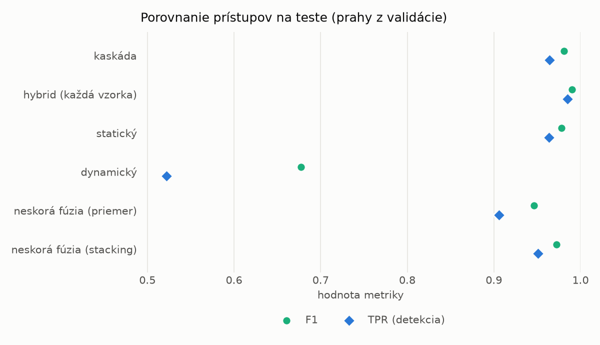
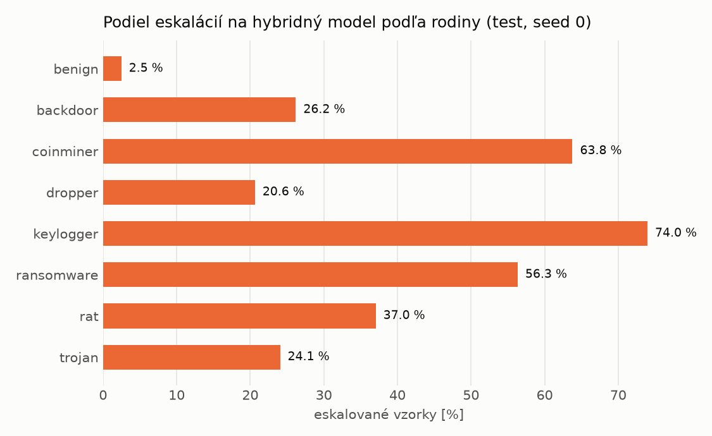

# Kaskáda `nokd` – beh `20261104-034531`

> Generované `src/cascade/evaluate.py` (2026-11-04T03:45:31+01:00). Seedy: [0, 1, 2]; hodnoty = priemer ± sm. odchýlka.
> Všetky prahy sú určené na validácii (FPR ≤ 1 %); test sa na nič nenastavuje.

| rola | beh |
|---|---|
| static | `runs_v2/lofo/dropper/students_static/mlp_nokd/20261104-034206` |
| dynamic | `runs_v2/lofo/dropper/students_dynamic/mlp_nokd/20261104-034356` |
| hybrid | `runs_v2/lofo/dropper/hybrid/lightgbm/20261104-022110` |

## Test
| prístup | accuracy | balanced_accuracy | precision | recall_tpr | fpr | f1 | mcc |
|---|---|---|---|---|---|---|---|
| kaskáda | 0.9794 ± 0.0039 | 0.9808 ± 0.0036 | 0.9975 ± 0.0006 | 0.9644 ± 0.0075 | 0.0028 ± 0.0007 | 0.9807 ± 0.0037 | 0.9593 ± 0.0076 |
| hybrid (každá vzorka) | 0.9896 ± 0.0008 | 0.9900 ± 0.0006 | 0.9960 ± 0.0009 | 0.9848 ± 0.0022 | 0.0047 ± 0.0010 | 0.9904 ± 0.0007 | 0.9792 ± 0.0015 |
| statický | 0.9766 ± 0.0037 | 0.9779 ± 0.0034 | 0.9933 ± 0.0007 | 0.9634 ± 0.0069 | 0.0076 ± 0.0008 | 0.9781 ± 0.0035 | 0.9536 ± 0.0071 |
| dynamický | 0.7303 ± 0.0058 | 0.7494 ± 0.0052 | 0.9639 ± 0.0050 | 0.5220 ± 0.0128 | 0.0232 ± 0.0037 | 0.6772 ± 0.0100 | 0.5458 ± 0.0075 |
| neskorá fúzia (priemer) | 0.9451 ± 0.0262 | 0.9486 ± 0.0240 | 0.9918 ± 0.0026 | 0.9062 ± 0.0504 | 0.0089 ± 0.0033 | 0.9465 ± 0.0269 | 0.8951 ± 0.0472 |
| neskorá fúzia (stacking) | 0.9704 ± 0.0013 | 0.9721 ± 0.0012 | 0.9939 ± 0.0004 | 0.9512 ± 0.0027 | 0.0069 ± 0.0005 | 0.9721 ± 0.0013 | 0.9416 ± 0.0025 |

## Validácia
| prístup | accuracy | balanced_accuracy | precision | recall_tpr | fpr | f1 | mcc |
|---|---|---|---|---|---|---|---|
| kaskáda | 0.9920 ± 0.0021 | 0.9925 ± 0.0018 | 0.9967 ± 0.0005 | 0.9905 ± 0.0030 | 0.0056 ± 0.0009 | 0.9936 ± 0.0017 | 0.9829 ± 0.0045 |
| hybrid (každá vzorka) | 0.9947 ± 0.0002 | 0.9939 ± 0.0002 | 0.9944 ± 0.0001 | 0.9973 ± 0.0001 | 0.0096 ± 0.0002 | 0.9958 ± 0.0001 | 0.9887 ± 0.0004 |
| statický | 0.9895 ± 0.0020 | 0.9897 ± 0.0015 | 0.9944 ± 0.0003 | 0.9889 ± 0.0032 | 0.0096 ± 0.0005 | 0.9916 ± 0.0016 | 0.9775 ± 0.0041 |
| dynamický | 0.9550 ± 0.0013 | 0.9623 ± 0.0010 | 0.9939 ± 0.0001 | 0.9343 ± 0.0023 | 0.0097 ± 0.0002 | 0.9632 ± 0.0011 | 0.9084 ± 0.0025 |
| neskorá fúzia (priemer) | 0.9903 ± 0.0002 | 0.9904 ± 0.0002 | 0.9945 ± 0.0006 | 0.9901 ± 0.0006 | 0.0093 ± 0.0009 | 0.9923 ± 0.0001 | 0.9793 ± 0.0003 |
| neskorá fúzia (stacking) | 0.9928 ± 0.0007 | 0.9925 ± 0.0008 | 0.9948 ± 0.0008 | 0.9938 ± 0.0004 | 0.0089 ± 0.0013 | 0.9943 ± 0.0006 | 0.9846 ± 0.0015 |

## Správanie kaskády (test, seed 0)
- podiel eskalácií na hybrid: **26.14%** (4533 vzoriek)
- chyby pri zhode študentov (kaskáda ich nemôže opraviť): **300**
  (2.343% zo zhôd; FP 4, FN 296)
- úspešnosť na eskalovaných vzorkách: hybrid 0.9761747187293184, statický 0.972645047429958,
  dynamický 0.027354952570041915  → prínos hybridu pri nezhode

## Výpočtové nároky (odhad z benchmarkov komponentov)
_Chýba benchmark niektorého komponentu (`python -m src.evaluation.benchmark`)._

