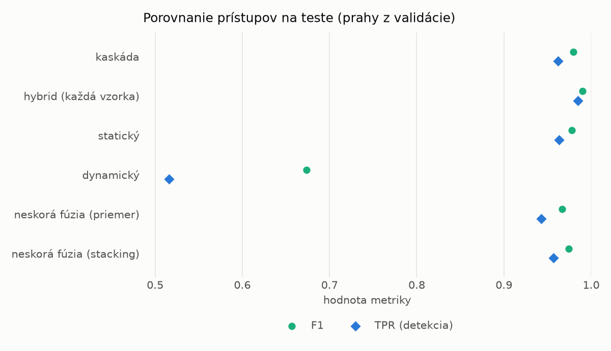
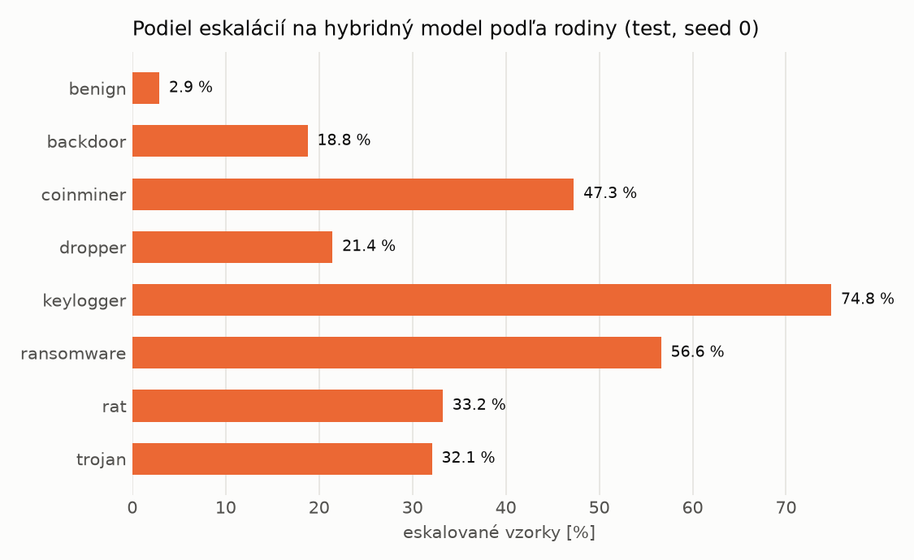

# Kaskáda `twobranch` – beh `20261104-034539`

> Generované `src/cascade/evaluate.py` (2026-11-04T03:45:39+01:00). Seedy: [0, 1, 2]; hodnoty = priemer ± sm. odchýlka.
> Všetky prahy sú určené na validácii (FPR ≤ 1 %); test sa na nič nenastavuje.

| rola | beh |
|---|---|
| static | `runs_v2/lofo/dropper/students_static/mlp_kd_twobranch/20261104-034252` |
| dynamic | `runs_v2/lofo/dropper/students_dynamic/mlp_kd_twobranch/20261104-034455` |
| hybrid | `runs_v2/lofo/dropper/hybrid/lightgbm/20261104-022110` |

## Test
| prístup | accuracy | balanced_accuracy | precision | recall_tpr | fpr | f1 | mcc |
|---|---|---|---|---|---|---|---|
| kaskáda | 0.9783 ± 0.0026 | 0.9798 ± 0.0024 | 0.9980 ± 0.0005 | 0.9618 ± 0.0053 | 0.0023 ± 0.0006 | 0.9796 ± 0.0025 | 0.9571 ± 0.0050 |
| hybrid (každá vzorka) | 0.9896 ± 0.0008 | 0.9900 ± 0.0006 | 0.9960 ± 0.0009 | 0.9848 ± 0.0022 | 0.0047 ± 0.0010 | 0.9904 ± 0.0007 | 0.9792 ± 0.0015 |
| statický | 0.9765 ± 0.0024 | 0.9777 ± 0.0021 | 0.9933 ± 0.0009 | 0.9632 ± 0.0051 | 0.0077 ± 0.0010 | 0.9780 ± 0.0023 | 0.9534 ± 0.0045 |
| dynamický | 0.7296 ± 0.0176 | 0.7492 ± 0.0158 | 0.9721 ± 0.0065 | 0.5162 ± 0.0367 | 0.0177 ± 0.0052 | 0.6737 ± 0.0300 | 0.5487 ± 0.0223 |
| neskorá fúzia (priemer) | 0.9646 ± 0.0033 | 0.9666 ± 0.0029 | 0.9916 ± 0.0019 | 0.9427 ± 0.0073 | 0.0094 ± 0.0022 | 0.9665 ± 0.0032 | 0.9304 ± 0.0061 |
| neskorá fúzia (stacking) | 0.9725 ± 0.0012 | 0.9740 ± 0.0012 | 0.9924 ± 0.0007 | 0.9566 ± 0.0017 | 0.0086 ± 0.0008 | 0.9742 ± 0.0012 | 0.9455 ± 0.0024 |

## Validácia
| prístup | accuracy | balanced_accuracy | precision | recall_tpr | fpr | f1 | mcc |
|---|---|---|---|---|---|---|---|
| kaskáda | 0.9915 ± 0.0006 | 0.9922 ± 0.0006 | 0.9969 ± 0.0004 | 0.9895 ± 0.0006 | 0.0052 ± 0.0006 | 0.9932 ± 0.0005 | 0.9818 ± 0.0013 |
| hybrid (každá vzorka) | 0.9947 ± 0.0002 | 0.9939 ± 0.0002 | 0.9944 ± 0.0001 | 0.9973 ± 0.0001 | 0.0096 ± 0.0002 | 0.9958 ± 0.0001 | 0.9887 ± 0.0004 |
| statický | 0.9895 ± 0.0003 | 0.9899 ± 0.0005 | 0.9949 ± 0.0010 | 0.9885 ± 0.0009 | 0.0086 ± 0.0018 | 0.9917 ± 0.0002 | 0.9777 ± 0.0006 |
| dynamický | 0.9530 ± 0.0007 | 0.9608 ± 0.0006 | 0.9941 ± 0.0000 | 0.9310 ± 0.0011 | 0.0094 ± 0.0000 | 0.9615 ± 0.0006 | 0.9047 ± 0.0013 |
| neskorá fúzia (priemer) | 0.9918 ± 0.0014 | 0.9916 ± 0.0011 | 0.9946 ± 0.0004 | 0.9923 ± 0.0023 | 0.0091 ± 0.0006 | 0.9935 ± 0.0011 | 0.9824 ± 0.0030 |
| neskorá fúzia (stacking) | 0.9927 ± 0.0002 | 0.9922 ± 0.0002 | 0.9943 ± 0.0001 | 0.9942 ± 0.0001 | 0.0097 ± 0.0002 | 0.9942 ± 0.0001 | 0.9844 ± 0.0003 |

## Správanie kaskády (test, seed 0)
- podiel eskalácií na hybrid: **24.22%** (4199 vzoriek)
- chyby pri zhode študentov (kaskáda ich nemôže opraviť): **302**
  (2.298% zo zhôd; FP 4, FN 298)
- úspešnosť na eskalovaných vzorkách: hybrid 0.9757085020242915, statický 0.97165991902834,
  dynamický 0.02834008097165992  → prínos hybridu pri nezhode

## Výpočtové nároky (odhad z benchmarkov komponentov)
_Chýba benchmark niektorého komponentu (`python -m src.evaluation.benchmark`)._

