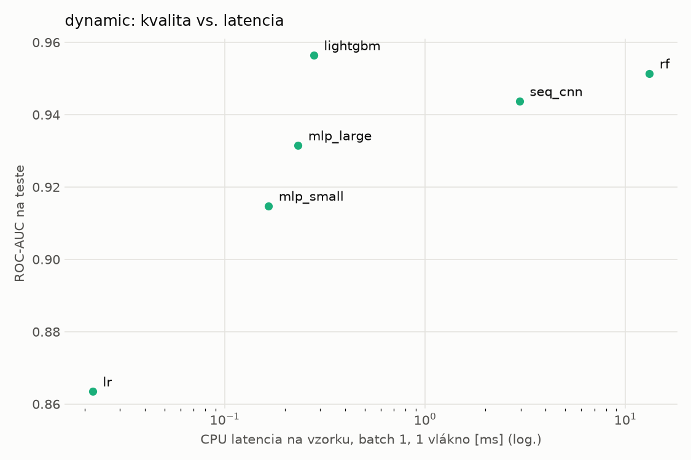
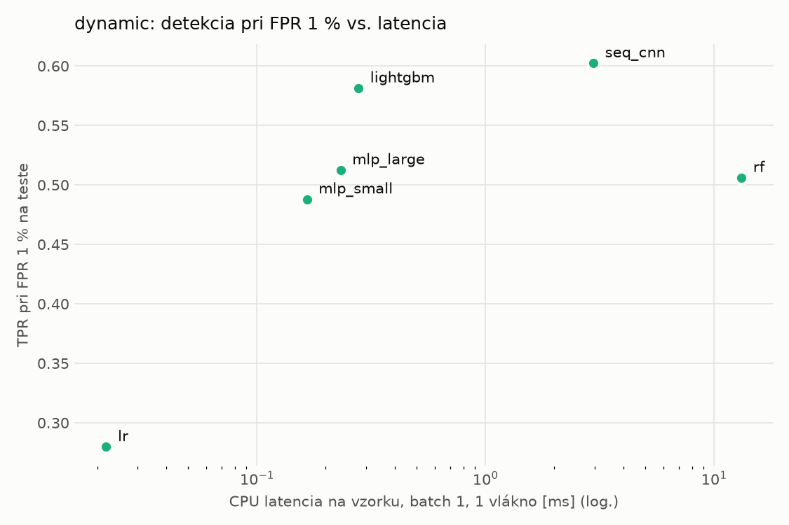
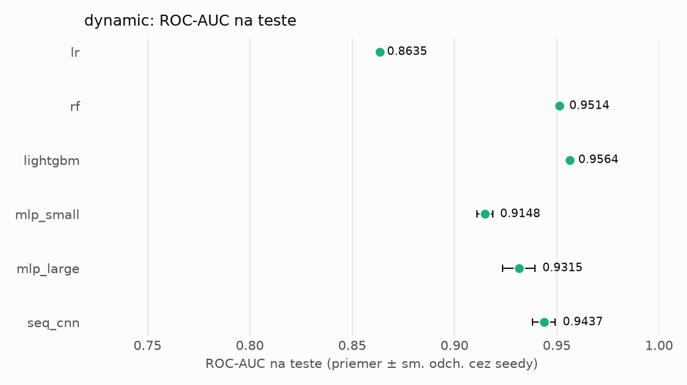
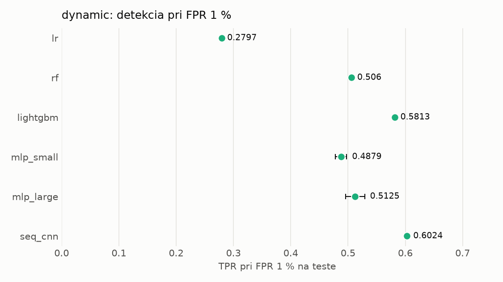

# Porovnanie modelov – dynamic

> Generované `src/evaluation/compare.py` (2026-11-04T02:14:46+01:00); použitý je posledný beh každého modelu.
> Metriky sú priemer cez seedy. \* = pri prahu určenom na validácii (FPR ≤ 1 %).
> CPU ms/vz. = medián latencie jednej vzorky na 1 vlákne vrátane transformácie vstupu (meranie hneď po tréningu,
> orientačné). Oficiálne merania spotreby sú v časti „Spotreba zdrojov pri inferencii“.

## Detekčná kvalita a orientačné časy
| model | ROC-AUC val | ROC-AUC test | TPR@FPR 1 % test | TPR@FPR 0,1 % test | F1 test* | FPR test* | gap train−val | CPU ms/vz. | CPU vz./s | GPU ms/vz. | parametre | MB | tréning s | ladenie min |
|---|---|---|---|---|---|---|---|---|---|---|---|---|---|---|
| [lr](../../dynamic/lr/20261104-013903/README.md) | 0.9949 | 0.8635 ± 0.0000 | 0.2797 | 0.1883 | 0.6534 | 0.1169 | 0.0016 | 0.022 | 348 099 | – | 2 001 | 0.06 | 5.1 | 0.0 |
| [rf](../../dynamic/rf/20261104-013925/README.md) | 0.9973 | 0.9514 ± 0.0011 | 0.5060 | 0.0000 | 0.7240 | 0.0186 | 0.0013 | 13.173 | 91 536 | – | 969 746 | 78.00 | 32.8 | 0.0 |
| [lightgbm](../../dynamic/lightgbm/20261104-014114/README.md) | 0.9975 | 0.9564 ± 0.0005 | 0.5813 | 0.3122 | 0.8104 | 0.0239 | 0.0011 | 0.278 | 50 323 | – | 730 868 | 41.57 | 27.6 | 0.0 |
| [mlp_small](../../dynamic/mlp_small/20261104-014301/README.md) | 0.9963 | 0.9148 ± 0.0039 | 0.4879 | 0.2751 | 0.6732 | 0.0137 | 0.0012 | 0.165 | 121 418 | 0.428 | 546 049 | 2.24 | 4.1 | 0.0 |
| [mlp_large](../../dynamic/mlp_large/20261104-014321/README.md) | 0.9963 | 0.9315 ± 0.0079 | 0.5125 | 0.3151 | 0.7295 | 0.0190 | 0.0011 | 0.232 | 76 878 | 0.444 | 1 190 657 | 4.83 | 14.8 | 0.0 |
| [seq_cnn](../../dynamic/seq_cnn/20261104-014415/README.md) | 0.9973 | 0.9437 ± 0.0056 | 0.6024 | 0.3732 | 0.7708 | 0.0134 | 0.0010 | 2.963 | 1 174 | 0.983 | 209 281 | 0.84 | 570.0 | 0.0 |

## Nízka prevalencia malvéru (test, prah z validácie)
| model | TPR | FPR | precision @ 1 % | falošné na 1 skutočný poplach @ 1 % | precision @ 0.1 % | falošné na 1 skutočný poplach @ 0.1 % |
|---|---|---|---|---|---|---|
| lr | 0.5331 | 0.1169 | 0.044 | 21.70 | 0.005 | 219.00 |
| rf | 0.5763 | 0.0186 | 0.239 | 3.19 | 0.030 | 32.17 |
| lightgbm | 0.6950 | 0.0239 | 0.227 | 3.41 | 0.028 | 34.40 |
| mlp_small | 0.5134 | 0.0137 | 0.274 | 2.65 | 0.036 | 26.72 |
| mlp_large | 0.5839 | 0.0190 | 0.237 | 3.22 | 0.030 | 32.54 |
| seq_cnn | 0.6346 | 0.0134 | 0.324 | 2.08 | 0.045 | 21.02 |

Prepočet: TPR a FPR nezávisia od podielu malvéru, preto sa dajú preniesť na nízku prevalenciu (v reálnej prevádzke je malvéru ~1 % alebo menej; v teste 54 %). „Falošné na 1 skutočný poplach“ = koľko neškodných súborov je označených na každý zachytený malvér.

## Spotreba zdrojov pri inferencii (benchmark, testovacia množina)
_Benchmark zatiaľ nebol spustený (`python -m src.evaluation.benchmark --approach dynamic`)._

## Grafy

