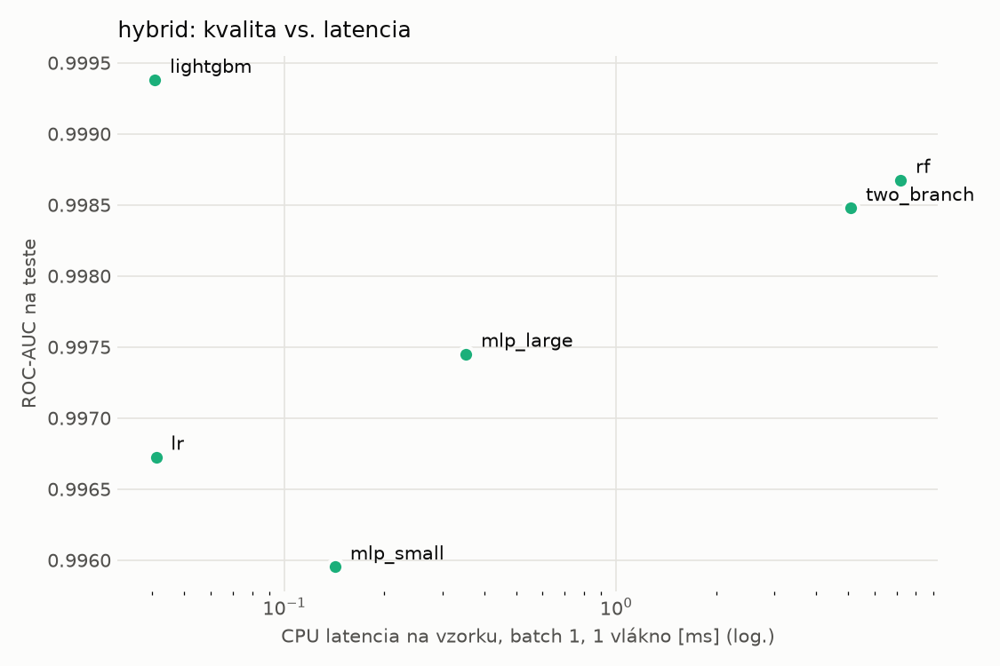
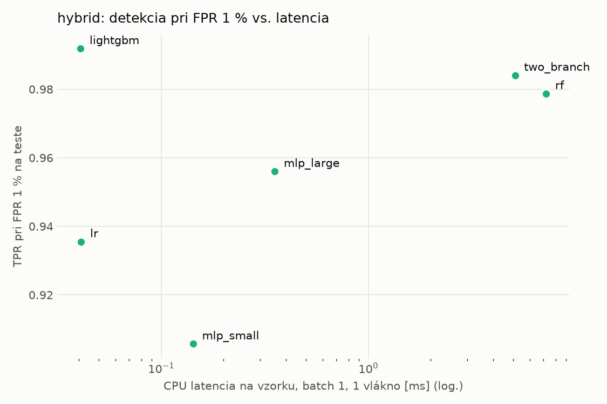
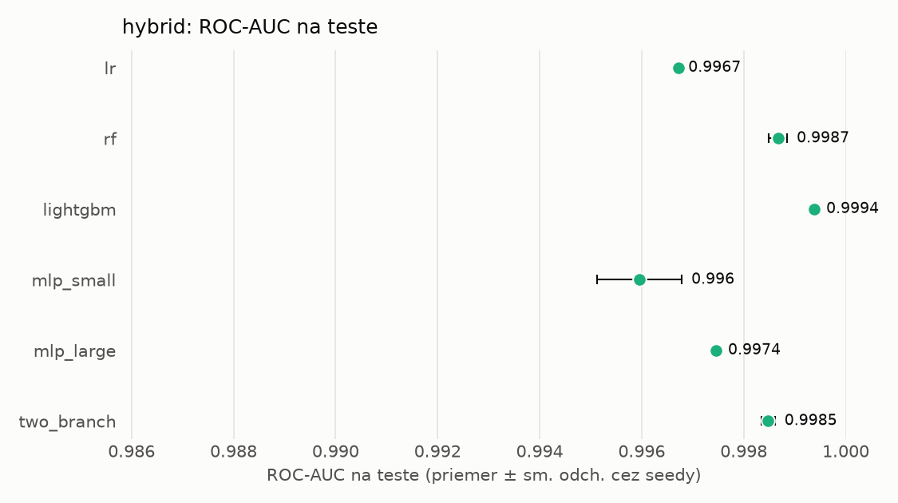
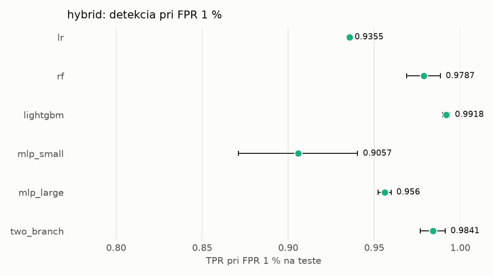

# Porovnanie modelov – hybrid

> Generované `src/evaluation/compare.py` (2026-11-04T02:50:06+01:00); použitý je posledný beh každého modelu.
> Metriky sú priemer cez seedy. \* = pri prahu určenom na validácii (FPR ≤ 1 %).
> CPU ms/vz. = medián latencie jednej vzorky na 1 vlákne vrátane transformácie vstupu (meranie hneď po tréningu,
> orientačné). Oficiálne merania spotreby sú v časti „Spotreba zdrojov pri inferencii“.

## Detekčná kvalita a orientačné časy
| model | ROC-AUC val | ROC-AUC test | TPR@FPR 1 % test | TPR@FPR 0,1 % test | F1 test* | FPR test* | gap train−val | CPU ms/vz. | CPU vz./s | GPU ms/vz. | parametre | MB | tréning s | ladenie min |
|---|---|---|---|---|---|---|---|---|---|---|---|---|---|---|
| [lr](../../hybrid/lr/20261104-021449/README.md) | 0.9986 | 0.9967 ± 0.0000 | 0.9355 | 0.6478 | 0.9539 | 0.0059 | 0.0010 | 0.041 | 164 582 | – | 4 320 | 0.13 | 4.8 | 0.0 |
| [rf](../../hybrid/rf/20261104-021519/README.md) | 0.9998 | 0.9987 ± 0.0002 | 0.9787 | 0.8707 | 0.9725 | 0.0075 | 0.0002 | 7.203 | 109 092 | – | 260 634 | 21.19 | 114.4 | 0.0 |
| [lightgbm](../../hybrid/lightgbm/20261104-022110/README.md) | 0.9998 | 0.9994 ± 0.0001 | 0.9918 | 0.9436 | 0.9904 | 0.0047 | 0.0002 | 0.041 | 317 172 | – | 24 787 | 1.42 | 17.7 | 0.0 |
| [mlp_small](../../hybrid/mlp_small/20261104-022207/README.md) | 0.9990 | 0.9960 ± 0.0008 | 0.9057 | 0.7594 | 0.9249 | 0.0069 | 0.0009 | 0.142 | 46 000 | 0.420 | 138 881 | 0.67 | 5.6 | 0.0 |
| [mlp_large](../../hybrid/mlp_large/20261104-022243/README.md) | 0.9992 | 0.9974 ± 0.0001 | 0.9560 | 0.8083 | 0.9696 | 0.0068 | 0.0007 | 0.353 | 37 465 | 0.525 | 2 386 305 | 9.67 | 6.4 | 0.0 |
| [two_branch](../../hybrid/two_branch/20261104-022321/README.md) | 0.9992 | 0.9985 ± 0.0001 | 0.9841 | 0.8298 | 0.9848 | 0.0073 | 0.0007 | 5.100 | 657 | 1.311 | 1 756 866 | 7.10 | 462.9 | 0.0 |

## Nízka prevalencia malvéru (test, prah z validácie)
| model | TPR | FPR | precision @ 1 % | falošné na 1 skutočný poplach @ 1 % | precision @ 0.1 % | falošné na 1 skutočný poplach @ 0.1 % |
|---|---|---|---|---|---|---|
| lr | 0.9164 | 0.0059 | 0.610 | 0.64 | 0.134 | 6.45 |
| rf | 0.9527 | 0.0075 | 0.563 | 0.78 | 0.113 | 7.84 |
| lightgbm | 0.9848 | 0.0047 | 0.681 | 0.47 | 0.175 | 4.73 |
| mlp_small | 0.8654 | 0.0069 | 0.558 | 0.79 | 0.111 | 8.00 |
| mlp_large | 0.9464 | 0.0068 | 0.583 | 0.72 | 0.122 | 7.22 |
| two_branch | 0.9760 | 0.0073 | 0.576 | 0.74 | 0.119 | 7.43 |

Prepočet: TPR a FPR nezávisia od podielu malvéru, preto sa dajú preniesť na nízku prevalenciu (v reálnej prevádzke je malvéru ~1 % alebo menej; v teste 54 %). „Falošné na 1 skutočný poplach“ = koľko neškodných súborov je označených na každý zachytený malvér.

## Spotreba zdrojov pri inferencii (benchmark, testovacia množina)
_Benchmark zatiaľ nebol spustený (`python -m src.evaluation.benchmark --approach hybrid`)._

## Grafy

