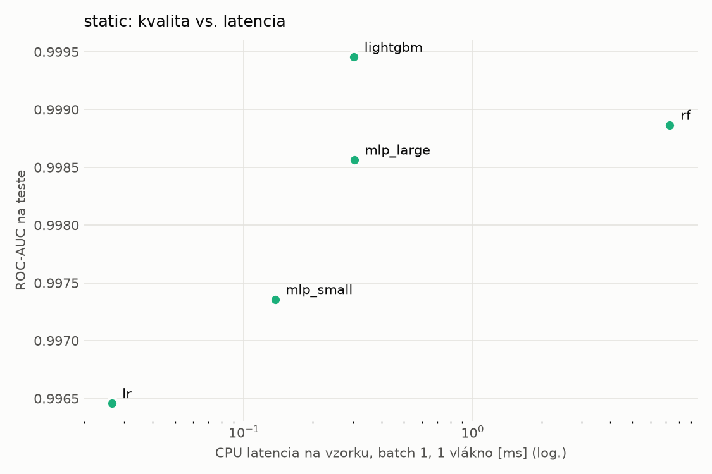
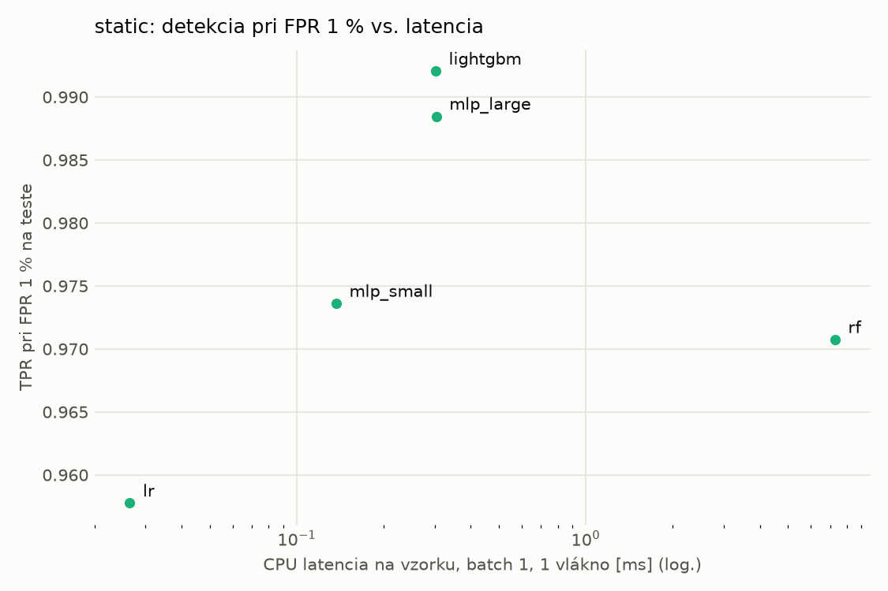
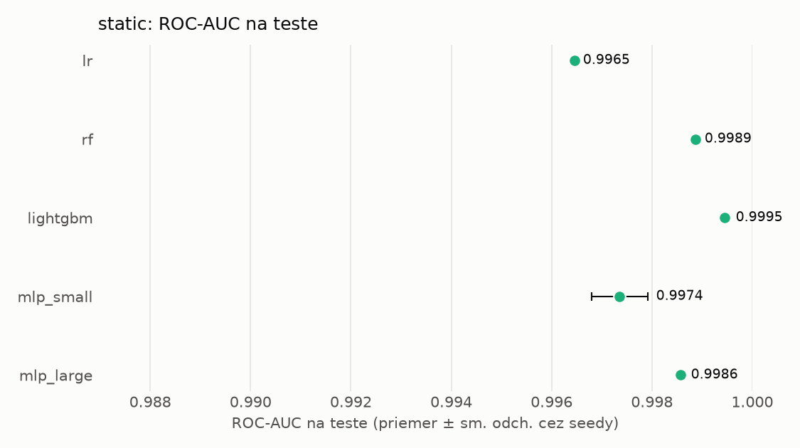
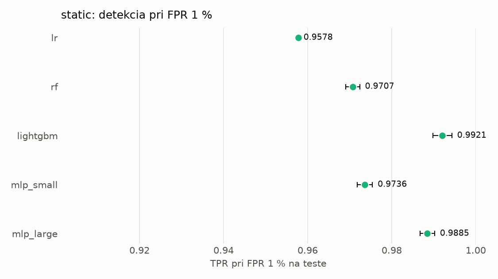

# Porovnanie modelov – static

> Generované `src/evaluation/compare.py` (2026-11-04T01:39:00+01:00); použitý je posledný beh každého modelu.
> Metriky sú priemer cez seedy. \* = pri prahu určenom na validácii (FPR ≤ 1 %).
> CPU ms/vz. = medián latencie jednej vzorky na 1 vlákne vrátane transformácie vstupu (meranie hneď po tréningu,
> orientačné). Oficiálne merania spotreby sú v časti „Spotreba zdrojov pri inferencii“.

## Detekčná kvalita a orientačné časy
| model | ROC-AUC val | ROC-AUC test | TPR@FPR 1 % test | TPR@FPR 0,1 % test | F1 test* | FPR test* | gap train−val | CPU ms/vz. | CPU vz./s | GPU ms/vz. | parametre | MB | tréning s | ladenie min |
|---|---|---|---|---|---|---|---|---|---|---|---|---|---|---|
| [lr](../../static/lr/20261104-012529/README.md) | 0.9982 | 0.9965 ± 0.0000 | 0.9578 | 0.0882 | 0.9673 | 0.0081 | 0.0013 | 0.026 | 292 103 | – | 2 320 | 0.07 | 2.2 | 0.0 |
| [rf](../../static/rf/20261104-012544/README.md) | 0.9998 | 0.9989 ± 0.0000 | 0.9707 | 0.9264 | 0.9768 | 0.0053 | 0.0002 | 7.284 | 112 088 | – | 363 854 | 29.45 | 21.1 | 0.0 |
| [lightgbm](../../static/lightgbm/20261104-012654/README.md) | 0.9998 | 0.9995 ± 0.0000 | 0.9921 | 0.9638 | 0.9894 | 0.0047 | 0.0002 | 0.303 | 40 926 | – | 497 386 | 29.17 | 220.2 | 0.0 |
| [mlp_small](../../static/mlp_small/20261104-013810/README.md) | 0.9988 | 0.9974 ± 0.0006 | 0.9736 | 0.4541 | 0.9789 | 0.0078 | 0.0010 | 0.137 | 109 052 | 0.384 | 74 881 | 0.36 | 3.7 | 0.0 |
| [mlp_large](../../static/mlp_large/20261104-013830/README.md) | 0.9992 | 0.9986 ± 0.0000 | 0.9885 | 0.8657 | 0.9842 | 0.0061 | 0.0007 | 0.304 | 82 365 | 0.607 | 1 364 417 | 5.53 | 6.2 | 0.0 |

## Nízka prevalencia malvéru (test, prah z validácie)
| model | TPR | FPR | precision @ 1 % | falošné na 1 skutočný poplach @ 1 % | precision @ 0.1 % | falošné na 1 skutočný poplach @ 0.1 % |
|---|---|---|---|---|---|---|
| lr | 0.9430 | 0.0081 | 0.542 | 0.85 | 0.105 | 8.54 |
| rf | 0.9590 | 0.0053 | 0.647 | 0.55 | 0.154 | 5.51 |
| lightgbm | 0.9829 | 0.0047 | 0.681 | 0.47 | 0.174 | 4.74 |
| mlp_small | 0.9650 | 0.0078 | 0.557 | 0.80 | 0.111 | 8.04 |
| mlp_large | 0.9740 | 0.0061 | 0.618 | 0.62 | 0.138 | 6.24 |

Prepočet: TPR a FPR nezávisia od podielu malvéru, preto sa dajú preniesť na nízku prevalenciu (v reálnej prevádzke je malvéru ~1 % alebo menej; v teste 54 %). „Falošné na 1 skutočný poplach“ = koľko neškodných súborov je označených na každý zachytený malvér.

## Spotreba zdrojov pri inferencii (benchmark, testovacia množina)
_Benchmark zatiaľ nebol spustený (`python -m src.evaluation.benchmark --approach static`)._

## Grafy

