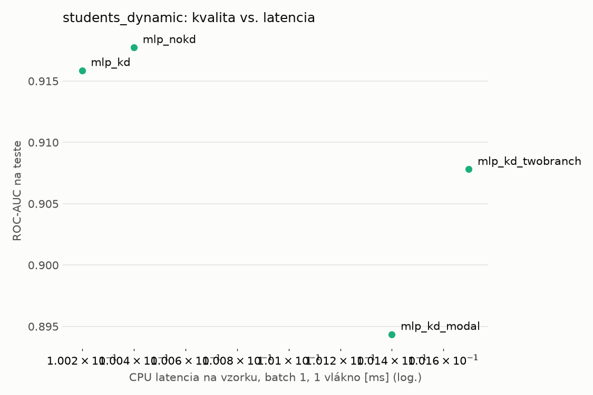
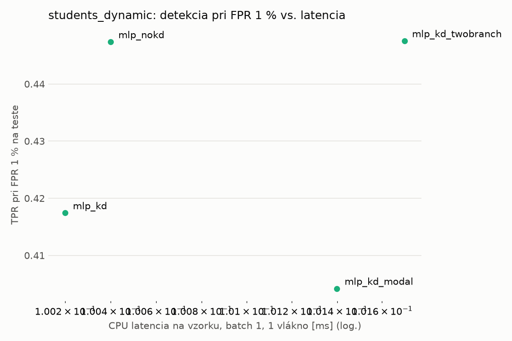
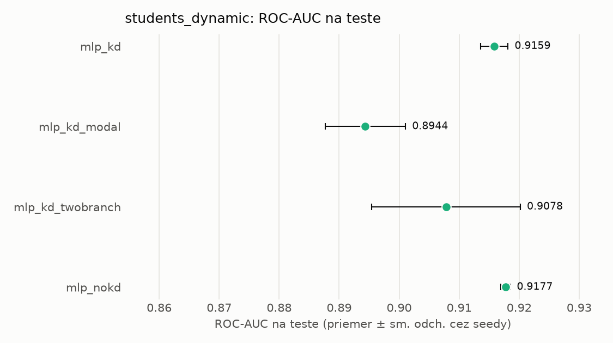
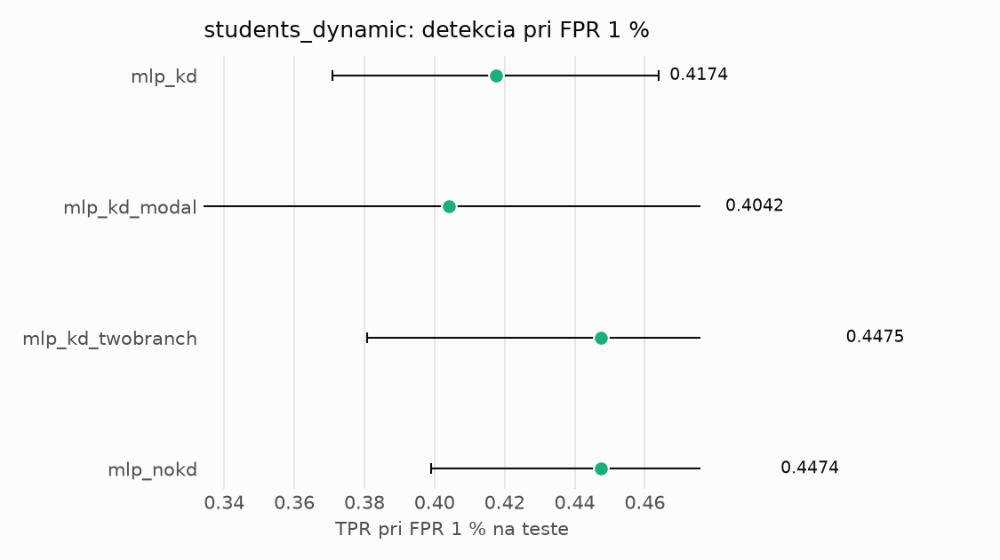

# Porovnanie modelov – students_dynamic

> Generované `src/evaluation/compare.py` (2026-11-04T03:45:26+01:00); použitý je posledný beh každého modelu.
> Metriky sú priemer cez seedy. \* = pri prahu určenom na validácii (FPR ≤ 1 %).
> CPU ms/vz. = medián latencie jednej vzorky na 1 vlákne vrátane transformácie vstupu (meranie hneď po tréningu,
> orientačné). Oficiálne merania spotreby sú v časti „Spotreba zdrojov pri inferencii“.

## Detekčná kvalita a orientačné časy
| model | ROC-AUC val | ROC-AUC test | TPR@FPR 1 % test | TPR@FPR 0,1 % test | F1 test* | FPR test* | gap train−val | CPU ms/vz. | CPU vz./s | GPU ms/vz. | parametre | MB | tréning s | ladenie min |
|---|---|---|---|---|---|---|---|---|---|---|---|---|---|---|
| [mlp_kd](../../students_dynamic/mlp_kd/20261104-034323/README.md) | 0.9964 | 0.9159 ± 0.0023 | 0.4174 | 0.2722 | 0.7014 | 0.0264 | 0.0011 | 0.100 | 140 079 | 0.290 | 64 129 | 0.31 | 8.2 | 0.0 |
| [mlp_kd_modal](../../students_dynamic/mlp_kd_modal/20261104-034420/README.md) | 0.9964 | 0.8944 ± 0.0067 | 0.4042 | 0.2520 | 0.6908 | 0.0207 | 0.0012 | 0.101 | 139 710 | 0.343 | 64 129 | 0.31 | 9.0 | 0.0 |
| [mlp_kd_twobranch](../../students_dynamic/mlp_kd_twobranch/20261104-034455/README.md) | 0.9963 | 0.9078 ± 0.0124 | 0.4475 | 0.2681 | 0.6737 | 0.0177 | 0.0012 | 0.102 | 140 206 | 0.280 | 64 129 | 0.31 | 7.7 | 0.0 |
| [mlp_nokd](../../students_dynamic/mlp_nokd/20261104-034356/README.md) | 0.9961 | 0.9177 ± 0.0008 | 0.4474 | 0.3350 | 0.6772 | 0.0232 | 0.0013 | 0.100 | 95 923 | 0.452 | 64 129 | 0.31 | 5.3 | 0.0 |

## Nízka prevalencia malvéru (test, prah z validácie)
| model | TPR | FPR | precision @ 1 % | falošné na 1 skutočný poplach @ 1 % | precision @ 0.1 % | falošné na 1 skutočný poplach @ 0.1 % |
|---|---|---|---|---|---|---|
| mlp_kd | 0.5525 | 0.0264 | 0.174 | 4.73 | 0.021 | 47.75 |
| mlp_kd_modal | 0.5370 | 0.0207 | 0.208 | 3.81 | 0.025 | 38.42 |
| mlp_kd_twobranch | 0.5162 | 0.0177 | 0.227 | 3.40 | 0.028 | 34.29 |
| mlp_nokd | 0.5220 | 0.0232 | 0.185 | 4.39 | 0.022 | 44.35 |

Prepočet: TPR a FPR nezávisia od podielu malvéru, preto sa dajú preniesť na nízku prevalenciu (v reálnej prevádzke je malvéru ~1 % alebo menej; v teste 54 %). „Falošné na 1 skutočný poplach“ = koľko neškodných súborov je označených na každý zachytený malvér.

## Spotreba zdrojov pri inferencii (benchmark, testovacia množina)
_Benchmark zatiaľ nebol spustený (`python -m src.evaluation.benchmark --approach students_dynamic`)._

## Grafy

