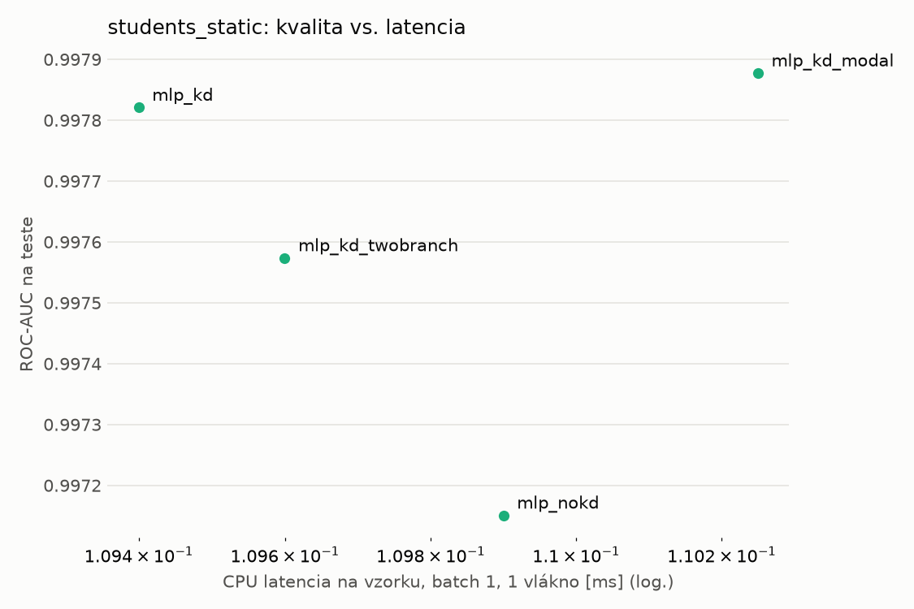
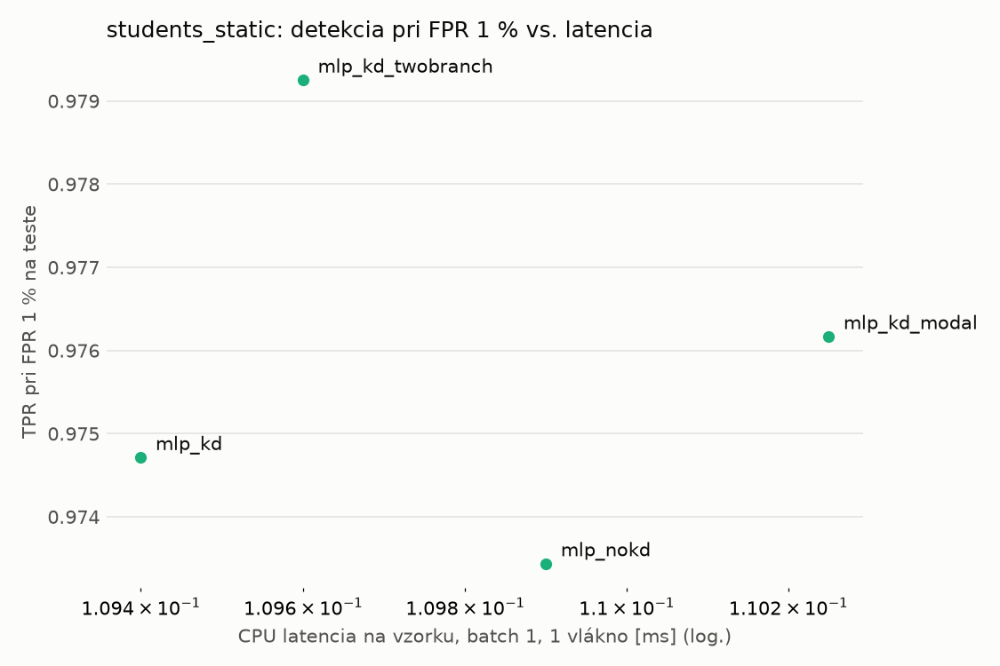
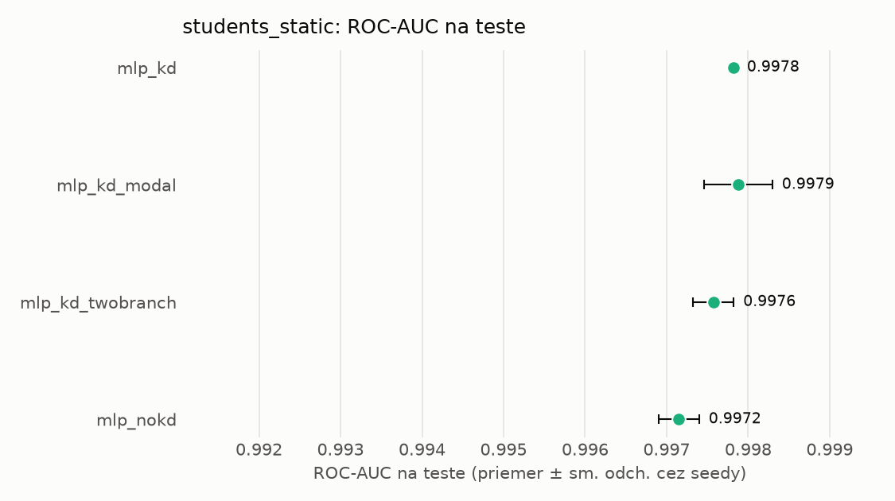
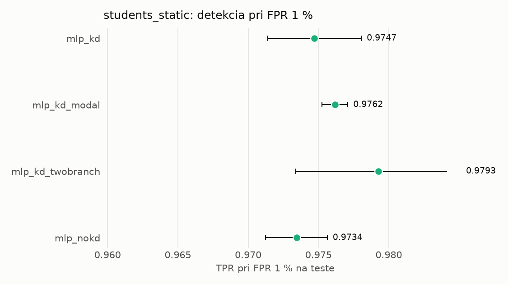

# Porovnanie modelov – students_static

> Generované `src/evaluation/compare.py` (2026-11-04T03:43:20+01:00); použitý je posledný beh každého modelu.
> Metriky sú priemer cez seedy. \* = pri prahu určenom na validácii (FPR ≤ 1 %).
> CPU ms/vz. = medián latencie jednej vzorky na 1 vlákne vrátane transformácie vstupu (meranie hneď po tréningu,
> orientačné). Oficiálne merania spotreby sú v časti „Spotreba zdrojov pri inferencii“.

## Detekčná kvalita a orientačné časy
| model | ROC-AUC val | ROC-AUC test | TPR@FPR 1 % test | TPR@FPR 0,1 % test | F1 test* | FPR test* | gap train−val | CPU ms/vz. | CPU vz./s | GPU ms/vz. | parametre | MB | tréning s | ladenie min |
|---|---|---|---|---|---|---|---|---|---|---|---|---|---|---|
| [mlp_kd](../../students_static/mlp_kd/20261104-034134/README.md) | 0.9989 | 0.9978 ± 0.0000 | 0.9747 | 0.7058 | 0.9752 | 0.0060 | 0.0009 | 0.109 | 109 747 | 0.448 | 74 337 | 0.36 | 7.5 | 0.0 |
| [mlp_kd_modal](../../students_static/mlp_kd_modal/20261104-034223/README.md) | 0.9989 | 0.9979 ± 0.0004 | 0.9762 | 0.5727 | 0.9770 | 0.0064 | 0.0009 | 0.110 | 61 347 | 0.304 | 74 337 | 0.36 | 6.3 | 0.0 |
| [mlp_kd_twobranch](../../students_static/mlp_kd_twobranch/20261104-034252/README.md) | 0.9988 | 0.9976 ± 0.0002 | 0.9793 | 0.2490 | 0.9780 | 0.0077 | 0.0011 | 0.110 | 110 048 | 0.305 | 74 337 | 0.36 | 6.1 | 0.0 |
| [mlp_nokd](../../students_static/mlp_nokd/20261104-034206/README.md) | 0.9987 | 0.9972 ± 0.0002 | 0.9734 | 0.1040 | 0.9781 | 0.0076 | 0.0011 | 0.110 | 109 275 | 0.267 | 74 337 | 0.36 | 2.6 | 0.0 |

## Nízka prevalencia malvéru (test, prah z validácie)
| model | TPR | FPR | precision @ 1 % | falošné na 1 skutočný poplach @ 1 % | precision @ 0.1 % | falošné na 1 skutočný poplach @ 0.1 % |
|---|---|---|---|---|---|---|
| mlp_kd | 0.9564 | 0.0060 | 0.615 | 0.63 | 0.137 | 6.31 |
| mlp_kd_modal | 0.9602 | 0.0064 | 0.602 | 0.66 | 0.130 | 6.68 |
| mlp_kd_twobranch | 0.9632 | 0.0077 | 0.557 | 0.79 | 0.111 | 8.01 |
| mlp_nokd | 0.9634 | 0.0076 | 0.560 | 0.79 | 0.112 | 7.92 |

Prepočet: TPR a FPR nezávisia od podielu malvéru, preto sa dajú preniesť na nízku prevalenciu (v reálnej prevádzke je malvéru ~1 % alebo menej; v teste 54 %). „Falošné na 1 skutočný poplach“ = koľko neškodných súborov je označených na každý zachytený malvér.

## Spotreba zdrojov pri inferencii (benchmark, testovacia množina)
_Benchmark zatiaľ nebol spustený (`python -m src.evaluation.benchmark --approach students_static`)._

## Grafy

