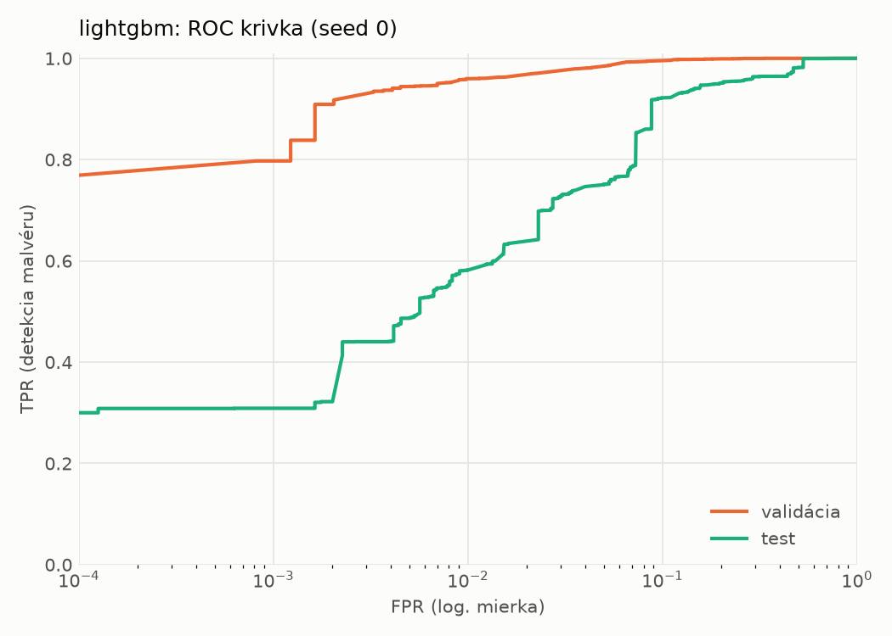
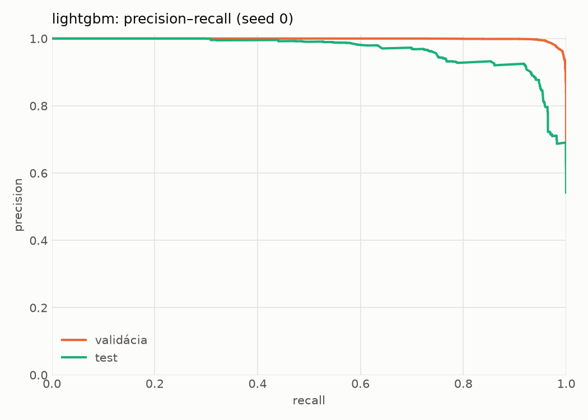
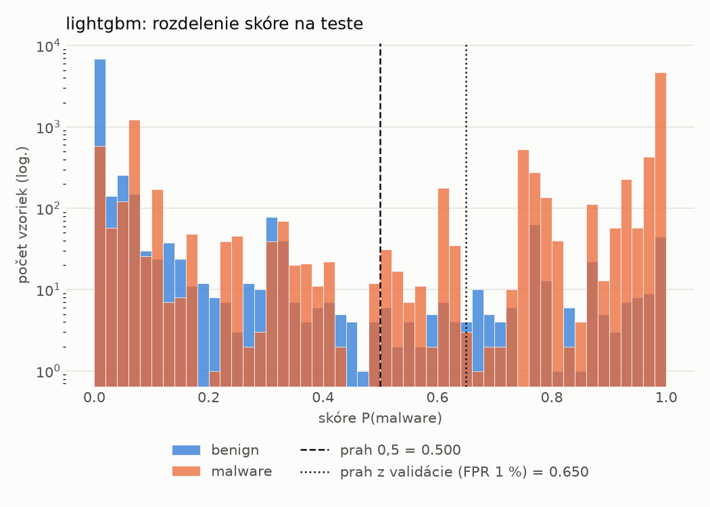
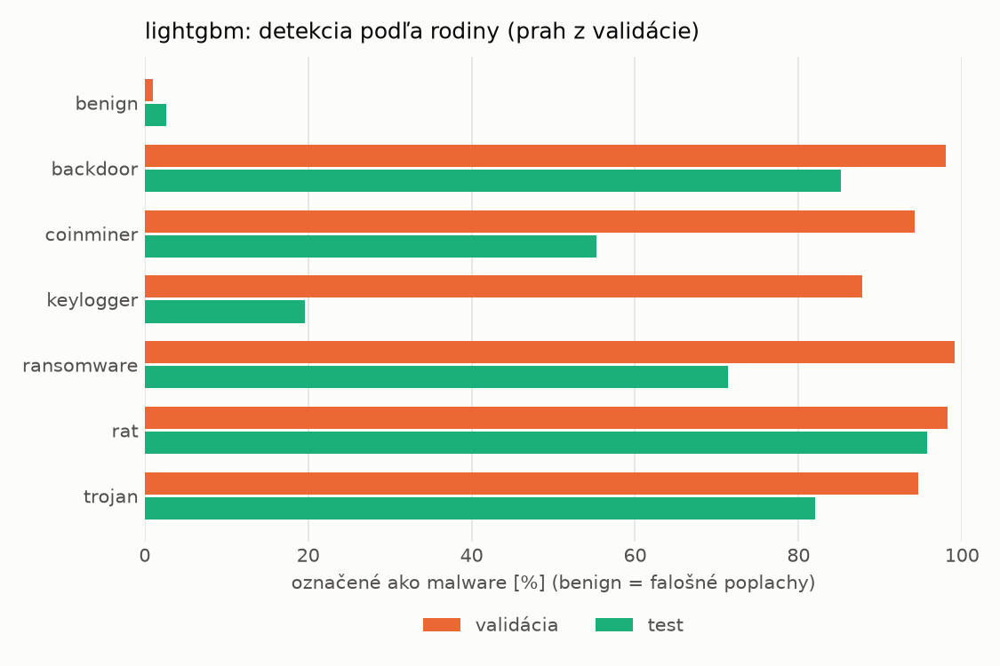
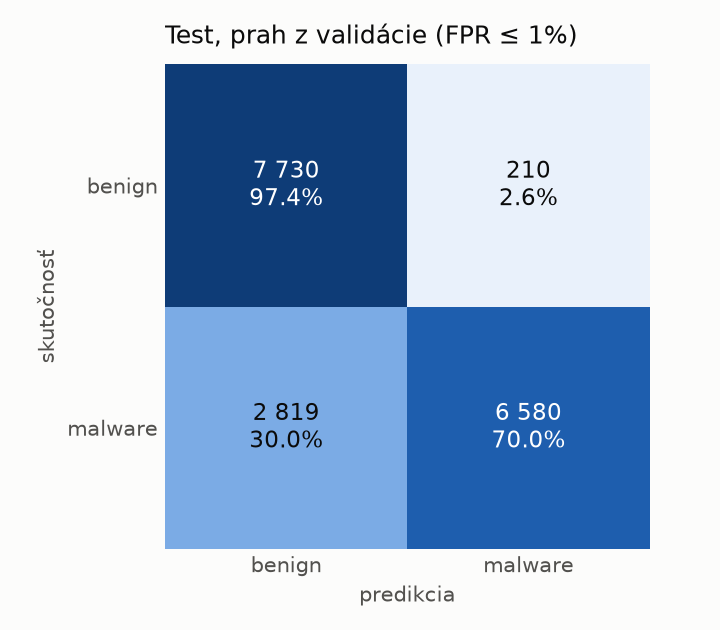
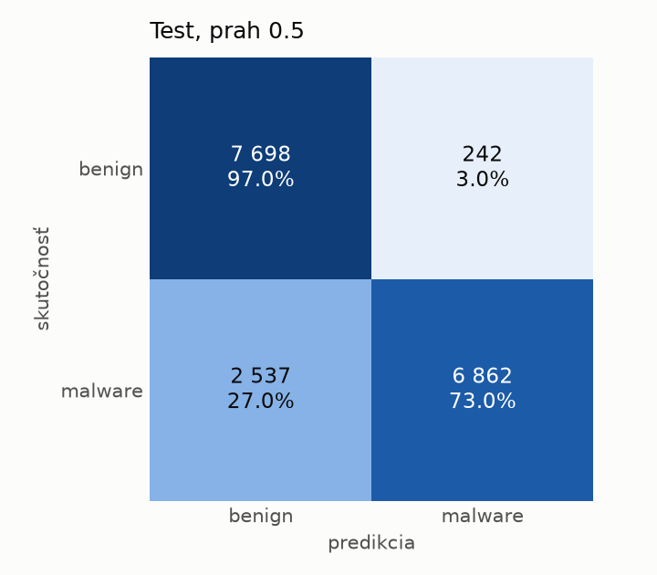
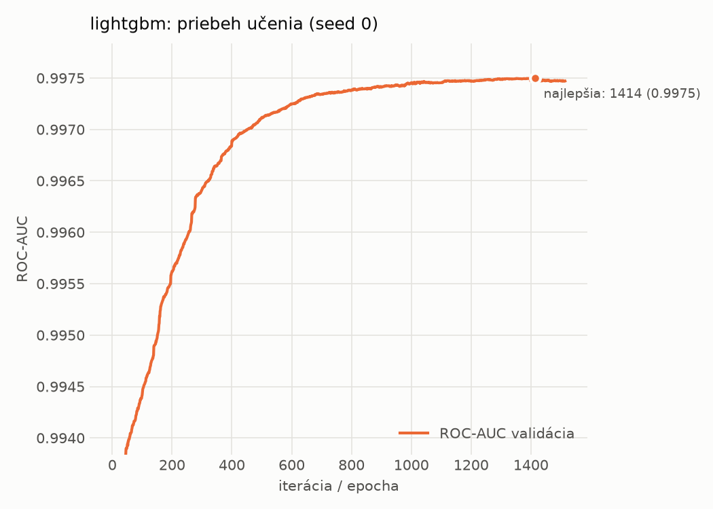

# dynamic/lightgbm – beh `20261104-014114`

> Automaticky generované (`src/training/run_tabular.py`). Konfigurácia: `config.yaml`, protokol: `protocol.yaml`.

- **Model:** `lightgbm` – LightGBM, gradient boosting stromov s early stopping na validácii (pôvodné hodnoty príznakov)
- **Ladenie:** bez ladenia – hyperparametre prevzaté z `runs_final/dynamic/lightgbm/20261102-003953`
- **Finálne modely:** seedy [0, 1, 2]; hodnoty sú priemer ± smerodajná odchýlka cez seedy
- **Najlepšie hyperparametre:** `{"num_boost_round": 5000, "early_stopping_rounds": 100, "learning_rate": 0.012600391102852807, "num_leaves": 261, "min_child_samples": 12, "feature_fraction": 0.7323605840883831, "bagging_fraction": 0.7241803281580393, "lambda_l1": 9.843384499248837e-06, "lambda_l2": 0.7301583949167907}`

## Detekčná kvalita (bez prahu)
| metrika | train (podvzorka) | validácia | test |
|---|---|---|---|
| ROC-AUC | 0.9986 ± 0.0000 | 0.9975 ± 0.0000 | 0.9564 ± 0.0005 |
| PR-AUC | 0.9991 ± 0.0000 | 0.9985 ± 0.0000 | 0.9648 ± 0.0002 |
| TPR pri FPR 1 % | 0.9655 ± 0.0005 | 0.9583 ± 0.0015 | 0.5813 ± 0.0007 |
| TPR pri FPR 0,1 % | 0.9501 ± 0.0003 | 0.8045 ± 0.0064 | 0.3122 ± 0.0069 |
| log loss | 0.0463 ± 0.0005 | 0.0629 ± 0.0001 | 0.5508 ± 0.0189 |
| Brier skóre | 0.0147 ± 0.0001 | 0.0187 ± 0.0001 | 0.1408 ± 0.0014 |

Rozdiel ROC-AUC train − validácia: **0.0011** (veľký rozdiel = preučenie).

## Pri prahu z validácie (FPR ≤ 1% na validácii)
| metrika | train (podvzorka) | validácia | test |
|---|---|---|---|
| accuracy | 0.9737 ± 0.0005 | 0.9702 ± 0.0009 | 0.8237 ± 0.0014 |
| balanced accuracy | 0.9781 ± 0.0002 | 0.9743 ± 0.0007 | 0.8355 ± 0.0011 |
| precision | 0.9977 ± 0.0005 | 0.9942 ± 0.0003 | 0.9717 ± 0.0023 |
| recall (TPR) | 0.9598 ± 0.0012 | 0.9583 ± 0.0015 | 0.6950 ± 0.0044 |
| FPR | 0.0036 ± 0.0008 | 0.0096 ± 0.0005 | 0.0239 ± 0.0022 |
| F1 | 0.9784 ± 0.0004 | 0.9759 ± 0.0008 | 0.8104 ± 0.0022 |
| MCC | 0.9459 ± 0.0009 | 0.9379 ± 0.0018 | 0.6862 ± 0.0012 |

## Pri pevnom prahu 0.5
| metrika | train (podvzorka) | validácia | test |
|---|---|---|---|
| accuracy | 0.9752 ± 0.0003 | 0.9707 ± 0.0001 | 0.8390 ± 0.0009 |
| balanced accuracy | 0.9790 ± 0.0002 | 0.9742 ± 0.0000 | 0.8492 ± 0.0008 |
| precision | 0.9965 ± 0.0000 | 0.9924 ± 0.0001 | 0.9660 ± 0.0003 |
| recall (TPR) | 0.9635 ± 0.0004 | 0.9609 ± 0.0003 | 0.7287 ± 0.0020 |
| FPR | 0.0055 ± 0.0000 | 0.0126 ± 0.0002 | 0.0304 ± 0.0003 |
| F1 | 0.9797 ± 0.0002 | 0.9764 ± 0.0001 | 0.8307 ± 0.0012 |
| MCC | 0.9488 ± 0.0005 | 0.9387 ± 0.0002 | 0.7077 ± 0.0013 |

## Výpočtové nároky (seed 0, testovacia množina)
| meranie | hodnota |
|---|---|
| tréning finálneho modelu | 27.6 s (priemer cez seedy) |
| ladenie spolu | 0 s |
| počet parametrov / uzlov | 730 868 |
| veľkosť modelu na disku | 41.57 MB |
| CPU latencia modelu (batch 1, 1 vlákno) | 0.278 ms (p95 0.581) |
| CPU priepustnosť (24 vlákien) | 50 323 vzoriek/s |

## Grafy
| | |
|---|---|
|  |  |
|  |  |
|  |  |
|  |  |

## Súbory
`metrics.json` (všetky metriky po seedoch vrátane rodín), `timing.json`, `hpo_trials.csv`,
`predictions/<časť>_seed<N>.parquet` (sha256, family, label, score), `model/seed_<N>/`, `log.txt`.
