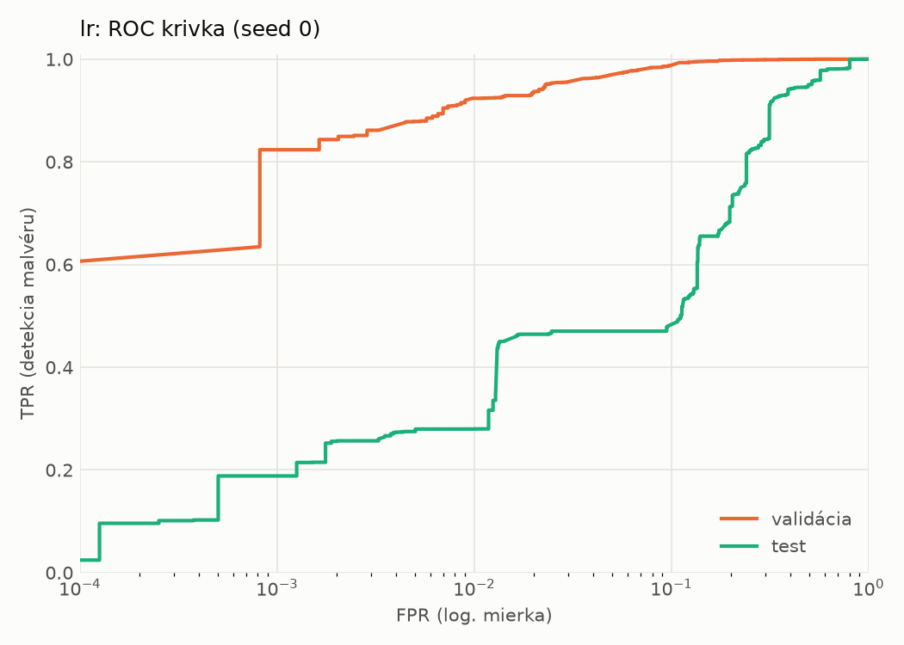
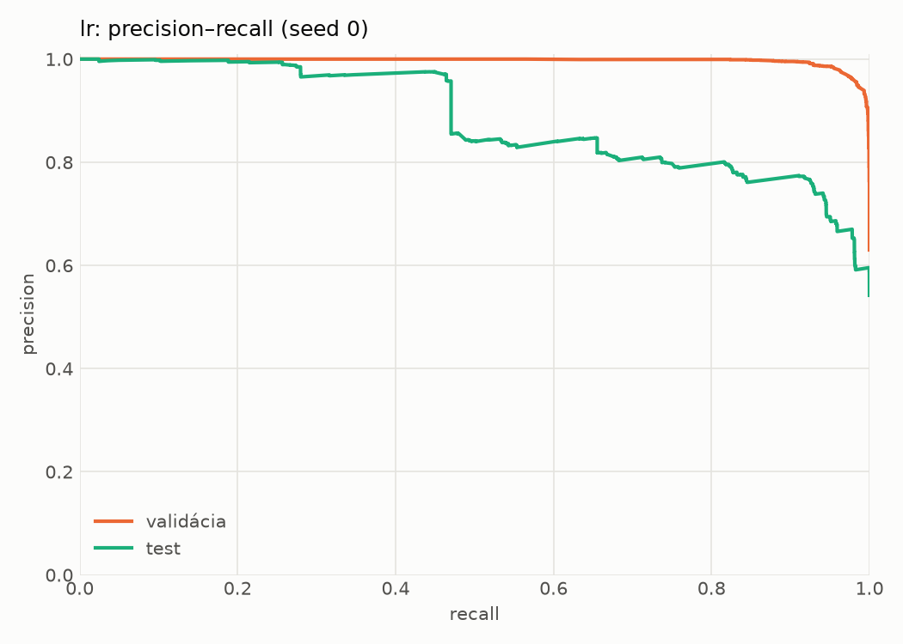
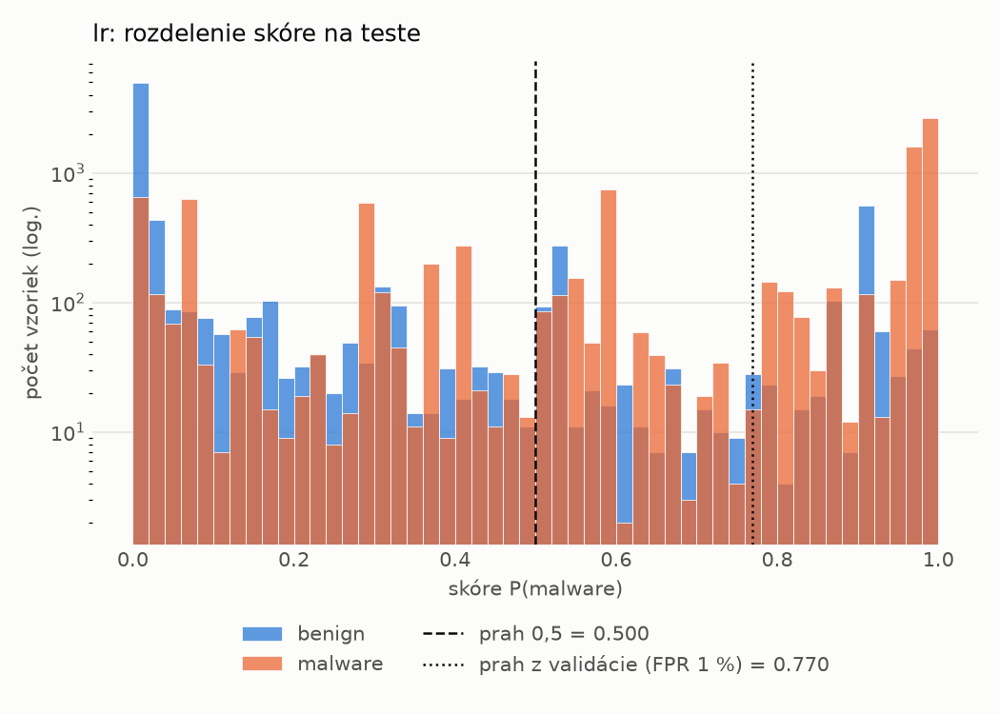
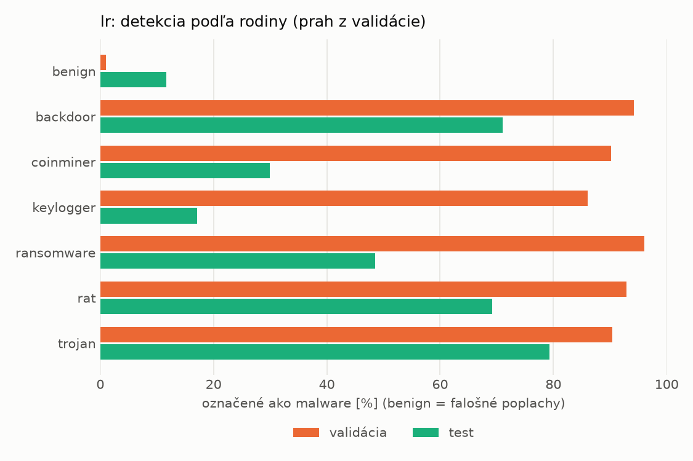
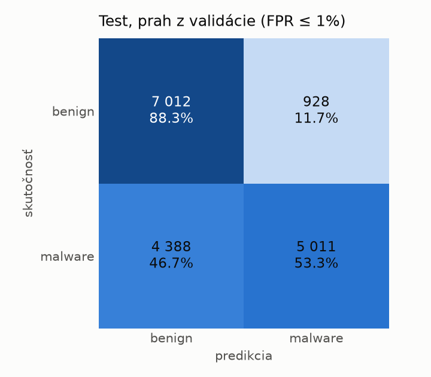
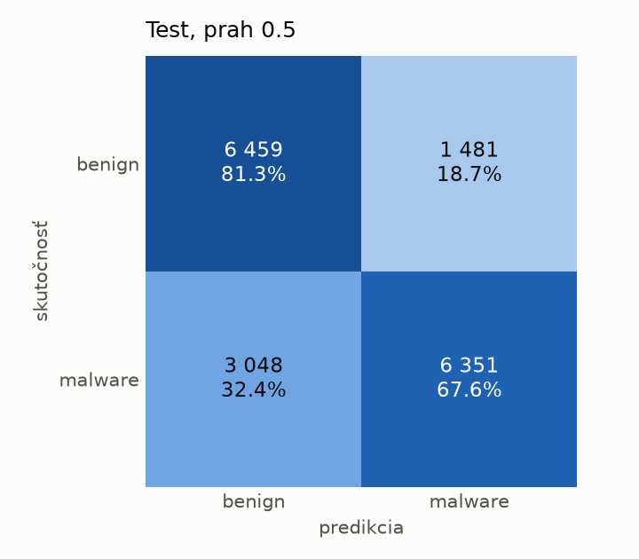

# dynamic/lr – beh `20261104-013903`

> Automaticky generované (`src/training/run_tabular.py`). Konfigurácia: `config.yaml`, protokol: `protocol.yaml`.

- **Model:** `logreg` – logistická regresia s L2 regularizáciou (vstup signed log1p + štandardizácia)
- **Ladenie:** bez ladenia – hyperparametre prevzaté z `runs_final/dynamic/lr/20261102-002602`
- **Finálne modely:** seedy [0, 1, 2]; hodnoty sú priemer ± smerodajná odchýlka cez seedy
- **Najlepšie hyperparametre:** `{"max_iter": 2000, "C": 0.04224422279858655}`

## Detekčná kvalita (bez prahu)
| metrika | train (podvzorka) | validácia | test |
|---|---|---|---|
| ROC-AUC | 0.9965 ± 0.0000 | 0.9949 ± 0.0000 | 0.8635 ± 0.0000 |
| PR-AUC | 0.9978 ± 0.0000 | 0.9970 ± 0.0000 | 0.8844 ± 0.0000 |
| TPR pri FPR 1 % | 0.9331 ± 0.0000 | 0.9238 ± 0.0000 | 0.2797 ± 0.0000 |
| TPR pri FPR 0,1 % | 0.8377 ± 0.0000 | 0.8236 ± 0.0000 | 0.1883 ± 0.0000 |
| log loss | 0.0778 ± 0.0000 | 0.0907 ± 0.0000 | 0.7466 ± 0.0000 |
| Brier skóre | 0.0240 ± 0.0000 | 0.0275 ± 0.0000 | 0.1971 ± 0.0000 |

Rozdiel ROC-AUC train − validácia: **0.0016** (veľký rozdiel = preučenie).

## Pri prahu z validácie (FPR ≤ 1% na validácii)
| metrika | train (podvzorka) | validácia | test |
|---|---|---|---|
| accuracy | 0.9494 ± 0.0000 | 0.9483 ± 0.0000 | 0.6934 ± 0.0000 |
| balanced accuracy | 0.9586 ± 0.0000 | 0.9570 ± 0.0000 | 0.7081 ± 0.0000 |
| precision | 0.9977 ± 0.0000 | 0.9938 ± 0.0000 | 0.8437 ± 0.0000 |
| recall (TPR) | 0.9206 ± 0.0000 | 0.9238 ± 0.0000 | 0.5331 ± 0.0000 |
| FPR | 0.0034 ± 0.0000 | 0.0098 ± 0.0000 | 0.1169 ± 0.0000 |
| F1 | 0.9576 ± 0.0000 | 0.9575 ± 0.0000 | 0.6534 ± 0.0000 |
| MCC | 0.8996 ± 0.0000 | 0.8957 ± 0.0000 | 0.4370 ± 0.0000 |

## Pri pevnom prahu 0.5
| metrika | train (podvzorka) | validácia | test |
|---|---|---|---|
| accuracy | 0.9644 ± 0.0000 | 0.9609 ± 0.0000 | 0.7388 ± 0.0000 |
| balanced accuracy | 0.9678 ± 0.0000 | 0.9639 ± 0.0000 | 0.7446 ± 0.0000 |
| precision | 0.9885 ± 0.0000 | 0.9851 ± 0.0000 | 0.8109 ± 0.0000 |
| recall (TPR) | 0.9538 ± 0.0000 | 0.9524 ± 0.0000 | 0.6757 ± 0.0000 |
| FPR | 0.0182 ± 0.0000 | 0.0246 ± 0.0000 | 0.1865 ± 0.0000 |
| F1 | 0.9708 ± 0.0000 | 0.9685 ± 0.0000 | 0.7372 ± 0.0000 |
| MCC | 0.9262 ± 0.0000 | 0.9180 ± 0.0000 | 0.4897 ± 0.0000 |

## Výpočtové nároky (seed 0, testovacia množina)
| meranie | hodnota |
|---|---|
| tréning finálneho modelu | 5.1 s (priemer cez seedy) |
| ladenie spolu | 0 s |
| počet parametrov / uzlov | 2 001 |
| veľkosť modelu na disku | 0.06 MB |
| transformácia vstupu – latencia (1 vlákno) | 0.017 ms |
| transformácia vstupu – priepustnosť | 56 137 vzoriek/s |
| CPU latencia modelu (batch 1, 1 vlákno) | 0.005 ms (p95 0.005) |
| CPU priepustnosť (24 vlákien) | 348 099 vzoriek/s |

## Grafy
| | |
|---|---|
|  |  |
|  |  |
|  |  |
|  |  |

## Súbory
`metrics.json` (všetky metriky po seedoch vrátane rodín), `timing.json`, `hpo_trials.csv`,
`predictions/<časť>_seed<N>.parquet` (sha256, family, label, score), `model/seed_<N>/`, `log.txt`.
