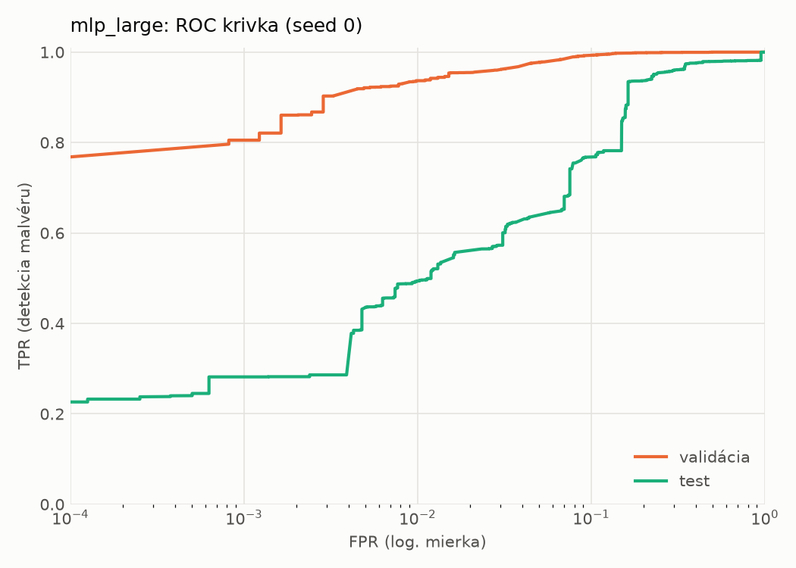
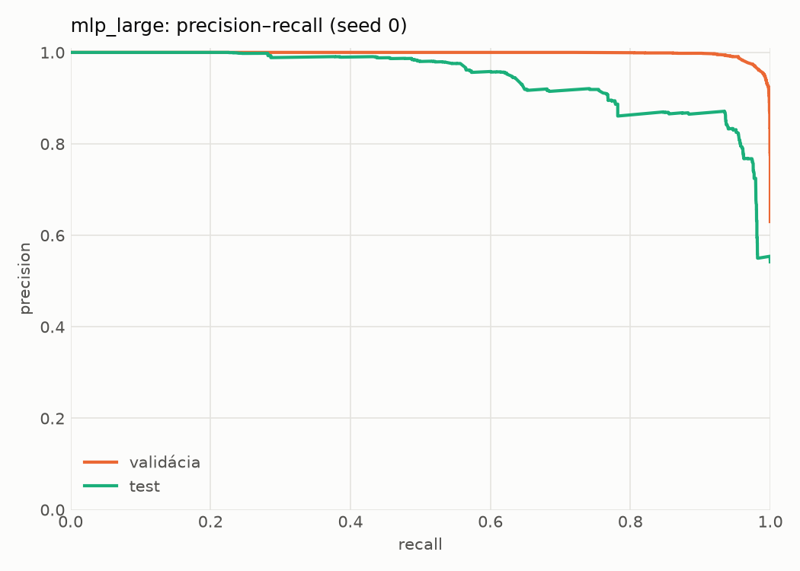
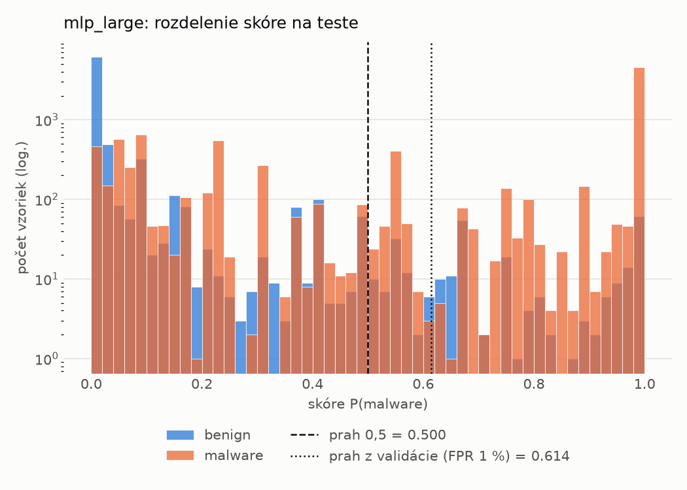
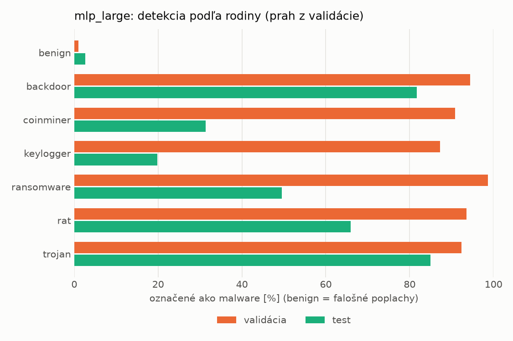
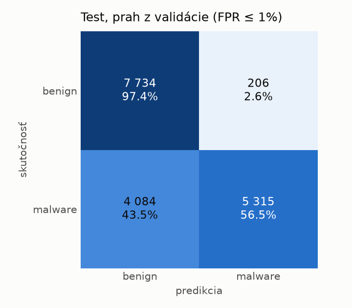
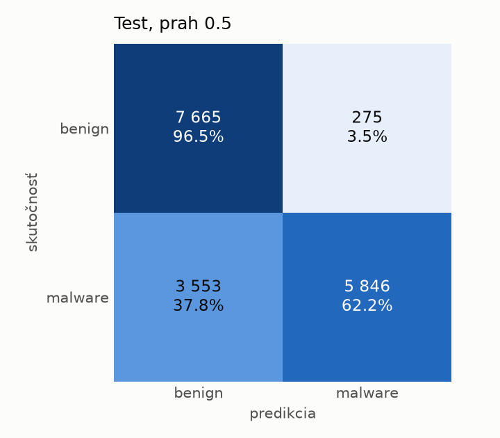
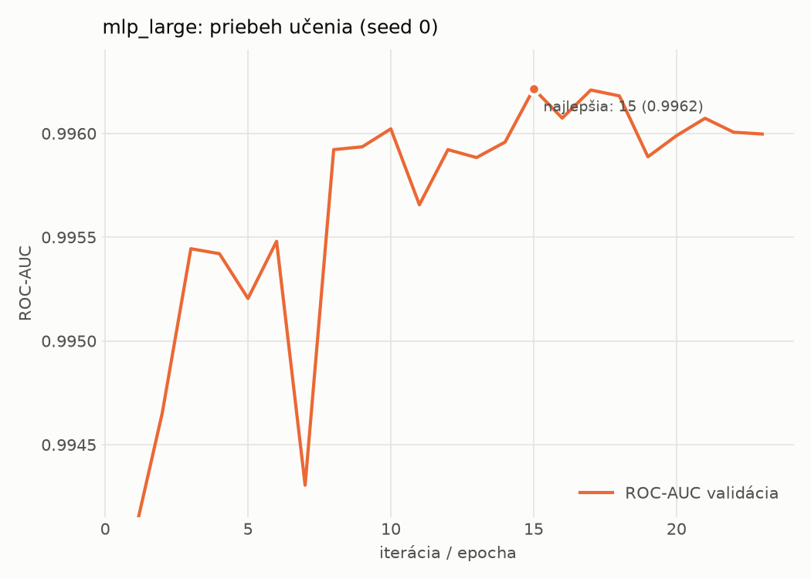

# dynamic/mlp_large – beh `20261104-014321`

> Automaticky generované (`src/training/run_tabular.py`). Konfigurácia: `config.yaml`, protokol: `protocol.yaml`.

- **Model:** `mlp` – veľká neurónová sieť (3–5 skrytých vrstiev, 512–2048 neurónov), kandidát na učiteľa
- **Ladenie:** bez ladenia – hyperparametre prevzaté z `runs_final/dynamic/mlp_large/20261102-005920`
- **Finálne modely:** seedy [0, 1, 2]; hodnoty sú priemer ± smerodajná odchýlka cez seedy
- **Najlepšie hyperparametre:** `{"max_epochs": 100, "patience": 8, "hidden_layers": 3, "hidden_width": 512, "width_decay": 0.5, "dropout": 0.3735687797102123, "lr": 0.00020669709962675654, "weight_decay": 1.4747439017290252e-05, "batch_size": 256}`

## Detekčná kvalita (bez prahu)
| metrika | train (podvzorka) | validácia | test |
|---|---|---|---|
| ROC-AUC | 0.9974 ± 0.0002 | 0.9963 ± 0.0001 | 0.9315 ± 0.0079 |
| PR-AUC | 0.9984 ± 0.0001 | 0.9978 ± 0.0001 | 0.9469 ± 0.0069 |
| TPR pri FPR 1 % | 0.9457 ± 0.0017 | 0.9356 ± 0.0032 | 0.5125 ± 0.0165 |
| TPR pri FPR 0,1 % | 0.9165 ± 0.0117 | 0.7973 ± 0.0070 | 0.3151 ± 0.0320 |
| log loss | 0.0629 ± 0.0023 | 0.0800 ± 0.0002 | 0.6781 ± 0.0895 |
| Brier skóre | 0.0203 ± 0.0008 | 0.0236 ± 0.0005 | 0.1691 ± 0.0146 |

Rozdiel ROC-AUC train − validácia: **0.0011** (veľký rozdiel = preučenie).

## Pri prahu z validácie (FPR ≤ 1% na validácii)
| metrika | train (podvzorka) | validácia | test |
|---|---|---|---|
| accuracy | 0.9600 ± 0.0018 | 0.9559 ± 0.0020 | 0.7657 ± 0.0202 |
| balanced accuracy | 0.9667 ± 0.0012 | 0.9630 ± 0.0016 | 0.7824 ± 0.0190 |
| precision | 0.9965 ± 0.0008 | 0.9940 ± 0.0001 | 0.9730 ± 0.0097 |
| recall (TPR) | 0.9388 ± 0.0036 | 0.9356 ± 0.0032 | 0.5839 ± 0.0332 |
| FPR | 0.0054 ± 0.0013 | 0.0096 ± 0.0002 | 0.0190 ± 0.0063 |
| F1 | 0.9668 ± 0.0015 | 0.9639 ± 0.0017 | 0.7295 ± 0.0279 |
| MCC | 0.9191 ± 0.0032 | 0.9100 ± 0.0038 | 0.6007 ± 0.0331 |

## Pri pevnom prahu 0.5
| metrika | train (podvzorka) | validácia | test |
|---|---|---|---|
| accuracy | 0.9673 ± 0.0014 | 0.9653 ± 0.0007 | 0.7981 ± 0.0219 |
| balanced accuracy | 0.9707 ± 0.0011 | 0.9688 ± 0.0007 | 0.8114 ± 0.0207 |
| precision | 0.9902 ± 0.0009 | 0.9891 ± 0.0012 | 0.9616 ± 0.0088 |
| recall (TPR) | 0.9569 ± 0.0028 | 0.9554 ± 0.0017 | 0.6535 ± 0.0356 |
| FPR | 0.0156 ± 0.0014 | 0.0179 ± 0.0021 | 0.0307 ± 0.0059 |
| F1 | 0.9732 ± 0.0012 | 0.9720 ± 0.0006 | 0.7779 ± 0.0280 |
| MCC | 0.9323 ± 0.0028 | 0.9274 ± 0.0014 | 0.6434 ± 0.0367 |

## Výpočtové nároky (seed 0, testovacia množina)
| meranie | hodnota |
|---|---|
| tréning finálneho modelu | 14.8 s (priemer cez seedy) |
| ladenie spolu | 0 s |
| počet parametrov / uzlov | 1 190 657 |
| veľkosť modelu na disku | 4.83 MB |
| transformácia vstupu – latencia (1 vlákno) | 0.034 ms |
| transformácia vstupu – priepustnosť | 47 536 vzoriek/s |
| CPU latencia modelu (batch 1, 1 vlákno) | 0.198 ms (p95 0.230) |
| CPU priepustnosť (24 vlákien) | 76 878 vzoriek/s |
| GPU latencia (batch 1) | 0.444 ms (p95 0.916) |
| GPU priepustnosť | 111 666 vzoriek/s |
| GPU špičková pamäť | 1257 MB |

## Grafy
| | |
|---|---|
|  |  |
|  |  |
|  |  |
|  |  |

## Súbory
`metrics.json` (všetky metriky po seedoch vrátane rodín), `timing.json`, `hpo_trials.csv`,
`predictions/<časť>_seed<N>.parquet` (sha256, family, label, score), `model/seed_<N>/`, `log.txt`.
