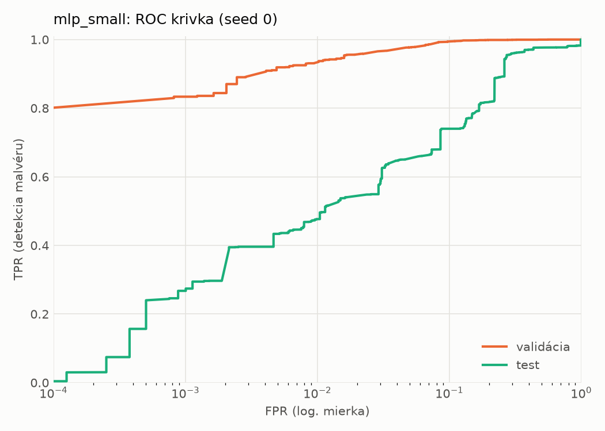
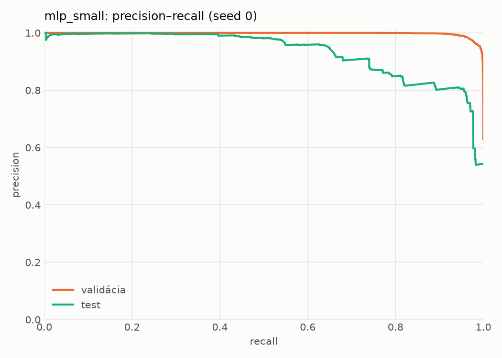
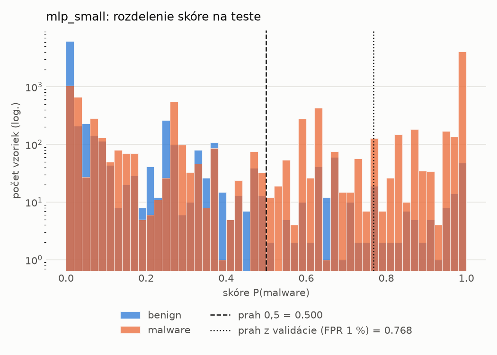
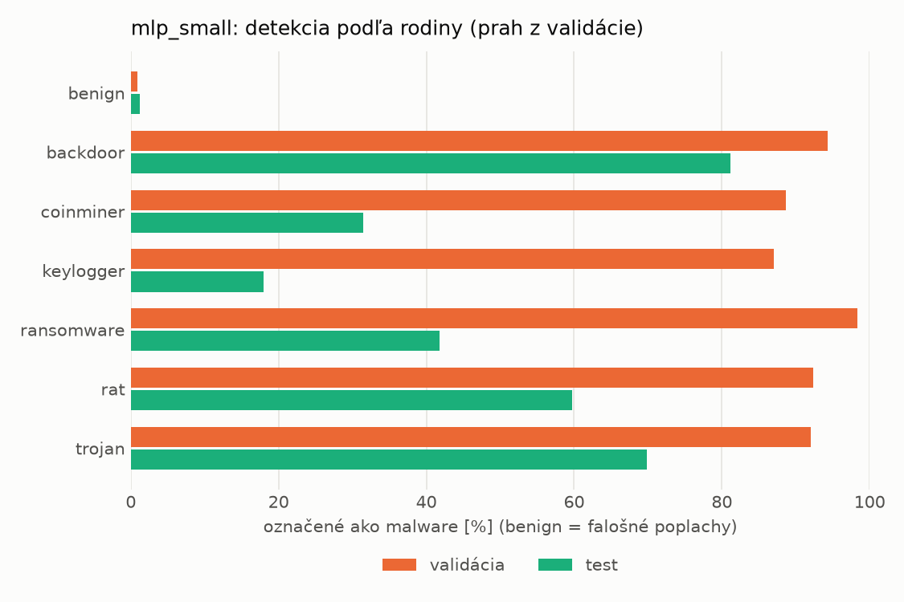
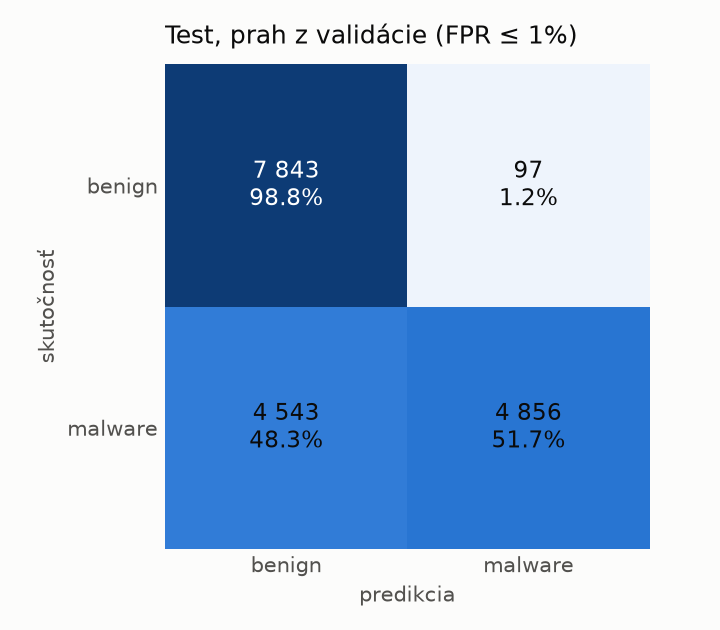
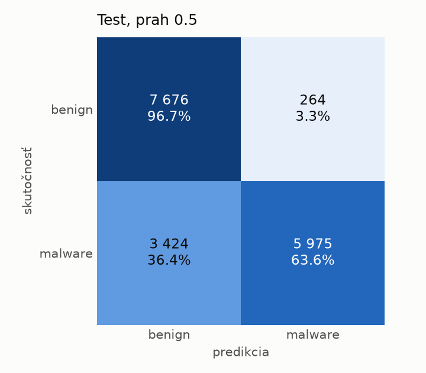
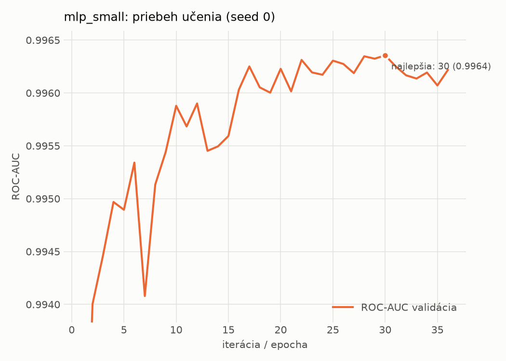

# dynamic/mlp_small – beh `20261104-014301`

> Automaticky generované (`src/training/run_tabular.py`). Konfigurácia: `config.yaml`, protokol: `protocol.yaml`.

- **Model:** `mlp` – malá neurónová sieť (1–2 skryté vrstvy), kandidát na ľahkého študenta
- **Ladenie:** bez ladenia – hyperparametre prevzaté z `runs_final/dynamic/mlp_small/20261102-005611`
- **Finálne modely:** seedy [0, 1, 2]; hodnoty sú priemer ± smerodajná odchýlka cez seedy
- **Najlepšie hyperparametre:** `{"width_decay": 0.5, "max_epochs": 100, "patience": 8, "hidden_layers": 2, "hidden_width": 256, "dropout": 0.194338644844741, "lr": 0.0002516607127550297, "weight_decay": 0.0020651425578959264, "batch_size": 1024}`

## Detekčná kvalita (bez prahu)
| metrika | train (podvzorka) | validácia | test |
|---|---|---|---|
| ROC-AUC | 0.9975 ± 0.0002 | 0.9963 ± 0.0000 | 0.9148 ± 0.0039 |
| PR-AUC | 0.9984 ± 0.0001 | 0.9978 ± 0.0000 | 0.9324 ± 0.0025 |
| TPR pri FPR 1 % | 0.9468 ± 0.0024 | 0.9330 ± 0.0025 | 0.4879 ± 0.0098 |
| TPR pri FPR 0,1 % | 0.9160 ± 0.0070 | 0.8252 ± 0.0462 | 0.2751 ± 0.0105 |
| log loss | 0.0634 ± 0.0029 | 0.0786 ± 0.0007 | 0.6978 ± 0.0852 |
| Brier skóre | 0.0201 ± 0.0009 | 0.0237 ± 0.0007 | 0.1765 ± 0.0095 |

Rozdiel ROC-AUC train − validácia: **0.0012** (veľký rozdiel = preučenie).

## Pri prahu z validácie (FPR ≤ 1% na validácii)
| metrika | train (podvzorka) | validácia | test |
|---|---|---|---|
| accuracy | 0.9592 ± 0.0020 | 0.9544 ± 0.0017 | 0.7299 ± 0.0060 |
| balanced accuracy | 0.9665 ± 0.0015 | 0.9619 ± 0.0014 | 0.7498 ± 0.0055 |
| precision | 0.9978 ± 0.0004 | 0.9942 ± 0.0002 | 0.9779 ± 0.0026 |
| recall (TPR) | 0.9363 ± 0.0036 | 0.9330 ± 0.0025 | 0.5134 ± 0.0118 |
| FPR | 0.0033 ± 0.0007 | 0.0093 ± 0.0002 | 0.0137 ± 0.0018 |
| F1 | 0.9661 ± 0.0017 | 0.9626 ± 0.0014 | 0.6732 ± 0.0100 |
| MCC | 0.9180 ± 0.0037 | 0.9072 ± 0.0032 | 0.5517 ± 0.0083 |

## Pri pevnom prahu 0.5
| metrika | train (podvzorka) | validácia | test |
|---|---|---|---|
| accuracy | 0.9683 ± 0.0011 | 0.9654 ± 0.0005 | 0.7731 ± 0.0160 |
| balanced accuracy | 0.9717 ± 0.0005 | 0.9687 ± 0.0002 | 0.7865 ± 0.0158 |
| precision | 0.9912 ± 0.0013 | 0.9888 ± 0.0015 | 0.9318 ± 0.0224 |
| recall (TPR) | 0.9575 ± 0.0031 | 0.9558 ± 0.0022 | 0.6275 ± 0.0215 |
| FPR | 0.0140 ± 0.0022 | 0.0184 ± 0.0026 | 0.0545 ± 0.0185 |
| F1 | 0.9740 ± 0.0010 | 0.9720 ± 0.0004 | 0.7498 ± 0.0191 |
| MCC | 0.9343 ± 0.0021 | 0.9275 ± 0.0008 | 0.5931 ± 0.0319 |

## Výpočtové nároky (seed 0, testovacia množina)
| meranie | hodnota |
|---|---|
| tréning finálneho modelu | 4.1 s (priemer cez seedy) |
| ladenie spolu | 0 s |
| počet parametrov / uzlov | 546 049 |
| veľkosť modelu na disku | 2.24 MB |
| transformácia vstupu – latencia (1 vlákno) | 0.034 ms |
| transformácia vstupu – priepustnosť | 48 492 vzoriek/s |
| CPU latencia modelu (batch 1, 1 vlákno) | 0.132 ms (p95 0.147) |
| CPU priepustnosť (24 vlákien) | 121 418 vzoriek/s |
| GPU latencia (batch 1) | 0.428 ms (p95 0.457) |
| GPU priepustnosť | 121 860 vzoriek/s |
| GPU špičková pamäť | 706 MB |

## Grafy
| | |
|---|---|
|  |  |
|  |  |
|  |  |
|  |  |

## Súbory
`metrics.json` (všetky metriky po seedoch vrátane rodín), `timing.json`, `hpo_trials.csv`,
`predictions/<časť>_seed<N>.parquet` (sha256, family, label, score), `model/seed_<N>/`, `log.txt`.
