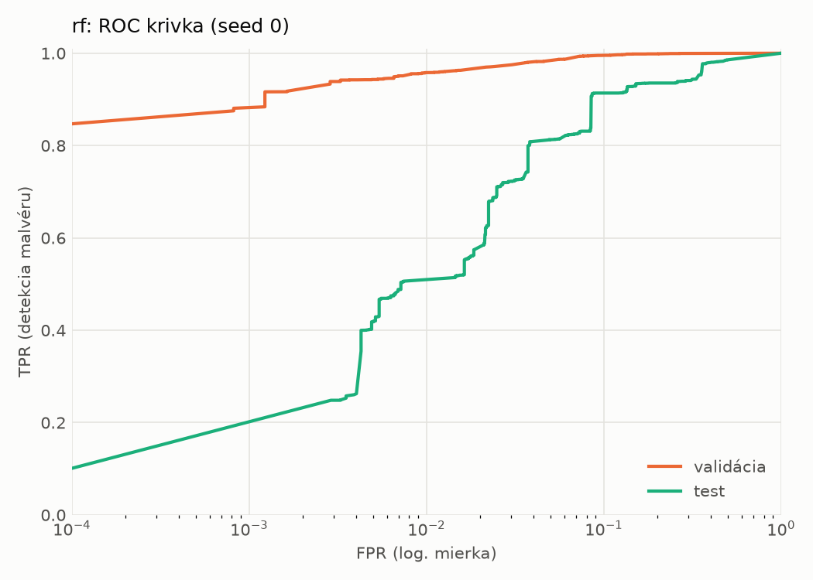
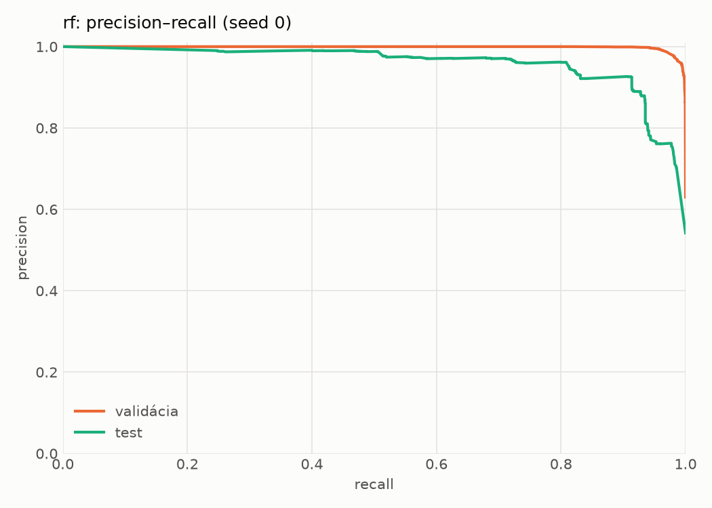
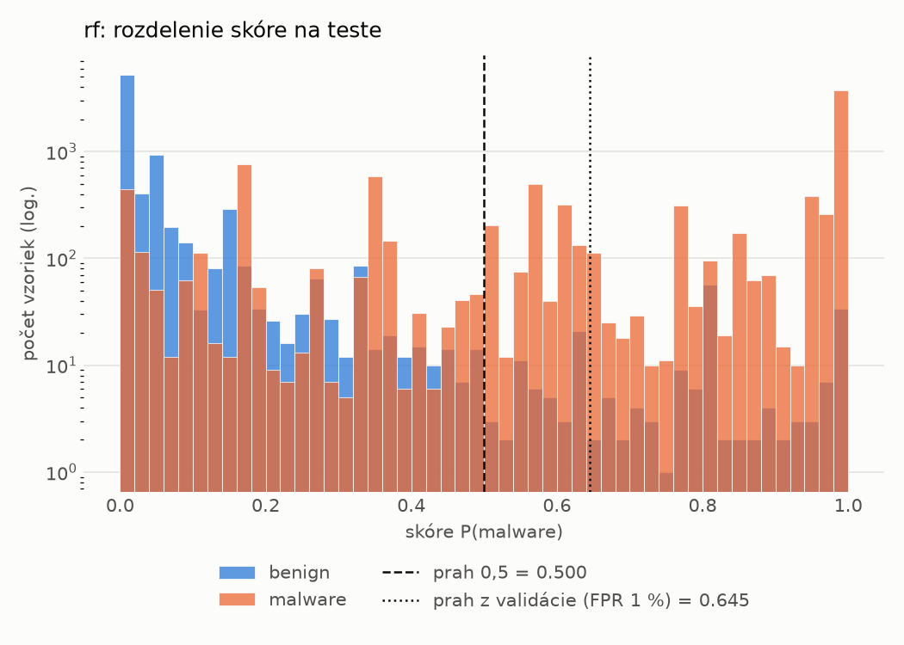
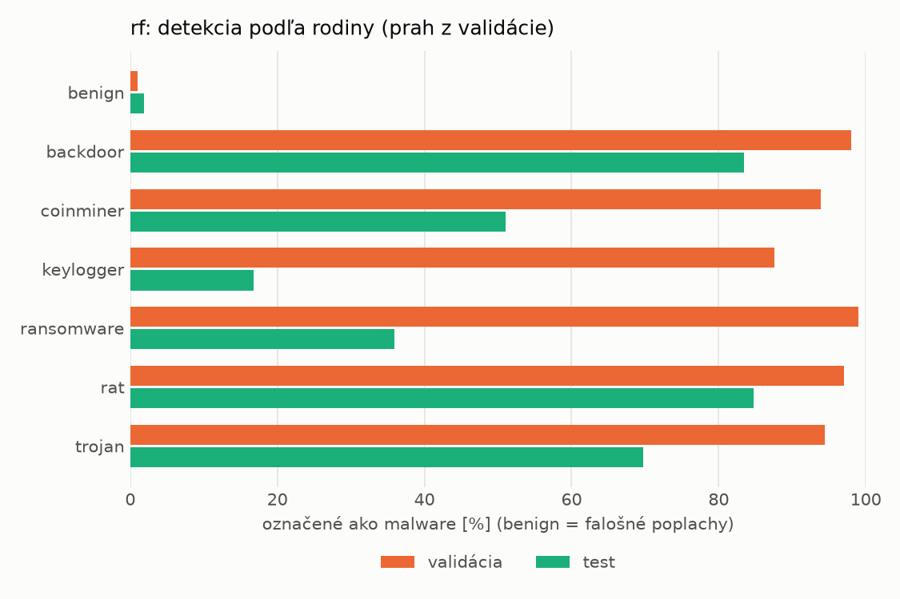
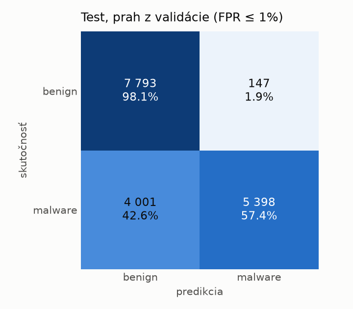
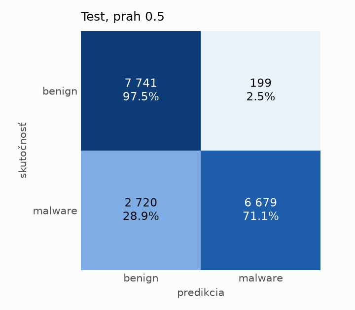

# dynamic/rf – beh `20261104-013925`

> Automaticky generované (`src/training/run_tabular.py`). Konfigurácia: `config.yaml`, protokol: `protocol.yaml`.

- **Model:** `random_forest` – Random Forest (pôvodné hodnoty príznakov)
- **Ladenie:** bez ladenia – hyperparametre prevzaté z `runs_final/dynamic/rf/20261102-003041`
- **Finálne modely:** seedy [0, 1, 2]; hodnoty sú priemer ± smerodajná odchýlka cez seedy
- **Najlepšie hyperparametre:** `{"n_estimators": 450, "max_depth": null, "min_samples_leaf": 1, "max_features": 0.05}`

## Detekčná kvalita (bez prahu)
| metrika | train (podvzorka) | validácia | test |
|---|---|---|---|
| ROC-AUC | 0.9987 ± 0.0000 | 0.9973 ± 0.0001 | 0.9514 ± 0.0011 |
| PR-AUC | 0.9991 ± 0.0000 | 0.9984 ± 0.0000 | 0.9578 ± 0.0008 |
| TPR pri FPR 1 % | 0.9661 ± 0.0002 | 0.9575 ± 0.0005 | 0.5060 ± 0.0007 |
| TPR pri FPR 0,1 % | 0.9467 ± 0.0004 | 0.8908 ± 0.0178 | 0.0000 ± 0.0000 |
| log loss | 0.0469 ± 0.0000 | 0.0658 ± 0.0007 | 0.5207 ± 0.0170 |
| Brier skóre | 0.0149 ± 0.0000 | 0.0189 ± 0.0000 | 0.1305 ± 0.0009 |

Rozdiel ROC-AUC train − validácia: **0.0013** (veľký rozdiel = preučenie).

## Pri prahu z validácie (FPR ≤ 1% na validácii)
| metrika | train (podvzorka) | validácia | test |
|---|---|---|---|
| accuracy | 0.9729 ± 0.0003 | 0.9697 ± 0.0003 | 0.7618 ± 0.0038 |
| balanced accuracy | 0.9773 ± 0.0002 | 0.9740 ± 0.0002 | 0.7789 ± 0.0035 |
| precision | 0.9972 ± 0.0000 | 0.9942 ± 0.0001 | 0.9735 ± 0.0004 |
| recall (TPR) | 0.9591 ± 0.0004 | 0.9575 ± 0.0005 | 0.5763 ± 0.0070 |
| FPR | 0.0045 ± 0.0000 | 0.0096 ± 0.0002 | 0.0186 ± 0.0001 |
| F1 | 0.9778 ± 0.0002 | 0.9755 ± 0.0002 | 0.7240 ± 0.0056 |
| MCC | 0.9444 ± 0.0005 | 0.9370 ± 0.0005 | 0.5952 ± 0.0057 |

## Pri pevnom prahu 0.5
| metrika | train (podvzorka) | validácia | test |
|---|---|---|---|
| accuracy | 0.9761 ± 0.0001 | 0.9708 ± 0.0002 | 0.8257 ± 0.0052 |
| balanced accuracy | 0.9794 ± 0.0000 | 0.9737 ± 0.0002 | 0.8373 ± 0.0048 |
| precision | 0.9958 ± 0.0000 | 0.9910 ± 0.0001 | 0.9705 ± 0.0005 |
| recall (TPR) | 0.9655 ± 0.0001 | 0.9623 ± 0.0001 | 0.6997 ± 0.0096 |
| FPR | 0.0066 ± 0.0000 | 0.0149 ± 0.0002 | 0.0251 ± 0.0003 |
| F1 | 0.9804 ± 0.0000 | 0.9765 ± 0.0001 | 0.8131 ± 0.0066 |
| MCC | 0.9504 ± 0.0001 | 0.9386 ± 0.0003 | 0.6888 ± 0.0082 |

## Výpočtové nároky (seed 0, testovacia množina)
| meranie | hodnota |
|---|---|
| tréning finálneho modelu | 32.8 s (priemer cez seedy) |
| ladenie spolu | 0 s |
| počet parametrov / uzlov | 969 746 |
| veľkosť modelu na disku | 78.00 MB |
| CPU latencia modelu (batch 1, 1 vlákno) | 13.173 ms (p95 13.462) |
| CPU priepustnosť (24 vlákien) | 91 536 vzoriek/s |

## Grafy
| | |
|---|---|
|  |  |
|  |  |
|  |  |
|  |  |

## Súbory
`metrics.json` (všetky metriky po seedoch vrátane rodín), `timing.json`, `hpo_trials.csv`,
`predictions/<časť>_seed<N>.parquet` (sha256, family, label, score), `model/seed_<N>/`, `log.txt`.
