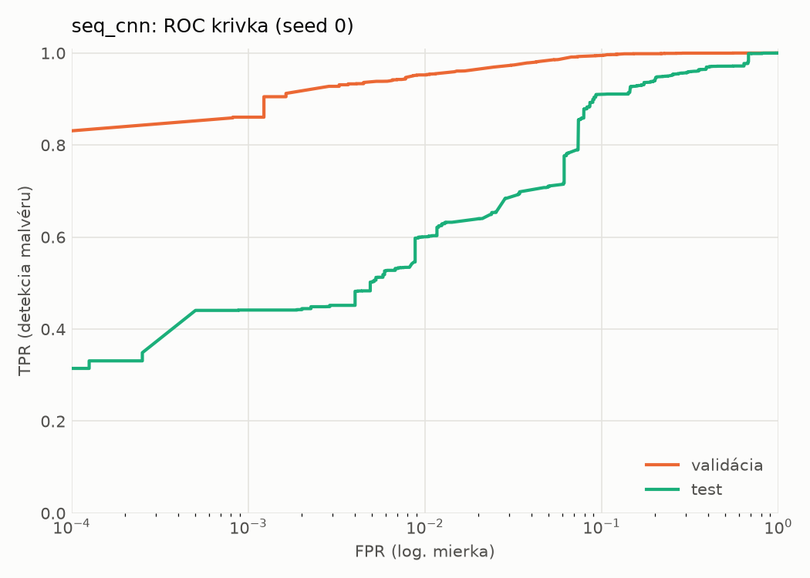
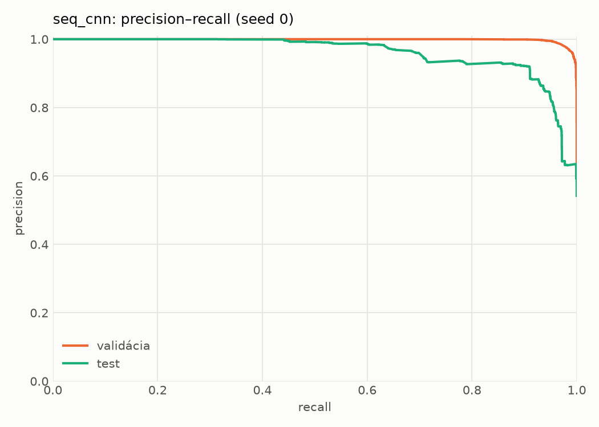
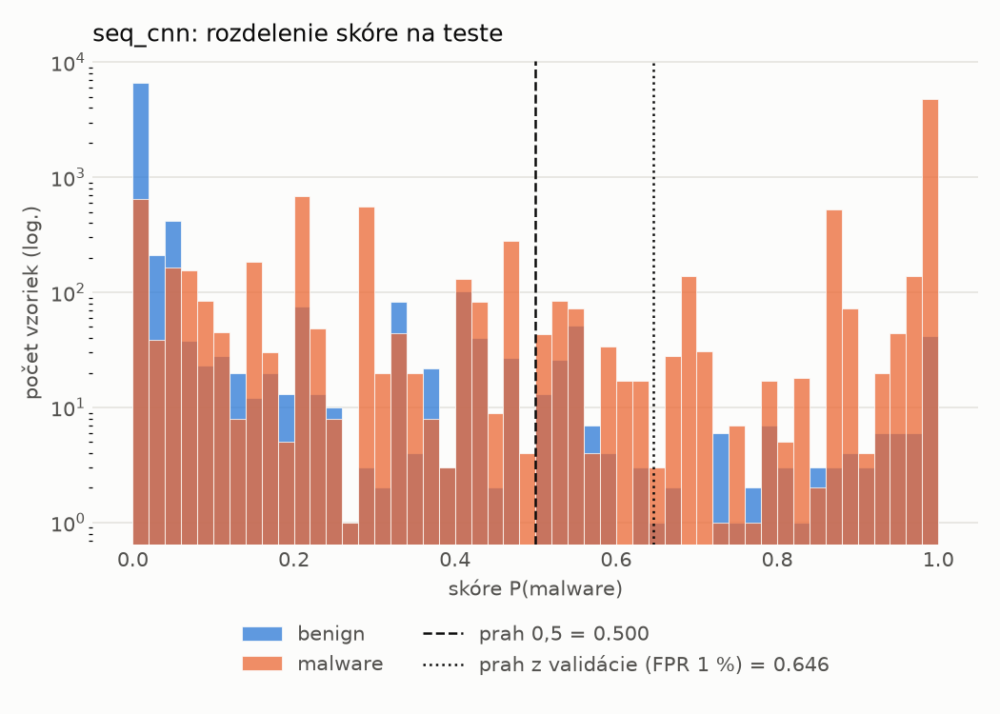
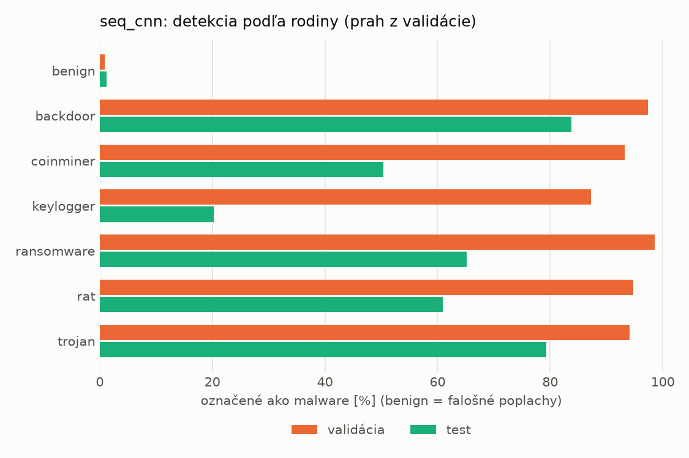
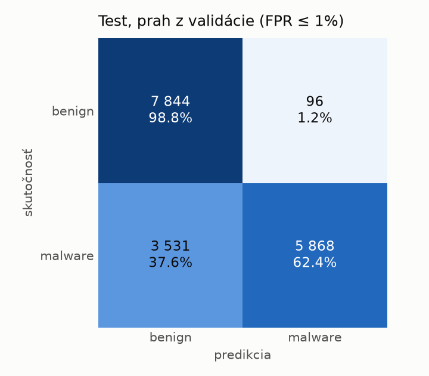
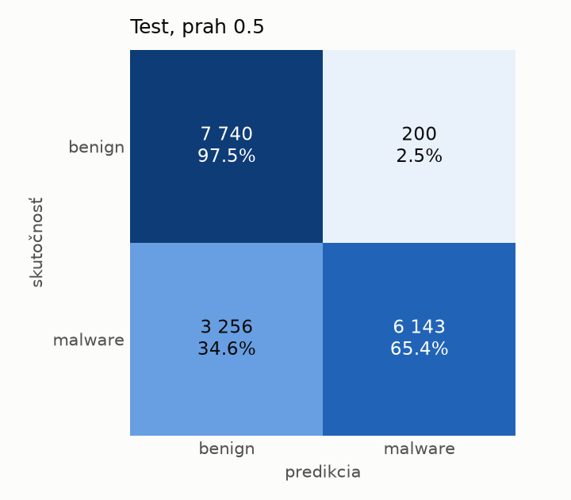
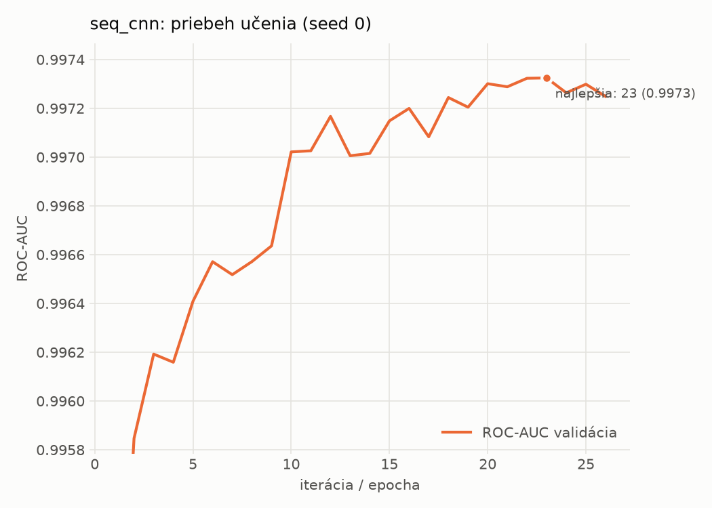

# dynamic_seq/seq_cnn – beh `20261104-014415`

> Automaticky generované (`src/training/run_tabular.py`). Konfigurácia: `config.yaml`, protokol: `protocol.yaml`.

- **Model:** `seq_cnn` – embedding API + paralelné 1D konvolúcie + maximum cez postupnosť
- **Ladenie:** bez ladenia – hyperparametre prevzaté z `runs_final/dynamic/seq_cnn/20261102-010741`
- **Finálne modely:** seedy [0, 1, 2]; hodnoty sú priemer ± smerodajná odchýlka cez seedy
- **Najlepšie hyperparametre:** `{"max_epochs": 30, "patience": 4, "emb_dim": 64, "channels": 128, "kernels": "2-4-8", "hidden": 64, "dropout": 0.19665662644598886, "lr": 0.0005755683530429188, "weight_decay": 0.0005400591881097476, "batch_size": 128}`

## Detekčná kvalita (bez prahu)
| metrika | train (podvzorka) | validácia | test |
|---|---|---|---|
| ROC-AUC | 0.9983 ± 0.0000 | 0.9973 ± 0.0000 | 0.9437 ± 0.0056 |
| PR-AUC | 0.9989 ± 0.0000 | 0.9984 ± 0.0000 | 0.9577 ± 0.0037 |
| TPR pri FPR 1 % | 0.9593 ± 0.0015 | 0.9518 ± 0.0022 | 0.6024 ± 0.0021 |
| TPR pri FPR 0,1 % | 0.9355 ± 0.0011 | 0.8258 ± 0.0301 | 0.3732 ± 0.0591 |
| log loss | 0.0509 ± 0.0009 | 0.0692 ± 0.0010 | 0.6634 ± 0.0719 |
| Brier skóre | 0.0165 ± 0.0003 | 0.0201 ± 0.0001 | 0.1392 ± 0.0109 |

Rozdiel ROC-AUC train − validácia: **0.0010** (veľký rozdiel = preučenie).

## Pri prahu z validácie (FPR ≤ 1% na validácii)
| metrika | train (podvzorka) | validácia | test |
|---|---|---|---|
| accuracy | 0.9702 ± 0.0013 | 0.9661 ± 0.0013 | 0.7958 ± 0.0171 |
| balanced accuracy | 0.9751 ± 0.0009 | 0.9711 ± 0.0010 | 0.8106 ± 0.0158 |
| precision | 0.9971 ± 0.0006 | 0.9941 ± 0.0001 | 0.9825 ± 0.0016 |
| recall (TPR) | 0.9547 ± 0.0025 | 0.9518 ± 0.0022 | 0.6346 ± 0.0317 |
| FPR | 0.0045 ± 0.0009 | 0.0096 ± 0.0002 | 0.0134 ± 0.0011 |
| F1 | 0.9755 ± 0.0011 | 0.9725 ± 0.0011 | 0.7708 ± 0.0234 |
| MCC | 0.9390 ± 0.0024 | 0.9298 ± 0.0026 | 0.6490 ± 0.0257 |

## Pri pevnom prahu 0.5
| metrika | train (podvzorka) | validácia | test |
|---|---|---|---|
| accuracy | 0.9717 ± 0.0003 | 0.9671 ± 0.0002 | 0.8109 ± 0.0298 |
| balanced accuracy | 0.9760 ± 0.0002 | 0.9715 ± 0.0003 | 0.8239 ± 0.0271 |
| precision | 0.9960 ± 0.0002 | 0.9929 ± 0.0006 | 0.9730 ± 0.0063 |
| recall (TPR) | 0.9582 ± 0.0007 | 0.9546 ± 0.0005 | 0.6700 ± 0.0591 |
| FPR | 0.0062 ± 0.0003 | 0.0116 ± 0.0009 | 0.0223 ± 0.0064 |
| F1 | 0.9767 ± 0.0002 | 0.9734 ± 0.0001 | 0.7925 ± 0.0397 |
| MCC | 0.9417 ± 0.0005 | 0.9316 ± 0.0004 | 0.6679 ± 0.0439 |

## Výpočtové nároky (seed 0, testovacia množina)
| meranie | hodnota |
|---|---|
| tréning finálneho modelu | 570.0 s (priemer cez seedy) |
| ladenie spolu | 0 s |
| počet parametrov / uzlov | 209 281 |
| veľkosť modelu na disku | 0.84 MB |
| CPU latencia modelu (batch 1, 1 vlákno) | 2.963 ms (p95 3.405) |
| CPU priepustnosť (24 vlákien) | 1 174 vzoriek/s |
| GPU latencia (batch 1) | 0.983 ms (p95 1.887) |
| GPU priepustnosť | 9 415 vzoriek/s |
| GPU špičková pamäť | 1892 MB |

## Grafy
| | |
|---|---|
|  |  |
|  |  |
|  |  |
|  |  |

## Súbory
`metrics.json` (všetky metriky po seedoch vrátane rodín), `timing.json`, `hpo_trials.csv`,
`predictions/<časť>_seed<N>.parquet` (sha256, family, label, score), `model/seed_<N>/`, `log.txt`.
