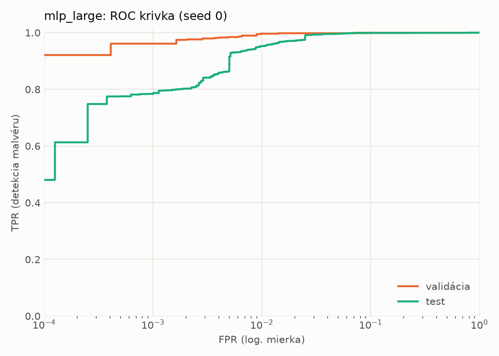
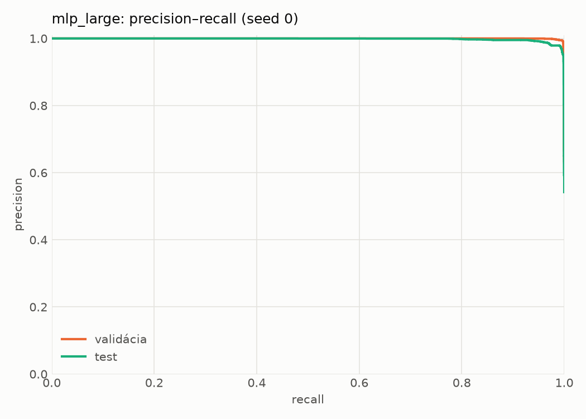
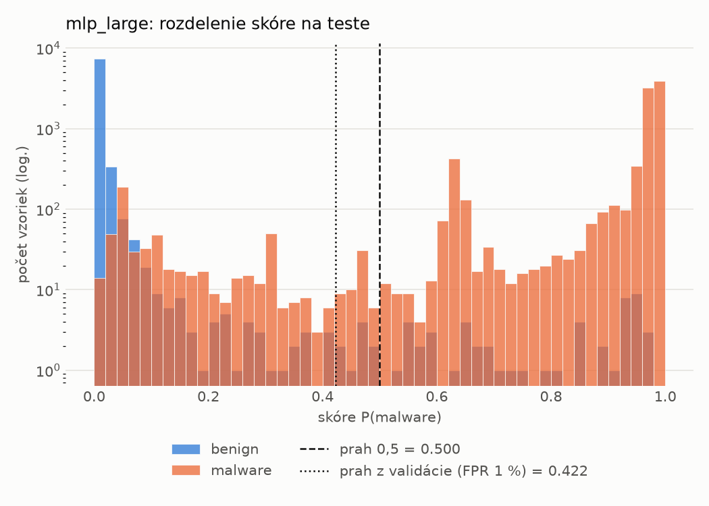
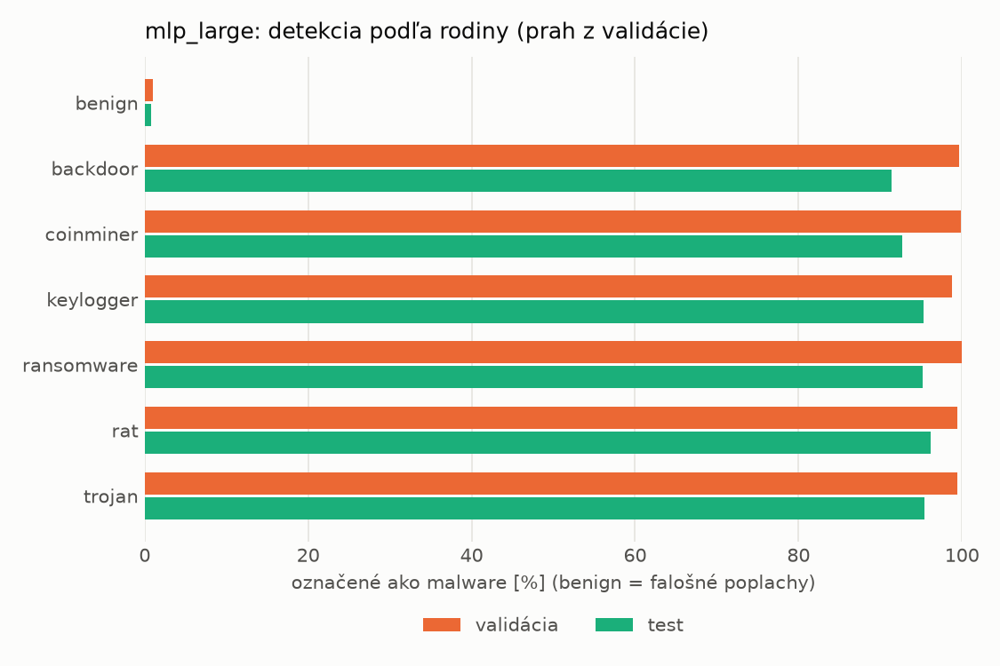
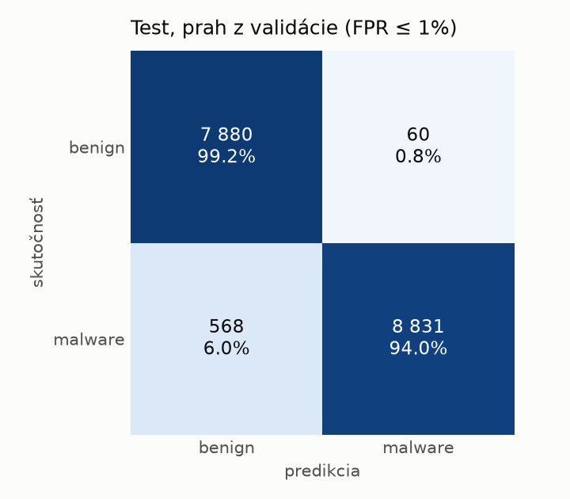
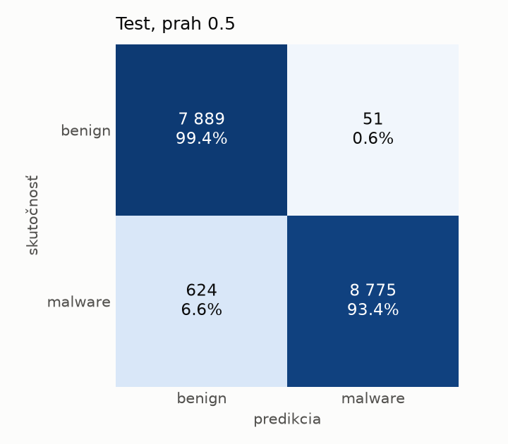
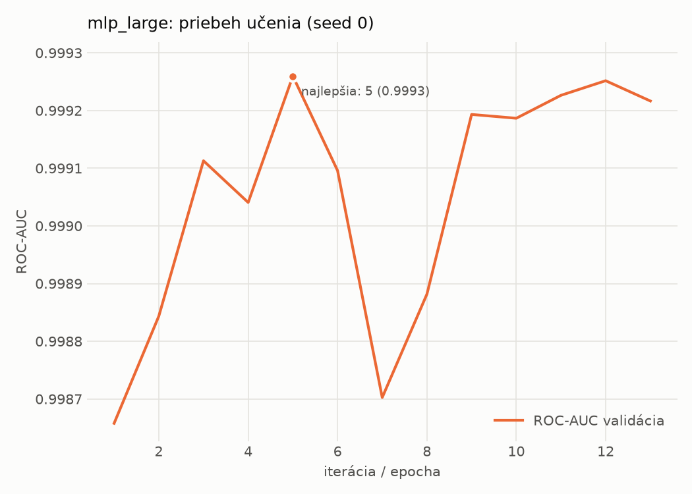

# hybrid/mlp_large – beh `20261104-022243`

> Automaticky generované (`src/training/run_tabular.py`). Konfigurácia: `config.yaml`, protokol: `protocol.yaml`.

- **Model:** `mlp` – veľká neurónová sieť (3–5 skrytých vrstiev, 512–2048 neurónov), kandidát na učiteľa
- **Ladenie:** bez ladenia – hyperparametre prevzaté z `runs_final/hybrid/mlp_large/20261102-064138`
- **Finálne modely:** seedy [0, 1, 2]; hodnoty sú priemer ± smerodajná odchýlka cez seedy
- **Najlepšie hyperparametre:** `{"max_epochs": 100, "patience": 8, "hidden_layers": 4, "hidden_width": 512, "width_decay": 0.5, "dropout": 0.1951820260605614, "lr": 0.000176468680848935, "weight_decay": 1.209699321025492e-05, "batch_size": 512}`

## Detekčná kvalita (bez prahu)
| metrika | train (podvzorka) | validácia | test |
|---|---|---|---|
| ROC-AUC | 1.0000 ± 0.0000 | 0.9992 ± 0.0001 | 0.9974 ± 0.0001 |
| PR-AUC | 1.0000 ± 0.0000 | 0.9996 ± 0.0001 | 0.9980 ± 0.0001 |
| TPR pri FPR 1 % | 0.9994 ± 0.0003 | 0.9960 ± 0.0003 | 0.9560 ± 0.0038 |
| TPR pri FPR 0,1 % | 0.9878 ± 0.0059 | 0.9500 ± 0.0102 | 0.8083 ± 0.0213 |
| log loss | 0.0166 ± 0.0076 | 0.0306 ± 0.0039 | 0.1311 ± 0.0132 |
| Brier skóre | 0.0023 ± 0.0007 | 0.0057 ± 0.0001 | 0.0327 ± 0.0032 |

Rozdiel ROC-AUC train − validácia: **0.0007** (veľký rozdiel = preučenie).

## Pri prahu z validácie (FPR ≤ 1% na validácii)
| metrika | train (podvzorka) | validácia | test |
|---|---|---|---|
| accuracy | 0.9976 ± 0.0004 | 0.9939 ± 0.0001 | 0.9678 ± 0.0035 |
| balanced accuracy | 0.9972 ± 0.0004 | 0.9932 ± 0.0000 | 0.9698 ± 0.0033 |
| precision | 0.9975 ± 0.0002 | 0.9943 ± 0.0001 | 0.9939 ± 0.0006 |
| recall (TPR) | 0.9986 ± 0.0006 | 0.9960 ± 0.0003 | 0.9464 ± 0.0059 |
| FPR | 0.0041 ± 0.0004 | 0.0097 ± 0.0002 | 0.0068 ± 0.0007 |
| F1 | 0.9980 ± 0.0003 | 0.9952 ± 0.0001 | 0.9696 ± 0.0034 |
| MCC | 0.9948 ± 0.0009 | 0.9869 ± 0.0002 | 0.9367 ± 0.0067 |

## Pri pevnom prahu 0.5
| metrika | train (podvzorka) | validácia | test |
|---|---|---|---|
| accuracy | 0.9975 ± 0.0004 | 0.9935 ± 0.0001 | 0.9637 ± 0.0040 |
| balanced accuracy | 0.9972 ± 0.0003 | 0.9930 ± 0.0002 | 0.9661 ± 0.0037 |
| precision | 0.9976 ± 0.0002 | 0.9948 ± 0.0005 | 0.9947 ± 0.0008 |
| recall (TPR) | 0.9983 ± 0.0004 | 0.9950 ± 0.0004 | 0.9380 ± 0.0078 |
| FPR | 0.0039 ± 0.0003 | 0.0089 ± 0.0009 | 0.0059 ± 0.0009 |
| F1 | 0.9980 ± 0.0003 | 0.9949 ± 0.0001 | 0.9655 ± 0.0039 |
| MCC | 0.9946 ± 0.0007 | 0.9861 ± 0.0002 | 0.9291 ± 0.0075 |

## Výpočtové nároky (seed 0, testovacia množina)
| meranie | hodnota |
|---|---|
| tréning finálneho modelu | 6.4 s (priemer cez seedy) |
| ladenie spolu | 0 s |
| počet parametrov / uzlov | 2 386 305 |
| veľkosť modelu na disku | 9.67 MB |
| transformácia vstupu – latencia (1 vlákno) | 0.061 ms |
| transformácia vstupu – priepustnosť | 21 914 vzoriek/s |
| CPU latencia modelu (batch 1, 1 vlákno) | 0.292 ms (p95 0.319) |
| CPU priepustnosť (24 vlákien) | 37 465 vzoriek/s |
| GPU latencia (batch 1) | 0.525 ms (p95 1.077) |
| GPU priepustnosť | 36 352 vzoriek/s |
| GPU špičková pamäť | 2651 MB |

## Grafy
| | |
|---|---|
|  |  |
|  |  |
|  |  |
|  |  |

## Súbory
`metrics.json` (všetky metriky po seedoch vrátane rodín), `timing.json`, `hpo_trials.csv`,
`predictions/<časť>_seed<N>.parquet` (sha256, family, label, score), `model/seed_<N>/`, `log.txt`.
