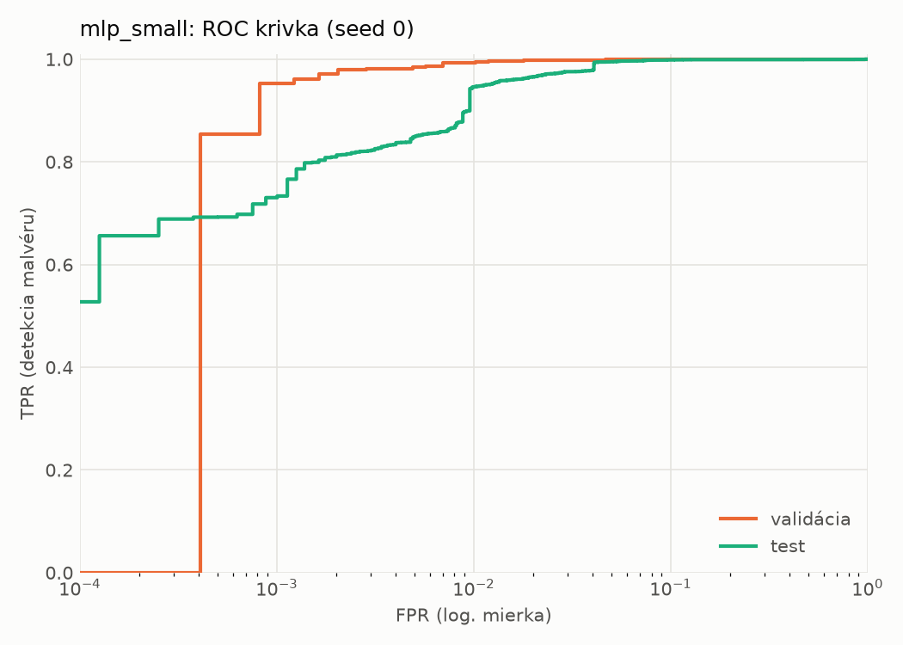
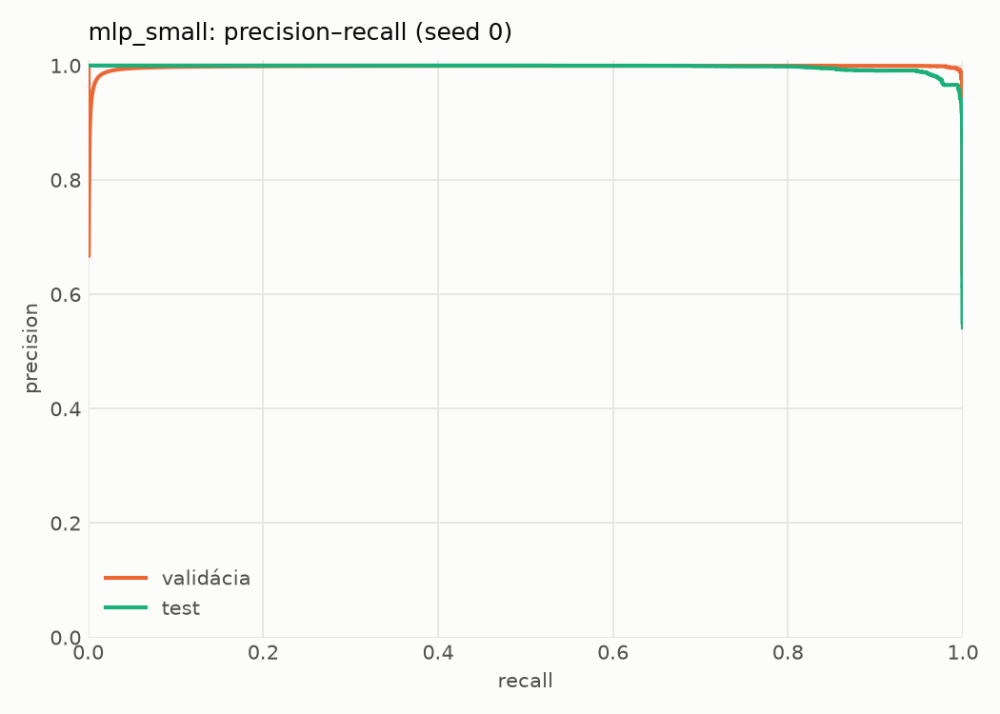
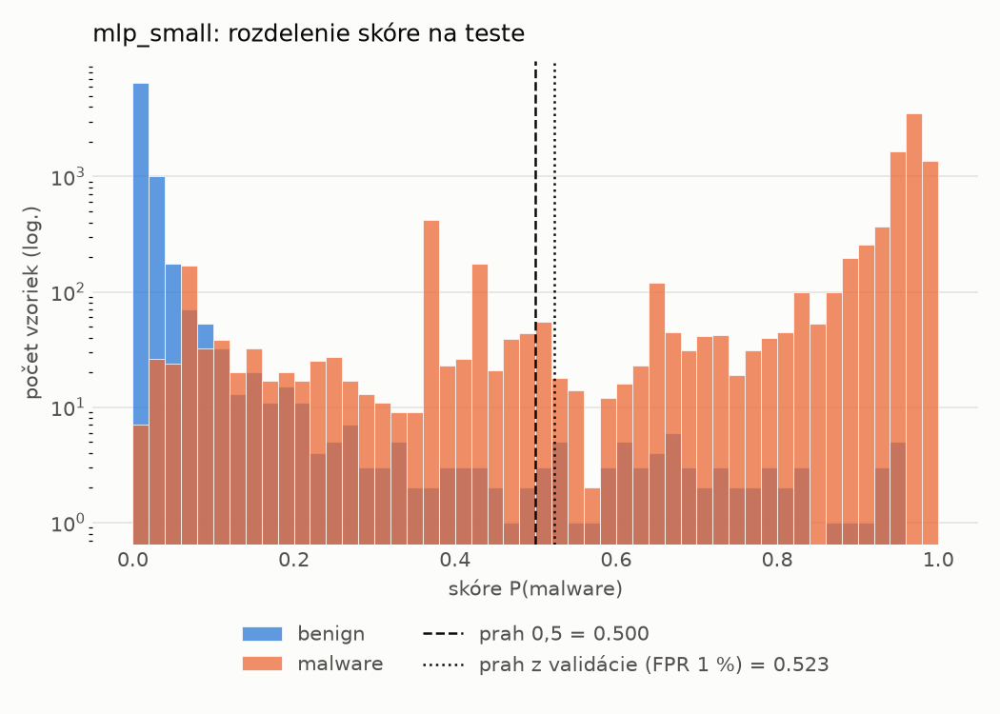
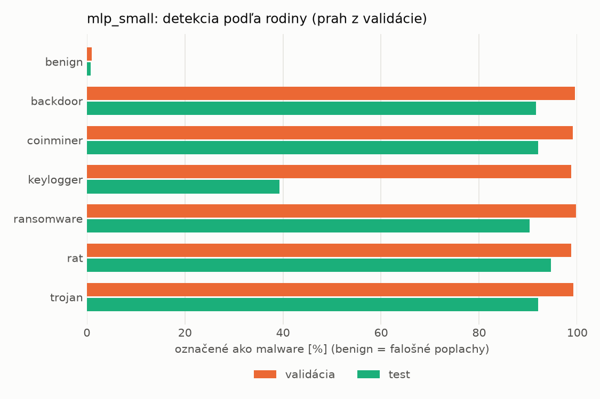
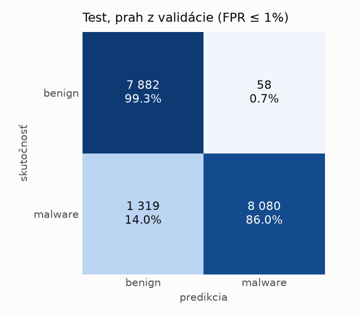
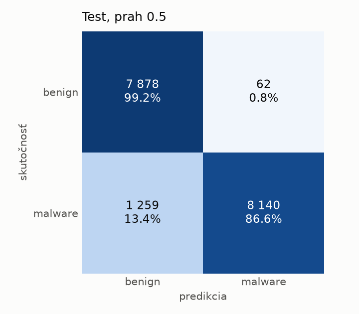
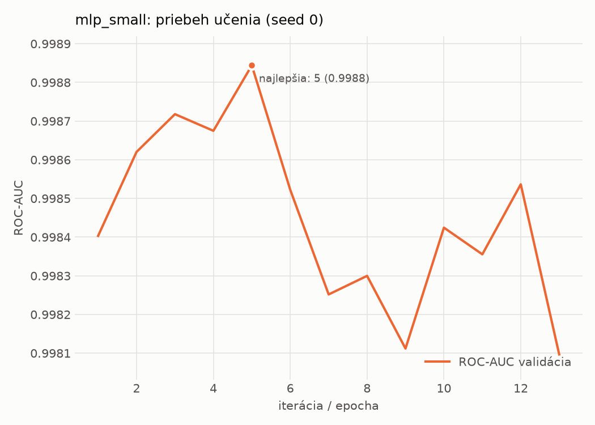

# hybrid/mlp_small – beh `20261104-022207`

> Automaticky generované (`src/training/run_tabular.py`). Konfigurácia: `config.yaml`, protokol: `protocol.yaml`.

- **Model:** `mlp` – malá neurónová sieť (1–2 skryté vrstvy), kandidát na ľahkého študenta
- **Ladenie:** bez ladenia – hyperparametre prevzaté z `runs_final/hybrid/mlp_small/20261102-063854`
- **Finálne modely:** seedy [0, 1, 2]; hodnoty sú priemer ± smerodajná odchýlka cez seedy
- **Najlepšie hyperparametre:** `{"width_decay": 0.5, "max_epochs": 100, "patience": 8, "hidden_layers": 2, "hidden_width": 32, "dropout": 0.16874195706419903, "lr": 0.0006143857735366936, "weight_decay": 0.007079811471617702, "batch_size": 512}`

## Detekčná kvalita (bez prahu)
| metrika | train (podvzorka) | validácia | test |
|---|---|---|---|
| ROC-AUC | 0.9999 ± 0.0001 | 0.9990 ± 0.0002 | 0.9960 ± 0.0008 |
| PR-AUC | 1.0000 ± 0.0000 | 0.9985 ± 0.0010 | 0.9962 ± 0.0010 |
| TPR pri FPR 1 % | 0.9991 ± 0.0005 | 0.9935 ± 0.0019 | 0.9057 ± 0.0346 |
| TPR pri FPR 0,1 % | 0.9881 ± 0.0061 | 0.9567 ± 0.0036 | 0.7594 ± 0.0269 |
| log loss | 0.0184 ± 0.0132 | 0.0297 ± 0.0099 | 0.1842 ± 0.0440 |
| Brier skóre | 0.0029 ± 0.0011 | 0.0059 ± 0.0005 | 0.0531 ± 0.0096 |

Rozdiel ROC-AUC train − validácia: **0.0009** (veľký rozdiel = preučenie).

## Pri prahu z validácie (FPR ≤ 1% na validácii)
| metrika | train (podvzorka) | validácia | test |
|---|---|---|---|
| accuracy | 0.9959 ± 0.0013 | 0.9923 ± 0.0012 | 0.9239 ± 0.0051 |
| balanced accuracy | 0.9960 ± 0.0010 | 0.9918 ± 0.0010 | 0.9292 ± 0.0047 |
| precision | 0.9977 ± 0.0009 | 0.9942 ± 0.0000 | 0.9933 ± 0.0011 |
| recall (TPR) | 0.9958 ± 0.0027 | 0.9935 ± 0.0019 | 0.8654 ± 0.0102 |
| FPR | 0.0038 ± 0.0015 | 0.0098 ± 0.0000 | 0.0069 ± 0.0012 |
| F1 | 0.9967 ± 0.0011 | 0.9939 ± 0.0010 | 0.9249 ± 0.0055 |
| MCC | 0.9914 ± 0.0028 | 0.9834 ± 0.0026 | 0.8568 ± 0.0088 |

## Pri pevnom prahu 0.5
| metrika | train (podvzorka) | validácia | test |
|---|---|---|---|
| accuracy | 0.9968 ± 0.0008 | 0.9930 ± 0.0007 | 0.9252 ± 0.0044 |
| balanced accuracy | 0.9965 ± 0.0008 | 0.9923 ± 0.0006 | 0.9303 ± 0.0040 |
| precision | 0.9972 ± 0.0003 | 0.9940 ± 0.0000 | 0.9923 ± 0.0002 |
| recall (TPR) | 0.9976 ± 0.0010 | 0.9949 ± 0.0012 | 0.8687 ± 0.0082 |
| FPR | 0.0047 ± 0.0005 | 0.0102 ± 0.0000 | 0.0080 ± 0.0002 |
| F1 | 0.9974 ± 0.0007 | 0.9944 ± 0.0006 | 0.9264 ± 0.0046 |
| MCC | 0.9931 ± 0.0018 | 0.9849 ± 0.0016 | 0.8588 ± 0.0076 |

## Výpočtové nároky (seed 0, testovacia množina)
| meranie | hodnota |
|---|---|
| tréning finálneho modelu | 5.6 s (priemer cez seedy) |
| ladenie spolu | 0 s |
| počet parametrov / uzlov | 138 881 |
| veľkosť modelu na disku | 0.67 MB |
| transformácia vstupu – latencia (1 vlákno) | 0.041 ms |
| transformácia vstupu – priepustnosť | 23 550 vzoriek/s |
| CPU latencia modelu (batch 1, 1 vlákno) | 0.101 ms (p95 0.116) |
| CPU priepustnosť (24 vlákien) | 46 000 vzoriek/s |
| GPU latencia (batch 1) | 0.420 ms (p95 0.457) |
| GPU priepustnosť | 30 342 vzoriek/s |
| GPU špičková pamäť | 1461 MB |

## Grafy
| | |
|---|---|
|  |  |
|  |  |
|  |  |
|  |  |

## Súbory
`metrics.json` (všetky metriky po seedoch vrátane rodín), `timing.json`, `hpo_trials.csv`,
`predictions/<časť>_seed<N>.parquet` (sha256, family, label, score), `model/seed_<N>/`, `log.txt`.
