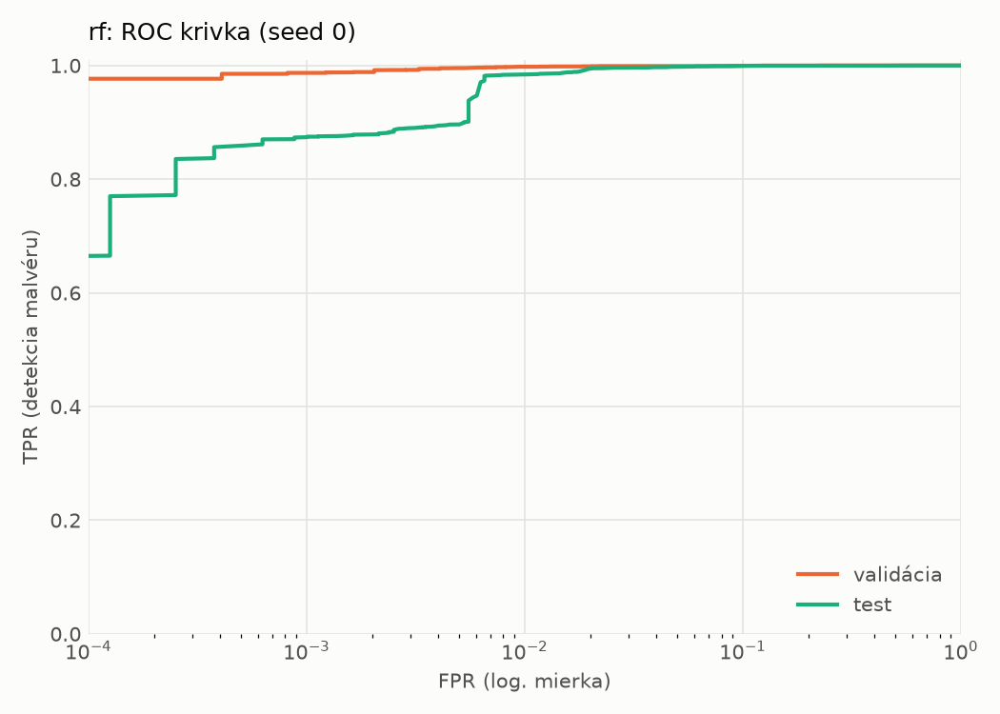
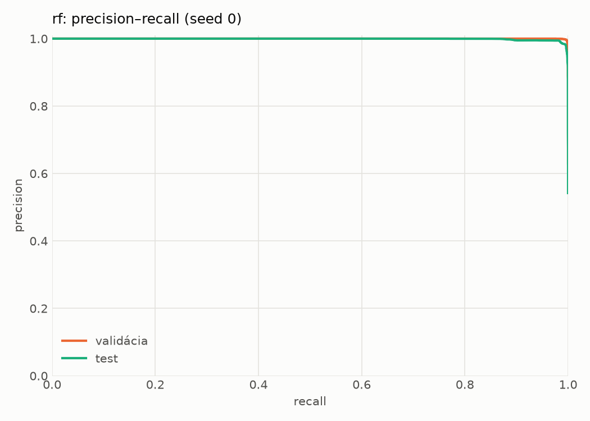
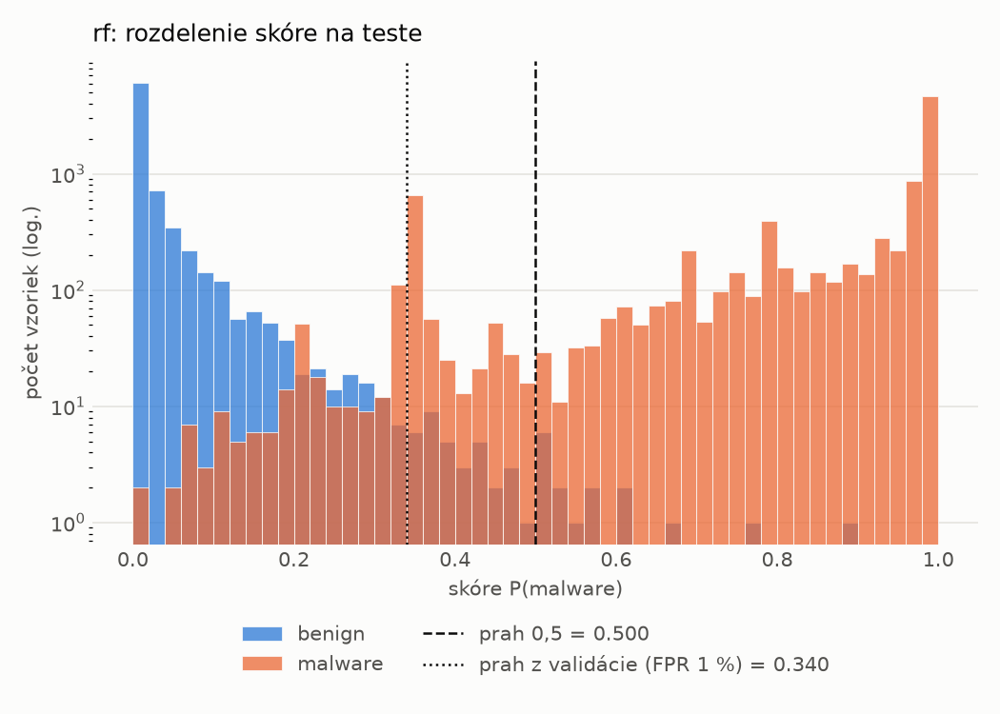
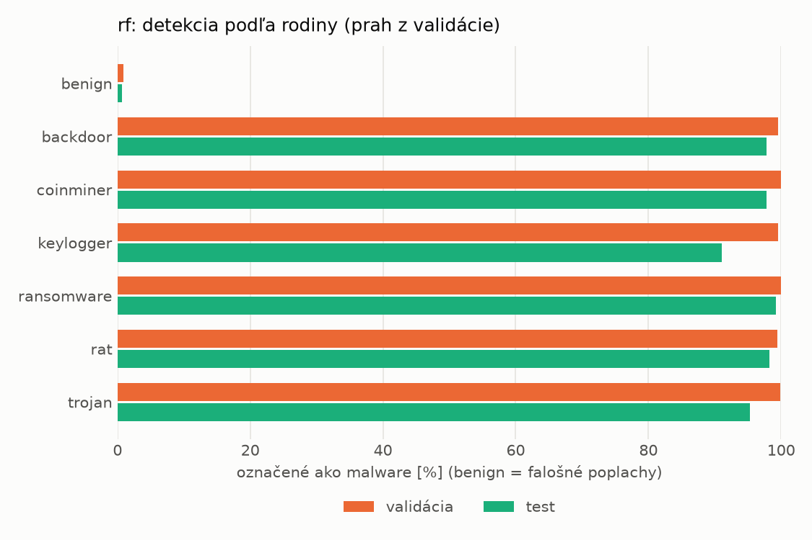
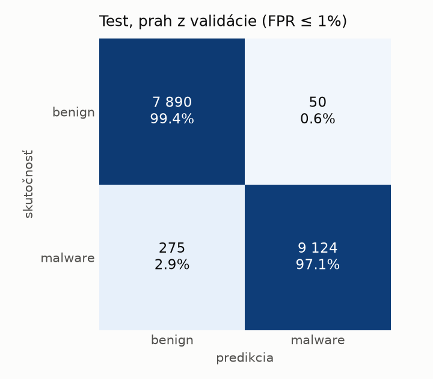
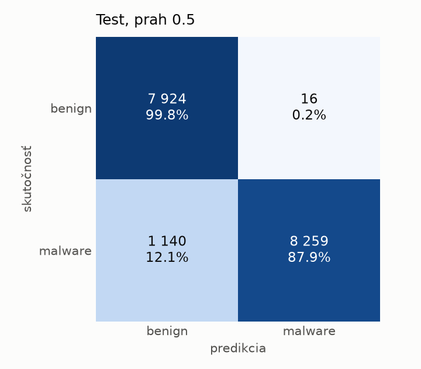

# hybrid/rf – beh `20261104-021519`

> Automaticky generované (`src/training/run_tabular.py`). Konfigurácia: `config.yaml`, protokol: `protocol.yaml`.

- **Model:** `random_forest` – Random Forest (pôvodné hodnoty príznakov)
- **Ladenie:** bez ladenia – hyperparametre prevzaté z `runs_final/hybrid/rf/20261102-044751`
- **Finálne modely:** seedy [0, 1, 2]; hodnoty sú priemer ± smerodajná odchýlka cez seedy
- **Najlepšie hyperparametre:** `{"n_estimators": 250, "max_depth": null, "min_samples_leaf": 1, "max_features": 0.05}`

## Detekčná kvalita (bez prahu)
| metrika | train (podvzorka) | validácia | test |
|---|---|---|---|
| ROC-AUC | 1.0000 ± 0.0000 | 0.9998 ± 0.0000 | 0.9987 ± 0.0002 |
| PR-AUC | 1.0000 ± 0.0000 | 0.9999 ± 0.0000 | 0.9989 ± 0.0001 |
| TPR pri FPR 1 % | 1.0000 ± 0.0000 | 0.9979 ± 0.0004 | 0.9787 ± 0.0098 |
| TPR pri FPR 0,1 % | 1.0000 ± 0.0000 | 0.9862 ± 0.0007 | 0.8707 ± 0.0042 |
| log loss | 0.0058 ± 0.0001 | 0.0204 ± 0.0001 | 0.1294 ± 0.0045 |
| Brier skóre | 0.0006 ± 0.0000 | 0.0046 ± 0.0000 | 0.0407 ± 0.0019 |

Rozdiel ROC-AUC train − validácia: **0.0002** (veľký rozdiel = preučenie).

## Pri prahu z validácie (FPR ≤ 1% na validácii)
| metrika | train (podvzorka) | validácia | test |
|---|---|---|---|
| accuracy | 1.0000 ± 0.0000 | 0.9952 ± 0.0002 | 0.9709 ± 0.0148 |
| balanced accuracy | 1.0000 ± 0.0000 | 0.9942 ± 0.0001 | 0.9726 ± 0.0137 |
| precision | 1.0000 ± 0.0000 | 0.9944 ± 0.0001 | 0.9934 ± 0.0010 |
| recall (TPR) | 1.0000 ± 0.0000 | 0.9979 ± 0.0004 | 0.9527 ± 0.0270 |
| FPR | 0.0000 ± 0.0000 | 0.0096 ± 0.0002 | 0.0075 ± 0.0010 |
| F1 | 1.0000 ± 0.0000 | 0.9962 ± 0.0001 | 0.9725 ± 0.0145 |
| MCC | 1.0000 ± 0.0000 | 0.9896 ± 0.0003 | 0.9429 ± 0.0282 |

## Pri pevnom prahu 0.5
| metrika | train (podvzorka) | validácia | test |
|---|---|---|---|
| accuracy | 1.0000 ± 0.0001 | 0.9951 ± 0.0002 | 0.9334 ± 0.0003 |
| balanced accuracy | 1.0000 ± 0.0000 | 0.9953 ± 0.0001 | 0.9385 ± 0.0003 |
| precision | 1.0000 ± 0.0000 | 0.9976 ± 0.0000 | 0.9982 ± 0.0001 |
| recall (TPR) | 0.9999 ± 0.0001 | 0.9946 ± 0.0003 | 0.8788 ± 0.0005 |
| FPR | 0.0000 ± 0.0000 | 0.0041 ± 0.0000 | 0.0019 ± 0.0001 |
| F1 | 1.0000 ± 0.0000 | 0.9961 ± 0.0001 | 0.9347 ± 0.0003 |
| MCC | 0.9999 ± 0.0001 | 0.9895 ± 0.0004 | 0.8747 ± 0.0006 |

## Výpočtové nároky (seed 0, testovacia množina)
| meranie | hodnota |
|---|---|
| tréning finálneho modelu | 114.4 s (priemer cez seedy) |
| ladenie spolu | 0 s |
| počet parametrov / uzlov | 260 634 |
| veľkosť modelu na disku | 21.19 MB |
| CPU latencia modelu (batch 1, 1 vlákno) | 7.203 ms (p95 7.422) |
| CPU priepustnosť (24 vlákien) | 109 092 vzoriek/s |

## Grafy
| | |
|---|---|
|  |  |
|  |  |
|  |  |
|  |  |

## Súbory
`metrics.json` (všetky metriky po seedoch vrátane rodín), `timing.json`, `hpo_trials.csv`,
`predictions/<časť>_seed<N>.parquet` (sha256, family, label, score), `model/seed_<N>/`, `log.txt`.
