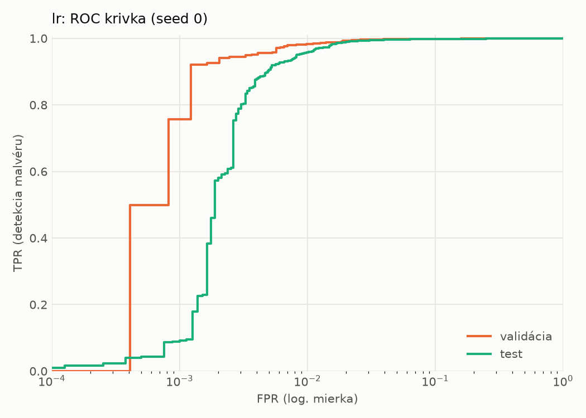
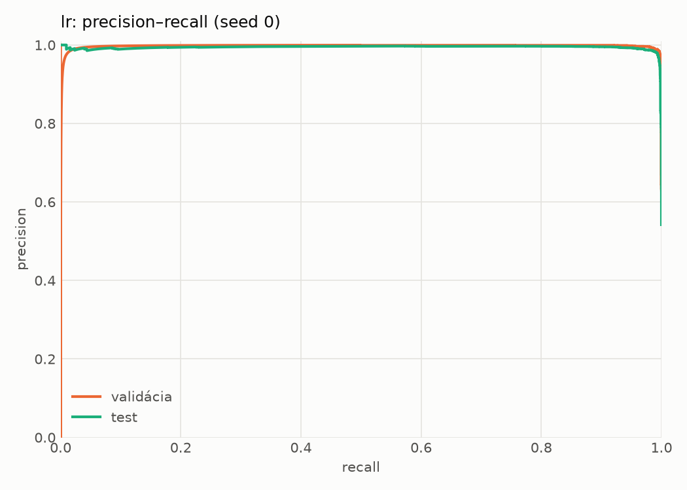
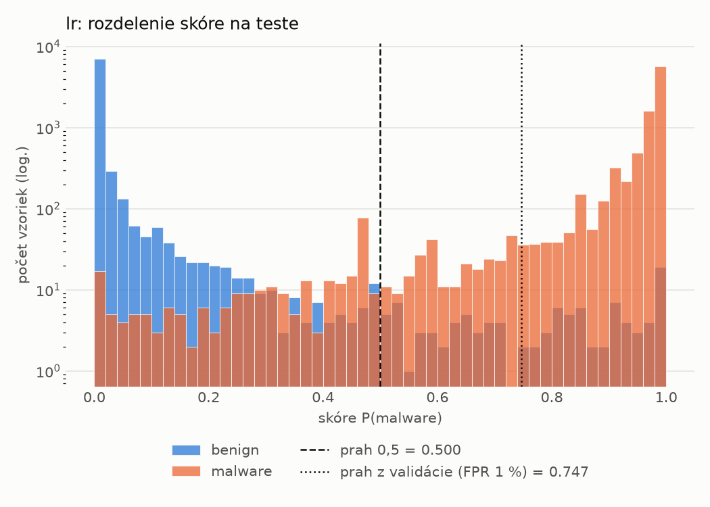
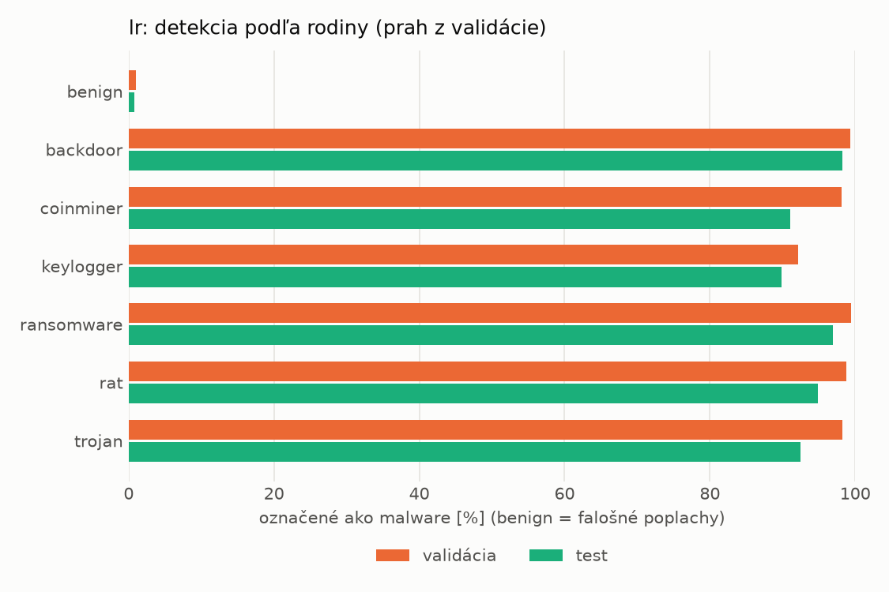
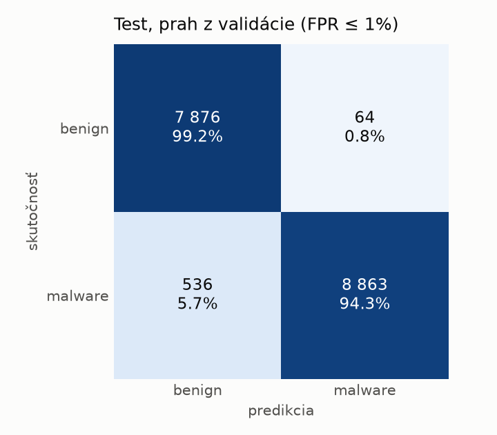
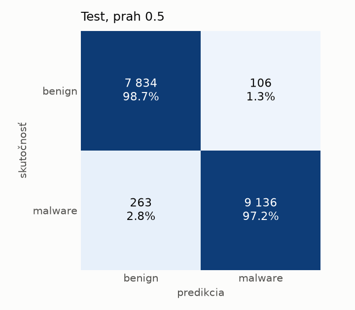

# static/lr – beh `20261104-012529`

> Automaticky generované (`src/training/run_tabular.py`). Konfigurácia: `config.yaml`, protokol: `protocol.yaml`.

- **Model:** `logreg` – logistická regresia s L2 regularizáciou (vstup signed log1p + štandardizácia)
- **Ladenie:** bez ladenia – hyperparametre prevzaté z `runs_final/static/lr/20261101-213555`
- **Finálne modely:** seedy [0, 1, 2]; hodnoty sú priemer ± smerodajná odchýlka cez seedy
- **Najlepšie hyperparametre:** `{"max_iter": 2000, "C": 0.00515917154582608}`

## Detekčná kvalita (bez prahu)
| metrika | train (podvzorka) | validácia | test |
|---|---|---|---|
| ROC-AUC | 0.9995 ± 0.0000 | 0.9982 ± 0.0000 | 0.9965 ± 0.0000 |
| PR-AUC | 0.9997 ± 0.0000 | 0.9974 ± 0.0000 | 0.9944 ± 0.0000 |
| TPR pri FPR 1 % | 0.9910 ± 0.0000 | 0.9822 ± 0.0000 | 0.9578 ± 0.0000 |
| TPR pri FPR 0,1 % | 0.9125 ± 0.0000 | 0.7565 ± 0.0000 | 0.0882 ± 0.0000 |
| log loss | 0.0298 ± 0.0000 | 0.0434 ± 0.0000 | 0.0659 ± 0.0000 |
| Brier skóre | 0.0066 ± 0.0000 | 0.0096 ± 0.0000 | 0.0155 ± 0.0000 |

Rozdiel ROC-AUC train − validácia: **0.0013** (veľký rozdiel = preučenie).

## Pri prahu z validácie (FPR ≤ 1% na validácii)
| metrika | train (podvzorka) | validácia | test |
|---|---|---|---|
| accuracy | 0.9883 ± 0.0000 | 0.9852 ± 0.0000 | 0.9654 ± 0.0000 |
| balanced accuracy | 0.9896 ± 0.0000 | 0.9862 ± 0.0000 | 0.9675 ± 0.0000 |
| precision | 0.9969 ± 0.0000 | 0.9942 ± 0.0000 | 0.9928 ± 0.0000 |
| recall (TPR) | 0.9842 ± 0.0000 | 0.9822 ± 0.0000 | 0.9430 ± 0.0000 |
| FPR | 0.0050 ± 0.0000 | 0.0098 ± 0.0000 | 0.0081 ± 0.0000 |
| F1 | 0.9905 ± 0.0000 | 0.9881 ± 0.0000 | 0.9673 ± 0.0000 |
| MCC | 0.9754 ± 0.0000 | 0.9684 ± 0.0000 | 0.9320 ± 0.0000 |

## Pri pevnom prahu 0.5
| metrika | train (podvzorka) | validácia | test |
|---|---|---|---|
| accuracy | 0.9904 ± 0.0000 | 0.9861 ± 0.0000 | 0.9787 ± 0.0000 |
| balanced accuracy | 0.9902 ± 0.0000 | 0.9851 ± 0.0000 | 0.9793 ± 0.0000 |
| precision | 0.9935 ± 0.0000 | 0.9892 ± 0.0000 | 0.9885 ± 0.0000 |
| recall (TPR) | 0.9910 ± 0.0000 | 0.9887 ± 0.0000 | 0.9720 ± 0.0000 |
| FPR | 0.0105 ± 0.0000 | 0.0184 ± 0.0000 | 0.0134 ± 0.0000 |
| F1 | 0.9923 ± 0.0000 | 0.9889 ± 0.0000 | 0.9802 ± 0.0000 |
| MCC | 0.9796 ± 0.0000 | 0.9701 ± 0.0000 | 0.9574 ± 0.0000 |

## Výpočtové nároky (seed 0, testovacia množina)
| meranie | hodnota |
|---|---|
| tréning finálneho modelu | 2.2 s (priemer cez seedy) |
| ladenie spolu | 0 s |
| počet parametrov / uzlov | 2 320 |
| veľkosť modelu na disku | 0.07 MB |
| transformácia vstupu – latencia (1 vlákno) | 0.021 ms |
| transformácia vstupu – priepustnosť | 44 289 vzoriek/s |
| CPU latencia modelu (batch 1, 1 vlákno) | 0.006 ms (p95 0.007) |
| CPU priepustnosť (24 vlákien) | 292 103 vzoriek/s |

## Grafy
| | |
|---|---|
|  |  |
|  |  |
|  |  |
|  |  |

## Súbory
`metrics.json` (všetky metriky po seedoch vrátane rodín), `timing.json`, `hpo_trials.csv`,
`predictions/<časť>_seed<N>.parquet` (sha256, family, label, score), `model/seed_<N>/`, `log.txt`.
