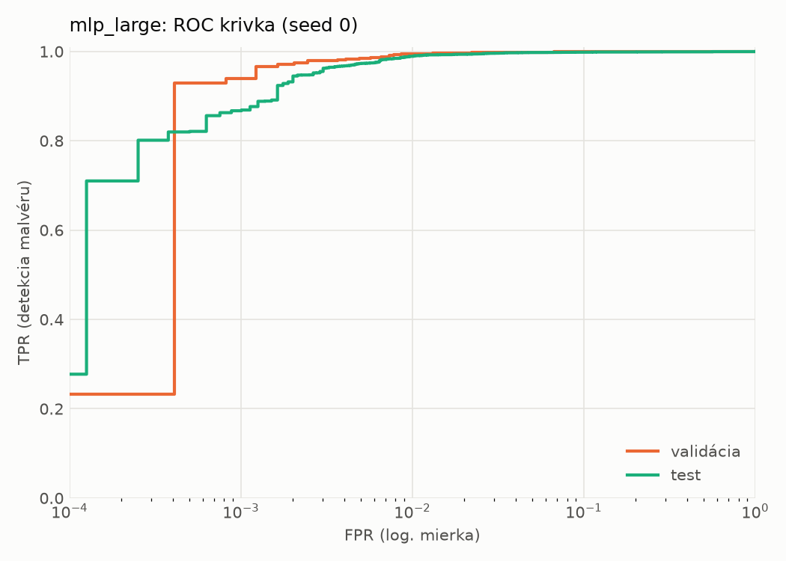
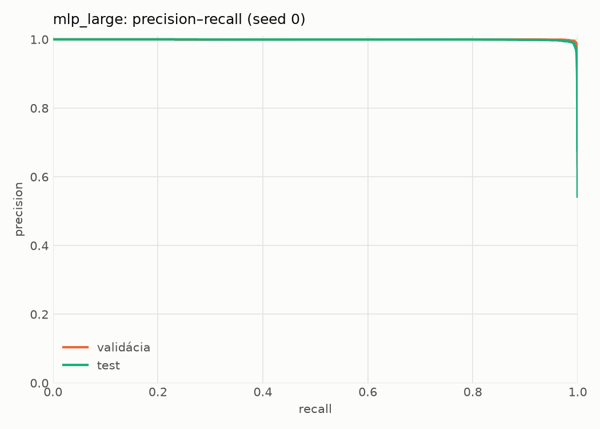
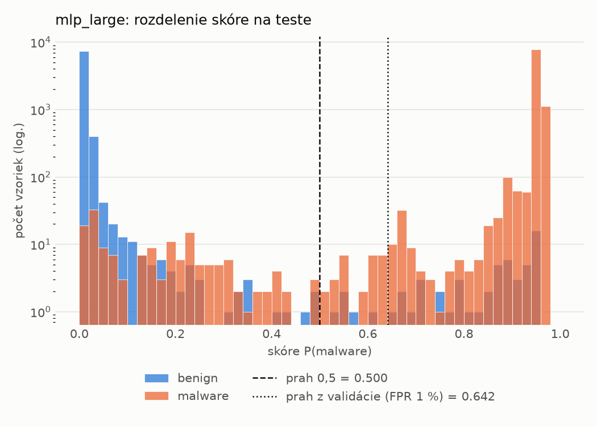
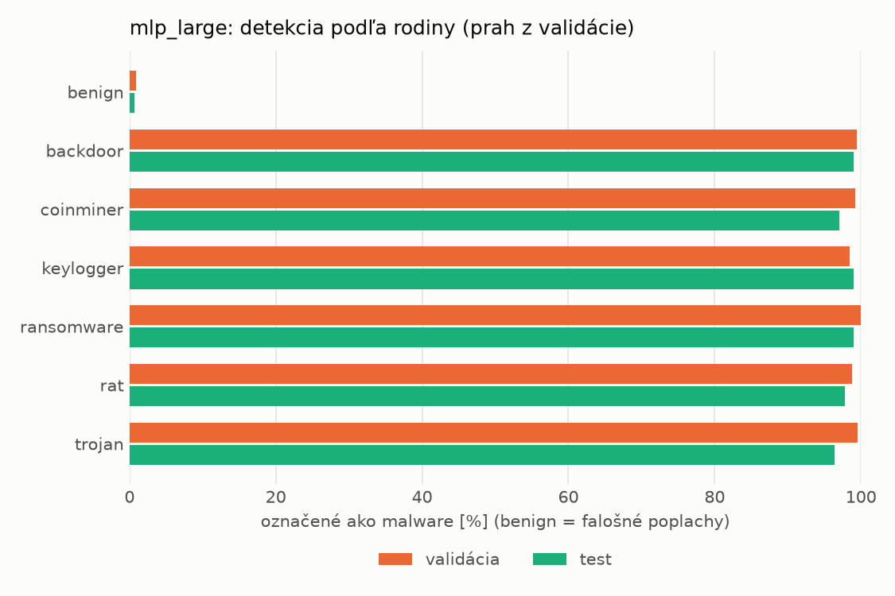
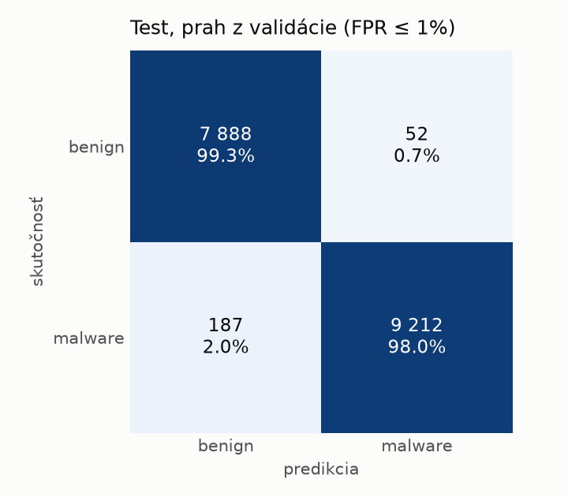
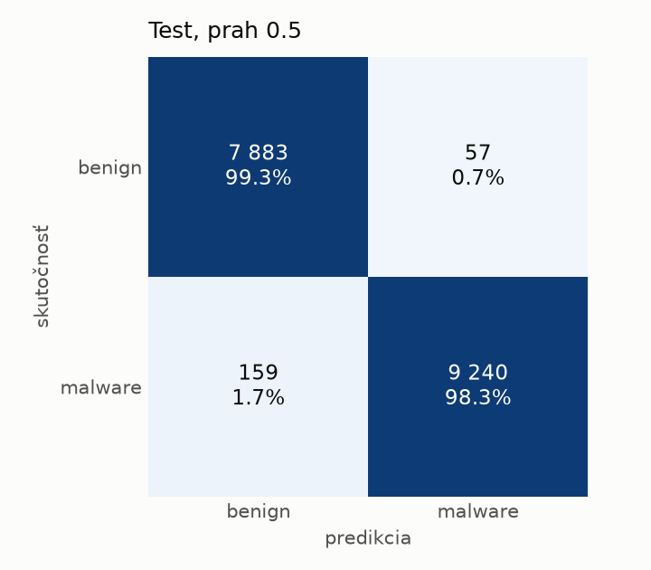
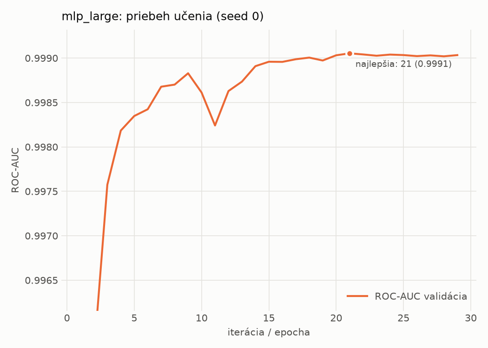

# static/mlp_large – beh `20261104-013830`

> Automaticky generované (`src/training/run_tabular.py`). Konfigurácia: `config.yaml`, protokol: `protocol.yaml`.

- **Model:** `mlp` – veľká neurónová sieť (3–5 skrytých vrstiev, 512–2048 neurónov), kandidát na učiteľa
- **Ladenie:** bez ladenia – hyperparametre prevzaté z `runs_final/static/mlp_large/20261101-235239`
- **Finálne modely:** seedy [0, 1, 2]; hodnoty sú priemer ± smerodajná odchýlka cez seedy
- **Najlepšie hyperparametre:** `{"max_epochs": 100, "patience": 8, "hidden_layers": 5, "hidden_width": 512, "width_decay": 0.5, "dropout": 0.4556986332296347, "lr": 0.00015070674125138616, "weight_decay": 0.0036646034219705954, "batch_size": 1024}`

## Detekčná kvalita (bez prahu)
| metrika | train (podvzorka) | validácia | test |
|---|---|---|---|
| ROC-AUC | 0.9999 ± 0.0000 | 0.9992 ± 0.0001 | 0.9986 ± 0.0000 |
| PR-AUC | 0.9999 ± 0.0000 | 0.9995 ± 0.0002 | 0.9989 ± 0.0002 |
| TPR pri FPR 1 % | 0.9993 ± 0.0001 | 0.9943 ± 0.0003 | 0.9885 ± 0.0017 |
| TPR pri FPR 0,1 % | 0.9876 ± 0.0010 | 0.9520 ± 0.0201 | 0.8657 ± 0.0087 |
| log loss | 0.0367 ± 0.0041 | 0.0499 ± 0.0031 | 0.0639 ± 0.0057 |
| Brier skóre | 0.0035 ± 0.0003 | 0.0073 ± 0.0001 | 0.0125 ± 0.0015 |

Rozdiel ROC-AUC train − validácia: **0.0007** (veľký rozdiel = preučenie).

## Pri prahu z validácie (FPR ≤ 1% na validácii)
| metrika | train (podvzorka) | validácia | test |
|---|---|---|---|
| accuracy | 0.9970 ± 0.0003 | 0.9929 ± 0.0002 | 0.9831 ± 0.0052 |
| balanced accuracy | 0.9967 ± 0.0003 | 0.9924 ± 0.0001 | 0.9840 ± 0.0047 |
| precision | 0.9972 ± 0.0003 | 0.9945 ± 0.0000 | 0.9948 ± 0.0004 |
| recall (TPR) | 0.9980 ± 0.0003 | 0.9943 ± 0.0003 | 0.9740 ± 0.0099 |
| FPR | 0.0046 ± 0.0005 | 0.0094 ± 0.0000 | 0.0061 ± 0.0005 |
| F1 | 0.9976 ± 0.0002 | 0.9944 ± 0.0001 | 0.9842 ± 0.0049 |
| MCC | 0.9937 ± 0.0006 | 0.9848 ± 0.0004 | 0.9664 ± 0.0101 |

## Pri pevnom prahu 0.5
| metrika | train (podvzorka) | validácia | test |
|---|---|---|---|
| accuracy | 0.9969 ± 0.0001 | 0.9924 ± 0.0004 | 0.9853 ± 0.0027 |
| balanced accuracy | 0.9965 ± 0.0001 | 0.9917 ± 0.0007 | 0.9859 ± 0.0024 |
| precision | 0.9970 ± 0.0002 | 0.9936 ± 0.0011 | 0.9940 ± 0.0012 |
| recall (TPR) | 0.9980 ± 0.0002 | 0.9943 ± 0.0005 | 0.9787 ± 0.0059 |
| FPR | 0.0049 ± 0.0004 | 0.0109 ± 0.0018 | 0.0070 ± 0.0015 |
| F1 | 0.9975 ± 0.0001 | 0.9940 ± 0.0003 | 0.9863 ± 0.0025 |
| MCC | 0.9934 ± 0.0002 | 0.9836 ± 0.0008 | 0.9705 ± 0.0052 |

## Výpočtové nároky (seed 0, testovacia množina)
| meranie | hodnota |
|---|---|
| tréning finálneho modelu | 6.2 s (priemer cez seedy) |
| ladenie spolu | 0 s |
| počet parametrov / uzlov | 1 364 417 |
| veľkosť modelu na disku | 5.53 MB |
| transformácia vstupu – latencia (1 vlákno) | 0.042 ms |
| transformácia vstupu – priepustnosť | 37 397 vzoriek/s |
| CPU latencia modelu (batch 1, 1 vlákno) | 0.262 ms (p95 0.299) |
| CPU priepustnosť (24 vlákien) | 82 365 vzoriek/s |
| GPU latencia (batch 1) | 0.607 ms (p95 1.306) |
| GPU priepustnosť | 80 317 vzoriek/s |
| GPU špičková pamäť | 1449 MB |

## Grafy
| | |
|---|---|
|  |  |
|  |  |
|  |  |
|  |  |

## Súbory
`metrics.json` (všetky metriky po seedoch vrátane rodín), `timing.json`, `hpo_trials.csv`,
`predictions/<časť>_seed<N>.parquet` (sha256, family, label, score), `model/seed_<N>/`, `log.txt`.
