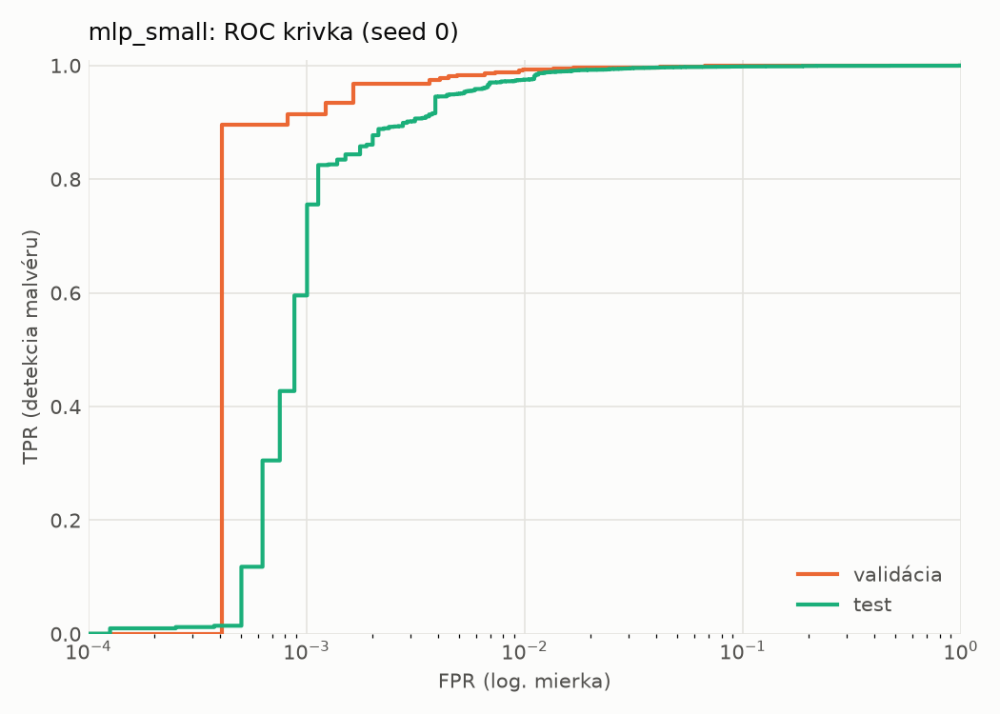
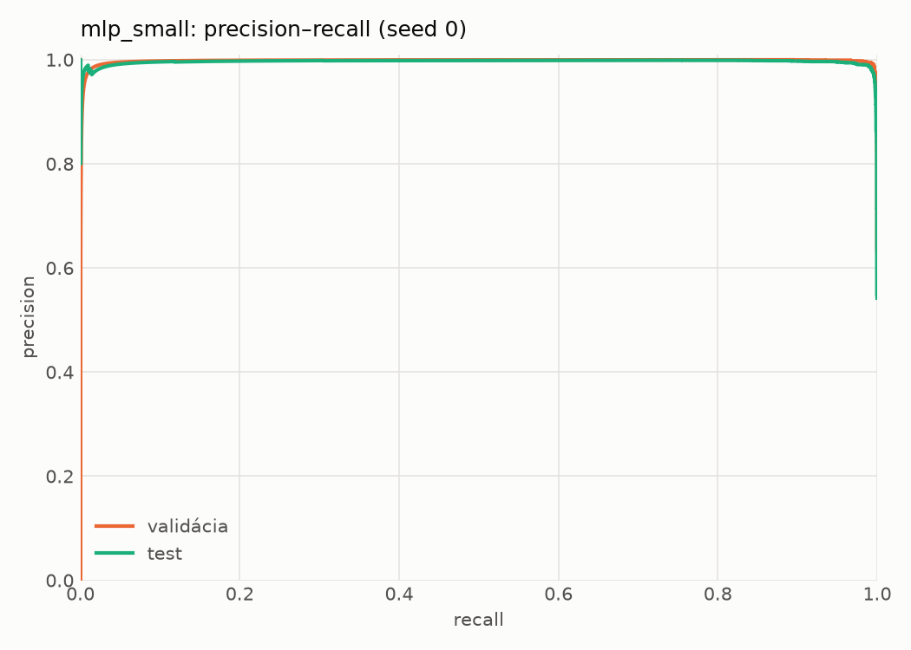
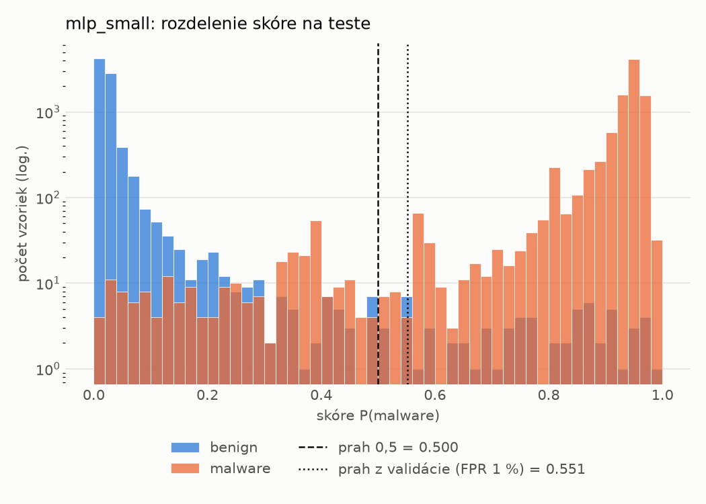
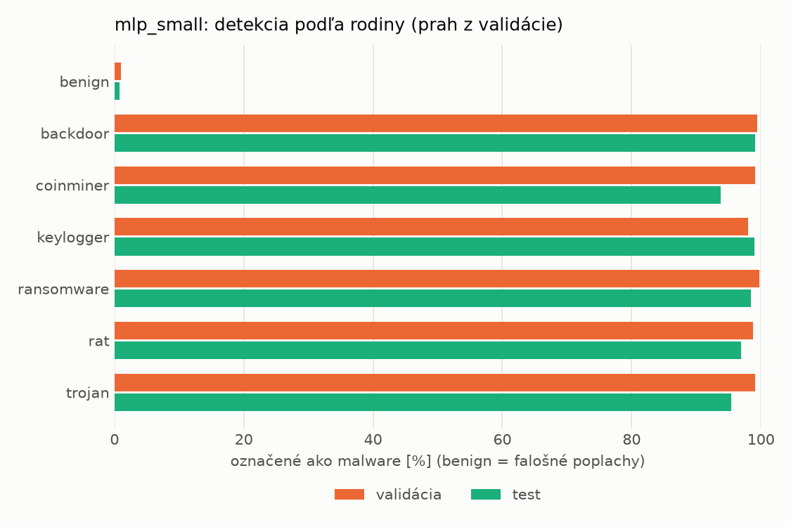
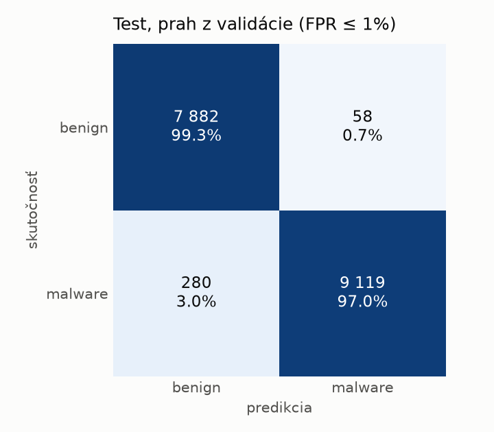
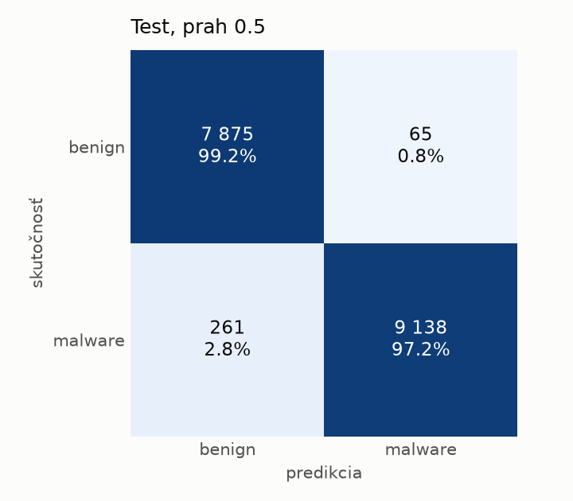
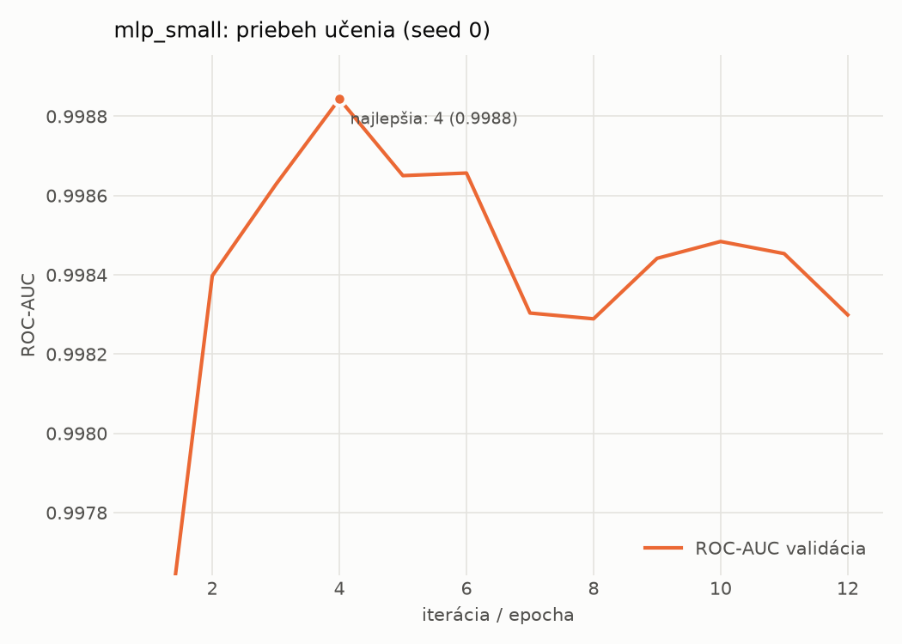

# static/mlp_small – beh `20261104-013810`

> Automaticky generované (`src/training/run_tabular.py`). Konfigurácia: `config.yaml`, protokol: `protocol.yaml`.

- **Model:** `mlp` – malá neurónová sieť (1–2 skryté vrstvy), kandidát na ľahkého študenta
- **Ladenie:** bez ladenia – hyperparametre prevzaté z `runs_final/static/mlp_small/20261101-235005`
- **Finálne modely:** seedy [0, 1, 2]; hodnoty sú priemer ± smerodajná odchýlka cez seedy
- **Najlepšie hyperparametre:** `{"width_decay": 0.5, "max_epochs": 100, "patience": 8, "hidden_layers": 2, "hidden_width": 32, "dropout": 0.15212112147976886, "lr": 0.0005958389350068958, "weight_decay": 5.34293726127978e-05, "batch_size": 512}`

## Detekčná kvalita (bez prahu)
| metrika | train (podvzorka) | validácia | test |
|---|---|---|---|
| ROC-AUC | 0.9998 ± 0.0000 | 0.9988 ± 0.0000 | 0.9974 ± 0.0006 |
| PR-AUC | 0.9999 ± 0.0000 | 0.9977 ± 0.0000 | 0.9950 ± 0.0022 |
| TPR pri FPR 1 % | 0.9982 ± 0.0002 | 0.9909 ± 0.0034 | 0.9736 ± 0.0018 |
| TPR pri FPR 0,1 % | 0.9765 ± 0.0071 | 0.9197 ± 0.0110 | 0.4541 ± 0.3966 |
| log loss | 0.0491 ± 0.0160 | 0.0595 ± 0.0153 | 0.0825 ± 0.0184 |
| Brier skóre | 0.0059 ± 0.0018 | 0.0090 ± 0.0017 | 0.0170 ± 0.0034 |

Rozdiel ROC-AUC train − validácia: **0.0010** (veľký rozdiel = preučenie).

## Pri prahu z validácie (FPR ≤ 1% na validácii)
| metrika | train (podvzorka) | validácia | test |
|---|---|---|---|
| accuracy | 0.9941 ± 0.0026 | 0.9907 ± 0.0019 | 0.9774 ± 0.0060 |
| balanced accuracy | 0.9939 ± 0.0020 | 0.9907 ± 0.0014 | 0.9786 ± 0.0054 |
| precision | 0.9960 ± 0.0004 | 0.9944 ± 0.0003 | 0.9933 ± 0.0018 |
| recall (TPR) | 0.9945 ± 0.0046 | 0.9909 ± 0.0034 | 0.9650 ± 0.0125 |
| FPR | 0.0066 ± 0.0007 | 0.0096 ± 0.0005 | 0.0078 ± 0.0021 |
| F1 | 0.9952 ± 0.0021 | 0.9926 ± 0.0016 | 0.9789 ± 0.0057 |
| MCC | 0.9874 ± 0.0055 | 0.9801 ± 0.0041 | 0.9552 ± 0.0114 |

## Pri pevnom prahu 0.5
| metrika | train (podvzorka) | validácia | test |
|---|---|---|---|
| accuracy | 0.9955 ± 0.0003 | 0.9912 ± 0.0010 | 0.9799 ± 0.0018 |
| balanced accuracy | 0.9950 ± 0.0002 | 0.9908 ± 0.0011 | 0.9808 ± 0.0017 |
| precision | 0.9957 ± 0.0002 | 0.9936 ± 0.0008 | 0.9925 ± 0.0006 |
| recall (TPR) | 0.9970 ± 0.0006 | 0.9925 ± 0.0008 | 0.9702 ± 0.0036 |
| FPR | 0.0071 ± 0.0003 | 0.0109 ± 0.0014 | 0.0086 ± 0.0007 |
| F1 | 0.9964 ± 0.0002 | 0.9930 ± 0.0008 | 0.9813 ± 0.0018 |
| MCC | 0.9904 ± 0.0006 | 0.9812 ± 0.0021 | 0.9599 ± 0.0036 |

## Výpočtové nároky (seed 0, testovacia množina)
| meranie | hodnota |
|---|---|
| tréning finálneho modelu | 3.7 s (priemer cez seedy) |
| ladenie spolu | 0 s |
| počet parametrov / uzlov | 74 881 |
| veľkosť modelu na disku | 0.36 MB |
| transformácia vstupu – latencia (1 vlákno) | 0.041 ms |
| transformácia vstupu – priepustnosť | 35 546 vzoriek/s |
| CPU latencia modelu (batch 1, 1 vlákno) | 0.096 ms (p95 0.110) |
| CPU priepustnosť (24 vlákien) | 109 052 vzoriek/s |
| GPU latencia (batch 1) | 0.384 ms (p95 0.427) |
| GPU priepustnosť | 79 739 vzoriek/s |
| GPU špičková pamäť | 794 MB |

## Grafy
| | |
|---|---|
|  |  |
|  |  |
|  |  |
|  |  |

## Súbory
`metrics.json` (všetky metriky po seedoch vrátane rodín), `timing.json`, `hpo_trials.csv`,
`predictions/<časť>_seed<N>.parquet` (sha256, family, label, score), `model/seed_<N>/`, `log.txt`.
