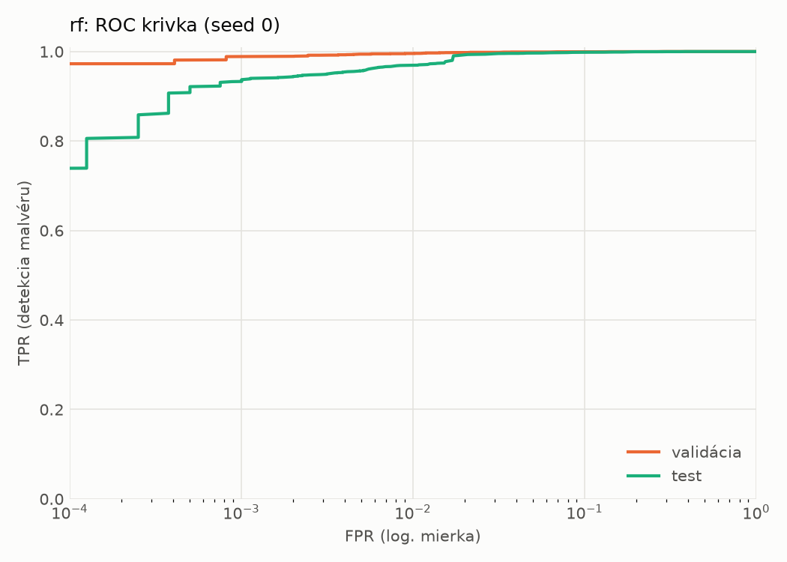
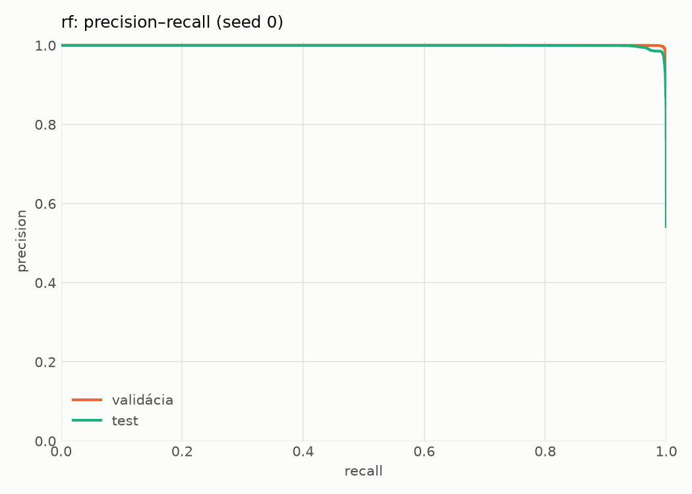
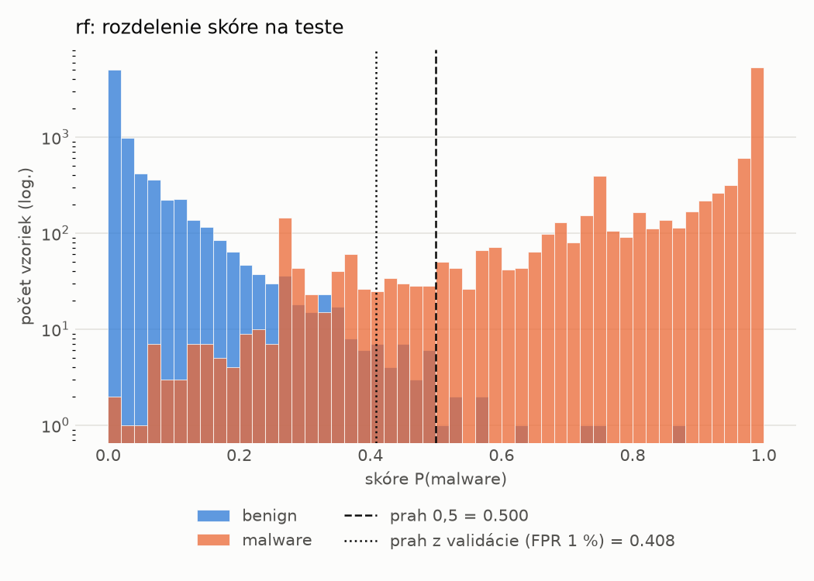
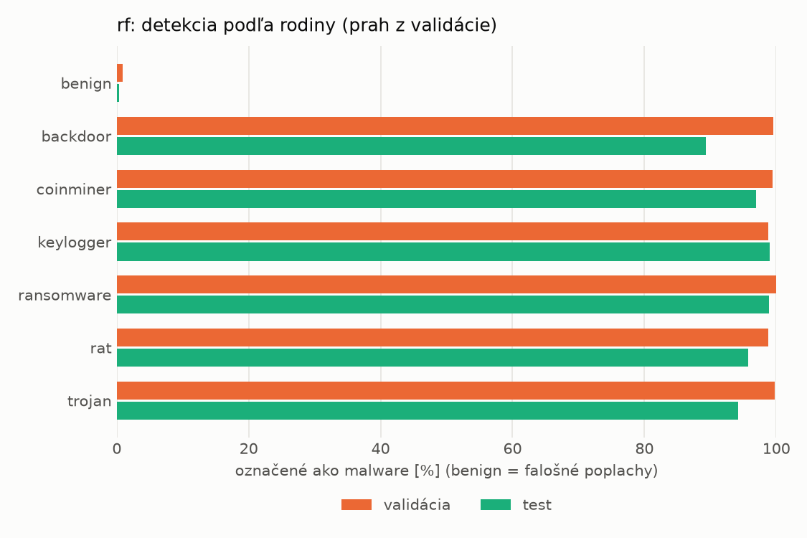
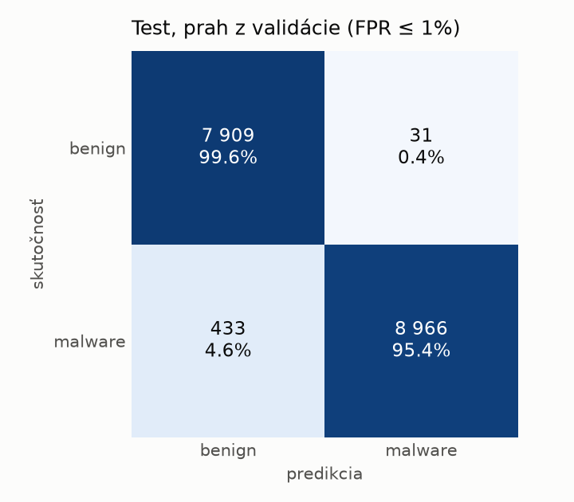
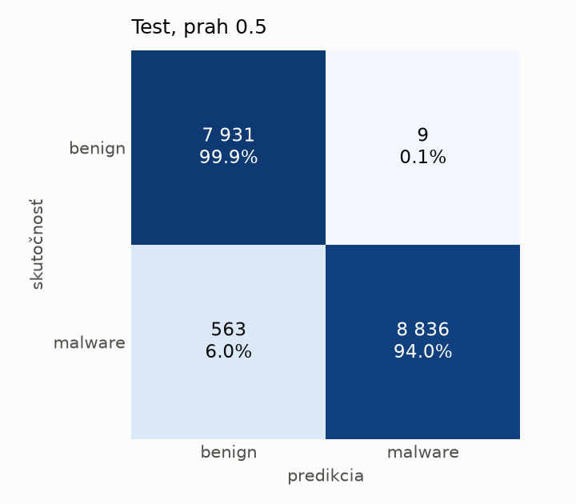

# static/rf – beh `20261104-012544`

> Automaticky generované (`src/training/run_tabular.py`). Konfigurácia: `config.yaml`, protokol: `protocol.yaml`.

- **Model:** `random_forest` – Random Forest (pôvodné hodnoty príznakov)
- **Ladenie:** bez ladenia – hyperparametre prevzaté z `runs_final/static/rf/20261101-213728`
- **Finálne modely:** seedy [0, 1, 2]; hodnoty sú priemer ± smerodajná odchýlka cez seedy
- **Najlepšie hyperparametre:** `{"n_estimators": 250, "max_depth": null, "min_samples_leaf": 1, "max_features": "sqrt"}`

## Detekčná kvalita (bez prahu)
| metrika | train (podvzorka) | validácia | test |
|---|---|---|---|
| ROC-AUC | 1.0000 ± 0.0000 | 0.9998 ± 0.0000 | 0.9989 ± 0.0000 |
| PR-AUC | 1.0000 ± 0.0000 | 0.9999 ± 0.0000 | 0.9991 ± 0.0000 |
| TPR pri FPR 1 % | 1.0000 ± 0.0000 | 0.9962 ± 0.0005 | 0.9707 ± 0.0016 |
| TPR pri FPR 0,1 % | 1.0000 ± 0.0000 | 0.9861 ± 0.0025 | 0.9264 ± 0.0072 |
| log loss | 0.0076 ± 0.0000 | 0.0263 ± 0.0002 | 0.0996 ± 0.0003 |
| Brier skóre | 0.0008 ± 0.0000 | 0.0059 ± 0.0001 | 0.0274 ± 0.0001 |

Rozdiel ROC-AUC train − validácia: **0.0002** (veľký rozdiel = preučenie).

## Pri prahu z validácie (FPR ≤ 1% na validácii)
| metrika | train (podvzorka) | validácia | test |
|---|---|---|---|
| accuracy | 1.0000 ± 0.0000 | 0.9941 ± 0.0003 | 0.9754 ± 0.0022 |
| balanced accuracy | 1.0000 ± 0.0000 | 0.9934 ± 0.0002 | 0.9769 ± 0.0019 |
| precision | 1.0000 ± 0.0000 | 0.9945 ± 0.0002 | 0.9954 ± 0.0011 |
| recall (TPR) | 1.0000 ± 0.0000 | 0.9962 ± 0.0005 | 0.9590 ± 0.0051 |
| FPR | 0.0000 ± 0.0000 | 0.0094 ± 0.0004 | 0.0053 ± 0.0012 |
| F1 | 1.0000 ± 0.0000 | 0.9953 ± 0.0002 | 0.9768 ± 0.0021 |
| MCC | 1.0000 ± 0.0000 | 0.9873 ± 0.0006 | 0.9513 ± 0.0041 |

## Pri pevnom prahu 0.5
| metrika | train (podvzorka) | validácia | test |
|---|---|---|---|
| accuracy | 1.0000 ± 0.0001 | 0.9945 ± 0.0005 | 0.9667 ± 0.0004 |
| balanced accuracy | 1.0000 ± 0.0000 | 0.9948 ± 0.0005 | 0.9692 ± 0.0004 |
| precision | 1.0000 ± 0.0000 | 0.9977 ± 0.0003 | 0.9987 ± 0.0003 |
| recall (TPR) | 0.9999 ± 0.0001 | 0.9935 ± 0.0005 | 0.9398 ± 0.0007 |
| FPR | 0.0000 ± 0.0000 | 0.0038 ± 0.0005 | 0.0015 ± 0.0003 |
| F1 | 1.0000 ± 0.0000 | 0.9956 ± 0.0004 | 0.9683 ± 0.0004 |
| MCC | 0.9999 ± 0.0001 | 0.9882 ± 0.0010 | 0.9352 ± 0.0008 |

## Výpočtové nároky (seed 0, testovacia množina)
| meranie | hodnota |
|---|---|
| tréning finálneho modelu | 21.1 s (priemer cez seedy) |
| ladenie spolu | 0 s |
| počet parametrov / uzlov | 363 854 |
| veľkosť modelu na disku | 29.45 MB |
| CPU latencia modelu (batch 1, 1 vlákno) | 7.284 ms (p95 7.534) |
| CPU priepustnosť (24 vlákien) | 112 088 vzoriek/s |

## Grafy
| | |
|---|---|
|  |  |
|  |  |
|  |  |
|  |  |

## Súbory
`metrics.json` (všetky metriky po seedoch vrátane rodín), `timing.json`, `hpo_trials.csv`,
`predictions/<časť>_seed<N>.parquet` (sha256, family, label, score), `model/seed_<N>/`, `log.txt`.
